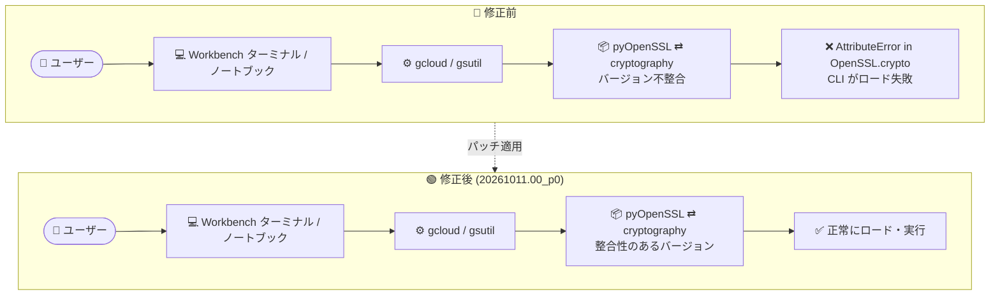

# Agent Platform Workbench: パッチリリース 20261011.00_p0 (gcloud / gsutil の OpenSSL エラー修正)

**リリース日**: 2026-10-12

**サービス**: Agent Platform Workbench (Gemini Enterprise Agent Platform)

**機能**: インスタンスイメージ パッチリリース 20261011.00_p0

**ステータス**: Change / Fixed (パッチリリース)

📊 [このアップデートのインフォグラフィックを見る](https://takech9203.github.io/google-cloud-news-summary/20261012-agent-platform-workbench-20261011-patch.html)

## 概要

Gemini Enterprise Agent Platform のコンポーネントである Agent Platform Workbench (旧 Vertex AI Workbench) のインスタンスイメージに、パッチリリース 20261011.00_p0 が公開されました。本リリースは 2026 年 10 月 11 日に公開されたリリース候補 (20261011-2130-rc0 / 20261011-2230-rc0) に続くパッチ版で、2026 年 10 月 12 日のリリースノートに掲載されています。

今回のパッチには、アップストリーム依存パッケージの最新化 (Change) に加えて、重要な不具合修正 (Fixed) が含まれます。具体的には、pyOpenSSL と cryptography パッケージのバージョン不整合が原因で、`gcloud` および `gsutil` が `OpenSSL.crypto` の `AttributeError` により起動 (ロード) に失敗する問題が修正されました。

Workbench インスタンス上のノートブックやターミナルから `gcloud` / `gsutil` を使って Google Cloud リソースを操作しているユーザーにとって、CLI が利用できなくなる障害を解消する運用上重要なメンテナンスリリースです。

**アップデート前の課題**

- pyOpenSSL と cryptography のバージョン不整合がある環境では、`gcloud` および `gsutil` の実行時に `OpenSSL.crypto` で `AttributeError` が発生し、CLI がロードできなかった
- ノートブックやターミナルから `gcloud` / `gsutil` に依存するワークフロー (Cloud Storage へのデータ転送、リソース操作など) が実行できない状態になり得た
- 回避には利用者側でのパッケージバージョンの手動調整が必要だった

**アップデート後の改善**

- pyOpenSSL と cryptography のバージョン不整合が解消され、`gcloud` / `gsutil` が正常にロードされるようになった
- アップストリーム依存パッケージが最新化され、セキュリティとパッケージ鮮度が維持される
- 利用者側での手動のパッケージ修復作業が不要になった

## アーキテクチャ図



パッチ適用前は pyOpenSSL と cryptography のバージョン不整合により gcloud / gsutil のロードが失敗していましたが、20261011.00_p0 の適用でパッケージ整合性が回復し、CLI が正常に動作します。

## サービスアップデートの詳細

### 主要な変更内容

1. **アップストリーム依存パッケージの最新化 (Change)**
   - イメージに含まれる依存パッケージをアップストリームの最新版に更新
   - 定期的なイメージリリースの一環として、セキュリティパッチとパッケージ更新を提供

2. **gcloud / gsutil のロード失敗の修正 (Fixed)**
   - pyOpenSSL と cryptography のバージョン不整合に起因して、`gcloud` と `gsutil` が `OpenSSL.crypto` の `AttributeError` でロードに失敗する問題を修正
   - pyOpenSSL は cryptography パッケージに依存しており、両者のバージョンが噛み合わない場合にモジュール読み込み時のエラーが発生していた

### バージョニングについて

Agent Platform Workbench (workbench-instances-2603 イメージファミリー、26.03 リリース以降) では、日付ベースのバージョニング形式が採用されています。今回の `20261011.00_p0` は 2026 年 10 月 11 日版イメージに対するパッチ (p0) を示します。リリース候補 (20261011-2130-rc0 / 20261011-2230-rc0) は 2026 年 10 月 11 日に公開されています。

## 設定方法

パッチを適用するには、インスタンスの環境をアップグレードします。アップグレード方法は 2 通りあります。

### 方法 1: 自動アップグレード

インスタンス作成時に「Environment auto-upgrade (環境の自動アップグレード)」を有効にしている場合、指定したスケジュール (`notebook-upgrade-schedule` メタデータ、unix-cron 形式・GMT) で新しいイメージの有無がチェックされ、自動的にアップグレードされます。

- 自動アップグレードは実行中のインスタンスにのみ適用される (停止中のインスタンスは自動アップグレードされない)
- スケジュールはインスタンス詳細ページの「Environment auto-upgrade」セクションから変更可能

### 方法 2: 手動アップグレード

1. Google Cloud コンソールの「Instances」ページを開く
2. 対象インスタンスが停止している場合は起動する (アップグレードは実行中のインスタンスのみ可能)
3. インスタンス名をクリックし、「Instance details」ページで **Upgrade** をクリック
4. 事前にデータのバックアップ (コピー) を取得していることを確認してから **Upgrade** を実行

アップグレードはブートディスクを新しいイメージに置き換え、データディスク上のデータは保持されます。

### アップグレード時に保持されるもの / されないもの

| コンポーネント | アップグレード結果 |
|------|------|
| ML フレームワーク / プリインストール依存関係 | 更新される |
| `/home/jupyter` 配下のローカルファイル・ノートブック | 保持される |
| ユーザーがインストールしたライブラリ | 原則再インストールが必要 (`pip install --user` なら保持) |
| ユーザーがインストールした OS パッケージ | 保持されない |
| GPU ドライバ | 更新される |

問題が発生した場合は、「Instance details」ページの「Upgrade history」から **Rollback** で以前のバージョンに戻せます。

## メリット

### ビジネス面

- **ワークフローの復旧**: gcloud / gsutil に依存するデータ転送・運用タスクが正常化し、業務の中断を解消
- **セキュリティ維持**: 依存パッケージの最新化により、既知の脆弱性への露出を低減

### 技術面

- **CLI の安定動作**: pyOpenSSL / cryptography の整合性が取れたイメージにより、`OpenSSL.crypto` 起因のロードエラーを解消
- **手動修復の不要化**: 利用者側でのパッケージバージョン調整といった回避策が不要になる

## デメリット・制約事項

### 制限事項

- アップグレードには Notebooks API がプロジェクトで有効になっている必要がある
- アップグレードできるのはデュアルディスク (ブートディスク + データディスク) 構成のインスタンスのみ
- アップグレード後の後方互換性は保証されない

### 考慮すべき点

- アップグレード前にデータのコピー (バックアップ) を取得することが公式に推奨されている
- ブートディスクに `pip` / Conda でインストールしたライブラリはアップグレードで失われるため、再インストールが必要 (`--user` フラグ付きインストールで `/home/jupyter/` に保持可能)
- アップグレードは実行中のユーザー操作に影響を与える可能性があるため、作業時間帯に注意する

## ユースケース

### ユースケース 1: ノートブックからの Cloud Storage データ操作の復旧

**シナリオ**: Workbench インスタンスのノートブックやターミナルから `gsutil` / `gcloud storage` で学習データを Cloud Storage とやり取りしているが、`OpenSSL.crypto` の `AttributeError` で CLI が起動せずパイプラインが停止している。

**実装例**:
```bash
# パッチ適用後のインスタンスで動作確認
gcloud --version
gsutil ls gs://my-training-data-bucket/
```

**効果**: 最新イメージへのアップグレードにより CLI が正常に動作し、データ転送・リソース操作のワークフローが復旧する。

## 料金

本パッチリリース自体による料金変更はありません。Agent Platform Workbench インスタンスの料金は、使用するコンピューティングリソースなどに基づいて課金されます。詳細は料金ページを参照してください。

- [Google Cloud 料金](https://cloud.google.com/pricing)

## 関連サービス・機能

- **Gemini Enterprise Agent Platform**: Agent Platform Workbench はこのプラットフォームのコンポーネント。プラットフォーム全体のリリースは Agent Platform release notes を参照
- **Deep Learning VM Images**: Agent Platform Workbench インスタンスは JupyterLab が有効化された Deep Learning VM Images インスタンスとして提供される
- **gcloud CLI / gsutil**: 今回の修正対象。インスタンスから Google Cloud リソースを操作するための CLI ツール
- **Compute Engine**: インスタンスの実体となる VM 基盤。アップグレード要否の確認は Compute Engine の詳細画面からも可能

## 参考リンク

- 📊 [インフォグラフィック](https://takech9203.github.io/google-cloud-news-summary/20261012-agent-platform-workbench-20261011-patch.html)
- [公式リリースノート (Google Cloud 全体)](https://docs.cloud.google.com/release-notes#October_12_2026)
- [Agent Platform Workbench リリースノート](https://docs.cloud.google.com/gemini-enterprise-agent-platform/notebooks/workbench/release-notes)
- [インスタンス環境のアップグレード](https://docs.cloud.google.com/gemini-enterprise-agent-platform/notebooks/workbench/instances/upgrade)
- [イメージバージョンの管理](https://cloud.google.com/vertex-ai/docs/workbench/instances/manage-image-versions)

## まとめ

Agent Platform Workbench のパッチリリース 20261011.00_p0 は、gcloud / gsutil が pyOpenSSL と cryptography のバージョン不整合によりロードできなくなる問題を修正する、運用上重要なメンテナンスアップデートです。この問題の影響を受けている場合は、データのバックアップを取得した上で、手動アップグレードまたは自動アップグレードにより最新イメージへの更新を推奨します。

---

**タグ**: Agent Platform Workbench, Gemini Enterprise Agent Platform, Vertex AI Workbench, パッチリリース, gcloud, gsutil, pyOpenSSL, cryptography, バグ修正
