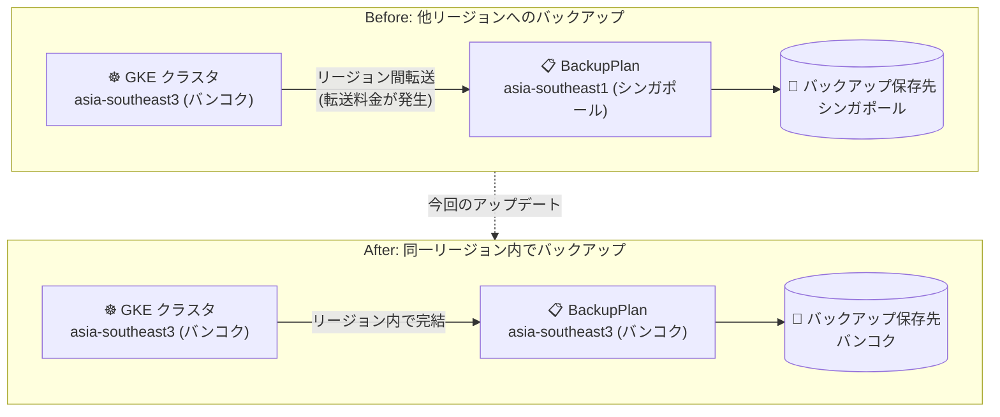

# Backup for GKE: asia-southeast3 (バンコク) リージョンで利用可能に

**リリース日**: 2026-10-12

**サービス**: Backup for GKE

**機能**: asia-southeast3 (バンコク、タイ) リージョンへの提供拡大

**ステータス**: Generally Available (リージョン拡大)

📊 [このアップデートのインフォグラフィックを見る](https://takech9203.github.io/google-cloud-news-summary/20261012-backup-for-gke-asia-southeast3.html)

## 概要

Backup for GKE が新たに asia-southeast3 (バンコク、タイ) リージョンで利用可能になりました。Backup for GKE は、GKE クラスタ上の Kubernetes ワークロード (構成情報と永続ボリュームデータ) をバックアップ・リストアするためのマネージドサービスです。

Backup for GKE はリージョナルサービスであり、`BackupPlan` を作成したリージョンにすべてのバックアップ成果物 (構成バックアップとボリュームバックアップ) が保存されます。今回の拡大により、バンコクリージョンで稼働する GKE クラスタのバックアップを同一リージョン内に保存できるようになり、タイ国内にデータを保持する要件を持つ企業や、リージョン間データ転送コストを避けたいユーザーにとって重要なアップデートです。

**アップデート前の課題**

- asia-southeast3 (バンコク) の GKE クラスタをバックアップするには、`BackupPlan` を asia-southeast1 (シンガポール) や asia-southeast2 (ジャカルタ) など他のリージョンに作成する必要があった
- クラスタと `BackupPlan` のリージョンが異なる場合、バックアップ実行時にリージョン間データ転送料金が発生していた
- バックアップデータをタイ国内に保持することができず、データレジデンシー要件への対応が困難だった

**アップデート後の改善**

- バンコクリージョンの GKE クラスタに対し、同一リージョン内で `BackupPlan` / `RestorePlan` を作成できるようになった
- バックアップ・リストアをリージョン内で完結でき、リージョン間データ転送料金を回避できるようになった
- バックアップデータ (および CMEK 暗号鍵) をタイ国内のリージョンに保持できるようになり、データレジデンシー要件に対応しやすくなった

## アーキテクチャ図



これまでバンコクの GKE クラスタのバックアップは他リージョンに保存する必要がありましたが、今回の拡大によりリージョン内で完結し、リージョン間データ転送料金とデータレジデンシーの課題が解消されます。

## サービスアップデートの詳細

### 主要機能

1. **asia-southeast3 での BackupPlan / RestorePlan 作成**
   - Backup for GKE の最上位リソースである `BackupPlan` と `RestorePlan` を asia-southeast3 に作成可能
   - `BackupPlan` のリージョンが、構成バックアップとボリュームバックアップの保存先リージョンを決定する

2. **リージョン内でのバックアップ・リストア**
   - `RestorePlan` の対象クラスタは、`RestorePlan` と同じリージョン内のゾーンクラスタまたはリージョナルクラスタである必要がある
   - バンコクリージョン内のクラスタ間でのリストアが可能に

3. **CMEK (顧客管理暗号鍵) のリージョン整合**
   - バックアップ成果物を CMEK で暗号化する場合、鍵は `BackupPlan` と同じリージョンに存在する必要がある
   - asia-southeast3 の Cloud KMS 鍵を使用した暗号化が可能に

## 技術仕様

### Backup for GKE のリージョンに関する仕様

| 項目 | 詳細 |
|------|------|
| サービスタイプ | リージョナルサービス (ロケーションは常に Google Cloud リージョン) |
| BackupPlan のリージョン | すべてのバックアップ成果物 (構成 + ボリューム) の保存先を決定 |
| RestorePlan のリージョン | リストア先クラスタは同一リージョン内である必要がある |
| クロスリージョン構成 | クラスタと BackupPlan のリージョンが異なる場合、リージョン間データ転送料金が発生 |
| CMEK | 鍵は BackupPlan と同一リージョンである必要がある |

### サポートリージョンの確認方法

```bash
gcloud beta container backup-restore locations list \
    --project=PROJECT_ID
```

## 設定方法

### 前提条件

1. Google Cloud プロジェクトで GKE API および Backup for GKE API (`gkebackup.googleapis.com`) が有効であること
2. 対象クラスタに Backup for GKE エージェント (アドオン) がインストールされていること

### 手順

#### ステップ 1: Backup for GKE エージェントを有効化してクラスタを作成

```bash
# Standard クラスタの場合
gcloud container clusters create CLUSTER_NAME \
    --project=PROJECT_ID \
    --location=asia-southeast3 \
    --addons=BackupRestore

# Autopilot クラスタの場合
gcloud container clusters create-auto CLUSTER_NAME \
    --project=PROJECT_ID \
    --location=asia-southeast3 \
    --enable-backup-restore
```

クラスタ作成時にエージェントを有効化する方法が推奨されています。既存クラスタへの有効化や、最初のバックアッププランの作成時に自動的に有効化することも可能です。

#### ステップ 2: asia-southeast3 に BackupPlan を作成

Google Cloud コンソールの GKE クラスタ作成/編集画面の「バックアッププラン」セクション、または gcloud / Terraform (`gke_backup_agent_config`) から設定できます。コンソールのリージョンリストには、Backup for GKE がサポートされているリージョンのみが表示されます (今回 asia-southeast3 が追加)。

## メリット

### ビジネス面

- **データレジデンシー対応**: バックアップデータをタイ国内 (バンコクリージョン) に保持でき、現地の規制・コンプライアンス要件に対応しやすくなる
- **コスト削減**: バックアップをリージョン内で完結させることで、リージョン間データ転送料金を回避できる

### 技術面

- **ディザスタリカバリ設計の柔軟性向上**: バンコクをプライマリとしたバックアップ構成に加え、必要に応じて他リージョンへのクロスリージョンバックアップも選択可能になる
- **CMEK によるリージョン内暗号化**: asia-southeast3 の Cloud KMS 鍵でバックアップ成果物を暗号化できる

## デメリット・制約事項

### 考慮すべき点

- リージョン障害に備える場合は、あえて `BackupPlan` を別リージョンに作成するクロスリージョンバックアップ構成も検討する (その場合はリージョン間データ転送料金が発生)
- 料金は us-central1 の基準価格に対してリージョンごとの乗数が適用されるため、asia-southeast3 の実際の単価は料金ページで確認が必要

## ユースケース

### ユースケース 1: タイ国内のデータレジデンシー要件を持つワークロードの保護

**シナリオ**: タイの金融・公共系企業が、GKE 上のワークロードとそのバックアップデータをタイ国内に保持する必要がある。

**効果**: クラスタ、バックアッププラン、バックアップデータ、CMEK 鍵のすべてを asia-southeast3 内に配置でき、国内データ保持要件を満たしながらマネージドなバックアップ運用が可能になる。

### ユースケース 2: バンコクリージョンの GKE クラスタのリージョン内 DR

**シナリオ**: asia-southeast3 で稼働する本番 GKE クラスタについて、誤削除や構成破損からの迅速な復旧体制を構築したい。

**実装例**:
```bash
# asia-southeast3 の BackupPlan 配下のバックアップから
# 同一リージョン内の別クラスタへリストア (RestorePlan を asia-southeast3 に作成)
gcloud beta container backup-restore restore-plans create RESTORE_PLAN_NAME \
    --project=PROJECT_ID \
    --location=asia-southeast3 \
    --backup-plan=projects/PROJECT_ID/locations/asia-southeast3/backupPlans/BACKUP_PLAN_NAME \
    --cluster=projects/PROJECT_ID/locations/asia-southeast3/clusters/TARGET_CLUSTER
```

**効果**: リージョン間転送なしで低コスト・低レイテンシのバックアップ/リストアが実現し、RTO を短縮できる。

## 料金

Backup for GKE の料金は以下の 3 つのディメンションで構成されます。

- **バックアップ管理 (Backup Management)**: `BackupPlan` 単位で、直近の成功したバックアップに含まれる非システム Namespace 数に基づいて課金
- **バックアップストレージ (Backup Storage)**: 保存されたバックアップのバイト数 (GiB-月) に基づいて課金
- **ネットワーク下り (Egress)**: クラスタと `BackupPlan` が異なるリージョンにある場合のリージョン間転送に対して課金

2026 年 3 月 2 日より、バックアップ管理費は Pod ベースから Namespace ベースの料金モデルに移行しています。

### 料金例 (us-central1 の基準価格)

| SKU | 課金単位 | 料金 (us-central1) |
|------|---------|---------------------|
| Backup Management | Namespace-月 | $9.00 / Namespace-月 |
| Backup Storage | GiB-月 | $0.045 / GiB-月 |

例: 非システム Namespace 8 個をバックアップし、200 GiB のバックアップデータを保存する場合、月額約 $81 (管理費 $72 + ストレージ $9、us-central1 基準)。

他リージョンの料金はリージョン乗数により異なるため、asia-southeast3 の単価は [GKE 料金ページ](https://cloud.google.com/kubernetes-engine/pricing#backup-for-gke) を参照してください。

## 利用可能リージョン

今回のアップデートで **asia-southeast3 (バンコク、タイ)** が追加されました。既存の東南アジアでは asia-southeast1 (シンガポール)、asia-southeast2 (ジャカルタ) で提供されており、日本では asia-northeast1 (東京)、asia-northeast2 (大阪) で利用可能です。

サポートリージョンの全一覧は [Backup for GKE locations](https://docs.cloud.google.com/kubernetes-engine/docs/add-on/backup-for-gke/concepts/about-locations) を参照してください。

## 関連サービス・機能

- **Google Kubernetes Engine (GKE)**: Backup for GKE は GKE のアドオンとして動作し、Standard / Autopilot 両クラスタに対応
- **Cloud KMS (CMEK)**: バックアップ成果物の暗号化に顧客管理暗号鍵を使用可能 (BackupPlan と同一リージョンの鍵が必要)
- **Persistent Disk スナップショット**: ボリュームバックアップはスナップショットとして保存され、データは BackupPlan のリージョンに保持される
- **Terraform (google_container_cluster)**: `gke_backup_agent_config` でエージェントの有効化を IaC で管理可能

## 参考リンク

- 📊 [インフォグラフィック](https://takech9203.github.io/google-cloud-news-summary/20261012-backup-for-gke-asia-southeast3.html)
- [公式リリースノート](https://docs.cloud.google.com/release-notes#October_12_2026)
- [Backup for GKE locations](https://docs.cloud.google.com/kubernetes-engine/docs/add-on/backup-for-gke/concepts/about-locations)
- [Backup for GKE の有効化手順](https://docs.cloud.google.com/kubernetes-engine/docs/add-on/backup-for-gke/how-to/enable-gke-cluster)
- [Backup for GKE の料金](https://docs.cloud.google.com/kubernetes-engine/docs/add-on/backup-for-gke/concepts/about-pricing)
- [料金ページ (GKE)](https://cloud.google.com/kubernetes-engine/pricing#backup-for-gke)

## まとめ

Backup for GKE のバンコクリージョン対応により、タイで GKE を利用する組織はバックアップデータを国内に保持しつつ、リージョン間転送コストなしでワークロード保護を実現できるようになりました。asia-southeast3 でクラスタを運用している場合は、既存のクロスリージョンバックアップ構成の見直しと、同一リージョンへの `BackupPlan` 移行の検討をおすすめします。

---

**タグ**: Backup for GKE, GKE, リージョン拡大, asia-southeast3, バンコク, タイ, バックアップ, ディザスタリカバリ
