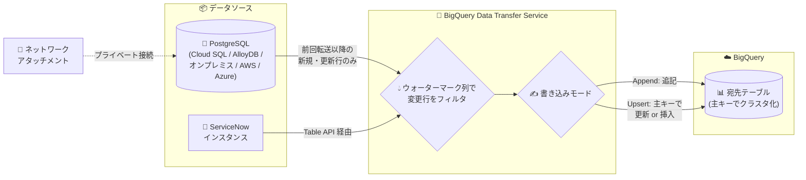

# BigQuery: Data Transfer Service の PostgreSQL / ServiceNow 向け増分データ転送が GA

**リリース日**: 2026-10-12

**サービス**: BigQuery (BigQuery Data Transfer Service)

**機能**: PostgreSQL および ServiceNow コネクタの増分データ転送 (Incremental Data Transfers)

**ステータス**: GA (一般提供)

📊 [このアップデートのインフォグラフィックを見る](https://takech9203.github.io/google-cloud-news-summary/20261012-bigquery-dts-incremental-transfers.html)

## 概要

BigQuery Data Transfer Service (DTS) の PostgreSQL コネクタおよび ServiceNow コネクタにおける増分データ転送 (Incremental Data Transfers) が一般提供 (GA) になりました。これまで Preview として提供されていた機能が、本番環境での利用に対応しました。

増分データ転送では、転送のたびにデータセット全体をロードする代わりに、前回の転送以降に作成・更新された行のみを BigQuery に転送します。ウォーターマーク列 (watermark column) を使って最終同期ポイントを追跡し、新規・更新行だけを効率的にクエリして転送する仕組みです。書き込みモードとして Append (追記) と Upsert (主キーに基づく更新または挿入) が利用できます。

PostgreSQL (Cloud SQL、AlloyDB、オンプレミス、AWS/Azure 上の PostgreSQL など) や ServiceNow のデータを BigQuery に定期的に取り込んで分析している組織にとって、転送時間・ソース側の負荷・コストを大幅に削減できるアップデートです。

**アップデート前の課題**

- 増分転送は Preview 段階であり、Pre-GA Offerings Terms が適用されるため本番ワークロードでの採用が難しかった
- フル転送のみを使う場合、転送のたびにソースのテーブル全体を再ロードする必要があり、データ量の増加に伴って転送時間とソースデータベースへの負荷が増大していた
- 大規模テーブルの頻繁な同期では、転送の重複によるスキップが発生しやすく、転送間隔を長く取る必要があった

**アップデート後の改善**

- 増分転送が GA となり、SLA を伴う本番環境のデータパイプラインで安心して利用できるようになった
- 前回転送以降の新規・更新行のみを転送するため、転送あたりのデータ量と転送時間を大幅に削減できる
- Upsert 書き込みモードにより、主キーに基づいて宛先テーブルの行を更新・挿入し、ソーステーブルとの同期を自動的に維持できる
- ソースのスキーマ変更 (列の追加・削除・リネームなど) にも定義された動作で追従する

## アーキテクチャ図



増分転送では、DTS コネクタがウォーターマーク列 (PostgreSQL は TIMESTAMP 型、ServiceNow は DATETIME 型) を使って前回の転送以降に変更された行だけを抽出し、Append または Upsert モードで BigQuery の宛先テーブルに書き込みます。

## サービスアップデートの詳細

### 主要機能

1. **増分取り込み (Incremental Ingestion)**
   - 転送設定の Ingestion type で `Full` または `Incremental` を選択可能
   - 増分転送では、ウォーターマーク列を基準に前回の正常な転送以降に作成・変更された行のみを転送
   - 既存のフル転送設定を増分モードに変更した場合、変更後の初回転送は全データを転送し、以降は差分のみを転送

2. **Append / Upsert 書き込みモード**
   - **Append (`WRITE_MODE_APPEND`)**: 新規・更新行を宛先テーブルに追記する。ウォーターマーク列の指定が必要
   - **Upsert (`WRITE_MODE_UPSERT`)**: 主キーを基に、宛先テーブルに存在する行は更新、存在しない行は挿入する。ウォーターマーク列と主キーの指定が必要
   - ServiceNow コネクタの増分転送では Upsert モードを使用する

3. **スキーマ変更への追従**
   - ソースでの列追加: 宛先 BigQuery テーブルに新しい列が追加される (過去レコードは NULL)
   - ソースでの列削除: 宛先テーブルに列は残り、新規エントリは NULL で埋められる
   - 列のデータ型変更: `ALTER COLUMN` DDL でサポートされる型変換のみ対応
   - 列のリネーム: 元の列は残り、新しい名前の列が追加される

## 技術仕様

### 増分転送の要件

| 項目 | PostgreSQL | ServiceNow |
|------|-----------|------------|
| ウォーターマーク列の型 | TIMESTAMP のみ | DATETIME のみ |
| 書き込みモード | Append / Upsert | Upsert |
| 主キー | Upsert 時に必須 | 必須 (例: `sys_id`) |
| データ型マッピング | 更新版マッピング必須 (`connector.legacyMapping: false`) | 更新版マッピング必須 (`connector.legacyMapping: false`) |
| 宛先テーブル | 主キーでクラスタ化される | 主キーでクラスタ化される |

### 増分転送の主な制約

- ウォーターマーク列の値は単調増加 (monotonically increasing) である必要がある
- ソーステーブルでの削除操作は同期されない
- 1 つの転送設定は増分またはフルのどちらか一方のみをサポート
- 初回の増分転送実行後は、アセットリスト・書き込みモード・ウォーターマーク列・主キーを変更できない
- 宛先テーブルはクラスタ化テーブルの制限の対象となる
- (PostgreSQL) ウォーターマーク列にインデックスを作成するとフィルタ性能が向上する

## 設定方法

### 前提条件

1. BigQuery Data Transfer Service を有効化し、`roles/bigquery.admin` など必要な IAM ロールを取得する
2. 転送先の BigQuery データセットを作成する
3. (PostgreSQL) パブリック IP がない場合はネットワークアタッチメントを設定する
4. (ServiceNow) OAuth 認証情報 (Client ID / Client Secret) を作成し、Procurement / Product Catalog / Contract Management アプリケーションを有効化する

### 手順

#### ステップ 1: PostgreSQL の増分転送設定を作成する

```bash
bq mk --transfer_config \
  --target_dataset=mydataset \
  --data_source=postgresql \
  --display_name='My Incremental PG Transfer' \
  --params='{
    "assets": ["DB1/PUBLIC/DEPARTMENT"],
    "connector.database": "DB1",
    "connector.endpoint.host": "192.168.0.1",
    "connector.endpoint.port": 5432,
    "connector.authentication.username": "User1",
    "connector.authentication.password": "********",
    "connector.tls.mode": "ENCRYPT_VERIFY_CA_AND_HOST",
    "ingestionType": "incremental",
    "writeMode": "WRITE_MODE_APPEND",
    "watermarkColumns": ["createdAt"],
    "connector.legacyMapping": false
  }'
```

`ingestionType` に `incremental` を指定し、ウォーターマーク列を設定します。増分転送では `connector.legacyMapping` を `false` (更新版データ型マッピング) にする必要があります。

#### ステップ 2: ServiceNow の増分転送設定を作成する (Upsert)

```bash
bq mk --transfer_config \
  --target_dataset=mydataset \
  --data_source=servicenow \
  --display_name='My Incremental ServiceNow Transfer' \
  --params='{
    "assets": ["incident", "change_request"],
    "connector.instanceId": "dev-instance",
    "connector.authentication.username": "user1",
    "connector.authentication.password": "********",
    "connector.authentication.oauth.clientId": "1234567890",
    "connector.authentication.oauth.clientSecret": "********",
    "ingestionType": "incremental",
    "writeMode": "WRITE_MODE_UPSERT",
    "watermarkColumns": ["sys_updated_on", "sys_updated_on"],
    "primaryKeys": [["sys_id"], ["sys_id"]]
  }'
```

複数アセットを指定する場合、`watermarkColumns` と `primaryKeys` の値は `assets` の並び順に対応させます。Google Cloud コンソールの「データ転送」ページからも同様の設定が可能です。

## メリット

### ビジネス面

- **コスト効率の向上**: 毎回フルロードする場合と比べ、転送データ量が差分のみになるため、転送時間とリソース消費を削減できる
- **本番利用への道が開けた**: GA により Pre-GA 条項の制約がなくなり、エンタープライズの本番データパイプラインに組み込める
- **鮮度の高い分析**: 転送あたりの処理量が減ることで、より高頻度な同期 (ServiceNow は最短 15 分間隔) が現実的になり、BigQuery 上の分析データの鮮度が向上する

### 技術面

- **ソース負荷の軽減**: PostgreSQL / ServiceNow インスタンスへのクエリ負荷が差分抽出のみに抑えられる
- **Upsert による同期の自動化**: 主キーに基づく更新・挿入で、宛先テーブルをソースと一致した状態に保つ処理を自作する必要がない
- **クエリ性能の最適化**: 宛先テーブルが主キーでクラスタ化されるため、キーを条件とするクエリの性能が向上する

## デメリット・制約事項

### 制限事項

- 削除操作は同期されないため、ソースで削除された行は宛先テーブルに残り続ける (完全な一致が必要な場合はフル転送や別途の削除処理が必要)
- ウォーターマーク列は PostgreSQL では TIMESTAMP 型、ServiceNow では DATETIME 型のみで、値が単調増加している必要がある
- 初回の増分転送実行後は、アセットリスト・書き込みモード・ウォーターマーク列・主キーを変更できない (変更する場合は転送設定の作り直しが必要)
- 増分転送では更新版データ型マッピングが必須 (PostgreSQL: `timestamp` → DATETIME、`json`/`jsonb` → JSON など、レガシーとは型マッピングが異なる)

### 考慮すべき点

- Upsert モードで指定する主キーは全行で一意かつ非 NULL である必要がある。一意性に確信が持てない場合はフル取り込みが推奨されている
- 既存のフル転送設定を増分に切り替えた直後の初回転送は全データを転送するため、初回のみ時間とコストがかかる
- 行の物理的な削除や履歴管理が必要な場合は、Datastream などの CDC ソリューションとの比較検討が必要

## ユースケース

### ユースケース 1: ServiceNow インシデントデータのニアリアルタイム分析

**シナリオ**: ITSM チームが ServiceNow の `incident` / `change_request` テーブルを BigQuery に同期し、Looker Studio でインシデント対応状況のダッシュボードを運用している。従来のフル転送では転送時間が長く、1 日 1 回の更新が限界だった。

**実装例**: ウォーターマーク列に `sys_updated_on`、主キーに `sys_id` を指定した Upsert 増分転送を構成し、転送頻度を短縮する。

**効果**: 転送あたりのデータ量が差分のみとなり、ServiceNow インスタンスへの負荷を抑えながら高頻度の同期が可能になる。ダッシュボードがより新しいデータを反映できる。

### ユースケース 2: 業務系 PostgreSQL データベースの DWH への差分ロード

**シナリオ**: Cloud SQL for PostgreSQL 上の数億行規模のトランザクションテーブルを BigQuery に日次ロードしており、フルロードによる転送時間の長期化とソース DB の負荷が課題になっている。

**効果**: `updated_at` のような TIMESTAMP 列をウォーターマークとした増分転送 (Append または Upsert) により、日次の転送が差分のみで完了し、転送ウィンドウとソース DB の負荷が大幅に削減される。宛先テーブルは主キーでクラスタ化されるためクエリ効率も向上する。

## 料金

PostgreSQL / ServiceNow 転送の料金は BigQuery Data Transfer Service の料金体系に従います。詳細は料金ページを参照してください。

- [BigQuery Data Transfer Service の料金](https://cloud.google.com/bigquery/pricing#data-transfer-service-pricing)

増分転送により転送対象のデータ量が削減されるため、フル転送と比較して転送関連コストの最適化が期待できます。

## 関連サービス・機能

- **Cloud SQL for PostgreSQL / AlloyDB for PostgreSQL**: PostgreSQL コネクタの代表的な転送元。ネットワークアタッチメント経由でプライベート接続が可能
- **VPC ネットワークアタッチメント**: パブリック IP を持たないデータベースや、固定 IP での接続が必要な ServiceNow インスタンスへの接続に使用
- **Datastream**: CDC (変更データキャプチャ) ベースのレプリケーションサービス。削除の同期や低レイテンシのレプリケーションが必要な場合の代替・補完手段
- **Pub/Sub / メール通知**: 転送実行の成否を通知する BigQuery Data Transfer Service の実行通知機能
- **BigQuery クラスタ化テーブル**: 増分転送の宛先テーブルは主キーでクラスタ化され、その制限事項が適用される

## 参考リンク

- 📊 [インフォグラフィック](https://takech9203.github.io/google-cloud-news-summary/20261012-bigquery-dts-incremental-transfers.html)
- [公式リリースノート](https://docs.cloud.google.com/release-notes#October_12_2026)
- [ドキュメント: PostgreSQL データ転送の概要 (Full or incremental transfers)](https://docs.cloud.google.com/bigquery/docs/postgresql-transfer-intro#full-incremental-transfers)
- [ドキュメント: PostgreSQL 転送のスケジュール設定](https://docs.cloud.google.com/bigquery/docs/postgresql-transfer)
- [ドキュメント: ServiceNow データの BigQuery への読み込み (Full or incremental transfers)](https://docs.cloud.google.com/bigquery/docs/servicenow-transfer#full_or_incremental_transfers)
- [ドキュメント: BigQuery Data Transfer Service の概要](https://docs.cloud.google.com/bigquery/docs/dts-introduction)
- [料金ページ](https://cloud.google.com/bigquery/pricing#data-transfer-service-pricing)

## まとめ

BigQuery Data Transfer Service の PostgreSQL / ServiceNow 向け増分データ転送が GA となり、差分のみを転送する効率的なデータパイプラインを本番環境で構築できるようになりました。現在フル転送を使用している場合は、ウォーターマーク列と主キーの設計 (単調増加する TIMESTAMP/DATETIME 列、一意な主キー) を確認のうえ、増分転送への移行を検討することを推奨します。削除の同期が必要な場合は Datastream などの CDC ソリューションとの使い分けも併せて検討してください。

---

**タグ**: BigQuery, BigQuery Data Transfer Service, PostgreSQL, ServiceNow, 増分転送, データパイプライン, GA
