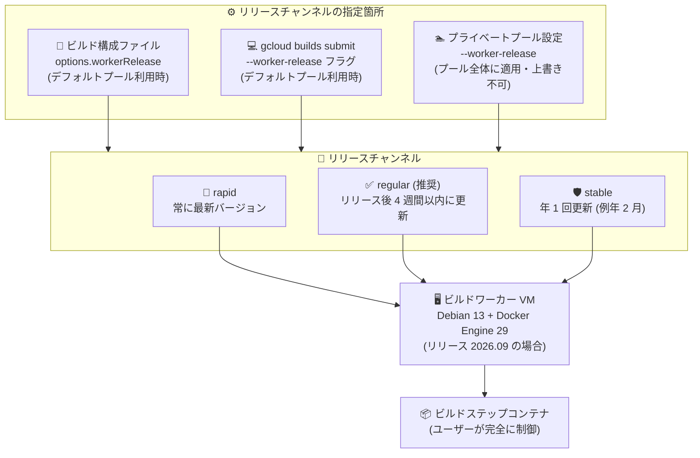

# Cloud Build: ビルド環境のリリースチャンネル選択機能

**リリース日**: 2026-10-12

**サービス**: Cloud Build

**機能**: ビルド構成・プライベートプール向けリリースチャンネル

**ステータス**: Announcement

📊 [このアップデートのインフォグラフィックを見る](https://takech9203.github.io/google-cloud-news-summary/20261012-cloud-build-release-channels.html)

## 概要

Cloud Build で、ビルド構成 (build config) またはプライベートプールに対して**リリースチャンネル**を選択できるようになりました。リリースチャンネルは、ビルドワーカー VM の基盤となる Debian (ベース OS) と Docker のバージョンがどの程度の頻度で更新されるかを決定します。`regular`、`rapid`、`stable` の 3 つのチャンネルから選択できるほか、特定のリリースバージョン (例: `2026.09`) を直接指定することも可能です。

この機能により、CI/CD パイプラインを運用するチームは「最新のセキュリティ更新を即座に取り込む」か「ビルドプロセスの安定性を優先する」かを、自組織のポリシーに合わせて制御できるようになります。リリースチャンネルが管理するのはワーカー VM のホスト環境のみであり、ビルドステップのコンテナ内で使用するソフトウェアのバージョンは引き続きユーザーが完全に制御できます。

対象ユーザーは、Cloud Build でビルドを実行するすべてのユーザーです。特に、ビルド環境の変更によるパイプライン破損リスクを管理したいエンタープライズの DevOps / Platform Engineering チームや、セキュリティコンプライアンス要件で最新パッチの適用頻度が定められている組織にとって重要なアップデートです。

**アップデート前の課題**

- ビルドワーカーの基盤となる Debian や Docker のバージョン更新タイミングをユーザーが制御できなかった
- 従来のワーカーイメージ (legacy) は Docker Engine 20.10 / Debian 11 ベースであり、新しいバージョンへの移行パスが明示されていなかった
- 基盤環境の更新頻度とビルドプロセスの安定性のバランスを、組織のポリシーに合わせて調整する手段がなかった

**アップデート後の改善**

- `regular` / `rapid` / `stable` の 3 チャンネルから更新頻度を選択できるようになった
- チャンネルではなく特定のリリースバージョン (例: `2026.09`) を固定して指定することも可能になった
- プライベートプール、ビルド構成ファイル、`gcloud builds submit` の 3 箇所で柔軟に指定できるようになった

## アーキテクチャ図



リリースチャンネルは 3 箇所 (ビルド構成、コマンドライン、プライベートプール) で指定でき、選択したチャンネルに応じてワーカー VM の Debian / Docker バージョンの更新頻度が決まります。ビルドステップコンテナ内のソフトウェアは引き続きユーザーが制御します。

## サービスアップデートの詳細

### 主要機能

1. **3 つのリリースチャンネル**
   - `regular`: 新バージョンのリリース後 4 週間以内に更新。デフォルトチャンネルであり、セキュリティコンプライアンスの観点から推奨
   - `rapid`: 常に利用可能な最新バージョンを使用。最新のセキュリティ更新と機能を即座に取得できるが、新しいベース OS / Docker バージョンが CI プロセスを破損させるリスクがある
   - `stable`: 年 1 回 (例年 2 月) の更新。新機能よりも安定性を優先し CI プロセスの耐障害性を高めるが、脆弱性への露出リスクが高くなり、基盤の Docker バージョンが Docker 社のパッチを受けられない可能性がある

2. **特定バージョンの固定指定**
   - チャンネルではなく、特定のリリースバージョン (例: `2026.09`) を指定して Docker と Debian のバージョンを固定可能
   - バージョン `2026.09` は Docker Engine 29 / Debian 13 で構成され、2029-09-30 までサポートされる

3. **3 箇所での柔軟な指定**
   - **プライベートプール**: プール設定で指定すると、そのプールを使用するすべてのビルドに適用される。ビルド構成やコマンドラインでの上書きは不可
   - **ビルド構成ファイル**: デフォルトプール利用時に `options.workerRelease` で指定
   - **コマンドライン**: デフォルトプール利用時に `gcloud builds submit --worker-release` で指定 (ビルド構成ファイルの設定を上書き)

## 技術仕様

### リリースチャンネル比較

| チャンネル | 更新頻度 | 用途 |
|------|------|------|
| `regular` | 新バージョンのリリース後 4 週間以内 | デフォルト。セキュリティコンプライアンスの推奨チャンネル。CI プロセスを新バージョンに追従させる必要がある |
| `rapid` | 常に最新バージョン | 最新のセキュリティ更新・機能を即座に取得。CI プロセス破損のリスクあり |
| `stable` | 年 1 回 (例年 2 月) | 安定性を最優先。脆弱性への露出リスクが相対的に高い |

### 利用可能なリリースバージョン

| リリースバージョン | 対応チャンネル | サポート期限 | 基盤バージョン |
|------|------|------|------|
| `2026.09` | `rapid`, `regular`, `stable` | 2029-09-30 | Docker Engine 29 / Debian 13 |
| `legacy` | (チャンネルなし) | 2028-03-31 | Docker Engine 20.10 / Debian 11 |

### 指定箇所と優先順位

| 指定箇所 | 対象プール | 備考 |
|------|------|------|
| プライベートプール設定 | プライベートプール | プール全体に適用。ビルド構成・コマンドラインでの上書き不可 |
| ビルド構成ファイル (`options.workerRelease`) | デフォルトプール | そのビルド構成を使うすべてのビルドに適用 |
| `gcloud builds submit --worker-release` | デフォルトプール | ビルド構成ファイルの設定を上書き |

**重要**: 2027-03-28 までは、デフォルトで `legacy` バージョンが使用されます。それ以降はデフォルトが `regular` チャンネルに切り替わります。

## 設定方法

### 前提条件

1. Cloud Build API が有効化された Google Cloud プロジェクト
2. `gcloud` CLI (最新バージョン推奨)
3. プライベートプールで設定する場合は、対象プールの更新権限

### 手順

#### ステップ 1: ビルド構成ファイルで指定 (デフォルトプール)

```yaml
steps:
  # ... ビルドステップ ...
options:
  workerRelease: regular  # regular / rapid / stable、または特定バージョン (例: "2026.09")
```

ビルド構成ファイルの `options` スタンザに `workerRelease` プロパティを追加します。この構成を使用するすべてのビルドに適用されます。プライベートプール利用時はビルド構成では指定できません。

#### ステップ 2: コマンドラインで指定 (デフォルトプール)

```bash
gcloud builds submit --worker-release=rapid
```

`--worker-release` フラグの値はビルド構成ファイルの設定を上書きします。プライベートプールで実行されるビルドでは使用できません (プール側の設定が優先されるため)。

#### ステップ 3: プライベートプールで指定

```bash
gcloud builds worker-pools update PRIVATEPOOL_ID \
  --worker-release=stable \
  --region=REGION \
  --project=PROJECT_ID
```

プライベートプール設定で指定したチャンネル / バージョンは、そのプールを使用するすべてのビルドに適用されます。Google Cloud コンソールからプールの作成・更新時に選択することも可能です。

## メリット

### ビジネス面

- **コンプライアンス対応の明確化**: `regular` チャンネルによりセキュリティパッチの適用頻度を担保でき、監査要件に対して基盤環境の更新ポリシーを説明しやすくなる
- **パイプライン破損リスクの管理**: `stable` チャンネルや特定バージョン固定により、基盤環境の予期しない変更によるビルド失敗 (リリース遅延) のリスクを低減できる
- **移行計画の立案が可能に**: `legacy` のサポート期限 (2028-03-31) とデフォルト切り替え日 (2027-03-28) が明示され、計画的な移行が可能になる

### 技術面

- **責任分界の明確化**: リリースチャンネルはワーカー VM のホスト環境 (Debian / Docker) のみを管理し、ビルドステップコンテナ内のソフトウェアはユーザーが完全に制御する構造が明確になる
- **環境の再現性向上**: 特定バージョン指定により、ビルド環境の Docker / Debian バージョンを固定して再現性の高いビルドを実現できる
- **段階的な検証が可能**: 検証用パイプラインは `rapid`、本番用パイプラインは `regular` や `stable` といった使い分けにより、新バージョンの影響を事前に検証できる

## デメリット・制約事項

### 制限事項

- プライベートプールでチャンネル / バージョンを指定した場合、ビルド構成ファイルやコマンドラインでの上書きはできない
- プライベートプール利用時は、ビルド構成ファイルの `workerRelease` や `--worker-release` フラグは使用できない
- `stable` チャンネルは更新が年 1 回のため、脆弱性への露出リスクが高くなり、基盤の Docker バージョンが Docker 社のパッチ提供対象外になる可能性がある

### 考慮すべき点

- 2027-03-28 まではデフォルトが `legacy` バージョン (Docker Engine 20.10 / Debian 11) のため、新しい基盤 (Docker Engine 29 / Debian 13) を使うには明示的な指定が必要
- `legacy` のサポートは 2028-03-31 までのため、それまでに新リリースへの移行検証を済ませる必要がある
- `rapid` / `regular` を選択する場合、基盤バージョンの更新に CI プロセスが追従できるよう、ビルドの定期的な動作確認体制を整えておく必要がある

## ユースケース

### ユースケース 1: セキュリティコンプライアンス要件への対応

**シナリオ**: 金融業の企業で、CI/CD 基盤に対して「セキュリティパッチを一定期間内に適用する」という社内規程がある。ビルドワーカーの基盤 OS / Docker の更新頻度を明示的に管理したい。

**実装例**:
```yaml
steps:
  - name: 'gcr.io/cloud-builders/docker'
    args: ['build', '-t', 'us-docker.pkg.dev/$PROJECT_ID/app/image', '.']
options:
  workerRelease: regular
```

**効果**: 新バージョンリリース後 4 週間以内に基盤が更新される `regular` チャンネルを明示的に指定することで、セキュリティコンプライアンスの推奨構成を維持しつつ、更新ポリシーを監査に対して説明できる。

### ユースケース 2: ミッションクリティカルなリリースパイプラインの安定運用

**シナリオ**: 本番リリース用のプライベートプールでは基盤環境の変更頻度を最小化してパイプラインの安定性を優先し、開発用パイプラインでは最新環境で事前検証を行いたい。

**実装例**:
```bash
# 本番リリース用プライベートプールは stable に固定
gcloud builds worker-pools update prod-pool \
  --worker-release=stable \
  --region=asia-northeast1

# 開発用ビルドは rapid で最新環境を検証
gcloud builds submit --worker-release=rapid
```

**効果**: 本番パイプラインは年 1 回の更新サイクルで安定性を確保しつつ、開発側で `rapid` を使って新バージョンの互換性を先行検証できるため、基盤更新時の本番ビルド破損リスクを最小化できる。

## 料金

リリースチャンネルの選択自体に追加料金は発生しません。Cloud Build の料金はビルド時間とマシンタイプ (およびプライベートプールの構成) に基づいて課金されます。詳細は料金ページを参照してください。

- [Cloud Build 料金ページ](https://cloud.google.com/build/pricing)

## 関連サービス・機能

- **Cloud Build プライベートプール**: 本機能の主要な設定対象の 1 つ。プール単位でチャンネルを統制でき、VPC 内リソースへのアクセスや環境のカスタマイズと組み合わせて利用する
- **Artifact Registry**: ビルドしたコンテナイメージの格納先。ワーカー基盤の Docker バージョン更新はイメージビルド工程に影響し得るため、チャンネル選定と合わせて検証する
- **Artifact Analysis / ソフトウェアサプライチェーンセキュリティ**: ビルド環境の基盤バージョン管理は、SLSA 準拠などサプライチェーンセキュリティの統制と補完関係にある
- **GKE リリースチャンネル**: GKE にも同様の `rapid` / `regular` / `stable` チャンネルの概念があり、Google Cloud 全体で一貫した更新頻度管理のモデルが採用されている

## 参考リンク

- 📊 [インフォグラフィック](https://takech9203.github.io/google-cloud-news-summary/20261012-cloud-build-release-channels.html)
- [公式リリースノート](https://docs.cloud.google.com/release-notes#October_12_2026)
- [ドキュメント: Cloud Build リリースチャンネル](https://docs.cloud.google.com/build/docs/release-channels)
- [ドキュメント: ビルド構成ファイルスキーマ](https://docs.cloud.google.com/build/docs/build-config-file-schema)
- [ドキュメント: プライベートプール構成ファイルスキーマ](https://docs.cloud.google.com/build/docs/private-pools/private-pool-config-file-schema)
- [料金ページ](https://cloud.google.com/build/pricing)

## まとめ

Cloud Build のビルドワーカー基盤 (Debian / Docker) の更新頻度を `regular` / `rapid` / `stable` の 3 チャンネルまたは特定バージョン指定で制御できるようになり、セキュリティと安定性のバランスを組織のポリシーに合わせて設計できるようになりました。2027-03-28 にデフォルトが `legacy` から `regular` チャンネルへ切り替わり、`legacy` のサポートも 2028-03-31 に終了するため、現行パイプラインでの新リリース (Docker Engine 29 / Debian 13) の互換性検証と、プライベートプールやビルド構成でのチャンネル指定の方針策定を早めに進めることを推奨します。

---

**タグ**: Cloud Build, CI/CD, リリースチャンネル, Debian, Docker, プライベートプール, DevOps, セキュリティ
