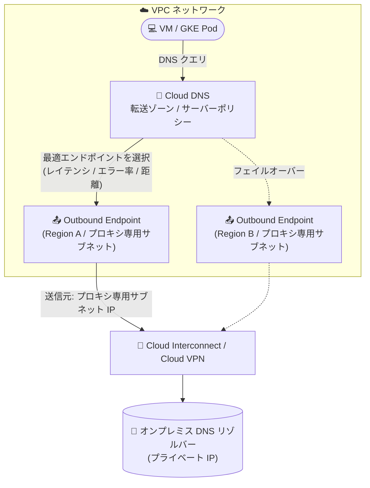

# Cloud DNS: Outbound Endpoints (Preview)

**リリース日**: 2026-10-12

**サービス**: Cloud DNS

**機能**: Outbound Endpoints

**ステータス**: Preview

📊 [このアップデートのインフォグラフィックを見る](https://takech9203.github.io/google-cloud-news-summary/20261012-cloud-dns-outbound-endpoints.html)

## 概要

Cloud DNS の Outbound Endpoints が Preview として利用可能になりました。Outbound Endpoints を転送ゾーン (forwarding zones) またはサーバーポリシーにアタッチすることで、VPC ネットワークから外部およびオンプレミスの DNS リゾルバーへ、プライベート IP アドレスを使用して DNS クエリを直接転送できるようになります。

Outbound Endpoint は特定の VPC ネットワーク内に作成されるリージョンリソースで、そのネットワークのプロキシ専用サブネット (proxy-only subnet) を送信元 IP アドレスとして使用します。従来の固定転送プロキシ範囲 (`35.199.192.0/19`) によるルーティング上の制約を克服し、VPC ネットワークごとに固有のエグレス範囲を割り当てることで、アウトバウンド DNS トラフィックのきめ細かな制御が可能になります。ハイブリッドおよびマルチクラウド環境で DNS 名前解決を構成するネットワーク管理者や Solutions Architect にとって重要なアップデートです。

**アップデート前の課題**

- アウトバウンド DNS 転送はすべて Google 所有の固定プロキシ範囲 `35.199.192.0/19` を送信元として行われ、オンプレミス側でこの範囲への戻りルートを同一 VPC ネットワーク経由で構成する必要があるなど、ルーティング上の制約があった
- すべての VPC ネットワークが同じ送信元範囲を共有するため、オンプレミスのファイアウォールや DNS リゾルバー側で VPC ネットワークごとにトラフィックを識別・分離することができなかった
- Hub-and-Spoke 構成で DNS 転送を集約するには、ネットワーク間の接続構成に依存した設計が必要だった

**アップデート後の改善**

- VPC ネットワークごとに固有のエグレス範囲 (プロキシ専用サブネットの IP 範囲) を割り当てられるようになり、オンプレミス側で VPC ネットワーク単位のファイアウォール設定やアクセス制御が可能になった
- ハブ VPC ネットワークの Outbound Endpoint をスポーク VPC の転送ゾーン/サーバーポリシーから利用でき、ハブ・スポーク間のネットワーク接続なしで DNS 転送を一元化できるようになった (Cloud DNS が内部でクエリ転送を処理)
- Shared VPC に対応し、ホストプロジェクトに集約した Outbound Endpoint をサービスプロジェクトの転送ゾーン/サーバーポリシーからクロスプロジェクトでバインドできるようになった
- GKE クラスタはホスト VPC ネットワークの Outbound Endpoints を自動的に継承し、クラスタレベルの変更なしに外部宛てクエリをリージョナル Outbound Endpoint 経由でルーティングできるようになった

## アーキテクチャ図



VM からの DNS クエリは転送ゾーン/サーバーポリシーにアタッチされた Outbound Endpoint を経由し、プロキシ専用サブネットの IP を送信元としてオンプレミスのリゾルバーへ転送されます。複数リージョンにエンドポイントを配置することで、リージョン障害時の自動フェイルオーバーが可能です。

## サービスアップデートの詳細

### 主要機能

1. **VPC ネットワーク固有の送信元 IP によるアウトバウンド DNS 転送**
   - Outbound Endpoint は VPC ネットワーク内に作成され、そのネットワークのリージョナルプロキシ専用サブネットを DNS クエリの送信元 IP 範囲として使用する
   - 従来の固定範囲 `35.199.192.0/19` によるルーティング制約を克服し、ネットワークごとに固有のエグレス範囲を割り当て可能
   - オンプレミスのファイアウォールが専用かつ予測可能な送信元 IP 範囲を要求する場合、DNS 専用のエグレス VPC ネットワークを構築するアーキテクチャも推奨されている

2. **自動ランキングとリージョンフェイルオーバー**
   - 複数の Outbound Endpoint をアタッチした場合、Cloud DNS は既存のターゲットランキングアルゴリズム (成功応答数、低レイテンシ、地理的近接性) に基づき最適なエンドポイントを自動選択する
   - 最上位のエンドポイントが異常な場合は次点のエンドポイントに自動フェイルオーバーし、回復後は再び優先される
   - リージョン障害への保護として、コンピュートワークロードを実行する 2 つ以上のリージョンにエンドポイントを構成することが推奨される

3. **Hub-and-Spoke 構成と Shared VPC のサポート**
   - 転送ゾーン/サーバーポリシーから別の集中管理 VPC ネットワーク (ハブ) の Outbound Endpoint を利用可能。ハブとスポーク間のネットワーク接続は不要 (Cloud DNS が内部で転送を処理)
   - Shared VPC では、エンドポイントとプロキシ専用サブネットをホストプロジェクトに集約し、サービスプロジェクトからクロスプロジェクトでバインドできる (`dns.outboundEndpoints.bindPrivateDNSZone` / `dns.outboundEndpoints.bindPrivateDNSPolicy` 権限が必要)

4. **GKE クラスタの自動継承**
   - ホスト VPC ネットワークが Outbound Endpoints を構成した標準のグローバル転送ゾーンまたはサーバーポリシーで認可されている場合、VPC DNS 解決を使用する Pod はクラスタレベルの変更なしに外部宛てクエリをリージョナル Outbound Endpoint 経由でルーティングする

5. **地理位置ルーティングポリシーとの連携**
   - FQDN を転送ターゲットに指定し、Geolocation ルーティングポリシーを組み合わせることで、クエリ元リージョンに近いオンプレミスリゾルバーへのルーティングが可能

## 技術仕様

### 主要スペック・クォータ

| 項目 | 詳細 |
|------|------|
| スコープ | リージョンリソース (使用する各リージョンに作成が必要) |
| 送信元 IP | VPC ネットワークのリージョナルプロキシ専用サブネット (`--purpose=REGIONAL_MANAGED_PROXY`) |
| エンドポイント IP | 通常サブネットのプライマリ IPv4 範囲から割り当て (DNS クエリのエグレスには使用されない) |
| アタッチ先 | 転送ゾーンまたは DNS サーバーポリシー |
| エンドポイント数の上限 | プロジェクト・リージョンあたり 10 個 (クォータ引き上げ申請可能) |
| ゾーン/ポリシーあたりの上限 | 最大 100 個の Outbound Endpoints をアタッチ可能 |
| IP バージョン | IPv4 のみ (転送先も IPv4 ターゲットまたは IPv4 に解決される FQDN のみ) |
| 転送先 | プライベートターゲットのみ (パブリックインターネット DNS トラフィックのエグレスプロキシとしては使用不可) |

### 必要な IAM 権限

| 権限 | 用途 |
|------|------|
| `dns.outboundEndpoints.create` / `update` / `delete` / `get` / `list` | Outbound Endpoint の管理 |
| `dns.outboundEndpoints.bindPrivateDNSZone` | 転送ゾーンへのバインド (Shared VPC ではホストプロジェクト側に必要) |
| `dns.outboundEndpoints.bindPrivateDNSPolicy` | サーバーポリシーへのバインド |
| `compute.networks.get` / `compute.subnetworks.get` / `compute.subnetworks.use` | ネットワークリソースの参照・使用 |

推奨ロール: `roles/dns.admin` および `roles/compute.networkAdmin`

## 設定方法

### 前提条件

1. オンプレミスまたは外部の DNS ネームサーバーへの接続性 (Cloud Interconnect / Cloud VPN など) を持つ VPC ネットワークがあること
2. エンドポイントをデプロイする各リージョンに、通常のサブネットとプロキシ専用サブネットの両方が存在すること
3. オンプレミスネットワークにリージョナルプロキシ専用サブネットの IP 範囲への戻りルートがあること
4. オンプレミスのファイアウォールで、プロキシ専用サブネットの IP 範囲からのインバウンド DNS クエリ (UDP/TCP ポート 53) を許可すること
5. Cloud DNS、Compute Engine、Network Services の各 API が有効化されていること

### 手順

#### ステップ 1: Outbound Endpoint を作成する

```bash
gcloud beta dns outbound-endpoints create ENDPOINT_NAME \
    --project=PROJECT_ID \
    --network=VPC_NETWORK \
    --subnetwork=REGULAR_SUBNET \
    --location=REGION \
    --endpoint-ip=IP_ADDRESS \
    --description="DESCRIPTION"
```

`--endpoint-ip` には通常サブネットのプライマリ IPv4 範囲から利用可能な内部 IP アドレスを指定します。この IP はネットワークスタック上の配置に使用され、実際の DNS クエリのエグレスはプロキシ専用サブネットの IP 範囲から行われます。

#### ステップ 2: 転送ゾーンにエンドポイントをアタッチする

```bash
gcloud beta dns managed-zones update ZONE_NAME \
    --project=PROJECT_ID \
    --outbound-endpoints=projects/PROJECT_ID/locations/REGION_1/outboundEndpoints/ENDPOINT_NAME_1,projects/PROJECT_ID/locations/REGION_2/outboundEndpoints/ENDPOINT_NAME_2
```

アタッチするエンドポイントはすべて同一の VPC ネットワークに属している必要があります。高可用性のため、異なるリージョンの 2 つ以上のエンドポイントを指定することが推奨されます。Google Cloud コンソールの場合は、転送ゾーン作成/編集時に「Forwarding path」で「Outbound Endpoints」を選択します。

## メリット

### ビジネス面

- **ハイブリッド/マルチクラウド DNS の制約解消**: 固定プロキシ範囲 `35.199.192.0/19` のルーティング要件が障壁となっていたハイブリッド/マルチクラウド DNS 解決のユースケースを実現できる
- **セキュリティポリシーの精緻化**: オンプレミスのファイアウォールで VPC ネットワークごとに異なる送信元 IP を識別できるため、ネットワーク単位のアクセス制御・監査が可能になる
- **運用の一元化**: Hub-and-Spoke や Shared VPC により、DNS エグレスをホスト/ハブプロジェクトに集約し、ガバナンスを強化できる

### 技術面

- **リージョンフェイルオーバー**: 複数リージョンにエンドポイントを配置することで、リージョン障害時も自動的に正常なエンドポイントへ切り替わる
- **GKE との透過的な統合**: クラスタレベルの変更やゾーン転送ゾーンの構成なしに、Pod のアウトバウンドクエリが Outbound Endpoint 経由でルーティングされる
- **ライフサイクル保護**: 使用中のプロキシ専用サブネットや VPC ネットワークは削除から保護され、誤操作による DNS 障害を防止できる

## デメリット・制約事項

### 制限事項

- **IPv4 のみ**: 送信元 IP は IPv4 のみで、転送先も IPv4 ターゲット (または IPv4 に解決される FQDN) に限定される
- **プライベートターゲットのみ**: パブリックインターネット宛て DNS トラフィックのエグレスプロキシや固定送信元 IP アンカーとしては使用できない (パブリック宛てクエリは Google の anycast エッジで直接解決される)
- **リージョンリソース**: 使用する各リージョンにエンドポイントを作成する必要がある
- **転送メカニズムの排他性**: 同一の転送ゾーン/サーバーポリシーで、デフォルトの `35.199.192.0/19` 範囲と Outbound Endpoints を同時に使用することはできない
- **クロスプロジェクトのエンドポイント作成は不可**: Shared VPC のサービスプロジェクトからホストプロジェクトの VPC にエンドポイントを作成することはできない (エンドポイントは VPC ネットワーク・サブネットと同一プロジェクトに作成する必要がある)
- **プロキシ専用サブネットへの直接ピアリング不可**: 外部ネームサーバーへの接続は Cloud Interconnect、Cloud VPN、VPC Network Peering などの標準的な VPC ルーティング経由で確立する必要がある

### 考慮すべき点

- 使用中のプロキシ専用サブネットは直接変更できない。IP 範囲の変更には BACKUP ロールの新サブネット作成 → ACTIVE 化 → ドレイン完了待ち → 旧サブネット削除という移行手順が必要
- プロキシ専用サブネットは Regional Application Load Balancer など同一リージョンの他のリソースと共有されるため、専用の送信元 IP 範囲が必要な場合は DNS 専用のエグレス VPC ネットワークの構築を検討する
- Preview (Pre-GA) 機能のため、サポートが限定される可能性がある。本番環境への適用は GA を待つか慎重に判断する
- 既存の転送構成からの移行については、公式の移行ガイド (Migrate an existing Cloud DNS forwarding setup to Outbound Endpoints) を参照する

## ユースケース

### ユースケース 1: VPC ネットワークごとの送信元 IP 分離

**シナリオ**: 同一リージョンの複数の VPC ネットワーク (本番用・開発用など) からオンプレミスのリゾルバーへクエリを転送し、オンプレミス側で VPC ごとに異なるファイアウォールポリシーを適用したい。

**実装例**:
```
1. 各 VPC ネットワークに Outbound Endpoint を作成
2. 各 VPC に転送ゾーン (またはサーバーポリシー) を作成し、
   その VPC のみを認可、その VPC のエンドポイントのみを使用
3. オンプレミス側では各 VPC のプロキシ専用サブネットの
   送信元 IP 範囲ごとにポリシーを適用
```

**効果**: オンプレミスネットワークが VPC ネットワークごとに異なる送信元 IP を識別でき、ネットワーク単位のきめ細かなアクセス制御が実現する。

### ユースケース 2: Hub-and-Spoke による DNS エグレスの一元化

**シナリオ**: 多数のスポーク VPC からのオンプレミス宛て DNS クエリを、ハイブリッド接続 (Cloud Interconnect) を持つハブ VPC に集約したい。

**効果**: ハブ VPC に Outbound Endpoint を作成し、スポーク VPC の転送ゾーン/サーバーポリシーからそれを指定するだけで、ハブ・スポーク間のネットワーク接続なしに DNS 転送を一元化できる。冗長なハイブリッド回線のプロビジョニングが不要になり、コストを最小化できる。

### ユースケース 3: 地理位置ルーティングによるリージョン別オンプレミスリゾルバーへの転送

**シナリオ**: 米国と欧州にそれぞれオンプレミス DNS リゾルバーがあり、クエリ元リージョンに近いリゾルバーへ転送したい。

**効果**: Geolocation ルーティングポリシーを適用したプライベートゾーンの FQDN (例: `onprem-resolvers.example.com`) を転送ターゲットに指定し、各リージョンの Outbound Endpoint をアタッチすることで、欧州のクエリは欧州のリゾルバーへ、米国のクエリは米国のリゾルバーへ 2 段階ルーティングされ、レイテンシを最小化できる。

## 料金

Outbound Endpoint の時間課金は、Public Preview 期間中 (2026 年 10 月 12 日開始) は免除 ($0.00) され、GA (2027 年 1 月 25 日開始予定) から適用されます。

### 料金例

| 項目 | 月額料金 (USD) |
|--------|-----------------|
| リージョナル Outbound Endpoint 1 個 | $182.50 / 月 (Preview 期間中は $0.00) |
| 2 リージョン冗長構成 (エンドポイント 2 個) | $365.00 / 月 (Preview 期間中は $0.00) |

- 料金はエンドポイントが課金月に存在した時間数に基づき時間按分される (1 時間未満は 1 時間として計上)
- Shared VPC 構成では、Outbound Endpoint が作成されたホストプロジェクトに課金される
- 転送ゾーンの標準クエリ課金は別途適用される。FQDN を転送ターゲットに使用する場合、FQDN の解決クエリも通常レートで課金される

詳細は [Cloud DNS の料金ページ](https://cloud.google.com/dns/pricing) を参照してください。

## 利用可能リージョン

Outbound Endpoints はリージョンリソースであり、使用する各リージョンに作成する必要があります。対応リージョンの詳細は[公式ドキュメント](https://docs.cloud.google.com/dns/docs/outbound-endpoints-overview)を参照してください。

## 関連サービス・機能

- **Cloud DNS 転送ゾーン (Forwarding Zones)**: 特定の DNS 名のクエリを別の DNS サーバーへ転送するゾーン。Outbound Endpoints の主要なアタッチ先
- **Cloud DNS サーバーポリシー (Server Policies)**: VPC ネットワークの名前解決順序を変更し、代替ネームサーバーへ全クエリを転送するアウトバウンドポリシー。Outbound Endpoints のもう 1 つのアタッチ先
- **Cloud DNS ルーティングポリシー (Geolocation)**: FQDN 転送ターゲットと組み合わせて、クエリ元リージョンに応じたリゾルバー選択を実現
- **Cloud Interconnect / Cloud VPN**: Outbound Endpoint からオンプレミスリゾルバーへの接続経路を提供するハイブリッド接続サービス
- **Shared VPC**: ホストプロジェクトにエンドポイントを集約し、サービスプロジェクトからクロスプロジェクトバインドが可能
- **Google Kubernetes Engine (GKE)**: ホスト VPC の Outbound Endpoints 構成を自動的に継承し、Pod の外部宛てクエリをルーティング

## 参考リンク

- 📊 [インフォグラフィック](https://takech9203.github.io/google-cloud-news-summary/20261012-cloud-dns-outbound-endpoints.html)
- [公式リリースノート](https://docs.cloud.google.com/release-notes#October_12_2026)
- [Outbound Endpoints overview](https://docs.cloud.google.com/dns/docs/outbound-endpoints-overview)
- [Create and update Outbound Endpoints](https://docs.cloud.google.com/dns/docs/create-update-outbound-endpoints)
- [DNS server policies overview](https://docs.cloud.google.com/dns/docs/server-policies-overview)
- [Forwarding zones](https://docs.cloud.google.com/dns/docs/zones/forwarding-zones)
- [料金ページ](https://cloud.google.com/dns/pricing)

## まとめ

Cloud DNS Outbound Endpoints は、長年ハイブリッド DNS 設計の制約となっていた固定転送プロキシ範囲 `35.199.192.0/19` への依存を解消し、VPC ネットワークごとの送信元 IP 分離、Hub-and-Spoke での一元化、Shared VPC 対応を実現する重要なアップデートです。Preview 期間中はエンドポイントの時間課金が免除されるため、ハイブリッド/マルチクラウド DNS を運用している組織は、この期間に 2 リージョン以上の冗長構成で検証を開始し、GA (2027 年 1 月予定) に向けた移行計画を立てることを推奨します。

---

**タグ**: Cloud DNS, Outbound Endpoints, Preview, ハイブリッドクラウド, DNS 転送, VPC, ネットワーキング
