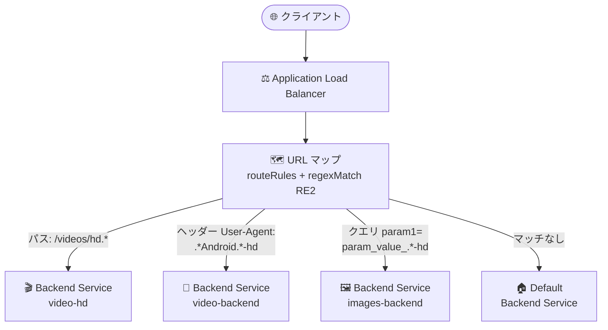

# Cloud Load Balancing: URL マップのホストルール・ルートルールにおける正規表現マッチャーが GA

**リリース日**: 2026-10-12

**サービス**: Cloud Load Balancing

**機能**: URL マップのホストルール・ルートルールにおける正規表現 (regex) マッチャー

**ステータス**: GA (一般提供)

📊 [このアップデートのインフォグラフィックを見る](https://takech9203.github.io/google-cloud-news-summary/20261012-cloud-load-balancing-url-map-regex-matchers.html)

## 概要

Application Load Balancer の URL マップにおいて、ホストルールとルートルールで正規表現 (regex) マッチャーを使用できる機能が一般提供 (GA) になりました。RE2 構文を活用して、URL パス、HTTP ヘッダー、HTTP クエリパラメータに対する柔軟かつ精密なマッチング条件を定義し、トラフィックルーティングルールを構成できます。

具体的には、`routeRules` 内の以下 3 つのフィールドで正規表現が利用できます。

- **URL パス**: `pathMatchers[].routeRules[].matchRules[].regexMatch`
- **HTTP ヘッダー**: `pathMatchers[].routeRules[].matchRules[].headerMatches[].regexMatch`
- **HTTP クエリパラメータ**: `pathMatchers[].routeRules[].matchRules[].queryParameterMatches[].regexMatch`

本機能は、グローバル外部 Application Load Balancer、リージョン外部 Application Load Balancer、リージョン内部 Application Load Balancer、クロスリージョン内部 Application Load Balancer で利用可能です。複雑な URL 構造を持つマイクロサービスや、ヘッダー・クエリパラメータに基づく高度なトラフィック制御 (A/B テスト、デバイス別振り分けなど) を行いたいユーザーに有用なアップデートです。

**アップデート前の課題**

- 正規表現マッチャーは Preview (プレビュー) 段階であり、Pre-GA Offerings Terms の下で「現状のまま」提供され、サポートが限定的であったため、本番環境での採用をためらうケースがあった
- 完全一致 (`fullPathMatch` / `exactMatch`)、プレフィックス一致 (`prefixMatch`) などの基本的なマッチャーだけでは、「パス中の可変部分 (ID など) を含むパターン」や「ヘッダー値の部分的なパターン」のような複雑な条件を 1 つのルールで表現することが難しかった
- 複雑なマッチング条件を実現するには、多数のルートルールを列挙するか、バックエンド側 (アプリケーションや Nginx など) でルーティングロジックを実装する必要があった

**アップデート後の改善**

- 正規表現マッチャーが GA となり、SLA の対象として本番ワークロードで安心して利用できるようになった
- RE2 構文により、URL パス・HTTP ヘッダー・クエリパラメータに対するパターンベースのマッチングを URL マップだけで宣言的に定義できるようになった
- 複数のマッチャーを 1 つの `matchRules` 内で AND 条件として組み合わせられるため (例: ヘッダーの regex 一致 + パスのプレフィックス一致)、きめ細かいルーティングがロードバランサー層で完結するようになった

## アーキテクチャ図



Application Load Balancer の URL マップが、URL パス・HTTP ヘッダー・クエリパラメータそれぞれに対する RE2 正規表現マッチングを評価し、条件に合致したバックエンドサービスへトラフィックを振り分ける構成です。

## サービスアップデートの詳細

### 主要機能

1. **URL パスの正規表現マッチング (`regexMatch`)**
   - `pathMatchers[].routeRules[].matchRules[].regexMatch` でリクエストパスを正規表現で評価
   - クエリパラメータとアンカーを除去した後のパスがマッチング対象
   - 例: `/videos/hd.*` は `/videos/hd-abcd?key=245` のパス部分にマッチ

2. **HTTP ヘッダーの正規表現マッチング (`headerMatches[].regexMatch`)**
   - `headerName` で指定したヘッダーの値を正規表現で評価
   - 例: `User-Agent` ヘッダーに対して `.*Android.*-hd` を指定し、特定のクライアントのみ別バックエンドへ誘導
   - `prefixMatch` などの他のマッチャーと組み合わせて AND 条件を構成可能

3. **HTTP クエリパラメータの正規表現マッチング (`queryParameterMatches[].regexMatch`)**
   - `name` で指定したクエリパラメータの値を正規表現で評価
   - 例: パラメータ `param1` の値に対して `param_value_.*-hd` を指定

4. **マッチングのセマンティクス**
   - 1 つの `routeRule` は、いずれかの `matchRule` が満たされればマッチ (OR)
   - 1 つの `matchRule` 内の述語 (predicate) はすべて満たされる必要がある (AND)
   - ルールは `priority` の小さい順に評価される

## 技術仕様

### 対応ロードバランサー

| ロードバランサー | 対応状況 |
|------|------|
| グローバル外部 Application Load Balancer | ✅ 対応 |
| リージョン外部 Application Load Balancer | ✅ 対応 |
| リージョン内部 Application Load Balancer | ✅ 対応 |
| クロスリージョン内部 Application Load Balancer | ✅ 対応 |
| クラシック Application Load Balancer | ❌ 非対応 |

### 制限値 (クォータ)

| 項目 | 制限 |
|------|------|
| パスマッチャーあたりの正規表現の最大数 | リージョン外部 / 内部 ALB: 5 |
| URL マップあたりの正規表現の最大数 | グローバル外部 ALB: 1 |
| 正規表現 1 つあたりの最大文字数 | 250 文字 |

### RE2 構文の主な制約

- 任意の先読み (`(?=)`, `(?!)`) / 後読み (`(?<=)`, `(?<!)`) アサーションおよび後方参照 (`\N`) は非対応
- アトミックグループ (`?>...`) や条件付きサブパターン、コメント (`?#...`) は非対応
- URL マップではさらに許可リスト方式の追加制限が適用される (グループは submatch 演算子のみ、グループの繰り返し不可、範囲に使用できる文字の制限など)
- 詳細は [RE2 specifications for URL maps](https://docs.cloud.google.com/load-balancing/docs/re2-support) を参照

## 設定方法

### 前提条件

1. 対応する Application Load Balancer (クラシック ALB 以外) がデプロイ済みであること
2. ルーティング先のバックエンドサービスが作成済みであること
3. RE2 構文および URL マップ固有の正規表現制限を理解していること

### 手順

#### ステップ 1: 正規表現マッチャーを含む URL マップを定義

```yaml
# url-map.yaml (パスの正規表現マッチングの例)
defaultService: projects/example-project/global/backendServices/org-site
name: rule-match-url-map
hostRules:
- hosts:
  - '*'
  pathMatcher: video-matcher
pathMatchers:
- name: video-matcher
  defaultService: projects/example-project/global/backendServices/video-site
  routeRules:
  - priority: 100000
    matchRules:
    - regexMatch: /videos/hd.*
    routeAction:
      weightedBackendServices:
      - backendService: projects/example-project/global/backendServices/video-hd
        weight: 100
```

`regexMatch: /videos/hd.*` により、`/videos/hd-abcd?key=245` のようなパスへのリクエストが `video-hd` バックエンドへルーティングされます。

#### ステップ 2: URL マップをインポートして適用

```bash
# URL マップを更新 (グローバルの場合)
gcloud compute url-maps import rule-match-url-map \
    --source=url-map.yaml \
    --global
```

ヘッダーやクエリパラメータの正規表現マッチングも、同様に `matchRules` 内の `headerMatches[].regexMatch` や `queryParameterMatches[].regexMatch` で定義できます。

## メリット

### ビジネス面

- **アプリケーション改修なしの高度なルーティング**: デバイス種別やキャンペーンパラメータに応じた振り分けをロードバランサー層で実現でき、バックエンドの開発コストを削減できる
- **本番利用の安心感**: GA により SLA とフルサポートの対象となり、エンタープライズ環境での採用判断がしやすくなった

### 技術面

- **宣言的で精密なマッチング**: RE2 構文によりパターンベースの条件を URL マップに直接記述でき、多数のルール列挙が不要になる
- **AND / OR セマンティクスの組み合わせ**: `matchRule` 内は AND、`matchRules` 間は OR として評価されるため、複合条件を柔軟に表現できる
- **幅広い ALB タイプで利用可能**: 外部・内部、グローバル・リージョン・クロスリージョンの各 Application Load Balancer で一貫して利用できる

## デメリット・制約事項

### 制限事項

- クラシック Application Load Balancer では利用できない
- 正規表現の数に上限がある (リージョン外部 / 内部 ALB はパスマッチャーあたり 5 個、グローバル外部 ALB は URL マップあたり 1 個)
- 正規表現 1 つあたり最大 250 文字
- RE2 構文のみ対応で、先読み・後読み・後方参照などは使用不可。さらに URL マップ独自の許可リストによる構文制限がある

### 考慮すべき点

- 正規表現マッチングはメモリ消費とリクエスト処理レイテンシの面でコストが高い。公式ドキュメントによると、URL マップに正規表現が 1 つある場合で約 100 マイクロ秒/リクエスト、5 つの場合で約 200 マイクロ秒/リクエストのレイテンシ増加が見込まれるため、デプロイ計画時に性能劣化を考慮する必要がある
- 単純なプレフィックス一致や完全一致で表現できる条件には、従来の `prefixMatch` / `fullPathMatch` を使う方が効率的
- `priority` の設計を誤ると意図しないルールが先にマッチするため、ルール評価順序に注意が必要

## ユースケース

### ユースケース 1: 動画 ID を含むパスの HD 配信バックエンドへの振り分け

**シナリオ**: 動画配信サービスで、`/videos/hd-<可変 ID>` 形式のパスへのリクエストのみ HD 配信用の高性能バックエンドへルーティングしたい。

**実装例**:
```yaml
routeRules:
- priority: 100000
  matchRules:
  - regexMatch: /videos/hd.*
  service: projects/example-project/global/backendServices/video-hd
```

**効果**: 可変部分を含むパスパターンを 1 つのルールで表現でき、ルールの列挙やバックエンド側のルーティング実装が不要になる。

### ユースケース 2: User-Agent ヘッダーによるデバイス別ルーティング

**シナリオ**: Android の特定ビルド (`-hd` サフィックス付き) からのリクエストのうち、`/video/` 配下へのアクセスのみ専用バックエンドへ振り分けたい。

**実装例**:
```yaml
routeRules:
- priority: 1
  matchRules:
  - headerMatches:
    - headerName: User-Agent
      regexMatch: .*Android.*-hd
    prefixMatch: /video/
  service: projects/example-project/regions/us-central1/backendServices/video-backend-service
```

**効果**: ヘッダーの正規表現一致とパスのプレフィックス一致を AND 条件で組み合わせ、きめ細かいデバイス別配信をロードバランサー層で完結できる。

### ユースケース 3: クエリパラメータの値パターンによる A/B テスト・画質切り替え

**シナリオ**: クエリパラメータ `param1` の値が `param_value_*-hd` パターンのリクエストを高画質用バックエンドへルーティングしたい。

**効果**: アプリケーションコードを変更せず、クエリパラメータの値パターンに基づくトラフィック制御を実現できる。

## 料金

正規表現マッチャー自体に追加料金は発生せず、Cloud Load Balancing の標準料金 (転送ルール、処理データ量などに基づく課金) が適用されます。詳細は料金ページを参照してください。

- [Cloud Load Balancing の料金](https://cloud.google.com/vpc/network-pricing#lb)

## 利用可能リージョン

グローバル外部 Application Load Balancer、リージョン外部 Application Load Balancer、リージョン内部 Application Load Balancer、クロスリージョン内部 Application Load Balancer が利用可能なすべてのリージョンで使用できます。

## 関連サービス・機能

- **Cloud CDN**: 外部 Application Load Balancer と組み合わせて利用。ルーティングルールで振り分けたバックエンドごとにキャッシュ戦略を設計できる
- **Google Cloud Armor**: 外部 Application Load Balancer のセキュリティポリシーと併用し、ルーティングと WAF 保護を同一のエッジで実現できる
- **Cloud Service Mesh / Traffic Director**: サービスメッシュ内の高度なトラフィック管理でも同様のルートマッチングの考え方が利用される
- **正規表現 URL リライト (`regexRewrite`)**: ルートルールで RE2 のキャプチャグループを用いてパスを書き換える機能 (こちらは現時点で Preview)。regex マッチャーと組み合わせた高度なパス変換が可能

## 参考リンク

- 📊 [インフォグラフィック](https://takech9203.github.io/google-cloud-news-summary/20261012-cloud-load-balancing-url-map-regex-matchers.html)
- [公式リリースノート](https://docs.cloud.google.com/release-notes#October_12_2026)
- [URL マップの概念: 正規表現マッチャー](https://docs.cloud.google.com/load-balancing/docs/url-map-concepts#regex-support)
- [RE2 specifications for URL maps](https://docs.cloud.google.com/load-balancing/docs/re2-support)
- [クォータと上限 (URL マップ)](https://docs.cloud.google.com/load-balancing/docs/quotas)
- [料金ページ](https://cloud.google.com/vpc/network-pricing#lb)

## まとめ

URL マップの正規表現マッチャーが GA となり、Application Load Balancer のレイヤーでパス・ヘッダー・クエリパラメータに基づく高度なトラフィックルーティングを本番環境で安心して利用できるようになりました。バックエンド側で実装していた複雑なルーティングロジックのオフロード候補として検討する価値がありますが、正規表現の数や文字数の上限、リクエストあたり約 100〜200 マイクロ秒のレイテンシ増加を考慮した設計が推奨されます。

---

**タグ**: Cloud Load Balancing, Application Load Balancer, URL マップ, 正規表現, RE2, トラフィックルーティング, GA, ネットワーキング
