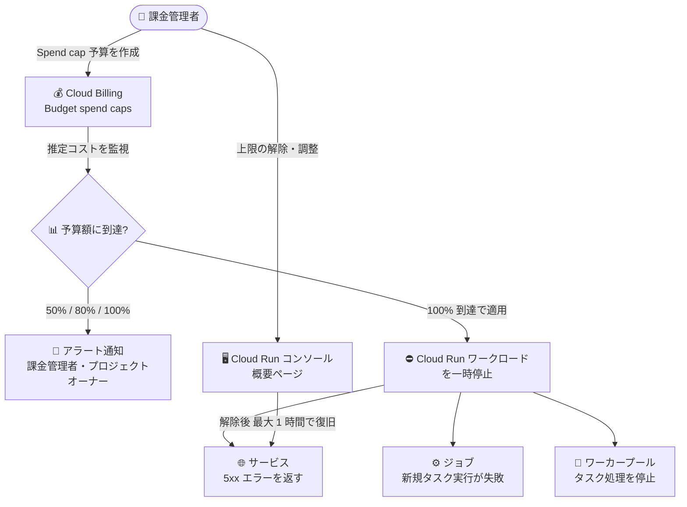

# Cloud Run: Budget spend caps によるワークロード一時停止が GA に

**リリース日**: 2026-10-12

**サービス**: Cloud Run

**機能**: Budget spend caps (予算上限によるワークロードの一時停止)

**ステータス**: GA (一般提供)

📊 [このアップデートのインフォグラフィックを見る](https://takech9203.github.io/google-cloud-news-summary/20261012-cloud-run-budget-spend-caps.html)

## 概要

Cloud Run のワークロードを予算上限 (Budget spend caps) で自動的に一時停止する機能が一般提供 (GA) になりました。Cloud Billing コンソールで Spend cap (支出上限) 付きの予算を設定すると、プロジェクト内のすべての Cloud Run リソースタイプ (サービス、ジョブ、ワーカープール) に上限が自動的に適用されます。推定コストが予算額の 100% に達すると、Google Cloud が Cloud Run ワークロードを自動的に一時停止し、それ以上のコスト発生を防ぎます。

従来の Cloud Billing の予算アラートは「通知のみ」の仕組みであり、支出を強制的に止めるハードリミットではありませんでした。今回の GA により、サーバーレスで従量課金の Cloud Run において、意図しないトラフィック急増やバグによる「コストの暴走 (runaway cost)」をプラットフォーム側で確実に止められるようになります。個人開発者、スタートアップ、検証環境を多く持つ企業など、コスト超過リスクを厳格に管理したいすべてのユーザーにとって重要なアップデートです。

支出上限の進捗は Cloud Run コンソールの概要ページから直接モニタリングでき、上限到達時にはアラート通知とコンソール上の適用バナーで通知されます。運用を再開するには、Cloud Run コンソールの概要ページから上限を解除または調整します。

**アップデート前の課題**

- Cloud Billing の予算アラートはしきい値超過時に通知を送るだけの仕組みで、ハードな支出上限ではなく、支出を自動的に止めることができなかった
- コスト超過を強制的に止めるには、予算通知をトリガーに課金を無効化するなどの独自の自動化を構築・運用する必要があった
- Cloud Run の従量課金モデルでは、予期しないトラフィック急増や無限ループなどにより、気づかないうちにコストが膨らむリスクがあった

**アップデート後の改善**

- Cloud Billing コンソールで Spend cap 付き予算を設定するだけで、プロジェクト内のすべての Cloud Run リソースタイプ (サービス、ジョブ、ワーカープール) に上限が自動適用されるようになった
- 推定コストが上限に達すると Google Cloud が自動的にワークロードを一時停止し、追加コストの発生を防止できるようになった
- 支出上限の進捗を Cloud Run コンソールの概要ページから直接確認でき、上限到達時はアラート通知と適用バナーで把握できるようになった
- 本機能が GA となり、Pre-GA (Preview) の利用条件から本番環境で安心して利用できるステータスになった

## アーキテクチャ図



Cloud Billing の Spend cap 予算が推定コストを監視し、上限到達時に Cloud Run の全リソースタイプを自動的に一時停止するフローです。復旧は Cloud Run コンソールから上限を解除するか、次の予算期間の開始時に自動で行われます。

## サービスアップデートの詳細

### 主要機能

1. **プロジェクト内の全 Cloud Run リソースタイプへの自動適用**
   - Cloud Billing コンソールで Spend cap 予算を設定すると、プロジェクト内のすべての Cloud Run リソースタイプに自動的に適用される
   - Spend cap 予算は 1 つのプロジェクトと 1 つの対象サービスの組み合わせごとに設定する

2. **上限到達時の自動一時停止**
   - サービス: 既存のサービスはトラフィックの処理に失敗し、5xx エラーを返す
   - ジョブ: 新規タスクの実行が開始できなくなり、実行中のタスクは完了に失敗する
   - ワーカープール: 既存のインスタンスがタスク処理を停止する
   - リソースやデータは削除されず、使用が一時停止されるのみ

3. **段階的なアラート通知**
   - 予算額の 50%、80%、100% 到達時に、すべての課金管理者とプロジェクトオーナーへメール通知が自動送信される (通知先・しきい値はカスタマイズ不可)
   - 上限適用時は Cloud Run コンソールと Billing コンソールに適用バナーが表示される

4. **Cloud Run コンソールからのモニタリングと解除**
   - 支出上限の進捗は Cloud Run コンソールの概要ページから直接確認できる
   - 上限の解除・調整も Cloud Run コンソールの概要ページから実行できる
   - 次の予算期間 (通常は翌月 1 日) の開始時には自動的に上限が解除され、支出額がゼロにリセットされる

## 技術仕様

### Spend cap 予算の仕様

| 項目 | 詳細 |
|------|------|
| 期間 (Time range) | 月次 (Monthly) 固定、変更不可 |
| 予算タイプ | 指定金額 (Specified amount) 固定 |
| スコープ | 1 予算につき 1 プロジェクト + 1 対象サービス |
| 判定に使うコスト | 総額の推定コスト (gross, estimated costs)。割引適用前の金額で判定されるサービスがある |
| アラート | 50% / 80% / 100% で課金管理者とプロジェクトオーナーに通知 (カスタマイズ不可) |
| 適用の即時性 | 即時ではない。レポートより高速な推定コストで判定されるが、レイテンシによる超過分は通常どおり課金される |
| 解除 | 手動解除 (同一期間内は再トリガーされない) または翌予算期間開始時の自動解除。解除後、最大 1 時間で通常動作に復旧 |
| 既存予算からの変換 | 既存のアラート専用予算を Spend cap 予算に変換することは不可 (新規作成が必要) |

### Spend cap 対象サービス

| サービス | API サービス名 |
|------|------|
| Cloud Run | run.googleapis.com |
| Cloud Run functions | cloudfunctions.googleapis.com |
| Gemini API | generativelanguage.googleapis.com |
| Gemini Enterprise Agent Platform (旧 Vertex AI) | aiplatform.googleapis.com |

### 必要な権限

Spend cap 予算の設定・編集・解除には、通常の予算管理権限に加えて以下の権限が必要です。

| レベル | 必要な権限 |
|------|------|
| 課金アカウントレベル | `billing.budgets.configureSpendCap` (課金アカウントに対して) |
| プロジェクトレベル | `billing.resourcebudgets.configureSpendCap` (プロジェクトに対して) |

事前定義ロールでは、課金アカウントに対する「Billing Account Administrator」ロール、または「Billing Account Costs Manager」+ 対象プロジェクトの「Editor」ロールの組み合わせで必要な権限が得られます。カスタムロールを使用している場合は上記権限の追加が必要です。

## 設定方法

### 前提条件

1. Cloud Billing アカウントにリンクされたプロジェクトで Cloud Run を使用していること
2. Spend cap 予算を設定できる権限 (`billing.budgets.configureSpendCap` など) を持っていること

### 手順

#### ステップ 1: 予算の作成を開始

Google Cloud コンソールで「予算とアラート (Budgets & alerts)」ページに移動し、「Create new budget」をクリックします。

#### ステップ 2: Spend cap enforcement を選択

「Define」セクションで「Alerts only」ではなく「**Spend cap enforcement**」オプションを選択し、予算名を入力します。

#### ステップ 3: スコープを設定

「Scope」セクションで、対象の **1 プロジェクト**と対象サービスとして **Cloud Run** を選択します。期間は月次 (Monthly) に固定されています。

#### ステップ 4: 上限額を設定

「Amount」セクションで上限の目標金額 (Target amount) を入力します。適用は即時ではないため、絶対的な上限よりやや低めの金額を設定することが推奨されています。

#### ステップ 5: 保存して有効化

「Actions」セクションで通知設定 (50% / 80% / 100%、自動構成) を確認し、「Finish」で保存・有効化します。以降、支出上限の進捗は Cloud Run コンソールの概要ページで確認できます。

## メリット

### ビジネス面

- **コスト超過リスクの排除**: 意図しないトラフィック急増やバグによる「コストの暴走」をプラットフォーム側で確実に停止でき、予算ガバナンスを強化できる
- **運用コストの削減**: 従来必要だった独自のコスト遮断の自動化 (予算通知 + 課金無効化処理など) の構築・保守が不要になる
- **安心なサーバーレス導入**: 従量課金への不安からサーバーレス採用をためらっていたチームでも、上限付きで Cloud Run を導入しやすくなる

### 技術面

- **全リソースタイプを一括カバー**: サービス、ジョブ、ワーカープールのすべてに 1 つの Spend cap が自動適用される
- **データは保全**: 上限適用時もリソースやデータは削除されず、使用のみが一時停止される。処理中 (in-flight) の使用は完了まで処理される
- **運用との統合**: Cloud Run コンソールの概要ページで進捗確認・解除が完結し、段階的なメール通知で事前に対処できる

## デメリット・制約事項

### 制限事項

- 上限適用時はサービスが 5xx エラーを返すため、本番ワークロードに設定する場合は可用性とのトレードオフを慎重に判断する必要がある
- 適用は即時ではなく、コストレポートのレイテンシに起因する超過分は通常どおり課金される
- 期間は月次固定、予算タイプは指定金額固定、通知先・しきい値はカスタマイズ不可
- 1 つの Spend cap 予算で指定できるのは 1 プロジェクト + 1 サービスのみ
- 既存のアラート専用予算を Spend cap 予算に変換することはできない (削除して新規作成が必要)
- VPC コネクタの VM は Compute Engine 側で課金されるため、Cloud Run の Spend cap の対象外。Egress ネットワーキングも上限でカバーしたい場合は Direct VPC egress の利用が必要

### 考慮すべき点

- 手動で上限を解除すると、その予算期間中は上限額を引き上げない限り再トリガーされない点に注意
- 上限解除後、サービスが通常動作に完全復旧するまで最大 1 時間かかる場合がある
- 判定は割引適用前の総額推定コストに基づくサービスがあるため、実際の請求額より早く上限に到達する可能性がある

## ユースケース

### ユースケース 1: 開発・検証環境のコスト上限管理

**シナリオ**: 開発者ごとに検証用プロジェクトを払い出しているが、消し忘れたワークロードや負荷テストの設定ミスにより、月末に想定外の請求が発生することがある。

**実装例**:
```
1. 各検証プロジェクトに対して Spend cap 予算を作成
   - スコープ: 検証プロジェクト + Cloud Run
   - 上限額: 月額 50 ドル (絶対上限より低めに設定)
2. 50% / 80% の通知メールで開発者に注意喚起
3. 100% 到達で Cloud Run ワークロードが自動停止
```

**効果**: 検証環境のコストが設定した上限付近で確実に止まり、消し忘れによる請求事故を防止できる。リソース自体は削除されないため、翌月または上限解除後に検証を再開できる。

### ユースケース 2: 個人開発・スモールビジネスの Web サービス

**シナリオ**: 個人開発の Web アプリを Cloud Run で公開しているが、SNS でのバズや DDoS 的なアクセスで従量課金が青天井になることが不安で、支払い可能な金額に上限を設けたい。

**効果**: 推定コストが上限に達した時点でサービスが自動停止するため、支払い能力を超える請求を回避できる。トラフィックが正当なものであれば、Cloud Run コンソールから上限を引き上げて即座にサービスを再開できる。

## 料金

Budget spend caps は Cloud Billing の予算機能として提供され、Cloud Run 自体の料金体系に変更はありません。以下の点に注意が必要です。

- コストレポートのレイテンシに起因する超過分は通常どおり課金される
- 上限適用中も、サービスの保持に必要な固定費は通常どおり課金される

Cloud Run の料金詳細は [Cloud Run の料金ページ](https://cloud.google.com/run/pricing) を参照してください。

## 関連サービス・機能

- **Cloud Billing (予算とアラート)**: Spend cap 予算の作成・管理を行う基盤。従来のアラート専用予算 (通知のみ) と Spend cap 予算 (強制停止) を使い分けられる
- **Cloud Run functions**: Cloud Run と並んで Spend cap の対象サービス (cloudfunctions.googleapis.com)。関数ワークロードにも同様の上限を設定可能
- **Gemini API / Gemini Enterprise Agent Platform**: Spend cap の対象サービス。AI ワークロードのコスト暴走対策にも利用できる
- **Direct VPC egress**: VPC コネクタの VM は Spend cap の対象外のため、Egress ネットワーキングを上限でカバーしたい場合に使用する
- **Cost Explorer / Recommender**: コストの内訳分析や課金設定 (リクエストベース/インスタンスベース) の最適化推奨など、Spend cap と組み合わせて使えるコスト管理ツール

## 参考リンク

- 📊 [インフォグラフィック](https://takech9203.github.io/google-cloud-news-summary/20261012-cloud-run-budget-spend-caps.html)
- [公式リリースノート](https://docs.cloud.google.com/release-notes#October_12_2026)
- [ドキュメント: Create, edit, or delete spend cap budgets](https://docs.cloud.google.com/billing/docs/how-to/budgets-spend-caps)
- [ドキュメント: Cloud Run billing settings (Budget spend caps)](https://docs.cloud.google.com/run/docs/configuring/billing-settings)
- [ドキュメント: Cloud Run services cost optimization](https://docs.cloud.google.com/run/docs/tips/services-cost-optimization)
- [料金ページ](https://cloud.google.com/run/pricing)

## まとめ

Budget spend caps の GA により、Cloud Run の従量課金で長年の懸念だった「コストの暴走」をプラットフォーム標準の仕組みで確実に止められるようになりました。まずは開発・検証環境や個人プロジェクトなど、停止による影響が小さいワークロードから Spend cap 予算を設定し、適用レイテンシを考慮して上限額を絶対上限より低めに設定することを推奨します。本番環境では 5xx エラーによる可用性への影響を踏まえ、アラート専用予算との使い分けを検討してください。

---

**タグ**: Cloud Run, Cloud Billing, Budget spend caps, コスト管理, FinOps, サーバーレス, GA
