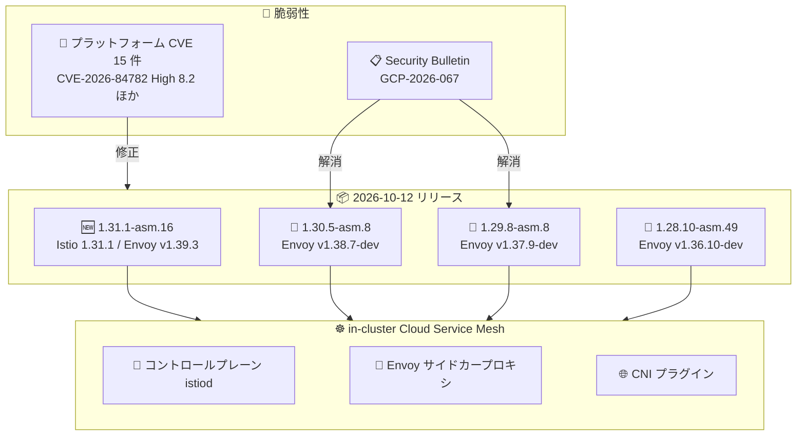

# Cloud Service Mesh: in-cluster 向け 1.31.1-asm.16 リリースとセキュリティパッチ (1.30 / 1.29 / 1.28)

**リリース日**: 2026-10-12

**サービス**: Cloud Service Mesh (in-cluster)

**機能**: 新バージョン 1.31.1-asm.16 の提供開始、および GCP-2026-067 対応を含むセキュリティパッチリリース

**ステータス**: Announcement / Security Fix

📊 [このアップデートのインフォグラフィックを見る](https://takech9203.github.io/google-cloud-news-summary/20261012-cloud-service-mesh-security-patch-releases.html)

## 概要

2026 年 10 月 12 日、in-cluster (クラスタ内コントロールプレーン) 型の Cloud Service Mesh について、4 つのバージョンが同時にリリースされました。新マイナーバージョンとなる 1.31.1-asm.16 は Istio 1.31.1 の機能を取り込んだ最新リリースで、Envoy v1.39.3 を使用します。あわせて既存のサポート対象バージョン向けに 1.30.5-asm.8 (Envoy v1.38.7-dev)、1.29.8-asm.8 (Envoy v1.37.9-dev)、1.28.10-asm.49 (Envoy v1.36.10-dev) のパッチが提供されました。

今回のパッチリリースの最大のポイントはセキュリティ対応です。1.30.5-asm.8 と 1.29.8-asm.8 はセキュリティ情報 (Security Bulletin) GCP-2026-067 に記載された脆弱性を解消します。さらに全パッチバージョンで、CVE-2026-84782 (High、スコア 8.2) を含む 15 件のプラットフォーム CVE が修正されています。修正対象のコンポーネントはプロキシ (Envoy サイドカー)、コントロールプレーン (istiod)、CNI で、Distroless イメージは影響を受けません。

in-cluster Cloud Service Mesh を自己管理で運用しているユーザー (特に Google Distributed Cloud (software only) 環境) は、セキュリティリスク低減のため、各マイナーバージョンの最新パッチへの早期アップグレードが推奨されます。

**アップデート前の課題**

- 1.30 / 1.29 系の既存バージョンには、Security Bulletin GCP-2026-067 に記載された脆弱性が存在していた
- プロキシ、コントロールプレーン、CNI の各コンポーネントに CVE-2026-84782 (High 8.2) をはじめとする複数のプラットフォーム CVE が未修正のまま残っていた
- Istio 1.31 系の機能を in-cluster Cloud Service Mesh で利用することができなかった

**アップデート後の改善**

- 1.30.5-asm.8 / 1.29.8-asm.8 へのアップグレードにより GCP-2026-067 の脆弱性が解消された
- 全パッチバージョン (1.31.1-asm.16 / 1.30.5-asm.8 / 1.29.8-asm.8 / 1.28.10-asm.49) で 15 件のプラットフォーム CVE が修正された
- 1.31.1-asm.16 により、Istio 1.31.1 の機能 (サポート対象機能リストに準拠) が in-cluster Cloud Service Mesh で利用可能になった

## アーキテクチャ図



Security Bulletin GCP-2026-067 の脆弱性と 15 件のプラットフォーム CVE が、4 つのパッチリリースによって修正され、メッシュを構成するコントロールプレーン・プロキシ・CNI の各コンポーネントに適用されます (Distroless イメージは影響なし)。

## サービスアップデートの詳細

### 主要機能

1. **1.31.1-asm.16 の提供開始 (新マイナーバージョン)**
   - Istio 1.31.1 の機能を、サポート対象機能リストの範囲で利用可能
   - Envoy v1.39.3 を使用
   - 一部の Istio 1.31 機能は非サポート (後述の技術仕様を参照)

2. **1.30.5-asm.8 / 1.29.8-asm.8 (セキュリティパッチ)**
   - Security Bulletin GCP-2026-067 に記載された脆弱性を解消
   - それぞれ Envoy v1.38.7-dev / v1.37.9-dev を使用
   - 15 件のプラットフォーム CVE 修正を含む

3. **1.28.10-asm.49 (セキュリティパッチ)**
   - Envoy v1.36.10-dev を使用
   - 15 件のプラットフォーム CVE 修正を含む
   - 1.28 系は最短 EOL が 2026 年 10 月 19 日に迫っているため、1.29 以降への計画的なアップグレードを推奨

## 技術仕様

### 修正されたプラットフォーム CVE (全パッチ共通)

影響コンポーネント: プロキシ = Yes、コントロールプレーン = Yes、Distroless = No、CNI = Yes

| CVE | 深刻度 (スコア) |
|------|------|
| CVE-2026-18924 | Medium (9.1) |
| CVE-2026-82474 | Medium (8.5) |
| CVE-2026-82209 | Medium (8.2) |
| CVE-2026-84782 | **High (8.2)** |
| CVE-2026-96512 | Medium (7.8) |
| CVE-2026-80230 | Medium (7.5) |
| CVE-2026-13608 | Medium (7.4) |
| CVE-2026-15534 | Medium (5.7) |
| CVE-2026-19487 | Medium (5.3) |
| CVE-2026-35189 | Low (5.3) |
| CVE-2026-75805 | Low (5.3) |
| CVE-2026-75806 | Low (5.3) |
| CVE-2026-54872 | Low (3.7) |
| CVE-2026-77696 | Low (3.7) |
| CVE-2026-0799 | Medium (0.0) |

### リリースバージョンと Envoy バージョンの対応

| Cloud Service Mesh バージョン | Envoy バージョン | GCP-2026-067 対応 |
|------|------|------|
| 1.31.1-asm.16 | v1.39.3 | - (新規リリース) |
| 1.30.5-asm.8 | v1.38.7-dev | 解消 |
| 1.29.8-asm.8 | v1.37.9-dev | 解消 |
| 1.28.10-asm.49 | v1.36.10-dev | - |

### 1.31.1-asm.16 で非サポートの Istio 1.31 機能

- `PILOT_NODE_UNTAINT_CONTROLLERS_TAINT_NAME`
- `HTTPRedirect` の `prefix_rewrite` フィールド
- `outboundTrafficPolicy` の `ALLOW_ANY_DYNAMIC_DNS`
- `ProxyConfig` の `connectionSettings`
- `MeshConfig` の `defaultTrafficPolicy`
- `DestinationRule` / `MeshConfig` の `zoneAwareLbSetting`
- `AuthorizationPolicy` の `source` 内 `trustDomains` / `notTrustDomains` フィールド
- `COMPLIANCE_POLICY` の `fips-140-3`
- `PILOT_ENABLE_REMOTE_CREDENTIALS_CONTROLLER`
- ゲートウェイ向け External SDS プロバイダ
- `PILOT_AGENT_MERGE_ENVOY_STATS`
- `prometheus.istio.io/scrape-targets`
- `ENVOY_SECURE_METRICS_PORT` / `ENVOY_SECURE_MERGED_METRICS_PORT`
- `istioctl manifest generate` の `-o/--output` オプション

## 設定方法

### 前提条件

1. 自己管理の in-cluster Cloud Service Mesh (Istio API) を利用していること
2. サポートされるアップグレード元バージョンであること (公式ドキュメントによると、1.30 系へは 1.28 以降から直接アップグレード可能)
3. インストール時のカスタマイズ (`--set` 値) がある場合は、同じ内容の overlay ファイル (`--custom_overlay`) を用意していること

### 手順

#### ステップ 1: asmcli で新しいコントロールプレーンのリビジョンをインストール

```bash
./asmcli install \
  --project_id PROJECT_ID \
  --cluster_name CLUSTER_NAME \
  --cluster_location CLUSTER_LOCATION \
  --fleet_id FLEET_PROJECT_ID \
  --output_dir DIR_PATH \
  --enable_all \
  --ca mesh_ca
```

カナリアアップグレードでは、既存のコントロールプレーンと並行して新しいリビジョンがインストールされます。それぞれのコントロールプレーンはリビジョンラベルで識別されます。

#### ステップ 2: ワークロードを新しいコントロールプレーンへ移行

```bash
# 新しいリビジョンラベルを namespace に設定
kubectl label namespace NAMESPACE istio.io/rev=REVISION --overwrite

# ローリング再起動でサイドカーを再注入
kubectl rollout restart deployment -n NAMESPACE
```

ローリング再起動によりサイドカープロキシが再注入され、新しいコントロールプレーンに接続されます。動作確認後に全トラフィックを新コントロールプレーンへ移行するか、問題があれば旧コントロールプレーンへロールバックできます。

## メリット

### ビジネス面

- **セキュリティリスクの低減**: GCP-2026-067 の脆弱性と High 深刻度を含む 15 件の CVE が解消され、コンプライアンス要件への対応が容易になる
- **サポート継続性の確保**: 最新パッチへの追従により、n-2 マイナーバージョンというサポートポリシーの範囲内で安全に運用を継続できる

### 技術面

- **カナリアアップグレードによる安全な移行**: 新旧コントロールプレーンを並行稼働させ、namespace 単位で段階的に移行・ロールバックが可能
- **Istio 1.31.1 の機能を利用可能**: 1.31.1-asm.16 により、サポート対象機能リストの範囲で最新の Istio 機能を in-cluster 環境で利用できる

## デメリット・制約事項

### 制限事項

- 1.31.1-asm.16 では Istio 1.31 の一部機能 (zoneAwareLbSetting、External SDS プロバイダなど) が非サポート
- CVE 修正は Distroless イメージには適用されない (影響を受けないため)
- GKE on Google Cloud 上の ISTIOD コントロールプレーンを使った in-cluster Cloud Service Mesh は非推奨 (deprecated) であり、Google Distributed Cloud (software only) での利用が引き続きサポートされる

### 考慮すべき点

- アップグレード時はサイドカーの再注入 (Pod のローリング再起動) が必要であり、ワークロードの再起動計画が必要
- インストール時のカスタマイズがある場合、overlay ファイルを指定しないとデフォルト設定に戻ってしまう
- 1.28 系は最短 EOL (2026 年 10 月 19 日) が目前のため、1.28.10-asm.49 の適用は暫定対応とし、1.29 以降への移行を計画すべき

## ユースケース

### ユースケース 1: GCP-2026-067 への緊急対応

**シナリオ**: Google Distributed Cloud (software only) 上で in-cluster Cloud Service Mesh 1.30 系を運用しており、Security Bulletin GCP-2026-067 の脆弱性への対応が必要。

**実装例**:
```bash
# 現在のバージョンを確認
istioctl version

# カナリアアップグレードで 1.30.5-asm.8 を導入
./asmcli install --project_id PROJECT_ID --cluster_name CLUSTER_NAME \
  --cluster_location CLUSTER_LOCATION --fleet_id FLEET_PROJECT_ID \
  --output_dir ./asm-output --enable_all --ca mesh_ca
```

**効果**: マイナーバージョンを変えずにパッチ適用のみで脆弱性を解消でき、アプリケーションへの影響を最小化しながらセキュリティリスクを除去できる。

### ユースケース 2: 1.28 系からの計画的なバージョンアップ

**シナリオ**: 1.28 系を運用中だが EOL (最短 2026 年 10 月 19 日) が迫っており、サポート継続のためにバージョンアップが必要。

**効果**: まず 1.28.10-asm.49 で CVE を解消して時間を確保しつつ、カナリアアップグレードで 1.29 / 1.30 系へ段階的に移行することで、サポートポリシー (n-2 マイナーバージョン) の範囲内で安全に運用を継続できる。

## 料金

今回のパッチリリース自体による追加料金はありません。Cloud Service Mesh の料金詳細は公式料金ページを参照してください。

- [Cloud Service Mesh の料金](https://cloud.google.com/service-mesh/pricing)

## 利用可能リージョン

in-cluster Cloud Service Mesh は自己管理型のため、クラスタが稼働する環境 (Google Distributed Cloud (software only) for VMware / bare metal など、サポート対象プラットフォーム) で利用できます。詳細は[サポート対象プラットフォーム](https://docs.cloud.google.com/service-mesh/docs/supported-platforms)を参照してください。

## 関連サービス・機能

- **GKE (Google Kubernetes Engine)**: Cloud Service Mesh が稼働する基盤。GKE on Google Cloud では managed Cloud Service Mesh への移行が推奨される
- **Google Distributed Cloud (software only)**: in-cluster コントロールプレーンが引き続きサポートされる主要プラットフォーム
- **GKE Enterprise / Fleet**: asmcli によるインストールではクラスタの Fleet 登録と fleet workload identity を利用
- **Cloud Service Mesh certificate authority (Mesh CA)**: mTLS 証明書を発行するマネージド CA。アップグレード時に `--ca mesh_ca` で指定

## 参考リンク

- 📊 [インフォグラフィック](https://takech9203.github.io/google-cloud-news-summary/20261012-cloud-service-mesh-security-patch-releases.html)
- [公式リリースノート](https://docs.cloud.google.com/release-notes#October_12_2026)
- [Cloud Service Mesh セキュリティ情報 (Security Bulletins)](https://docs.cloud.google.com/service-mesh/docs/security-bulletins)
- [Cloud Service Mesh のアップグレード](https://docs.cloud.google.com/service-mesh/docs/upgrade/upgrade)
- [in-cluster コントロールプレーンのサポート対象機能](https://docs.cloud.google.com/service-mesh/docs/supported-features-in-cluster)
- [料金ページ](https://cloud.google.com/service-mesh/pricing)

## まとめ

今回のリリースは、新マイナーバージョン 1.31.1-asm.16 の提供と、GCP-2026-067 および High 深刻度の CVE-2026-84782 を含む 15 件のプラットフォーム CVE を修正するセキュリティパッチの一斉提供です。in-cluster Cloud Service Mesh を運用しているチームは、まず現在のバージョンを確認し、該当するマイナーバージョンの最新パッチへカナリアアップグレードで速やかに更新することを推奨します。あわせて、EOL が迫る 1.28 系からの移行計画と、GKE on Google Cloud 利用者は managed Cloud Service Mesh への移行検討も進めてください。

---

**タグ**: Cloud Service Mesh, Istio, Envoy, セキュリティ, CVE, GCP-2026-067, アップグレード, GKE, サービスメッシュ
