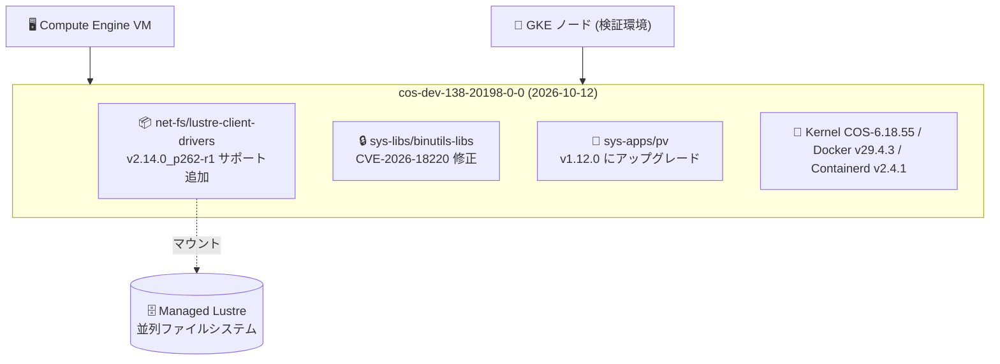

# Container-Optimized OS (COS): Lustre クライアント更新・binutils-libs の CVE 修正・pv アップグレード

**リリース日**: 2026-10-12

**サービス**: Container-Optimized OS (COS)

**機能**: Lustre クライアントドライバ v2.14.0_p262-r1 サポート、CVE-2026-18220 修正 (sys-libs/binutils-libs)、sys-apps/pv v1.12.0 へのアップグレード

**ステータス**: Available (Fixed / Security)

📊 [このアップデートのインフォグラフィックを見る](https://takech9203.github.io/google-cloud-news-summary/20261012-container-optimized-os-image-updates.html)

## 概要

2026 年 10 月 12 日、Google Cloud は Container-Optimized OS (COS) の新しいイメージリリースを公開した。Google Cloud 全体のリリースノートに記載されたのは、(1) Lustre クライアントドライバ (net-fs/lustre-client-drivers) v2.14.0_p262-r1 のサポート追加、(2) sys-libs/binutils-libs における CVE-2026-18220 の修正、(3) sys-apps/pv の v1.12.0 へのアップグレード、の 3 点である。

COS の dev チャネルのリリースノートを確認すると、これらの変更は dev チャネルの新イメージ **cos-dev-138-20198-0-0** (Kernel: COS-6.18.55、Docker: v29.4.3、Containerd: v2.4.1) に含まれるものである。同イメージには、このほかにも Linux カーネル v6.18.55 への更新、runc v1.5.2 へのアップグレード、sys-libs/glibc の CVE-2026-5450 修正、ARM64 向け Arm CCA Confidential VM のゲスト認証をサポートする CONFIG_ARM_CCA_GUEST の有効化などの変更が含まれている。

本アップデートの対象ユーザーは、Compute Engine VM や GKE ノードで COS を使用しているユーザー、特に次期マイルストーン (COS 138) の検証を dev チャネルで行っているユーザーである。Lustre クライアントドライバの更新は、Google Cloud Managed Lustre などの Lustre ファイルシステムを COS ノードからマウントする AI/ML・HPC ワークロードに関係する。

**アップデート前の課題**

- sys-libs/binutils-libs に CVE-2026-18220 の脆弱性が存在していた
- Lustre クライアントドライバは v2.14.0_p262 までのサポートであり、v2.14.0_p262-r1 に対応していなかった
- sys-apps/pv (Pipe Viewer) が旧バージョンのままだった

**アップデート後の改善**

- sys-libs/binutils-libs の CVE-2026-18220 が修正され、セキュリティリスクが軽減された
- Lustre クライアントドライバ v2.14.0_p262-r1 がサポートされ、最新のクライアントドライバリビジョンを利用できるようになった
- sys-apps/pv が v1.12.0 にアップグレードされた

## アーキテクチャ図



今回のアップデートは dev チャネルの新イメージとして提供され、Lustre クライアントドライバの更新により Managed Lustre などの Lustre ファイルシステムへの接続に関わるコンポーネントが最新化される。

## サービスアップデートの詳細

### 主要機能

1. **Lustre クライアントドライバ v2.14.0_p262-r1 のサポート追加 (Fixed)**
   - net-fs/lustre-client-drivers パッケージの新リビジョン v2.14.0_p262-r1 がサポートされた
   - Lustre は AI/ML や HPC ワークロードで使用される高性能並列ファイルシステムであり、COS は Google Cloud Managed Lustre のクライアントとしても利用される
   - 同イメージでは v2.14.0_p262 のサポートも併せて追加されている

2. **CVE-2026-18220 の修正 (Security)**
   - sys-libs/binutils-libs (GNU Binutils の共有ライブラリ群) に存在していた脆弱性 CVE-2026-18220 が修正された
   - binutils-libs はオブジェクトファイルやバイナリの操作に使用される基盤ライブラリであり、OS イメージの更新により修正が適用される

3. **sys-apps/pv の v1.12.0 へのアップグレード (Fixed)**
   - パイプラインを流れるデータの進捗を監視するユーティリティ pv (Pipe Viewer) が v1.12.0 に更新された

### 同一イメージに含まれるその他の主な変更 (cos-dev-138-20198-0-0)

COS dev チャネルのリリースノートで確認できた、同日の同イメージに含まれる主な変更は以下のとおり。

- Linux カーネルを v6.18.55 に更新
- app-containers/runc / runc-test を v1.5.2 にアップグレード
- sys-libs/glibc の CVE-2026-5450 を修正
- ARM64 向けに CONFIG_ARM_CCA_GUEST を有効化し、Arm CCA Confidential VM でのゲスト認証をサポート
- cos-gpu-installer のデフォルトバージョンを v2.7.9 に更新
- idpf ドライバに "watchdog_timeout" モジュールパラメータを追加
- dev-libs/expat v2.8.5、dev-libs/libgcrypt v1.12.4、dev-libs/libpcre2 v10.49、dev-python/oauthlib v4.0.0、sys-apps/xemu v0.0.11、app-admin/google-guest-configs v20260928.00、app-admin/oslogin v20260924.00 などのパッケージ更新

## 技術仕様

### cos-dev-138-20198-0-0 のコンポーネントバージョン

| 項目 | 詳細 |
|------|------|
| イメージ名 | cos-dev-138-20198-0-0 |
| イメージファミリ | cos-dev |
| Kernel | COS-6.18.55 |
| Docker | v29.4.3 |
| Containerd | v2.4.1 |
| Lustre クライアントドライバ | v2.14.0_p262-r1 / v2.14.0_p262 サポート |
| pv | v1.12.0 |

## 設定方法

### 前提条件

1. Compute Engine または GKE で Container-Optimized OS イメージを使用していること
2. cos-dev ファミリは検証用チャネルであり、本番環境では LTS ファミリ (`cos-[MILESTONE]-lts`) を使用すること

### 手順

#### ステップ 1: 最新 dev イメージの確認

```bash
gcloud compute images describe-from-family cos-dev \
  --project=cos-cloud
```

#### ステップ 2: 新イメージで検証用 VM を作成

```bash
gcloud compute instances create my-cos-dev-instance \
  --image=cos-dev-138-20198-0-0 \
  --image-project=cos-cloud \
  --zone=us-central1-a
```

dev チャネルは次期マイルストーンの機能をいち早く検証するためのチャネルである。今回の修正内容は、今後の beta / LTS リリースにも順次取り込まれていく。

## メリット

### ビジネス面

- **セキュリティリスクの低減**: 基盤ライブラリである binutils-libs の CVE-2026-18220 が修正され、脆弱性スキャンやコンプライアンス要件への対応が容易になる
- **次期 LTS への移行準備**: dev チャネル (COS 138) で最新カーネル・ランタイム構成を事前検証でき、将来の LTS 移行をスムーズに進められる

### 技術面

- **Lustre クライアントの最新化**: Lustre クライアントドライバ v2.14.0_p262-r1 がサポートされ、Managed Lustre などを利用する AI/ML・HPC ワークロードで最新のクライアントリビジョンを使用できる
- **ユーティリティの更新**: pv v1.12.0 への更新により、データ転送監視ユーティリティが最新化される

## デメリット・制約事項

### 制限事項

- cos-dev ファミリは検証用であり、本番ワークロードでの使用は推奨されない
- CVE-2026-18220 の深刻度や影響範囲の詳細は、リリースノート上では公開されていない

### 考慮すべき点

- COS イメージの更新には VM の再作成 (GKE の場合はノードの再作成) が伴うため、計画的なロールアウトが必要
- Managed Lustre を GKE から利用する場合は、ノードへのドライバ手動インストールは不要であり、Managed Lustre CSI ドライバ経由での利用が推奨される (COS ノードは GKE 1.33.2-gke.1111000 以降の x86_64、1.34.1-gke.2541000 以降の ARM でサポート)

## ユースケース

### ユースケース 1: 脆弱性スキャン指摘への対応

**シナリオ**: セキュリティチームの脆弱性スキャンで、COS ノードの binutils-libs に CVE-2026-18220 が検出された。

**効果**: CVE-2026-18220 の修正を含む COS イメージへ更新することで該当 CVE が解消され、スキャンアラートをクローズできる。dev チャネル利用環境では cos-dev-138-20198-0-0 以降を使用する。

### ユースケース 2: Lustre を使う AI/ML ワークロードの事前検証

**シナリオ**: Managed Lustre をストレージとして使う AI/ML 基盤を運用しており、次期 COS マイルストーン (COS 138) での動作を事前に確認したい。

**効果**: 最新の Lustre クライアントドライバ (v2.14.0_p262-r1) とカーネル v6.18 系を含む dev イメージで互換性検証を行い、将来の LTS 昇格時の移行リスクを低減できる。

## 料金

Container-Optimized OS 自体は無料で利用でき、イメージ更新に伴う追加料金は発生しない。COS を実行する Compute Engine VM や GKE ノードの料金が通常どおり適用される。

- [Compute Engine の料金](https://cloud.google.com/compute/pricing)
- [GKE の料金](https://cloud.google.com/kubernetes-engine/pricing)

## 関連サービス・機能

- **Google Cloud Managed Lustre**: COS に含まれる Lustre クライアントドライバで接続する高性能並列ファイルシステム。AI/ML・HPC ワークロード向け
- **Google Kubernetes Engine (GKE)**: COS は GKE ノードのデフォルトイメージ。Managed Lustre CSI ドライバにより、COS ノードから手動のドライバインストールなしで Lustre ボリュームをマウントできる
- **Compute Engine**: COS イメージ (cos-cloud プロジェクト) を直接指定して VM を作成できる
- **Security Command Center**: 脆弱なイメージを使用しているインスタンスの特定と CVE 状態の一元管理に使用

## 参考リンク

- 📊 [インフォグラフィック](https://takech9203.github.io/google-cloud-news-summary/20261012-container-optimized-os-image-updates.html)
- [公式リリースノート](https://docs.cloud.google.com/release-notes#October_12_2026)
- [COS dev チャネル リリースノート](https://cloud.google.com/container-optimized-os/docs/release-notes/dev)
- [COS バージョニングとライフサイクル](https://cloud.google.com/container-optimized-os/docs/concepts/versioning)
- [Managed Lustre CSI ドライバの概要](https://docs.cloud.google.com/kubernetes-engine/docs/concepts/managed-lustre)

## まとめ

今回のアップデートは、COS dev チャネルの新イメージ cos-dev-138-20198-0-0 として提供される、binutils-libs の CVE-2026-18220 修正、Lustre クライアントドライバ v2.14.0_p262-r1 サポート、pv v1.12.0 更新を中心としたメンテナンスリリースである。dev チャネルは検証用途であるため本番への直接の影響は限定的だが、これらの修正は今後 beta / LTS マイルストーンにも展開されるため、脆弱性管理を行うチームや Managed Lustre を利用する AI/ML・HPC 基盤の運用者は内容を把握しておくとよい。

---

**タグ**: #ContainerOptimizedOS #COS #Security #CVE #Lustre #ManagedLustre #GKE #ComputeEngine #DevChannel
