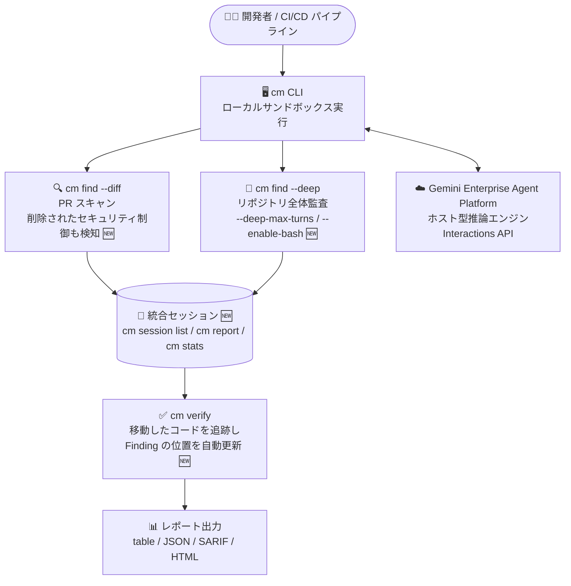

# Gemini Enterprise Agent Platform: CodeMender v0.14.0 アップデート

**リリース日**: 2026-10-12

**サービス**: Gemini Enterprise Agent Platform (CodeMender)

**機能**: CodeMender v0.14.0 (プルリクエストスキャン強化・セッション統合・ガイド付きアクティベーション)

**ステータス**: Fixed / Changed (CodeMender 自体は Preview)

📊 [このアップデートのインフォグラフィックを見る](https://takech9203.github.io/google-cloud-news-summary/20261012-gemini-enterprise-agent-platform-codemender-v0-14-0.html)

## 概要

Gemini Enterprise Agent Platform 上で提供される AI コードセキュリティエージェント「CodeMender」が v0.14.0 にアップデートされた。CodeMender は、コードベースの脆弱性をスキャン (`cm find`)、検証 (`cm verify`)、修正 (`cm fix`) する自律型エージェントで、推論エンジンは Google Cloud 側でホストされ、コードの読み取りや PoC (概念実証) エクスプロイトの実行はローカルの `cm` CLI サンドボックス内で行われるローカルファースト設計を採用している。

v0.14.0 では、CI/CD パイプラインでのプルリクエスト審査に使われる `cm find --diff` が「削除されたセキュリティ制御」を検知できるようになり、大きなファイルに対するタイムアウトも `--diff-job-timeout` で調整可能になった。また、`--deep` スキャンと `--diff` スキャンが `cm session list`、`cm report`、`cm stats` 上で単一セッションとして統合表示されるようになり、セッション管理の見通しが大きく改善された。さらに、`cm verify` がスキャン後に移動したコードを追跡して Finding の位置情報を自動更新するなど、スキャンから検証までのワークフロー全体の精度と使い勝手が向上している。

CodeMender を CI/CD のプルリクエストゲートや定期的なセキュリティ監査に組み込んでいる開発チーム・セキュリティチームにとって、誤検知の削減と運用の簡素化につながるアップデートである。

**アップデート前の課題**

- `cm find --diff` は変更された行とその依存関係を検査するものの、セキュリティ制御 (バリデーションや認可チェックなど) が「削除」されたケースの検知が不十分だった
- 大きなファイルのスキャンがタイムアウトしやすく、タイムアウト時間を調整する手段がなかった
- `--deep` スキャンと `--diff` スキャンがセッション管理上は別々に扱われ、`cm session list` や `cm report`、`cm stats` での横断的な把握がしづらかった
- `cm find` の実行後にコードがリファクタリング等で移動すると、`cm verify` が Finding の位置を見失うことがあった
- CLI が未アクティベート状態の場合、エラーで終了するだけで、ユーザーが自分でアクティベーションページを探す必要があった
- ネストされたシンボリックリンク経由のリポジトリでスキャンが失敗する、存在しないファイルに対する Finding が生成される、複数の Finding が過剰にマージされるといった不具合があった

**アップデート後の改善**

- `cm find --diff` が削除されたセキュリティ制御を検知できるようになり、プルリクエストでの「保護の後退」を見逃しにくくなった
- `--diff-job-timeout` フラグで大きなファイルへの処理時間を設定可能になった
- `--deep` / `--diff` スキャンが `cm session list`、`cm report`、`cm stats` で単一セッションとして表示され、セッション管理が統合された
- `cm verify` が `cm find` 以降に移動したコードを発見し、Finding の位置情報を自動更新するようになった
- 未アクティベート時は CLI がアクティベーションページを自動で開き、アクティベーション完了を待機するガイド付きフローになった
- `--deep-max-turns` (ファイルごとの探索ステップ数の上限) と `--enable-bash` (スキャン中のシェルコマンド実行許可) の新フラグが追加された
- ファイルごとの Finding の分離精度が向上し、脆弱なハッシュ・乱数生成に対する CWE 分類がより正確になった

## アーキテクチャ図



v0.14.0 では、`--diff` と `--deep` の両スキャンが単一セッションとして統合管理され、`cm verify` がコード移動後も Finding の位置を正しく追跡できるようになった。推論は Gemini Enterprise Agent Platform 側で、コードの読み取りや検証はローカルサンドボックスで実行される。

## サービスアップデートの詳細

### 主要機能

1. **プルリクエストスキャンの強化 (`cm find --diff`)**
   - 削除されたセキュリティ制御 (security controls) を検知できるようになった。従来の「追加されたコードの脆弱性検知」に加え、変更によって既存の防御が取り除かれる「後退」も捕捉する
   - 大きなファイルにはより長い処理時間が与えられるようになり、`--diff-job-timeout` フラグでタイムアウトを設定可能

2. **セッションの統合 (Unified sessions)**
   - `--deep` と `--diff` のスキャンが `cm session list`、`cm report`、`cm stats` 上で単一セッションとして表示される
   - スキャンモードをまたいだ Finding の確認・集計・レポート出力が一元化され、運用の見通しが向上

3. **`cm verify` でのコード移動追跡**
   - `cm find` の実行後にリファクタリング等でコードが移動していても、`cm verify` が移動先を特定し Finding の位置情報を更新する
   - スキャンと検証の間に開発が進んでも、Finding が「迷子」にならない

4. **ガイド付きアクティベーション**
   - 未アクティベート状態で `cm` を実行すると、エラー終了する代わりにアクティベーションページを自動で開き、アクティベーション完了を待機する

5. **`cm find` の新フラグ**
   - `--deep-max-turns`: `--deep` スキャンにおけるファイルごとの探索ステップ数を制限
   - `--enable-bash`: スキャン中のシェルコマンド実行を許可

6. **検知精度の向上**
   - ファイルごとに、より明確に分離された Finding を生成
   - 脆弱なハッシュ (weak hashing) と乱数生成 (randomness) に対する CWE 分類がより正確になった

7. **バグ修正**
   - ネストされたシンボリックリンク経由で到達するリポジトリのスキャンが失敗する問題を修正
   - 存在しないファイルに対する Finding と、過剰にマージされた Finding を修正
   - `cm verify` が生成するシェルスクリプトが実行可能 (executable) になった

## 技術仕様

### CodeMender の基本アーキテクチャ

| 項目 | 詳細 |
|------|------|
| 実行モデル | ローカルファースト (推論は Google Cloud 側、コード読み取り・ビルド・PoC 実行はローカルサンドボックス) |
| バックエンド | Gemini Enterprise Agent Platform の Interactions API |
| 既定モデル | `gemini-3.8-flash` (`gemini-3.8-flash-cyber` も選択可) |
| スキャンモード | Standard (`cm find PATH`) / Diff (`cm find --diff`) / Deep (`cm find --deep`) |
| Finding の状態 | OPEN / FIXED / DISMISSED / REOPENED |
| 重大度レベル | CRITICAL / HIGH / MEDIUM / LOW |
| レポート出力形式 | table / JSON / SARIF v2.1.0 / HTML / Markdown |
| セッション管理 | ローカル SQLite (`state.db`) によるステートフルセッション |

### `cm find` の主要フラグ (v0.14.0 時点)

| フラグ | モード | 説明 |
|--------|--------|------|
| `--diff[=REF]` | Diff | 対象リファレンス (例: `origin/main`) との差分をスキャン |
| `--diff-job-timeout` | Diff | 大きなファイルのスキャンジョブのタイムアウトを設定 (v0.14.0 新規) |
| `--staged` | Diff | ステージ済みの変更のみを対象 (pre-commit 用) |
| `--fail-on SEVERITIES` | Diff | 指定した重大度の検出時に終了コード 1 を返す (既定: `CRITICAL,HIGH`) |
| `--deep` | Deep | リポジトリ全体の網羅的スキャン |
| `--deep-workers COUNT` | Deep | Deep スキャンの並列ワーカー数 (1〜16、既定: 8) |
| `--deep-max-turns` | Deep | ファイルごとの探索ステップ数を制限 (v0.14.0 新規) |
| `--enable-bash` | 共通 | スキャン中のシェルコマンド実行を許可 (v0.14.0 新規) |
| `--model MODEL_NAME` | 共通 | 使用する Gemini モデル (`gemini-3.8-flash` / `gemini-3.8-flash-cyber`) |

## 設定方法

### 前提条件

1. Google Cloud プロジェクトで以下の API を有効化
   - Vertex AI API (`aiplatform.googleapis.com`)
   - Cloud Resource Manager API (`cloudresourcemanager.googleapis.com`)
2. IAM ロール **Vertex AI User** (`roles/aiplatform.user`) の付与
3. CodeMender は Public Preview のため、利用には対象顧客としてのアクセスが必要

### 手順

#### ステップ 1: CodeMender CLI のインストール (Linux x86_64 の例)

```bash
gcloud artifacts generic download \
  --project=cmoc-prod \
  --location=us \
  --repository=codemender-cli-production \
  --package=cm \
  --version=stable \
  --name=cm-linux-amd64.zip \
  --destination=./

unzip cm-linux-amd64.zip
chmod +x cm
sudo mv cm /usr/local/bin/cm
```

CLI バイナリは Artifact Registry でホストされている。v0.14.0 からは、未アクティベート時に `cm` がアクティベーションページを自動で開き、完了を待機する。

#### ステップ 2: プルリクエストの Diff スキャンを実行

```bash
# PR ブランチを main と比較してスキャンし、SARIF で出力
cm find . --diff=origin/main --format=sarif --output=results.sarif \
  --fail-on=CRITICAL,HIGH

# 大きなファイルが多いリポジトリではジョブタイムアウトを調整 (v0.14.0)
cm find . --diff=origin/main --diff-job-timeout=<TIMEOUT>
```

#### ステップ 3: Deep スキャンと検証

```bash
# ファイルごとの探索ステップを制限しつつ Deep スキャン (v0.14.0)
cm find . --deep --deep-max-turns=<MAX_TURNS>

# 統合セッションを確認
cm session list
cm report
cm stats

# Finding を検証 (コードが移動していても位置を自動更新)
cm verify FINDING_ID
```

## メリット

### ビジネス面

- **プルリクエストゲートの信頼性向上**: セキュリティ制御の削除という「静かな後退」を自動検知できるため、レビュー漏れによるセキュリティ劣化のリスクを低減できる
- **運用負荷の軽減**: ガイド付きアクティベーションとセッション統合により、CLI 導入時・運用時の手間が減り、チームへの展開が容易になる

### 技術面

- **検証ワークフローの堅牢化**: `cm verify` がコード移動を追跡するため、スキャンと検証の間に開発が進む実際のワークフローでも Finding を正確に扱える
- **スキャンの制御性向上**: `--diff-job-timeout` と `--deep-max-turns` により、リポジトリの特性に応じて実行時間とコスト (トークン消費) を調整できる
- **精度向上による誤検知削減**: Finding の分離精度向上と CWE 分類 (弱いハッシュ・乱数) の精緻化、過剰マージ・存在しないファイルへの Finding の修正により、ノイズの少ないレポートが得られる

## デメリット・制約事項

### 制限事項

- CodeMender は Preview (Pre-GA) であり、限定された顧客向けの提供。商用・本番目的での利用は不可で、テスト・評価目的に限定される
- 解析対象は、自身が所有または利用を許可されたコード、もしくは OSI 承認ライセンスで配布される OSS に限られる
- Diff スキャンはプルリクエストの影響範囲のみを解析し、変更されていない部分の既存脆弱性は検出しない。また Git リポジトリとターゲットのベースリファレンスへのアクセスが必要
- Deep スキャンは実行時間が長くトークン消費も多いため、プルリクエストをブロックする同期チェックには不向き

### 考慮すべき点

- `--enable-bash` はスキャン中のシェルコマンド実行を許可するフラグであり、サンドボックス設定 (`sandbox.enabled`、ネットワークプロファイル、`protected_files`) と合わせてセキュリティポリシーを検討する必要がある
- Pre-GA 製品のため、重大なエラーが修正できない状況では使用せず、人間による監督のもとで利用することが求められる

## ユースケース

### ユースケース 1: プルリクエストでのセキュリティ制御削除の検知

**シナリオ**: リファクタリングの PR で、入力バリデーションや認可チェックが意図せず削除された。従来の差分スキャンでは「追加されたコードの脆弱性」が中心で、削除による防御の後退は見逃されやすかった。

**実装例**:
```bash
# CI/CD (GitHub Actions / Cloud Build) で PR ごとに実行
cm find . --diff=origin/main --format=sarif --output=results.sarif \
  --fail-on=CRITICAL,HIGH
```

**効果**: 削除されたセキュリティ制御が Finding として報告され、マージ前にブロックできる。SARIF 出力により GitHub Code Scanning のアノテーションとしても確認可能。

### ユースケース 2: 夜間 Deep スキャンと日中の検証の連携

**シナリオ**: 夜間に `cm find --deep` でリポジトリ全体を監査し、日中に開発者が `cm verify` で Finding を検証する運用。日中の開発でコードが移動すると、従来は Finding の位置がずれる問題があった。

**効果**: v0.14.0 では `cm verify` が移動したコードを発見して Finding の位置を自動更新するため、スキャンと検証のタイムラグがあっても正確な検証が可能。また `--deep-max-turns` でファイルごとの探索を制限し、夜間ジョブの実行時間とコストを予測しやすくできる。

## 関連サービス・機能

- **Gemini Enterprise Agent Platform**: CodeMender のホスト型推論エンジンが稼働する基盤。Interactions API 経由で CLI と通信する
- **Vertex AI API**: セッションのストリーミングと管理に使用 (`aiplatform.googleapis.com` の有効化が必要)
- **Gemini 3.8 Flash / Gemini 3.8 Flash Cyber**: CodeMender のバックエンドモデル。Cyber はサイバーセキュリティ特化のポストトレーニング版
- **Artifact Registry**: CodeMender CLI バイナリの配布に使用
- **Cloud Build / GitHub Actions**: `cm find --diff` を組み込む CI/CD パイプライン。SARIF v2.1.0 出力で GitHub Code Scanning や Cloud Build ダッシュボードと統合可能

## 参考リンク

- 📊 [インフォグラフィック](https://takech9203.github.io/google-cloud-news-summary/20261012-gemini-enterprise-agent-platform-codemender-v0-14-0.html)
- [公式リリースノート](https://docs.cloud.google.com/release-notes#October_12_2026)
- [CodeMender ドキュメント](https://docs.cloud.google.com/gemini-enterprise-agent-platform/agents/codemender)
- [CodeMender find モード](https://docs.cloud.google.com/gemini-enterprise-agent-platform/agents/codemender/find-modes)
- [セッション管理とレポート](https://docs.cloud.google.com/gemini-enterprise-agent-platform/agents/codemender/manage-sessions)
- [環境のセットアップ](https://docs.cloud.google.com/gemini-enterprise-agent-platform/agents/codemender/set-up-environment)
- [CI/CD との統合](https://docs.cloud.google.com/gemini-enterprise-agent-platform/agents/codemender/integrate-with-cicd)

## まとめ

CodeMender v0.14.0 は、プルリクエストスキャンでの「セキュリティ制御の削除」検知、`--deep` / `--diff` セッションの統合、`cm verify` によるコード移動の追跡など、CI/CD と日常運用の両面で実用性を高めるアップデートである。CodeMender を評価中のチームは、PR ゲートに `--diff` スキャン (必要に応じて `--diff-job-timeout` を調整) を、定期監査に `--deep-max-turns` 付きの Deep スキャンを組み込み、統合されたセッションビューで運用を一元化することを推奨する。

---

**タグ**: #GeminiEnterpriseAgentPlatform #CodeMender #セキュリティ #AIエージェント #CICD #脆弱性スキャン #DevSecOps
