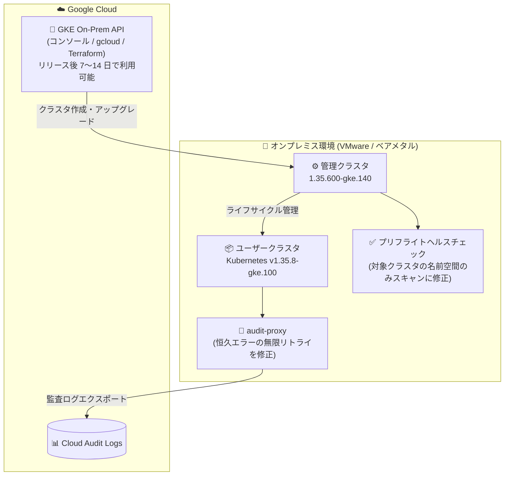

# Google Distributed Cloud (software only): VMware 版 / ベアメタル版 1.35.600-gke.140 リリース

**リリース日**: 2026-10-12

**サービス**: Google Distributed Cloud (software only) for VMware / for bare metal

**機能**: パッチリリース 1.35.600-gke.140 (脆弱性修正 + 複数のバグ修正)

**ステータス**: Announcement / Fixed

📊 [このアップデートのインフォグラフィックを見る](https://takech9203.github.io/google-cloud-news-summary/20261012-google-distributed-cloud-1-35-600.html)

## 概要

Google Distributed Cloud (software only) の VMware 版およびベアメタル版の両プラットフォームで、パッチリリース 1.35.600-gke.140 がダウンロード可能になりました。両バージョンとも Kubernetes v1.35.8-gke.100 上で動作します。リリース後、GKE On-Prem API クライアント (Google Cloud コンソール、gcloud CLI、Terraform) で利用可能になるまで約 7〜14 日かかります。

このパッチリリースは新機能の追加ではなく、セキュリティ脆弱性の修正と、クラスタ運用の安定性に関わる複数のバグ修正が中心です。特に、audit-proxy による監査ログエクスポートの無限リトライ問題、Kubernetes プリフライトヘルスチェックの名前空間スコープの問題 (アップグレード失敗の原因)、ユーザークラスタのステータスフラッピング問題など、両プラットフォーム共通の修正が含まれます。ベアメタル版ではさらに、containerd の状態破損への耐性向上、CA ローテーション失敗の修正、BGP ロードバランシングのフェイルオーバー高速化など、独自の修正が多数含まれています。

オンプレミス環境で GDC クラスタを運用している管理者、特に 1.35 系を利用中でアップグレードやメンテナンスの安定性に課題を抱えていた組織にとって重要なリリースです。

**アップデート前の課題**

- audit-proxy が恒久的なエラーに対しても監査ログのエクスポートを無限にリトライし、過剰な監査ログトラフィックが発生していた (両プラットフォーム)
- Kubernetes プリフライトヘルスチェックが対象クラスタの名前空間ではなく管理クラスタの全名前空間をスキャンしていたため、無関係なクラスタに古い reconciling リソースが残っているとクラスタのアップグレードが失敗していた (両プラットフォーム)
- 管理クラスタとユーザークラスタで Pod 密度設定が異なる場合、ユーザークラスタが reconciling 状態と running 状態を繰り返し行き来していた (両プラットフォーム)
- (ベアメタル) コンテナイメージの展開中にノードが再起動すると、containerd の状態が破損する可能性があった
- (ベアメタル) クラスタのアップグレードまたはロールバック中に、定期的な構成ドリフトヘルスチェックが「version not supported」エラーで失敗していた
- (ベアメタル) セルフマネージドクラスタ (admin / hybrid / standalone) の CA ローテーションが最終フェーズで失敗し、クラスタが管理不能な状態になることがあった
- (ベアメタル) バンドル型 BGP ロードバランシング使用時、コントロールプレーンのアップグレードや構成更新で最大 20 秒の API サーバー接続断が発生していた

**アップデート後の改善**

- audit-proxy が恒久的なエラーでは無限リトライしなくなり、過剰な監査ログトラフィックが解消された
- プリフライトヘルスチェックが対象クラスタの名前空間のみをスキャンするようになり、無関係なクラスタ起因のアップグレード失敗がなくなった
- Pod 密度設定が異なる構成でもユーザークラスタのステータスが安定するようになった
- (ベアメタル) イメージ展開中のノード再起動に対する containerd の耐性が向上した
- (ベアメタル) ノードドレイン時に kubelet による全ホストボリュームのアンマウントと CSI VolumeAttachment のデタッチ完了を検証するようになり、孤立した VolumeAttachment リソースや I/O エラーが防止された
- (ベアメタル) BGP ロードバランシング構成でのコントロールプレーンノード再起動時、正常なノードへのフェイルオーバーが約 4 秒で完了するようになった

## アーキテクチャ図



GDC (software only) のクラスタ構成と今回の主要な修正ポイントを示しています。管理クラスタのプリフライトチェックのスコープ修正と、audit-proxy から Cloud Audit Logs へのエクスポート処理の修正が、両プラットフォーム共通の中心的な改善です。

## サービスアップデートの詳細

### 主要機能

1. **1.35.600-gke.140 のリリース (両プラットフォーム共通)**
   - VMware 版・ベアメタル版ともに Kubernetes v1.35.8-gke.100 上で動作
   - [脆弱性修正一覧](https://docs.cloud.google.com/kubernetes-engine/distributed-cloud/vmware/docs/vulnerabilities)に記載されたセキュリティ脆弱性を修正
   - サードパーティストレージベンダーを利用している場合は、[認定済みストレージパートナー](https://docs.cloud.google.com/kubernetes-engine/enterprise/docs/resources/partner-storage)の一覧で対応状況の確認が必要

2. **両プラットフォーム共通のバグ修正**
   - **audit-proxy の無限リトライ修正**: 恒久的なエラー発生時に監査ログのエクスポートを無限にリトライし、過剰な監査ログトラフィックを生成していた問題を修正
   - **プリフライトヘルスチェックのスコープ修正**: 対象クラスタの名前空間ではなく管理クラスタの全名前空間をスキャンしていたため、無関係なクラスタの古い reconciling リソースが原因でアップグレードが失敗する問題を修正
   - **ユーザークラスタのステータスフラッピング修正**: 管理クラスタとユーザークラスタの Pod 密度設定が異なる場合に、reconciling と running の状態を繰り返す問題を修正

3. **ベアメタル版固有の修正**
   - **containerd の耐性向上**: コンテナイメージの展開中にノードが再起動した場合の状態破損に対する耐性を改善
   - **構成ドリフトヘルスチェックの修正**: アップグレードまたはロールバック実行中に「version not supported」エラーで失敗する問題を修正
   - **ノードドレインの検証強化**: メンテナンスモード中のノードアップグレード・再作成が、ストレージボリュームのデタッチ完了前に進行してしまう問題を修正。修正後は kubelet による全ホストボリュームのアンマウントと CSI VolumeAttachment のデタッチを検証してからドレインを完了
   - **CA ローテーションの修正**: セルフマネージドクラスタ (admin / hybrid / standalone) の CA ローテーションが最終フェーズで失敗する問題を修正。**CA をローテーションする前に 1.35.600-gke.140 へのアップグレードが必須**
   - **BareMetalMachine ステータスの修正**: メンテナンスモード遷移中にノードが早期に ready / available と報告される問題を修正
   - **BGP ロードバランシングのフェイルオーバー高速化**: コントロールプレーンノード再起動時の API サーバー接続断を最大約 20 秒から約 4 秒に短縮

## 技術仕様

### リリース情報

| 項目 | 詳細 |
|------|------|
| GDC バージョン | 1.35.600-gke.140 (VMware 版 / ベアメタル版共通) |
| Kubernetes バージョン | v1.35.8-gke.100 |
| リリースタイプ | パッチリリース (脆弱性修正 + バグ修正) |
| GKE On-Prem API クライアントでの利用 | リリース後約 7〜14 日で利用可能 |
| アップグレードツール | VMware 版: gkectl / ベアメタル版: bmctl (GKE On-Prem API クライアントも利用可) |

### パッチアップグレードのルール

| ルール | 内容 |
|------|------|
| パッチバージョン | 同一マイナーバージョン内では、より高いパッチバージョンへ直接アップグレード可能 (例: 1.35.500 → 1.35.600) |
| ツールバージョン | アップグレード先バージョンと同じバージョンの bmctl / gkectl を使用する必要がある |
| ダウングレード | クラスタのダウングレードは不可 |

## 設定方法

### 前提条件

1. 既存の GDC (software only) クラスタが 1.35 系または直前のマイナーバージョンで稼働していること
2. アップグレード前にプリフライトチェックが通過すること
3. サードパーティストレージベンダー利用時は、認定済みストレージパートナーの対応状況を確認すること

### 手順

#### ステップ 1: 新バージョンのツールをダウンロード

```bash
# ベアメタル版: bmctl 1.35.600-gke.140 をダウンロード
gcloud storage cp gs://anthos-baremetal-release/bmctl/1.35.600-gke.140/linux-amd64/bmctl ./bmctl
chmod +x ./bmctl
```

VMware 版は gkectl の 1.35.600-gke.140 をダウンロードし、管理ワークステーションに配置します。

#### ステップ 2: クラスタ構成ファイルの更新とアップグレード実行

```bash
# ベアメタル版の例: クラスタ構成ファイルの anthosBareMetalVersion を更新してアップグレード
# anthosBareMetalVersion: 1.35.600-gke.140
./bmctl upgrade cluster -c CLUSTER_NAME --kubeconfig ADMIN_KUBECONFIG
```

詳細な手順はプラットフォームごとのアップグレードガイド ([VMware 版](https://docs.cloud.google.com/kubernetes-engine/distributed-cloud/vmware/docs/how-to/upgrading) / [ベアメタル版](https://docs.cloud.google.com/kubernetes-engine/distributed-cloud/bare-metal/docs/how-to/upgrade)) を参照してください。

## メリット

### ビジネス面

- **セキュリティリスクの低減**: 既知の脆弱性が修正され、オンプレミス環境のコンプライアンス要件への対応が容易になる
- **運用コストの削減**: アップグレード失敗やステータスフラッピングなど、調査・復旧に工数がかかっていた問題が解消される
- **可用性の向上 (ベアメタル)**: BGP ロードバランシング構成での API サーバー接続断が約 20 秒から約 4 秒に短縮され、計画メンテナンス時の影響が最小化される

### 技術面

- **アップグレードの信頼性向上**: プリフライトチェックのスコープ修正により、無関係なクラスタの状態が原因でアップグレードが失敗する事象がなくなる
- **監査ログパイプラインの健全化**: audit-proxy の無限リトライ解消により、Cloud Audit Logs への不要なトラフィックが削減される
- **ストレージ運用の安全性向上 (ベアメタル)**: ノードドレイン時の CSI VolumeAttachment デタッチ検証により、孤立リソースや I/O エラーが防止される
- **CA ローテーションの安全性 (ベアメタル)**: セルフマネージドクラスタが管理不能になるリスクが解消される

## デメリット・制約事項

### 制限事項

- GKE On-Prem API クライアント (コンソール、gcloud CLI、Terraform) でこのバージョンが利用可能になるまで、リリース後約 7〜14 日かかる
- サードパーティストレージベンダー利用時は、本リリースに対する認定状況を事前に確認する必要がある
- クラスタのダウングレードはサポートされない

### 考慮すべき点

- **(ベアメタル) CA ローテーションを予定している場合は、必ず先に 1.35.600-gke.140 へアップグレードする必要がある**。旧バージョンでの CA ローテーションはクラスタが管理不能になるリスクがある
- アップグレードはコントロールプレーンとノードプールの再作成を伴うため、メンテナンスウィンドウの計画が必要
- 1.35 系はすでに 1.36 系がリリース済みのため、長期的には 1.36 へのマイナーバージョンアップグレードも計画に含めるとよい

## ユースケース

### ユースケース 1: アップグレード失敗が頻発していたマルチクラスタ環境の安定化

**シナリオ**: 1 つの管理クラスタで複数のユーザークラスタを運用しており、一部のクラスタに古い reconciling リソースが残っていたため、別のクラスタのアップグレードがプリフライトチェックで失敗していた。

**効果**: プリフライトヘルスチェックが対象クラスタの名前空間のみをスキャンするようになり、他クラスタの状態に影響されずにアップグレードを完了できる。

### ユースケース 2: (ベアメタル) 証明書ライフサイクル管理の実施

**シナリオ**: セキュリティポリシーに基づき、admin / hybrid / standalone クラスタの CA を定期的にローテーションする必要があるが、ローテーション失敗によるクラスタ管理不能のリスクを懸念していた。

**実装例**:
```bash
# 1. まず 1.35.600-gke.140 へアップグレード (必須)
./bmctl upgrade cluster -c CLUSTER_NAME --kubeconfig ADMIN_KUBECONFIG

# 2. その後 CA ローテーションを実行
./bmctl update credentials certificate-authorities rotate -c CLUSTER_NAME \
  --kubeconfig ADMIN_KUBECONFIG
```

**効果**: ローテーション最終フェーズでの失敗が修正されており、安全に CA ローテーションを完了できる。

### ユースケース 3: (ベアメタル) 高可用性要件のある BGP ロードバランシング環境

**シナリオ**: バンドル型 BGP ロードバランシングを使用する本番クラスタで、コントロールプレーンのアップグレードのたびに最大 20 秒の API サーバー接続断が発生し、CI/CD パイプラインや運用ツールがタイムアウトしていた。

**効果**: 正常なコントロールプレーンノードへのフェイルオーバーが約 4 秒で完了するようになり、計画メンテナンス中の接続断が大幅に短縮される。

## 料金

Google Distributed Cloud (software only) は GKE Enterprise エディションのライセンスに基づいて課金されます。本パッチリリースの適用自体に追加料金は発生しません。Cloud Audit Logs の機能は GDC の料金に含まれます。

詳細は [GKE の料金ページ](https://cloud.google.com/kubernetes-engine/pricing) を参照してください。

## 利用可能リージョン

オンプレミス環境 (VMware vSphere / ベアメタル) にデプロイするソフトウェアのため、リージョンの制約はありません。ダウンロードは即時可能で、GKE On-Prem API クライアント (コンソール、gcloud CLI、Terraform) 経由での利用はリリース後約 7〜14 日で可能になります。

## 関連サービス・機能

- **GKE Enterprise**: GDC (software only) はハイブリッド/マルチクラウド向けの GKE Enterprise の構成要素であり、フリート管理や Connect 経由の集中管理が可能
- **Cloud Audit Logs**: audit-proxy がコントロールプレーンノード上で動作し、Kubernetes API サーバーの Admin Activity 監査ログを Google Cloud プロジェクトへエクスポート (今回修正されたコンポーネント)
- **Cloud Logging / Cloud Monitoring**: クラスタのログ・メトリクスを Google Cloud 側で集中管理
- **GKE On-Prem API**: Google Cloud コンソール、gcloud CLI、Terraform からのクラスタライフサイクル管理を提供

## 参考リンク

- 📊 [インフォグラフィック](https://takech9203.github.io/google-cloud-news-summary/20261012-google-distributed-cloud-1-35-600.html)
- [公式リリースノート (Google Cloud 全体)](https://docs.cloud.google.com/release-notes#October_12_2026)
- [GDC (software only) for VMware リリースノート](https://docs.cloud.google.com/kubernetes-engine/distributed-cloud/vmware/docs/release-notes)
- [GDC (software only) for bare metal リリースノート](https://docs.cloud.google.com/kubernetes-engine/distributed-cloud/bare-metal/docs/release-notes)
- [VMware 版 アップグレードガイド](https://docs.cloud.google.com/kubernetes-engine/distributed-cloud/vmware/docs/how-to/upgrading)
- [ベアメタル版 アップグレードガイド](https://docs.cloud.google.com/kubernetes-engine/distributed-cloud/bare-metal/docs/how-to/upgrade)
- [VMware 版 脆弱性修正一覧](https://docs.cloud.google.com/kubernetes-engine/distributed-cloud/vmware/docs/vulnerabilities)
- [ベアメタル版 脆弱性修正一覧](https://docs.cloud.google.com/kubernetes-engine/distributed-cloud/bare-metal/docs/vulnerabilities)
- [Cloud Audit Logs の使用 (ベアメタル版)](https://docs.cloud.google.com/kubernetes-engine/distributed-cloud/bare-metal/docs/how-to/audit-logging)
- [認定済みストレージパートナー](https://docs.cloud.google.com/kubernetes-engine/enterprise/docs/resources/partner-storage)
- [料金ページ (GKE)](https://cloud.google.com/kubernetes-engine/pricing)

## まとめ

GDC (software only) 1.35.600-gke.140 は、脆弱性修正に加え、アップグレードの信頼性・監査ログパイプライン・クラスタステータスの安定性に関わる重要なバグ修正を含むパッチリリースです。特にベアメタル版で CA ローテーションを予定している組織は、ローテーション実行前に本バージョンへのアップグレードが必須となるため、早期の適用計画を推奨します。1.35 系を運用中のクラスタは、メンテナンスウィンドウを確保して本パッチへのアップグレードを進めてください。

---

**タグ**: Google Distributed Cloud, GDC, VMware, ベアメタル, GKE Enterprise, Kubernetes, パッチリリース, 脆弱性修正, オンプレミス, ハイブリッドクラウド
