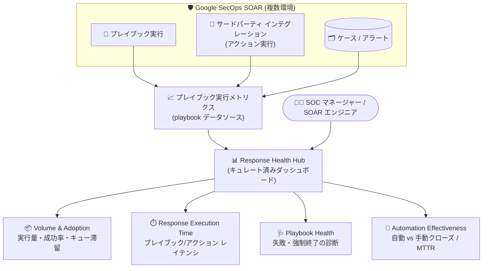

# Google SecOps: Response Health Hub によるレスポンスとプレイブックの健全性モニタリング

**リリース日**: 2026-10-12

**サービス**: Google SecOps

**機能**: Response Health Hub (キュレート済みダッシュボード)

**ステータス**: リリース済み (Spotlight Feature)

📊 [このアップデートのインフォグラフィックを見る](https://takech9203.github.io/google-cloud-news-summary/20261012-google-secops-response-health-hub.html)

## 概要

Google SecOps に、SOAR のプレイブックとインテグレーションの健全性を一元的にモニタリングするキュレート済みダッシュボード「**Response Health Hub**」が追加されました。Response Health Hub は、複数の環境 (Environment) にまたがるプレイブックのパフォーマンス、実行レイテンシ、自動化の有効性、インテグレーションの健全性を監視するための中央ロケーションです。

このダッシュボードは、プレイブックの実行量・キューの滞留・完了成功率、ケースやアラートへのプレイブックのアタッチ率と再実行 (rerun) 率、エンドツーエンドのプレイブック実行レイテンシとアクション単位のレイテンシ、失敗したプレイブックのサマリーやアクションの失敗理由、さらに自動クローズと手動クローズの MTTR (平均解決時間) 比較まで、自動対応ワークフローの運用状況を包括的に可視化します。

対象ユーザーは、プレイブックとインテグレーションの健全性・パフォーマンス・自動化効率を監視したいセキュリティエンジニア、SOAR エンジニア、SOC マネージャーです。プレイブック実行の問題、アクションのレイテンシ、サードパーティ インテグレーションの障害を特定・診断・修復するためのワークフローがダッシュボードとしてパッケージ化されています。

**アップデート前の課題**

- プレイブックの失敗やレイテンシの調査は、個々のケースのプレイブック モニタリング (プレイブック サマリー) を個別に開いて確認する必要があり、環境全体を横断する一元的なビューがなかった
- プレイブックの実行量・キュー滞留・再実行率・インテグレーション障害などの運用メトリクスを俯瞰するには、SOAR プレイブックのデータソースを使ってカスタム ダッシュボードを自作する必要があった
- 自動化の効果 (自動クローズと手動クローズの MTTR 比較など) を定量的に測定する標準的な手段がなかった

**アップデート後の改善**

- Response Health Hub という 1 つのキュレート済みダッシュボードで、プレイブックの実行量・成功率・キュー滞留・レイテンシ・失敗傾向・インテグレーション健全性を環境横断で一元監視できるようになった
- 最も遅いプレイブック実行/アクション実行の Top 30 や、失敗率の高いプレイブックの Top 30 など、ドリルダウン可能なウィジェットにより根本原因の特定が容易になった
- 自動クローズと手動クローズの MTTR 比較、インテグレーション/アクションの利用ランキングにより、自動化の有効性 (ROI) を定量的に評価できるようになった

## アーキテクチャ図



複数環境のプレイブック・インテグレーション・ケースから収集された実行メトリクスが Response Health Hub に集約され、SOC チームは実行量、レイテンシ、健全性、自動化効果の 4 つの観点から対応ワークフローを一元監視できます。

## サービスアップデートの詳細

### 主要機能

Response Health Hub は以下の 5 つのセクションで構成されます。

1. **Volume & Adoption (実行量と採用状況の追跡)**
   - プレイブック総実行数、実行回数 Top 30 のプレイブック、日次実行トレンド (折れ線グラフ) を表示
   - `PENDING_IN_QUEUE` ステータスで実行待ちのプレイブック数 (キュー滞留) を表示
   - 完了済みプレイブックの実行成功率 (`COMPLETED` と `FAILED` の内訳) を円グラフで表示

2. **Playbook Attachment Rates (アタッチ率と再実行のインサイト)**
   - ケース/アラートあたりの平均・最大プレイブック アタッチ数を表示
   - アタッチ数と再実行 (rerun) 頻度でプレイブックをランキングし、再実行率の高いプレイブックを特定

3. **Response Execution Time (実行レイテンシの診断)**
   - エンドツーエンドの平均プレイブック実行時間 (トリガー/アタッチからすべてのステップ完了まで。アクション実行、ステップ遷移、キュー遅延、手動アクション待ち時間を含む) を表示
   - 個々のアクションの平均実行時間 (アクション開始から結果保存まで) を表示し、プレイブック全体の待ち時間とアクティブな実行時間を区別可能
   - 最も遅いプレイブック実行 Top 30 / アクション実行 Top 30 をリスト表示

4. **Playbook Health (プレイブックとインテグレーションの健全性監視)**
   - 直近 30 件の失敗したプレイブックのサマリー (失敗したアクション、ステータス、エラーメッセージ、ケース ID リンク)
   - 失敗率の高いプレイブック Top 30、強制終了 (`TERMINATED`) されたプレイブック Top 30
   - 失敗したプレイブック率/インテグレーション率の時系列推移、アクションの失敗理由 (`FAULTED`、`UNHANDLED_TIMEDOUT`、`PENDING_ACTION_TIMEOUT` など)

5. **Integrations Utilization and Automation Effectiveness (自動化の有効性メトリクス)**
   - インテグレーションとアクションの利用ランキング
   - 自動クローズ (`AUTOMATIC`) と手動クローズのケース比率、および両者の MTTR (平均解決時間) 比較

### ダッシュボードレベルのフィルタ

- **Global Time Filter**: 期間フィルタ (デフォルト: 過去 7 日間)。ただし「Playbooks Pending in Queue」ウィジェットは固定の 7 日間ルックバックで現在のキュー数を表示
- **Playbook Simulated**: プレイブック シミュレータでの実行 (`playbook.simulated`) を含めるかどうか (デフォルト: `false` = 本番実行のみ)
- **Execution Scope Filter**: 実行スコープ (`playbook.metadata.execution_scope`) によるフィルタ
- **Environments Filter**: 複数の SecOps 環境 (`playbook.metadata.environments`、`case.environment`) を同時選択可能 (デフォルト: Default Environment)

## 技術仕様

### 主要な用語とメトリクスの定義

| 用語 | 定義 |
|------|------|
| プレイブック実行時間 | プレイブックがトリガーされてアラート/ケースにアタッチされてから全ステップ完了までのエンドツーエンド経過時間 (アクション実行、ステップ遷移、キュー遅延、手動アクション待ちを含む) |
| アクション実行時間 | 個々のアクションが実行を開始してから結果が保存されるまでのアクティブな実行時間 |
| アタッチされたプレイブック | アラートの取り込み/作成時にトリガーされ、ケースまたはアラートにリンクされたプレイブック |
| 再実行 (rerun) プレイブック | すでにアタッチ済みのケース/アラートに対して再トリガーされたプレイブック実行 |
| Faulted | 実行中にエラーまたはタイムアウトが発生したアクション (`FAULTED`、`FAULTED_AND_SKIPPED`、`UNHANDLED_TIMEDOUT`、`PENDING_ACTION_TIMEOUT`) |
| Terminated | アナリストが手動停止した、または完了前にアラート/ケースがクローズされたプレイブック実行 (`TERMINATED`) |
| MTTR | ケース作成からクローズまでの平均経過時間 (分)。プレイブックによる自動クローズ (`AUTOMATIC`) と手動クローズを比較 |

### 必要な IAM 権限と SOAR ロール

| 項目 | 詳細 |
|------|------|
| 対応する事前定義 IAM ロール | Chronicle API Admin (`roles/chronicle.admin`)、Chronicle API Editor (`roles/chronicle.editor`)、Chronicle API Viewer (`roles/chronicle.viewer`) |
| ダッシュボード閲覧権限 | `chronicle.nativeDashboards.get`、`chronicle.nativeDashboards.list` |
| プレイブック メトリクス閲覧権限 | `chronicle.playbooks.read` |
| 複製・カスタマイズ権限 | `chronicle.nativeDashboards.create`、`chronicle.nativeDashboards.duplicate` |
| SOAR ロール | ChronicleSOAR Admin、ChronicleSOAR Threat Manager、ChronicleSOAR Vulnerability Manager、ChronicleSOAR Observer など、プレイブックとダッシュボードを閲覧できるロール |

## 設定方法

### 前提条件

1. ダッシュボードとプレイブック データの閲覧に必要な IAM 権限 (`chronicle.nativeDashboards.get/list`、`chronicle.playbooks.read`) を含むロールが割り当てられていること
2. プレイブックとダッシュボードを閲覧できる SOAR ロールが割り当てられていること

### 手順

#### ステップ 1: Response Health Hub にアクセスする

ナビゲーション メニューで **Dashboards & Reports > Dashboards** をクリックし、事前定義されたキュレート済みダッシュボード一覧から **Response Health Hub** を選択します。

#### ステップ 2: フィルタで表示データを絞り込む

ページ上部のダッシュボードレベル フィルタ (Global Time Filter、Playbook Simulated、Execution Scope Filter、Environments Filter) で、期間・実行スコープ・環境ごとにメトリクスを絞り込みます。

#### ステップ 3: カスタマイズが必要な場合は複製する

Response Health Hub は読み取り専用のキュレート済みダッシュボードであり、直接編集できません。チャートやクエリをカスタマイズする場合は、ダッシュボードを複製 (duplicate) し、コピーを編集します (`chronicle.nativeDashboards.create` と `chronicle.nativeDashboards.duplicate` 権限が必要)。

## メリット

### ビジネス面

- **自動化 ROI の可視化**: 自動クローズと手動クローズの MTTR 比較により、SOAR 自動化への投資効果を経営層や SOC マネージャーに定量的に示せる
- **SOC 運用の信頼性向上**: プレイブックの失敗やインテグレーション障害を早期に検知し、インシデント対応の自動化が「静かに壊れている」状態を防げる
- **構築コスト不要**: キュレート済みダッシュボードとして提供されるため、カスタム ダッシュボードを自作することなくすぐに利用開始できる

### 技術面

- **レイテンシのボトルネック切り分け**: エンドツーエンドのプレイブック実行時間とアクティブなアクション実行時間を分離して計測できるため、「インテグレーションが遅い」のか「手動承認待ちが長い」のかを切り分けられる
- **障害の根本原因特定の高速化**: 直近の失敗サマリーからケース ID リンクで該当ケースのプレイブック サマリーに直接ジャンプし、ステップログの確認やアクションの再実行まで一気通貫で行える
- **インテグレーション障害の横断検知**: 複数プレイブックが同時に失敗した場合に、共有インテグレーションの問題 (認証情報の期限切れ、レート制限など) を Failed Integrations % Over Time やアクション失敗理由から特定できる

## デメリット・制約事項

### 制限事項

- Response Health Hub は読み取り専用で直接編集できない。カスタマイズには複製が必要
- 「Playbooks Pending in Queue」ウィジェットは固定の 7 日間ルックバックで表示され、Global Time Filter の影響を受けない
- ダッシュボードがクエリできる SOAR ケースデータは 2025 年 5 月 10 日以降に生成されたものに限られる (ネイティブ ダッシュボード共通の制約)
- プレイブック データソースのクエリ期間は最大 365 日 (ネイティブ ダッシュボード共通の制約)

### 考慮すべき点

- 閲覧には IAM 権限と SOAR ロールの両方が必要なため、SOC メンバーへのアクセス権設計を事前に確認する必要がある
- デフォルトでは Playbook Simulated フィルタが `false` のため、シミュレータでのテスト実行は表示されない (テスト実行の分析には明示的な切り替えが必要)
- メトリクスを見るだけでは問題は解決しないため、ダッシュボードで特定した事象 (認証エラー、タイムアウト、キュー滞留など) ごとの修復手順を運用 Runbook に組み込むことが望ましい

## ユースケース

### ユースケース 1: プレイブック失敗の急増を調査する

**シナリオ**: Playbook Execution Success Rate で失敗率の上昇を検知した SOAR エンジニアが、原因を特定して修復する。

**実装例**:
```
1. Top 30 Failure Rate Playbooks で失敗数・失敗率の高いプレイブックを特定
2. Failed Playbooks % Over Time で、失敗が突発的 (プレイブック編集や認証情報の
   期限切れ直後) か恒常的かを判断
3. Latest 30 Failed Playbook Summary で Action / Action Status / Action Message を
   確認し、失敗したステップと正確なエラーメッセージを把握
4. Case ID リンクから該当ケースを開き、Playbooks タブのプレイブック サマリーで
   ステップログを確認、根本原因の対処後にアクションまたはプレイブック全体を再実行
```

**効果**: 失敗したプレイブックの特定から根本原因の把握、再実行までをダッシュボード起点で完結でき、対応自動化の停止時間を最小化できる。

### ユースケース 2: インテグレーション障害 (認証エラー・タイムアウト) の切り分け

**シナリオ**: 複数のプレイブックが同時に失敗しており、共有しているサードパーティ インテグレーションの問題が疑われる。

**実装例**:
```
1. Failed Integrations % Over Time で失敗スパイクが特定のインテグレーションと
   相関しているかを確認
2. Actions Failure Rate で Failure % / Failure Statuses / Latest Failure Reasons を確認
   - FAULTED + 401/403: API キーやトークンの期限切れ・権限不足 → 認証情報を更新
   - UNHANDLED_TIMEDOUT: 外部エンドポイントの応答遅延やリモート エージェントの問題
   - PENDING_ACTION_TIMEOUT: 手動入力待ち/非同期コールバックのタイムアウト
3. Response > IDE または Settings > SOAR Settings > Environments で、該当環境の
   インテグレーション インスタンス設定と認証情報をテスト
```

**効果**: プレイブック個別の問題かインテグレーション共通の問題かを迅速に切り分け、認証情報更新などの修復アクションに直結できる。

### ユースケース 3: 自動化の有効性を定量評価する

**シナリオ**: SOC マネージャーが四半期レビューで SOAR 自動化の効果を報告する。

**効果**: 自動クローズと手動クローズの比率および MTTR 比較、インテグレーション/アクション利用ランキングから、自動化によって短縮された解決時間と、追加で自動化すべき領域 (手動待ちが長いプレイブックなど) をデータに基づいて提示できる。

### ユースケース 4: キュー滞留と過剰トリガーの最適化

**シナリオ**: Playbooks Pending in Queue の値が高止まりしており、アラート急増や過剰に広いトリガー条件により実行パイプラインが飽和している。

**効果**: トリガー条件の絞り込み、再利用可能ブロックによる冗長なプレイブックの統合、一括アクション/フィルタの活用によりキュー滞留を解消し、対応遅延を防止できる。

## 料金

Response Health Hub は Google SecOps のキュレート済みダッシュボードとして提供されます。個別の追加料金に関する公式情報は確認できなかったため、詳細は Google SecOps の料金情報を参照してください。

- [Google Security Operations](https://cloud.google.com/security/products/security-operations)

## 関連サービス・機能

- **キュレート済みダッシュボード (Curated Dashboards)**: Response Health Hub は Google SecOps の事前定義キュレート済みダッシュボードの 1 つ。SOAR ケース、SOAR プレイブック、Ingestion metrics など他のカテゴリのダッシュボードと併用できる
- **ネイティブ ダッシュボード (Native Dashboards)**: Response Health Hub を複製してカスタマイズする際の基盤。YARA-L クエリの `playbook` / `case` データソースを使って独自ウィジェットを追加可能
- **SOAR プレイブック / プレイブック モニタリング**: ダッシュボードの失敗サマリーからケースのプレイブック サマリー (ステップログ、エラー詳細、再実行) に直接遷移して修復作業を行う
- **リモート エージェント**: `UNHANDLED_TIMEDOUT` の診断時に、リモート実行されるインテグレーションのエージェント健全性のトラブルシューティングと組み合わせる
- **Cloud IAM**: ダッシュボードとプレイブック データへのアクセスは Chronicle API の IAM ロール/権限で制御される

## 参考リンク

- 📊 [インフォグラフィック](https://takech9203.github.io/google-cloud-news-summary/20261012-google-secops-response-health-hub.html)
- [公式リリースノート](https://docs.cloud.google.com/release-notes#October_12_2026)
- [ドキュメント: Monitor response and playbook health](https://docs.cloud.google.com/chronicle/docs/reports/response-health-monitoring-and-troubleshooting-dashboard)
- [ドキュメント: Curated dashboards (Out-of-the-box dashboards catalog)](https://docs.cloud.google.com/chronicle/docs/reports/native-curated-dashboards)
- [ドキュメント: Manage dashboards (Native Dashboards)](https://docs.cloud.google.com/chronicle/docs/reports/manage-native-dashboards)

## まとめ

Response Health Hub により、これまで個別のケース画面やカスタム ダッシュボードに分散していた SOAR プレイブックの運用監視が、環境横断の単一ダッシュボードに集約されました。SOAR を本番運用しているチームは、まずデフォルト設定でダッシュボードを確認して失敗率・キュー滞留・レイテンシのベースラインを把握し、認証エラーやタイムアウトなど事象別の修復手順を運用 Runbook に組み込むことを推奨します。

---

**タグ**: #GoogleSecOps #SOAR #Playbook #ResponseHealthHub #Dashboard #SOC #セキュリティ運用 #自動化
