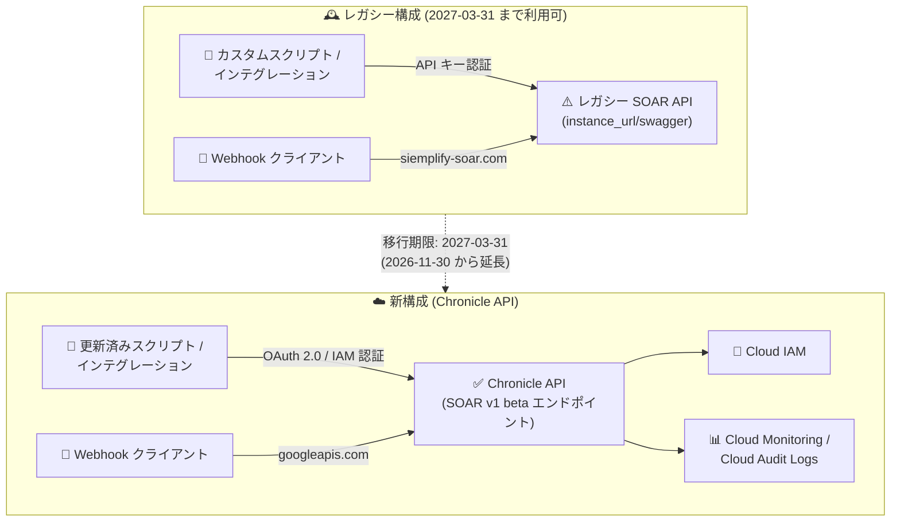

# Google SecOps / Google SecOps SOAR: SOAR API から Chronicle API への移行期限が 2027 年 3 月 31 日に延長

**リリース日**: 2026-10-12

**サービス**: Google SecOps / Google SecOps SOAR

**機能**: SOAR API → Chronicle API 移行期限の延長 (アナウンスメント)

**ステータス**: Announcement

📊 [このアップデートのインフォグラフィックを見る](https://takech9203.github.io/google-cloud-news-summary/20261012-google-secops-soar-api-migration-deadline.html)

## 概要

Google SecOps および Google SecOps SOAR において、レガシー SOAR API から Chronicle API への移行期限が **2026 年 11 月 30 日から 2027 年 3 月 31 日に延長** されたことが発表されました。この移行は、SOAR インフラストラクチャを Google Cloud に移行する大規模な取り組み (SOAR Migration) の Stage 2 に含まれる作業の 1 つで、スクリプト・カスタムインテグレーション・Webhook などでレガシー SOAR API をプログラマティックに利用しているすべての顧客が対象です。

レガシー SOAR API と API キーは 2027 年 3 月 31 日まで利用可能で、それ以降は完全に機能しなくなります。Webhook で使用されるレガシーの `siemplify-soar.com` ドメインも同日まで機能します。一方、Stage 2 に含まれる **SOAR 権限グループの IAM ロールへの移行期限は従来どおり 2026 年 11 月 30 日** であり、延長されていない点に注意が必要です。

今回の延長により移行作業の時間的猶予は約 4 か月増えましたが、Google はレガシー API の継続利用がプラットフォームのパフォーマンス低下や予期しない動作につながる可能性があるとして、早期の移行を引き続き推奨しています。

**アップデート前の課題**

- レガシー SOAR API から Chronicle API への移行期限は 2026 年 11 月 30 日に設定されており、IAM ロールへの権限移行と同時期にすべての API 移行を完了させる必要があった
- 多数のカスタムスクリプト・インテグレーション・Webhook を持つ組織では、認証方式の変更 (API キー → OAuth 2.0 / IAM) とデータモデルの変更を伴う移行を短期間で完了させるのが困難だった
- 移行には Stage 1 (Google 所有 SOAR プロジェクトの Google Cloud への移行) の完了が前提条件であり、スケジュールに余裕がなかった

**アップデート後の改善**

- API 移行の期限が 2027 年 3 月 31 日まで約 4 か月延長され、スクリプト・インテグレーション・Webhook の計画的な移行とテストの時間を確保できるようになった
- レガシー SOAR API と API キーは 2027 年 3 月 31 日まで引き続き機能するため、段階的な切り替えが可能になった
- Webhook のレガシードメイン (`siemplify-soar.com`) も 2027 年 3 月 31 日まで機能し、クライアント側 URL の更新を計画的に進められるようになった

## アーキテクチャ図



レガシー SOAR API (API キー認証) から、IAM/OAuth 2.0 認証と Google Cloud サービス統合を備えた Chronicle API への移行の全体像です。移行期限が 2026 年 11 月 30 日から 2027 年 3 月 31 日に延長されました。

## サービスアップデートの詳細

### 主要機能

1. **API 移行期限の延長**
   - レガシー SOAR API から Chronicle API (SOAR v1 beta エンドポイント) への移行期限が 2026 年 11 月 30 日から 2027 年 3 月 31 日に延長された
   - レガシー SOAR API と API キーは 2027 年 3 月 31 日まで利用可能で、それ以降は機能しなくなる

2. **Webhook 移行への影響**
   - Webhook URL のレガシードメイン `siemplify-soar.com` も 2027 年 3 月 31 日まで機能する
   - クライアント側で Webhook URL を `googleapis.com` ドメインの新しいリクエスト形式に更新する必要がある (認証は従来どおり API キーを継続使用)

3. **後方互換性のための UI の維持**
   - SOAR Settings > Organization > Permissions ページは、レガシー API との後方互換性のため 2027 年 3 月 31 日まで利用可能 (変更は行わず、権限は IAM で管理)
   - Group Mapping ページの Permission Group 列も 2027 年 3 月 31 日までに顧客への影響なく自動削除される予定

4. **変更されない期限 (注意点)**
   - Stage 2 の SOAR 権限グループ → Google Cloud IAM ロールへの移行期限は **2026 年 11 月 30 日のまま** であり、延長の対象外

## 技術仕様

### 移行スケジュール (SOAR Migration Stage 2)

| 項目 | 期限 | 備考 |
|------|------|------|
| SOAR 権限グループ → IAM ロール移行 | 2026-11-30 | 延長なし。移行スクリプトまたは Terraform で実行 |
| SOAR API → Chronicle API 移行 | **2027-03-31** | 今回 2026-11-30 から延長 |
| レガシー SOAR API / API キーの提供終了 | 2027-03-31 | 以降は完全に非機能化 |
| Webhook のレガシードメイン提供終了 | 2027-03-31 | `siemplify-soar.com` → `googleapis.com` へ更新 |

### レガシー SOAR API と Chronicle API の主な違い

| 項目 | レガシー SOAR API | Chronicle API |
|------|-------------------|---------------|
| 認証 | API トークン (API キー) | OAuth 2.0 / Google Cloud IAM |
| データモデル | フラット構造 | リソース指向設計 |
| エンドポイント命名 | 一貫性なし | RESTful で標準化 |
| エンドポイント | `https://{instance_url}/api/external/v1/...` | リージョナルエンドポイント (下記参照) |

### Chronicle API のエンドポイント構造

```
https://[service_endpoint]/[api_version]/projects/[project_id]/locations/[location]/instances/[instance_id]/...
```

- `service_endpoint`: リージョナルサービスアドレス (例: `chronicle.us.rep.googleapis.com`)
- `api_version`: `v1alpha`、`v1beta`、または `v1`
- `project_id`: IAM 権限を定義したプロジェクトの ID
- `location`: プロジェクトのリージョン
- `instance_id`: Google SecOps SIEM の顧客 ID

**リクエスト例 (US リージョンのケース一覧取得):**

```bash
GET https://chronicle.us.rep.googleapis.com/v1alpha/projects/my-project-name-or-id/locations/us/instances/408bfb7b-5746-4a50-885a-50a323023529/cases
```

## 設定方法

### 前提条件

1. SOAR Migration の Stage 1 (Google 所有 SOAR プロジェクトの Google Cloud への移行) が完了していること
2. Chronicle API を呼び出すユーザー・サービスアカウントに、対象エンドポイントへの適切な IAM 権限が付与されていること

### 手順

#### ステップ 1: 新 API ドキュメントの確認とエンドポイントのマッピング

Chronicle API リファレンスを確認し、アプリケーションが呼び出しているレガシー API ごとに対応する新エンドポイントとデータモデルの変更点を特定します。公式の [エンドポイントマッピングテーブル](https://docs.cloud.google.com/chronicle/docs/soar/admin-tasks/advanced/endpoint-mapping-table) を参照します。

#### ステップ 2: サービスエンドポイントと URL の更新

スクリプトやインテグレーション内のベース URL を、リージョナルな Chronicle API エンドポイントに置き換えます。

```bash
# 旧: レガシー SOAR API
https://{instance_url}/api/external/v1/...

# 新: Chronicle API (US リージョンの例)
https://chronicle.us.rep.googleapis.com/v1alpha/projects/{project_id}/locations/us/instances/{instance_id}/...
```

#### ステップ 3: 認証方式の更新

API キーによる認証を Google Cloud IAM (OAuth 2.0) ベースの認証フローに置き換えます。サービスアカウントまたは Workload Identity Federation を使用する場合は、SOAR Settings > Advanced > Group Mapping でその ID を SOC ロール・環境にマッピングする必要があります。

#### ステップ 4: Webhook URL の更新

クライアント側の Webhook URL をレガシードメインから新ドメインに置き換えます (Webhook の認証は従来の API キーのまま変更不要)。

```bash
# 旧
https://xxxx.siemplify-soar.com/api/external/v1/webhooks/{webhook_id}?api_key=xxxx

# 新
https://us-chronicle.googleapis.com/v1alpha/projects/{project_id}/locations/{location}/instances/{instance_id}/webhooks/{webhook_id}?api_key=xxxx
```

#### ステップ 5: ステージング環境でのテスト

カスタムインテグレーションを編集する場合は、本番の自動化フローに影響を与えないよう、ステージングインテグレーションに変更をプッシュしてテストします。テスト計画の作成、自動・手動テストの実行、新 API でのパフォーマンス監視を行ってから本番にデプロイします。

## メリット

### ビジネス面

- **移行計画の柔軟性向上**: 期限が約 4 か月延長されたことで、多数のインテグレーションを持つ組織でも計画的な移行・テスト・段階的ロールアウトが可能になる
- **サービス中断リスクの低減**: 期限超過によるスクリプト・Webhook の突然の停止リスクを回避しやすくなる

### 技術面

- **セキュリティの強化**: 移行先の Chronicle API は API キーではなく OAuth 2.0 / IAM 認証を採用し、より安全で標準化された認証を実現する
- **Google Cloud サービスとの統合**: Chronicle API は Cloud Audit Logs、Cloud Monitoring、IAM との統合が強化され、監査性・可観測性が向上する
- **標準化された API 設計**: リソース指向のデータモデルと RESTful な命名規則により、インテグレーション開発が容易になる

## デメリット・制約事項

### 制限事項

- 2027 年 3 月 31 日以降、レガシー SOAR API と API キーは完全に機能しなくなる
- API 移行には Stage 1 (Google Cloud への SOAR プロジェクト移行) の完了が前提条件となる
- Chronicle API はリージョナルサービスであり、リージョナルエンドポイントのみをサポートする

### 考慮すべき点

- **IAM 権限移行の期限 (2026-11-30) は延長されていない**: API 移行と権限移行の期限が異なるため、スケジュール管理に注意が必要
- レガシー API の継続利用はプラットフォームのパフォーマンス低下や予期しない動作につながる可能性があると Google は注意喚起しており、期限延長後も早期移行が推奨される
- 認証方式の変更に伴い、サービスアカウント / Workload Identity の Group Mapping へのマッピング作業が必要になる
- データモデルがフラット構造からリソース指向に変わるため、フィールド名やデータ構造の変更をアプリケーションロジックに反映する必要がある

## ユースケース

### ユースケース 1: カスタム SOAR 自動化スクリプトの計画的移行

**シナリオ**: SOC チームがレガシー SOAR API を使用したケース管理・プレイブック実行の自動化スクリプトを多数運用しており、2026 年 11 月末までの移行完了が困難だった。

**効果**: 延長された期限 (2027-03-31) を活用し、エンドポイントマッピングテーブルに基づく影響調査 → 認証フローの刷新 → ステージングでのテスト → 段階的な本番切り替え、というフェーズを十分な検証期間を確保して実施できる。

### ユースケース 2: サードパーティ SIEM / ITSM 連携 Webhook の切り替え

**シナリオ**: 外部のチケッティングシステムやアラートソースから `siemplify-soar.com` ドメインの Webhook URL に通知を送信している。

**効果**: 2027 年 3 月 31 日までクライアント側の URL 更新 (新しい `googleapis.com` ドメインへの置換) を計画的に実施できる。Webhook の認証は既存の API キーのまま変更不要のため、URL 置換のみで移行が完了する。

## 料金

今回のアナウンスメントは移行期限の延長であり、料金への直接的な影響はありません。Google SecOps の料金については公式ページを参照してください。

- [Google SecOps の料金](https://cloud.google.com/security/products/security-operations)

## 利用可能リージョン

Chronicle API はリージョナルサービスで、`us`、`eu` のほか、`asia-northeast1`、`asia-south1`、`asia-southeast1`、`australia-southeast1`、`europe-west2/3/6/9/12`、`me-central1/2`、`me-west1`、`northamerica-northeast2`、`southamerica-east1`、`africa-south1` などのリージョナルエンドポイントを提供しています。詳細は [API 移行ガイド](https://docs.cloud.google.com/chronicle/docs/soar/admin-tasks/advanced/api-migration-guide) を参照してください。

## 関連サービス・機能

- **Chronicle API**: 移行先となる Google SecOps の統合 API。SIEM / SOAR の機能を単一の API サーフェスで提供する
- **Cloud IAM**: 新 API の認証・認可基盤。SOAR 権限グループからカスタムロールへの移行先 (こちらの移行期限は 2026-11-30)
- **Cloud Audit Logs / Cloud Monitoring**: Chronicle API への移行により統合が強化される監査・監視サービス
- **レガシー SIEM API (Backstory API / Ingestion API)**: 別途 2027 年 7 月 20 日に廃止予定の Chronicle API への移行対象。SOAR API 移行と合わせた計画が推奨される
- **Terraform / クライアントライブラリ**: 同日に発表された Chronicle API 対応の Terraform プロバイダとクライアントライブラリにより、SOAR Domains / SOAR Networks などをコードで管理可能

## 参考リンク

- 📊 [インフォグラフィック](https://takech9203.github.io/google-cloud-news-summary/20261012-google-secops-soar-api-migration-deadline.html)
- [公式リリースノート](https://docs.cloud.google.com/release-notes#October_12_2026)
- [SOAR Migration overview (Migrate to Google Cloud)](https://docs.cloud.google.com/chronicle/docs/soar/admin-tasks/advanced/migrate-to-gcp)
- [Migrate to Chronicle API (API 移行ガイド)](https://docs.cloud.google.com/chronicle/docs/soar/admin-tasks/advanced/api-migration-guide)
- [API エンドポイントマッピングテーブル](https://docs.cloud.google.com/chronicle/docs/soar/admin-tasks/advanced/endpoint-mapping-table)
- [Chronicle API リファレンス](https://docs.cloud.google.com/chronicle/docs/reference/rest)
- [Chronicle API への認証](https://docs.cloud.google.com/chronicle/docs/reference/authentication)

## まとめ

SOAR API から Chronicle API への移行期限が 2027 年 3 月 31 日まで延長され、カスタムスクリプト・インテグレーション・Webhook を運用する組織に移行の猶予が生まれました。ただし、SOAR 権限グループの IAM 移行期限は 2026 年 11 月 30 日のまま変更されていないため、まず権限移行を期限内に完了させ、その後 API 移行をエンドポイントマッピングテーブルに基づいて計画的に進めることを推奨します。レガシー API の継続利用はパフォーマンス問題の原因となり得るため、期限を待たずに早期の移行着手が望まれます。

---

**タグ**: `Google SecOps`, `Google SecOps SOAR`, `Chronicle API`, `API Migration`, `Deprecation`, `IAM`, `Security Operations`, `Announcement`
