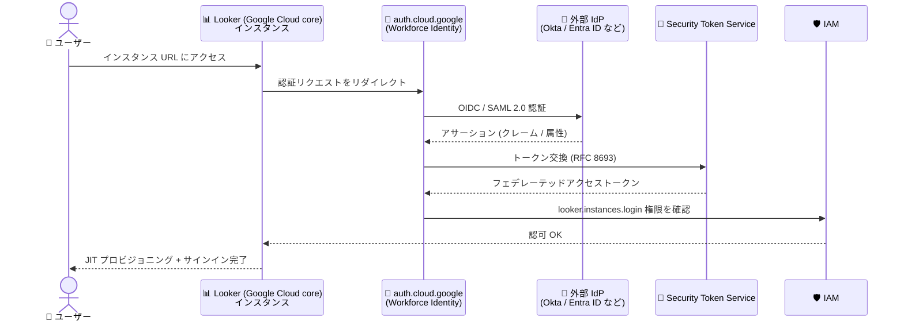

# Looker (Google Cloud core): Workforce Identity Federation サポート (Preview)

**リリース日**: 2026-10-12

**サービス**: Looker (Google Cloud core)

**機能**: Workforce Identity Federation による認証サポート

**ステータス**: Preview

📊 [このアップデートのインフォグラフィックを見る](https://takech9203.github.io/google-cloud-news-summary/20261012-looker-workforce-identity-federation.html)

## 概要

Looker (Google Cloud core) が、Looker 26.18 以降を使用するインスタンスで Workforce Identity Federation を Preview としてサポートしました。Workforce Identity Federation は、Okta や Microsoft Entra ID、PingIdentity などの外部 ID プロバイダ (IdP) を使ってユーザーを認証できる Google Cloud の仕組みで、ユーザーごとに Google アカウントを作成・管理する必要がなくなります。

管理者は、インスタンスの作成時または編集時に Workforce Identity をプライマリ認証方式として選択でき、さらにオプションとして、セカンダリの Google OAuth を有効化して安全なバックアップアクセス手段を確保できます。認証フローでは、ユーザーがインスタンス URL にアクセスすると `https://auth.cloud.google/authorize` にリダイレクトされ、外部 IdP での認証後に Security Token Service (STS) がフェデレーテッドトークンを発行し、`looker.instances.login` IAM 権限の確認を経て Just-In-Time (JIT) でユーザーがプロビジョニングされます。

このアップデートは、Google Workspace や Cloud Identity を全社導入していない組織や、既存の企業 IdP (Okta、Entra ID など) を認証の単一ソースとして維持したい組織にとって、Looker (Google Cloud core) 導入のハードルを大きく下げるものです。

**アップデート前の課題**

- Looker (Google Cloud core) の認証は Google OAuth (IAM 連携) をベースとしており、ユーザーごとに Google アカウント (Cloud Identity / Google Workspace アカウント) が必要だった
- 外部 IdP を使う場合も、Google Cloud Directory Sync (GCDS) などで ID を Google アカウントに同期 (フェデレーション) する運用が前提となり、アカウントのライフサイクル管理の負担が発生していた
- SAML / OIDC をプライマリ認証にする構成でも、バックアップ用の Google OAuth には Google アカウントが必要だった

**アップデート後の改善**

- 外部 IdP (OIDC / SAML 2.0 対応の任意の IdP) の資格情報だけで Looker (Google Cloud core) にシングルサインオン (SSO) できるようになった
- Workforce Identity Federation は同期レス (sync-less) のため、GCDS などによるユーザー同期ツールの運用が不要になった
- IdP の属性 (クレーム) を Looker のユーザー属性やグループにマッピングでき、グループミラーリングによるロール付与や行レベルフィルタへの活用が可能になった
- セカンダリ Google OAuth をバックアップとして有効化でき、IdP 障害時にも管理者がアクセスを維持できるようになった

## アーキテクチャ図



外部 IdP で認証されたユーザーのアサーションを Security Token Service が Google Cloud のフェデレーテッドトークンに交換し、IAM 権限の確認を経て Looker (Google Cloud core) に JIT プロビジョニングでサインインする流れです。Google アカウントは一切登場しません。

## サービスアップデートの詳細

### 主要機能

1. **外部 IdP によるプライマリ認証**
   - OIDC または SAML 2.0 に対応する任意の IdP (Microsoft Entra ID、Okta、PingIdentity など) を利用可能
   - インスタンスの作成時・編集時に、認証セクションで「Workforce Identity Federation (SAML/OIDC)」をプライマリ認証方式として選択
   - Google アカウントの作成・同期が不要な同期レス構成

2. **セカンダリ Google OAuth によるバックアップアクセス**
   - 既存インスタンスの編集時に「Enable Secondary OAuth」トグルを有効化すると、Google OAuth をセカンダリ認証方式として利用可能
   - IdP 側の障害や設定ミス時にも、IAM ロールを持つ管理者・ユーザーが安全にアクセスを維持できる

3. **属性マッピングと JIT プロビジョニング**
   - IdP のクレームを `google.email` (必須)、`attribute.given_name` / `attribute.family_name` (必須)、`google.groups` (グループミラーリング用) にマッピング
   - カスタムクレームは `attribute.<attribute_name>` として Looker のユーザー属性に連携でき、接続のパラメータ化や行レベルフィルタに活用可能
   - 初回サインイン時にユーザーを JIT 作成し、グループとロールのマッピング、デフォルトロール / デフォルトグループを適用

4. **Looker 管理パネルでの制御**
   - [管理] > [認証] > [Workforce Identity] で、ユーザーマージ方式 (Google / SAML / OIDC)、ログインページのバイパス (デフォルト有効)、属性マッピング、グループミラーリングを設定可能

## 技術仕様

### 前提条件と要件

| 項目 | 詳細 |
|------|------|
| 対象バージョン | Looker 26.18 以降のインスタンス |
| ステータス | Preview (Pre-GA Offerings Terms が適用) |
| 対応プロトコル | OIDC、SAML 2.0 |
| 必要な IAM ロール | `roles/iam.workforcePoolAdmin` (組織)、`roles/looker.admin` (プロジェクト)、`roles/resourcemanager.projectIamAdmin` (プロジェクト) |
| 有効化が必要な API | `iam.googleapis.com`、`sts.googleapis.com`、`cloudresourcemanager.googleapis.com`、`looker.googleapis.com` |
| ネットワーク制限 (Preview 中) | パブリックなセキュア接続を使用するインスタンスのみサポート (Private Service Connect / プライベートサービスアクセスは非対応) |
| 必須の属性マッピング | `google.email`、`attribute.given_name`、`attribute.family_name` (未設定の場合は認証に失敗) |

### セッションとトークンの動作

| 項目 | 詳細 |
|------|------|
| ブラウザセッション | 最大 30 日。ただし Workforce プールのリフレッシュトークン有効期間が短い場合はそちらが優先 |
| 推奨セッション設定 | Access Context Manager の拡張セッション長ポリシーで 90 日 (`7776000s`) を設定 |
| スケジュール配信 / アラート | 所有者が約 90 日 (設定した期間) 以内にサインインしない場合は一時停止 |
| ユーザー API キートークン | 有効期間 1 時間、アクティブな IdP セッションが必要 (サービスアカウント API キーは影響なし) |
| バックグラウンド同期 | OIDC は Authorization Code フロー + `offline_access` スコープ、SAML は SCIM 2.0 プロビジョニングが必要 |

### Workforce プリンシパルへの IAM 付与例

```bash
# 特定ユーザーに Looker Instance User ロールを付与
gcloud projects add-iam-policy-binding PROJECT_ID \
  --role="roles/looker.instanceUser" \
  --member="principal://iam.googleapis.com/locations/global/workforcePools/POOL_ID/subject/SUBJECT_ID"

# IdP のグループ単位で付与
gcloud projects add-iam-policy-binding PROJECT_ID \
  --role="roles/looker.instanceUser" \
  --member="principalSet://iam.googleapis.com/locations/global/workforcePools/POOL_ID/group/GROUP_ID"
```

## 設定方法

### 前提条件

1. Google Cloud 組織が設定済みであること (Workforce Identity プールは組織レベルのリソース)
2. Looker 26.18 以降の Looker (Google Cloud core) インスタンス (パブリックなセキュア接続を使用)
3. OIDC または SAML 2.0 に対応した外部 IdP

### 手順

#### ステップ 1: Workforce Identity プールとプロバイダを作成

IAM の Workforce Identity プールを作成し、IdP をプロバイダとして登録します。属性マッピングで `google.email`、`attribute.given_name`、`attribute.family_name` を必ず設定し、グループミラーリングを使う場合は `google.groups` もマッピングします。

#### ステップ 2: Workforce プリンシパルに IAM ロールを付与

`roles/looker.instanceUser` または `roles/looker.admin` を、`principal://` / `principalSet://` 形式のプリンシパル識別子で付与します。

#### ステップ 3: インスタンスでプライマリ認証方式を選択

Google Cloud コンソールでインスタンスの作成または編集を行い、認証セクションで「Workforce Identity Federation (SAML/OIDC)」を選択します。必要に応じて、既存インスタンスの編集時に「Enable Secondary OAuth」を有効化してバックアップアクセスを設定します (セカンダリ OAuth は作成後の編集でのみ設定可能)。

#### ステップ 4: Looker 管理パネルで詳細を設定

Looker インスタンスの [管理] > [認証] > [Workforce Identity] ページで、ユーザーマージ方式、属性マッピング、グループマッピング、新規ユーザーのデフォルトロール / グループを設定します。

#### ステップ 5 (推奨): 拡張セッション長ポリシーを設定

Access Context Manager の `GcpUserAccessBinding` で、Looker インスタンスを所有するプロジェクトをスコープにした拡張セッション長 (最大 90 日) を設定します。

```yaml
# esl-binding.yaml
scopedAccessSettings:
  - scope:
      clientScope:
        restrictedProject:
          name: projects/PROJECT_NUMBER
    activeSettings:
      sessionSettings:
        sessionLength: 7776000s
        sessionLengthEnabled: true
        sessionReauthMethod: LOGIN
```

```bash
gcloud access-context-manager cloud-bindings create \
  --organization=ORG_ID \
  --federated-principal="principalSet://cloudresourcemanager.googleapis.com/organizations/ORG_ID/type/WorkforcePool" \
  --binding-file="esl-binding.yaml"
```

## メリット

### ビジネス面

- **Google アカウント管理の廃止**: ユーザーごとの Google アカウント発行・同期 (GCDS など) が不要になり、ID 管理の運用コストとオンボーディング期間を削減できる
- **既存 IdP への統合**: Okta や Entra ID を認証の単一ソースとして維持したままで Looker (Google Cloud core) を導入でき、全社のセキュリティポリシー (MFA、条件付きアクセスなど) を IdP 側で一元適用できる

### 技術面

- **同期レスのフェデレーション**: ID は IdP 側にのみ存在し、Google Cloud 側にユーザーアカウントを保持しないため、退職者アカウントの消し忘れなどのリスクを低減できる
- **属性ベースのアクセス制御**: IdP のクレームを Looker のユーザー属性・グループにマッピングし、ロール付与や行レベルフィルタ、接続のパラメータ化に活用できる
- **バックアップ経路の確保**: セカンダリ Google OAuth により、IdP 障害時にも管理者のアクセス経路を維持できる

## デメリット・制約事項

### 制限事項

- Preview 機能であり、Pre-GA Offerings Terms が適用される (SLA 対象外)
- Looker 26.18 以降のインスタンスのみ対応
- Preview 期間中はパブリックなセキュア接続を使用するインスタンスのみサポート (Private Service Connect / プライベートサービスアクセスのインスタンスは非対応)
- 拡張セッション長を使う場合、OIDC は Authorization Code フロー + `offline_access` (または SCIM)、SAML は SCIM プロビジョニングが必須
- 属性の鮮度チェックとして 24 時間のしきい値が適用され、IdP から属性を更新できない場合はセッションが無効化され再認証が必要

### 考慮すべき点

- `google.email`、`attribute.given_name`、`attribute.family_name` の属性マッピングが未設定だと認証自体が失敗するため、プロバイダ作成時に必ず設定する
- ユーザー API キートークンは 1 時間で失効し、アクティブな IdP セッションが必要になるため、自動化にはサービスアカウント (API 専用アカウント) の利用を検討する
- スケジュール配信・アラートは所有者のサインインが約 90 日間ない場合に一時停止するため、拡張セッション長ポリシーの設定を推奨
- セカンダリ Google OAuth はインスタンス作成時ではなく、作成後の編集でのみ有効化できる

## ユースケース

### ユースケース 1: Okta を全社 IdP とする企業での Looker 導入

**シナリオ**: 全社の ID 管理を Okta に統一している企業が、Google Workspace を導入せずに Looker (Google Cloud core) で BI 環境を構築したい。

**実装例**:
```
1. 組織に Workforce Identity プールを作成し、Okta を OIDC プロバイダとして登録
2. Okta のグループクレームを google.groups にマッピング
3. principalSet://.../group/analytics-team に roles/looker.instanceUser を付与
4. インスタンスのプライマリ認証を Workforce Identity Federation に設定
5. Looker 管理パネルでグループマッピングと新規ユーザーのデフォルトロールを設定
```

**効果**: ユーザーは Okta の資格情報だけで Looker に SSO でき、Google アカウントの発行・同期作業がゼロになる。入退社時の権限管理も Okta のグループ操作だけで完結する。

### ユースケース 2: IdP 障害に備えたバックアップアクセスの確保

**シナリオ**: Workforce Identity Federation をプライマリ認証にしつつ、IdP の障害や設定ミスで管理者がロックアウトされる事態を回避したい。

**効果**: セカンダリ Google OAuth を有効化し、少数の管理者にのみ `roles/looker.admin` を付与した Google アカウントを用意しておくことで、IdP に依存しない緊急アクセス経路を確保できる。

## 料金

Workforce Identity Federation 自体は無料で利用できます。ただし、詳細監査ログ (detailed audit logging) を有効化した場合は Cloud Logging の料金が発生します。Looker (Google Cloud core) 本体の料金はエディションとユーザー数に基づく既存の料金体系から変更ありません。

- [Looker 料金ページ](https://cloud.google.com/looker/pricing)
- [Google Cloud Observability (Logging) 料金](https://docs.cloud.google.com/stackdriver/pricing#logs-costs)

## 利用可能リージョン

リージョン固有の制限は公式ドキュメントに記載されていません。Preview 期間中はパブリックなセキュア接続を使用するインスタンスのみが対象です。詳細は [Looker (Google Cloud core) のドキュメント](https://docs.cloud.google.com/looker/docs/looker-core-workforce-identity)を参照してください。

## 関連サービス・機能

- **IAM Workforce Identity Federation**: 本機能の基盤。組織レベルの Workforce Identity プールとプロバイダで外部 IdP とのフェデレーションを構成する
- **Security Token Service (STS)**: IdP のアサーションを Google Cloud の短命なフェデレーテッドトークンに交換する (RFC 8693 準拠)
- **Access Context Manager**: 拡張セッション長 (最大 90 日) ポリシーを Looker (Google Cloud core) 向けに設定するために使用
- **Cloud Audit Logs / Cloud Logging**: Workforce Identity Federation の詳細監査ログで IdP から受信した属性を記録し、属性マッピングのトラブルシューティングに活用
- **Cloud SQL**: Looker 以外にも Workforce Identity Federation 認証に対応するサービスの一例 (MySQL / PostgreSQL のマネージド接続)

## 参考リンク

- 📊 [インフォグラフィック](https://takech9203.github.io/google-cloud-news-summary/20261012-looker-workforce-identity-federation.html)
- [公式リリースノート](https://docs.cloud.google.com/release-notes#October_12_2026)
- [Workforce Identity Federation for Looker (Google Cloud core)](https://docs.cloud.google.com/looker/docs/looker-core-workforce-identity)
- [Workforce Identity Federation の概要](https://docs.cloud.google.com/iam/docs/workforce-identity-federation)
- [Workforce Identity Federation の構成](https://docs.cloud.google.com/iam/docs/configuring-workforce-identity-federation)
- [拡張セッション長 (Access Context Manager)](https://docs.cloud.google.com/access-context-manager/docs/extended-session-length-for-workforce-identity-federation)
- [Looker 料金ページ](https://cloud.google.com/looker/pricing)

## まとめ

Looker (Google Cloud core) の Workforce Identity Federation 対応により、Google アカウントを管理せずに Okta や Entra ID などの既存 IdP だけで Looker への SSO が実現できるようになりました。Google Workspace を導入していない組織にとって Looker (Google Cloud core) 採用の大きな障壁が取り除かれます。Preview 段階のためパブリック接続のみの対応などの制約はありますが、外部 IdP を標準とする組織は属性マッピングとグループミラーリングの設計を含めた検証を始めることを推奨します。

---

**タグ**: #Looker #WorkforceIdentityFederation #認証 #SSO #IAM #Preview #セキュリティ
