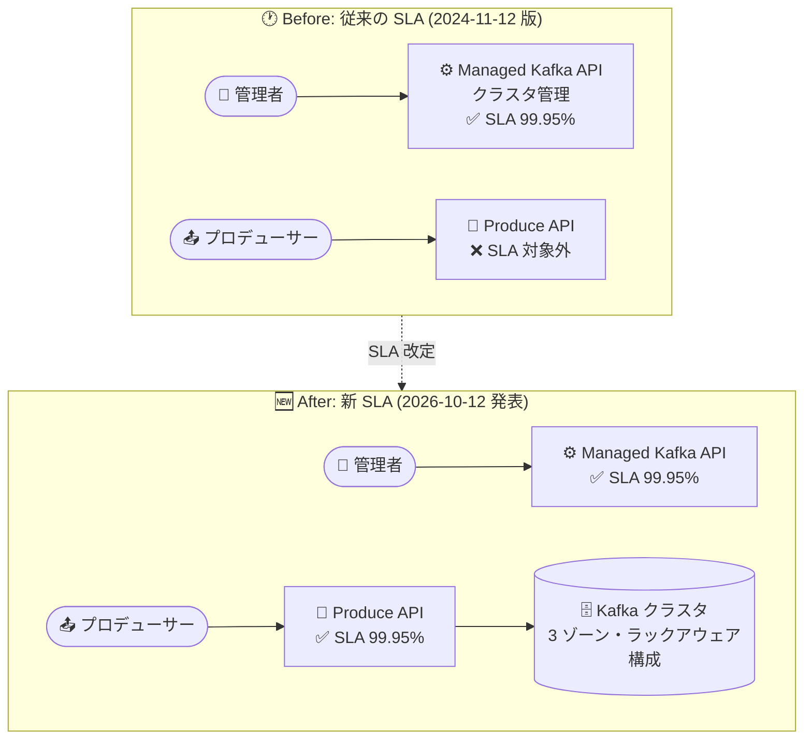

# Google Cloud Managed Service for Apache Kafka: SLA が Produce API をカバー対象に追加

**リリース日**: 2026-10-12

**サービス**: Google Cloud Managed Service for Apache Kafka

**機能**: Produce API の SLA (Service Level Agreement) カバレッジ追加

**ステータス**: Announcement (一般提供)

📊 [このアップデートのインフォグラフィックを見る](https://takech9203.github.io/google-cloud-news-summary/20261012-managed-kafka-produce-api-sla.html)

## 概要

Google Cloud Managed Service for Apache Kafka の SLA (Service Level Agreement) が改定され、新たに **Produce API** がカバー対象 (Covered Service) に追加されました。Produce API に対する月間稼働率 (Monthly Uptime Percentage) の SLO は **99.95% 以上** と定義されており、これはクラスタ管理用の Managed Kafka API と同水準です。

これまでの SLA (2024 年 11 月 12 日版) では、カバー対象はクラスタ・ロケーション・オペレーション管理などのコントロールプレーン操作を担う Managed Kafka API のみでした。今回の改定により、プロデューサークライアントがメッセージを書き込むデータプレーン側の可用性にも金銭的な補償 (Financial Credit) を伴うコミットメントが提供されるようになり、ミッションクリティカルなイベントストリーミング基盤としての信頼性保証が大きく強化されました。

本番環境で Kafka を利用する企業にとって、データプレーンの可用性保証は SLA 要件の厳しいワークロード (決済イベント、注文処理、テレメトリ収集など) を Managed Service for Apache Kafka に移行する際の重要な判断材料となります。

**アップデート前の課題**

- 従来の SLA のカバー対象は「Managed Kafka API」(クラスタ管理用 REST/gRPC API) のみで、メッセージの書き込みを行うデータプレーン (Produce API) は SLA の対象外だった
- プロデューサーからの書き込みが失敗しても、SLA に基づく Financial Credit の請求根拠がなかった
- 可用性要件が厳格なワークロードでは、データプレーンの保証がないことが採用・移行のハードルになっていた

**アップデート後の改善**

- Produce API が Covered Service に追加され、月間稼働率 99.95% 以上の SLO が適用されるようになった
- Produce、InitProducerId、AddPartitionsToTxn、EndTxn、Metadata、SaslHandshake、SaslAuthenticate、ApiVersions といったプロデューサークライアントが使用する Kafka クラスタ API メソッドが保証対象になった
- SLO 未達の場合、月額料金の最大 50% の Financial Credit を受けられる明確な補償体系がデータプレーンにも適用されるようになった

## アーキテクチャ図



従来はコントロールプレーン (Managed Kafka API) のみが SLA 対象でしたが、今回の改定でプロデューサーがメッセージを書き込むデータプレーン (Produce API) も 99.95% の SLO でカバーされるようになりました。

## サービスアップデートの詳細

### 主要機能

1. **Produce API の SLA カバレッジ追加 (SLO 99.95%)**
   - プロデューサークライアントが使用する Kafka クラスタ API メソッド群が Covered Service に追加
   - 対象メソッド: Produce、InitProducerId、AddPartitionsToTxn、EndTxn、Metadata、SaslHandshake、SaslAuthenticate、ApiVersions
   - クライアントをクラスタに接続するための Private Service Connect は対象外

2. **Produce API 固有のダウンタイム定義**
   - Produce API のダウンタイムは「エラー率 100%」(完全な書き込み不能) と定義
   - 1 分あたり 100 件以上の有効なリクエスト (Valid Requests) があった分単位で測定され、100 件未満の分はダウンタイムとしてカウントされない
   - エラー率の算出対象となるエラーコードは -1 (UNKNOWN_SERVER_ERROR)、8 (BROKER_NOT_AVAILABLE)、56 (KAFKA_STORAGE_ERROR)、57 (LOG_DIR_NOT_FOUND)

3. **クラスタ単位での測定と Financial Credit**
   - 月間稼働率と Financial Credit はクラスタごと・暦月単位で算定
   - SLO 未達の場合、未達レベルに応じて月額料金の 10%〜50% がクレジットとして将来の請求に充当される

## 技術仕様

### SLO とダウンタイム定義の比較

| 項目 | Managed Kafka API | Produce API (新規) |
|------|-------------------|--------------------|
| 月間稼働率 SLO | 99.95% 以上 | 99.95% 以上 |
| ダウンタイム定義 | エラー率 50% 超 | エラー率 100% |
| ダウンタイム期間 | 10 分以上連続するダウンタイム | 有効リクエストが 100 件/分以上あった分の合計 |
| 最小有効リクエスト数 | 10 分間に 10 件 | 1 分間に 100 件 |
| 対象エラー | HTTP 500 (Internal Error) | Kafka エラーコード -1、8、56、57 |

### Financial Credit (返金クレジット)

| 月間稼働率 | クレジット (対象サービス月額料金に対する割合) |
|-----------|--------------------------------------------|
| 99.0% 以上 99.95% 未満 | 10% |
| 95% 以上 99.0% 未満 | 25% |
| 95% 未満 | 50% |

- 1 請求月あたりのクレジット上限は、SLO 未達となった Covered Service の月額料金の 50%
- クレジットは将来の利用に充当される形で、請求から 60 日以内に適用される

### SLA 適用の前提となる構成要件 (Valid Requests の条件)

Produce API の有効なリクエストと見なされるには、以下の条件を満たす必要があります。

| 要件 | 内容 |
|------|------|
| Properly Configured Topic | レプリカ数 3 以上、min.insync.replicas が 2 以上かつ総レプリカ数未満 |
| Properly Operated Cluster | 全ブローカーの CPU 使用率が 80% 以下、ブローカーあたりのパーティションレプリカ数が 4,000 以下 |

## 設定方法

SLA の適用に特別な設定は不要ですが、SLA の恩恵を受けるためにトピックとクラスタを要件に沿って構成・運用する必要があります。

### 前提条件

1. トピックをレプリカ数 3 以上、min.insync.replicas = 2 (かつ総レプリカ数未満) で構成する (サービスのデフォルト構成に準拠)
2. クラスタをドキュメントの推奨事項に従って運用する (ブローカー CPU 使用率 80% 以下、ブローカーあたりパーティションレプリカ 4,000 以下)

### 手順

#### ステップ 1: トピック構成の確認

```bash
gcloud managed-kafka topics describe TOPIC_NAME \
  --cluster=CLUSTER_NAME \
  --location=REGION
```

レプリカ数と min.insync.replicas が SLA の「Properly Configured Topic」要件を満たしているか確認します。

#### ステップ 2: Cloud Monitoring でダウンタイムの証跡を記録

Financial Credit を請求するには、ダウンタイムの発生日時を示す Cloud Monitoring のメトリクスを添えて、クレジット受給資格が発生してから 30 日以内に Google テクニカルサポートに申請する必要があります。Produce API のエラー率や可用性に関するアラートポリシーを事前に設定しておくことを推奨します。

## メリット

### ビジネス面

- **ミッションクリティカルワークロードの移行判断材料**: データプレーンの可用性に金銭的補償付きのコミットメントが得られるため、SLA 要件が厳しい基幹システムのイベント基盤として採用しやすくなった
- **コンプライアンス・契約要件への対応**: 社内外の SLA 要件 (ベンダー管理、監査) に対して、公式な稼働率保証を根拠として提示できる

### 技術面

- **可用性の数値目標が明確化**: Produce API について 99.95% という明確な SLO が定義され、可用性設計 (エラーバジェット管理) の基準にできる
- **運用ベストプラクティスの明文化**: SLA 要件 (レプリカ 3、min.insync.replicas 2、CPU 80% 以下、ブローカーあたり 4,000 レプリカ以下) が、そのまま高可用性運用のガイドラインとして機能する

## デメリット・制約事項

### 制限事項

- コンシューマー側 (Fetch API など) は今回の SLA 改定でも明示的なカバー対象になっていない
- Private Service Connect (クライアントとクラスタ間の接続) は Produce API の SLA 対象外
- 1 分あたり 100 件未満の有効リクエストしかない時間帯はダウンタイムとしてカウントされないため、低トラフィックのワークロードでは SLA 違反が成立しにくい
- Produce API のダウンタイム定義は「エラー率 100%」であり、部分的な書き込み失敗 (例: エラー率 50%) はダウンタイムに該当しない

### 考慮すべき点

- SLA の恩恵を受けるには、トピック構成 (レプリカ 3 以上、min.insync.replicas 2 以上) とクラスタ運用 (CPU 80% 以下など) が顧客側の責任として要件化されている点に注意
- Financial Credit は自動付与ではなく、30 日以内の申請と Cloud Monitoring メトリクスによる証跡の提出が必要
- Apache Kafka 自体のバグや顧客側ソフトウェア・ハードウェアに起因するエラー、Pre-GA 機能は SLA の除外対象

## ユースケース

### ユースケース 1: 決済・注文イベントストリーミング基盤の SLA 準拠

**シナリオ**: 金融・EC 企業が決済イベントや注文イベントの処理基盤として Kafka を利用しており、社内規程でデータ書き込み経路に 99.9% 以上の可用性保証が求められている。

**実装例**:
```bash
# SLA 要件を満たすトピック構成 (レプリカ 3、min.insync.replicas 2)
gcloud managed-kafka topics create payment-events \
  --cluster=prod-kafka --location=us-central1 \
  --partitions=12 --replication-factor=3 \
  --configs=min.insync.replicas=2
```

**効果**: Produce API に 99.95% の SLO が適用されるため、自己管理 Kafka で可用性を自前で担保する場合と比べて、保証水準を契約ベースで明示でき、監査・ベンダー評価にも対応しやすくなる。

### ユースケース 2: 自己管理 Kafka からの移行における可用性評価

**シナリオ**: Compute Engine 上で自己管理している Kafka クラスタをマネージドサービスへ移行検討中で、データプレーンの可用性保証の有無が移行判断のブロッカーになっていた。

**効果**: コントロールプレーンとデータプレーン (書き込み) の両方に 99.95% の SLO が揃ったことで、移行後の可用性水準を定量的に評価でき、移行の意思決定が容易になる。

## 料金

今回のアップデートは SLA の改定であり、料金体系の変更はありません。Managed Service for Apache Kafka の料金は、プロビジョニングしたリソース (vCPU、RAM、ローカルストレージ) と消費したリソース (永続ストレージ、データ転送) に基づく従量課金です。

詳細は [Managed Service for Apache Kafka の料金ページ](https://cloud.google.com/managed-service-for-apache-kafka/pricing) を参照してください。

## 利用可能リージョン

SLA は Managed Service for Apache Kafka が提供されるすべてのリージョンのクラスタに適用されます。対応リージョンは [公式ドキュメント](https://docs.cloud.google.com/managed-service-for-apache-kafka/docs/locations) を参照してください。

## 関連サービス・機能

- **Cloud Monitoring**: クラスタのメトリクス監視に加え、Financial Credit 申請時のダウンタイム証跡として必須。エラー率アラートの事前設定を推奨
- **Cloud Logging**: ブローカーログのエクスポート先。障害時の原因調査やログベースのアラート作成に利用
- **Private Service Connect**: クライアントとクラスタ間の接続に使用されるが、Produce API の SLA 対象外である点に注意
- **Pub/Sub**: Google Cloud ネイティブのメッセージングサービス。Pub/Sub にも独自の SLA があり、ワークロード特性に応じた使い分けの比較対象となる
- **Kafka Connect (Managed Service for Apache Kafka)**: BigQuery、Cloud Storage、Pub/Sub などとのデータ統合や MirrorMaker 2.0 によるクラスタ間レプリケーションに利用

## 参考リンク

- 📊 [インフォグラフィック](https://takech9203.github.io/google-cloud-news-summary/20261012-managed-kafka-produce-api-sla.html)
- [公式リリースノート](https://docs.cloud.google.com/release-notes#October_12_2026)
- [Managed Service for Apache Kafka Service Level Agreement](https://cloud.google.com/terms/managed-service-for-apache-kafka/sla)
- [旧版 SLA (2024 年 11 月 12 日版・アーカイブ)](https://cloud.google.com/archive/terms/managed-service-for-apache-kafka/sla-20241112)
- [Managed Service for Apache Kafka 概要](https://docs.cloud.google.com/managed-service-for-apache-kafka/docs/overview)
- [料金ページ](https://cloud.google.com/managed-service-for-apache-kafka/pricing)

## まとめ

Managed Service for Apache Kafka の SLA が Produce API をカバーするようになり、コントロールプレーンに加えてデータプレーン (書き込み) にも 99.95% の可用性コミットメントが提供されるようになりました。ミッションクリティカルなイベントストリーミング基盤の移行を検討しているチームは、本 SLA を根拠に可用性評価を進めるとともに、SLA 適用条件 (レプリカ 3・min.insync.replicas 2 のトピック構成、推奨されたクラスタ運用) を満たしているか既存環境を点検することを推奨します。

---

**タグ**: #ManagedServiceForApacheKafka #Kafka #SLA #ProduceAPI #可用性 #イベントストリーミング
