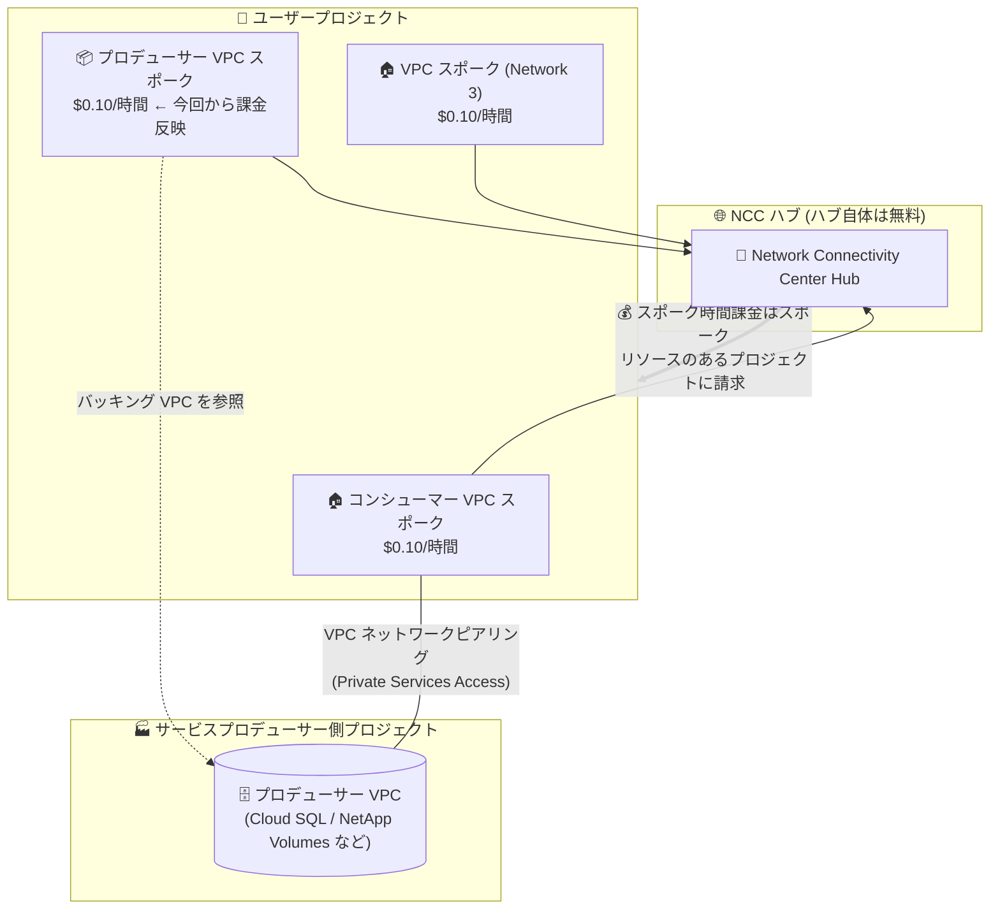

# Network Connectivity Center: プロデューサー VPC スポークの課金問題修正と時間課金の開始

**リリース日**: 2026-10-12

**サービス**: Network Connectivity Center

**機能**: プロデューサー VPC スポークの課金問題修正 (時間単位の使用料金の適用開始)

**ステータス**: Fixed (課金変更)

📊 [このアップデートのインフォグラフィックを見る](https://takech9203.github.io/google-cloud-news-summary/20261012-network-connectivity-center-producer-vpc-spoke-billing.html)

## 概要

Network Connectivity Center (NCC) において、プロデューサー VPC スポーク (producer VPC spoke) に対する誤った課金を引き起こしていた技術的な問題が修正されました。2026 年 10 月 12 日以降、NCC ハブにリンクされたプロデューサー VPC スポークを持つプロジェクトには、時間単位の使用料金 (スポーク時間課金) が請求に反映されます。今後の請求書における料金は、Network Connectivity Center の公式料金体系に基づいて計算されます。

プロデューサー VPC スポークは、プライベートサービスアクセス (Private Services Access) を利用するマネージドサービス (Cloud SQL などの Google サービスや Google Cloud NetApp Volumes など) のプロデューサー VPC ネットワークを NCC ハブに接続する機能です。これにより、ピアリングされたコンシューマー VPC だけでなく、同一ハブ上の他の VPC スポークからもマネージドサービスへアクセスできるようになります。

今回のアップデートは機能変更ではなく課金の修正ですが、プロデューサー VPC スポークを利用しているプロジェクトでは今後のコストが実際に増加するため、Solutions Architect や FinOps 担当者はコストへの影響を把握しておく必要があります。

**アップデート前の課題**

このアップデート以前には、以下の課金上の問題が存在していました。

- 技術的な問題により、プロデューサー VPC スポークに対する課金が正しく行われていなかった (時間単位の使用料金が請求書に正しく反映されていなかった)
- 実際の請求額が公式料金体系と一致しないため、プロデューサー VPC スポーク利用時の正確なコスト予測・コスト管理が困難だった

**アップデート後の改善**

- 課金を誤らせていた技術的な問題が修正された
- 2026 年 10 月 12 日以降、プロデューサー VPC スポークの時間単位の使用料金 (スポーク時間課金) が請求書に正しく反映されるようになった
- 今後の請求は公式の [Network Connectivity Center 料金](https://cloud.google.com/network-connectivity/pricing#ncc-pricing)に基づくため、料金ページを参照した正確なコスト見積もりが可能になった

## アーキテクチャ図



プロデューサー VPC スポークはユーザープロジェクト内に作成されるリソースであり、スポーク時間課金 ($0.10/時間) はスポークリソースが存在するプロジェクトに請求されます。今回の修正により、この課金が請求書へ正しく反映されるようになりました。

## サービスアップデートの詳細

### 主要なポイント

1. **課金の技術的問題の修正**
   - プロデューサー VPC スポークに対する誤った課金を引き起こしていた技術的な問題が修正された
   - 修正日 (2026 年 10 月 12 日) 以降の使用分から、時間単位の使用料金が請求に反映される

2. **スポーク時間課金の適用**
   - プロデューサー VPC スポークには VPC スポークと同じ **$0.10/時間** のスポーク時間課金が適用される
   - スポーク時間課金は、スポークが **ACTIVE 状態** の間のみ発生する
   - 課金はスポークリソースが存在するプロジェクト (ピアリングされたコンシューマー VPC スポークと同じプロジェクト) に請求される

3. **プロデューサー VPC スポークとは**
   - プライベートサービスアクセス経由で提供されるマネージドサービスのプロデューサー VPC ネットワークを、NCC ハブにスポークとして追加する機能
   - プロデューサー VPC スポークのサブネットルートがハブにエクスポートされ、同一ハブ上の他の VPC スポークからマネージドサービスにアクセス可能になる
   - 対応サービス: プライベートサービスアクセスで提供される Google サービス、Google Cloud NetApp Volumes など

## 技術仕様

### 課金仕様

| 項目 | 詳細 |
|------|------|
| 課金対象 | NCC ハブにリンクされたプロデューサー VPC スポーク |
| 課金単位 | スポーク時間 (時間単位の使用料金) |
| 単価 | $0.10/時間 (VPC スポークと同額) |
| 課金条件 | スポークが ACTIVE 状態の間のみ課金 |
| 請求先 | スポークリソースが存在するプロジェクト |
| 適用開始 | 2026 年 10 月 12 日以降の請求書に反映 |

### プロデューサー VPC スポークの特性 (課金に関連する部分)

| 項目 | 詳細 |
|------|------|
| リソースの場所 | プロデューサー VPC スポークリソースはユーザーのプロジェクトに作成される (バッキング VPC はプロデューサー所有プロジェクト) |
| アウトバウンドトラフィック | トラフィックの発信元スポークのプロジェクトに課金 (NetApp Volumes の場合、プロデューサー VPC スポークからのデータ転送はボリュームを所有するユーザープロジェクトに課金) |
| ADN (Advanced Data Networking) | スポークからハブ経由で送信されるトラフィックに $0.02/GiB のデータ処理料金 |

## メリット

### ビジネス面

- **コストの透明性向上**: 請求額が公式料金体系と一致するようになり、プロデューサー VPC スポークの正確なコスト予測・予算策定が可能になった
- **請求の正確性**: 誤課金の問題が解消され、請求書の内容を公式料金ページと照合して検証できるようになった

### 技術面

- **料金体系の一貫性**: プロデューサー VPC スポークが通常の VPC スポークと同じ $0.10/時間で課金され、スポークタイプ間で一貫したコストモデルになった
- **ACTIVE 状態ベースの課金**: スポークが ACTIVE 状態の間のみ課金されるため、使用状況に応じた公平な課金が行われる

## デメリット・制約事項

### 考慮すべき点

- **コスト増加**: これまで課金が正しく反映されていなかったプロジェクトでは、2026 年 10 月 12 日以降の請求額が実質的に増加する。プロデューサー VPC スポーク 1 本あたり月額約 $73 (730 時間 × $0.10) のコストを見込む必要がある
- **請求の確認**: プロデューサー VPC スポークを利用中のプロジェクトは、次回以降の請求書で NCC のスポーク時間課金の項目を確認することを推奨
- **不要なスポークの整理**: 利用していないプロデューサー VPC スポークが残っている場合、課金対象となるため削除を検討する。ただし、スポークを削除して別のハブに同じ VPC のスポークを再作成する場合は 10 分以上のクールダウン期間が必要
- **ADN・データ転送料金は別途**: スポーク時間課金に加えて、ハブ経由のトラフィックには ADN ($0.02/GiB) などの料金が別途適用される

## ユースケース

### ユースケース 1: プロデューサー VPC スポーク利用プロジェクトのコスト影響確認

**シナリオ**: Cloud SQL や NetApp Volumes をプライベートサービスアクセス経由で利用し、プロデューサー VPC スポークで NCC ハブに接続している企業が、今回の課金開始によるコスト影響を把握したい。

**実装例**:
```bash
# プロジェクト内のスポーク一覧を確認 (プロデューサー VPC スポークの有無と状態をチェック)
gcloud network-connectivity spokes list \
    --project=PROJECT_ID \
    --format="table(name, spokeType, state)"
```

**効果**: ACTIVE 状態のプロデューサー VPC スポーク数を把握し、「スポーク数 × $0.10/時間」で月額コストを事前に見積もることができる。

### ユースケース 2: 不要なプロデューサー VPC スポークの棚卸し

**シナリオ**: 検証用に作成したまま使用していないプロデューサー VPC スポークが残っており、課金開始を機にコスト最適化を行いたい。

**効果**: 不要なスポークを削除することで、スポーク 1 本あたり月額約 $73 のコストを削減できる。削除後も、コンシューマー VPC とプロデューサー VPC 間の既存の VPC ネットワークピアリングによる接続は維持される (NCC 経由の他スポークからのアクセスは失われる点に注意)。

## 料金

Network Connectivity Center のハブ・スポーク課金は以下の通りです (2026 年 10 月時点、公式料金ページより)。

| リソース | 料金 (USD) |
|----------|------------|
| ハブ | 無料 |
| スポーク時間 (Cloud Interconnect / Cloud VPN / Router アプライアンススポーク) | $0.075/時間 |
| スポーク時間 (**VPC スポークおよびプロデューサー VPC スポーク**) | **$0.10/時間** |
| Advanced Data Networking (ADN) | $0.02/GiB (VPC スポーク発のハブ経由トラフィック) |

- スポーク時間課金は、スポークが ACTIVE 状態である時間に対して発生します
- スポーク時間課金の免除 (VPN スポーク 3 本、Cloud Interconnect スポーク 3 本まで) はハイブリッドスポークが対象であり、VPC / プロデューサー VPC スポークには適用されません

### 料金例

| 使用量 | 月額料金 (概算) |
|--------|-----------------|
| プロデューサー VPC スポーク 1 本 (730 時間稼働) | 約 $73 |
| プロデューサー VPC スポーク 1 本 + コンシューマー VPC スポーク 1 本 (30 日間) | 約 $144 (2 × 24 時間 × 30 日 × $0.10) |

## 関連サービス・機能

- **VPC ネットワークピアリング / プライベートサービスアクセス**: プロデューサー VPC スポークの前提となる接続方式。コンシューマー VPC とプロデューサー VPC 間のピアリング接続が必要
- **Google Cloud NetApp Volumes**: プロデューサー VPC スポークの対応サービスの 1 つ。Flex Unified / Flex File サービスレベルのストレージプールを NCC 経由で他ネットワークへ公開可能
- **Cloud Billing**: 請求書でスポーク時間課金の反映状況を確認。予算アラートの設定によりコスト増加を監視可能
- **Cloud Interconnect / Cloud VPN / Router アプライアンス**: NCC ハブに接続できるハイブリッドスポーク。スポーク時間課金の単価が異なる ($0.075/時間)

## 参考リンク

- 📊 [インフォグラフィック](https://takech9203.github.io/google-cloud-news-summary/20261012-network-connectivity-center-producer-vpc-spoke-billing.html)
- [公式リリースノート](https://docs.cloud.google.com/release-notes#October_12_2026)
- [プロデューサー VPC スポークの概要](https://docs.cloud.google.com/network-connectivity/docs/network-connectivity-center/concepts/producer-vpc-spokes-overview)
- [VPC スポークの概要 (課金セクション)](https://docs.cloud.google.com/network-connectivity/docs/network-connectivity-center/concepts/vpc-spokes-overview)
- [プロデューサー VPC スポークの作成](https://docs.cloud.google.com/network-connectivity/docs/network-connectivity-center/how-to/create-producer-vpc-spoke)
- [Network Connectivity Center 料金ページ](https://cloud.google.com/network-connectivity/pricing#ncc-pricing)

## まとめ

今回の修正により、NCC のプロデューサー VPC スポークに対して時間単位の使用料金 ($0.10/時間) が 2026 年 10 月 12 日以降の請求に正しく反映されるようになりました。プロデューサー VPC スポークを利用中のプロジェクトでは、スポーク 1 本あたり月額約 $73 のコスト増を見込み、次回請求書の確認と不要なスポークの棚卸しを行うことを推奨します。

---

**タグ**: Network Connectivity Center, NCC, プロデューサー VPC スポーク, 課金, 料金, VPC ピアリング, プライベートサービスアクセス, ネットワーキング
