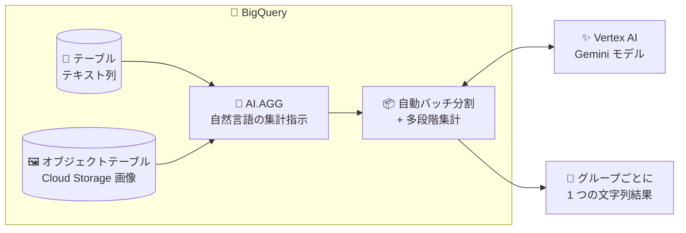

# BigQuery: AI.AGG 関数が一般提供 (GA) 開始

**リリース日**: 2026-10-13

**サービス**: BigQuery

**機能**: AI.AGG 関数 (セマンティック集計)

**ステータス**: GA (一般提供)

📊 [このアップデートのインフォグラフィックを見る](https://takech9203.github.io/google-cloud-news-summary/20261013-bigquery-ai-agg-ga.html)

## 概要

BigQuery の AI.AGG 関数が一般提供 (GA) になりました。AI.AGG は、自然言語の指示に基づいて非構造化データをセマンティックに集計する関数です。Vertex AI の Gemini モデルを使用し、テキストや画像データを入力として受け取り、グループごとに 1 つの文字列結果を返します。

従来の SQL 集計関数 (SUM、COUNT、STRING_AGG など) は数値演算や単純な文字列連結しかできませんでしたが、AI.AGG を使うと「このユーザーのレビュー全体のセンチメントを要約して」「これらの画像の主要なカテゴリは何か」といった意味的な集計を SQL の `GROUP BY` と組み合わせて実行できます。AI.IF、AI.SCORE、AI.CLASSIFY と並ぶ BigQuery のマネージド AI 関数ファミリーの一つであり、データアナリストやデータエンジニアが追加のパイプラインを構築せずに LLM による分析を SQL ワークフローに組み込めます。

**アップデート前の課題**

- AI.AGG は Preview として提供されており、Pre-GA Offerings Terms の下で「現状有姿」での提供となるため、本番ワークロードでの利用には SLA やサポートの面で制約があった
- 汎用 AI 関数 (AI.GENERATE、AI.GENERATE_TEXT) で集計タスクを行う場合、Gemini のコンテキストウィンドウを超えるデータを扱うには、バッチ分割と多段集計のロジックを手動で実装する必要があった
- AI.GENERATE は入力行ごとに 1 つの結果を返すため、グループ全体を要約するには結果をさらに集約する追加処理が必要だった

**アップデート後の改善**

- GA となり、一般提供の利用規約の下で本番環境のワークロードに安心して利用できるようになった
- データのバッチ処理とバッチ結果の集約による多段階集計を関数が自動実行するため、Gemini の標準コンテキストウィンドウを超えるサイズのデータも手動実装なしで分析できる
- 入力グループごとに 1 つの文字列結果を返すため、`GROUP BY` と自然に組み合わせて使用できる

## アーキテクチャ図



AI.AGG はテーブルのテキスト列や Cloud Storage 上の画像 (ObjectRef 経由) を入力として受け取り、データを自動的にバッチ分割して Gemini で多段階集計を行い、グループごとに 1 つの集計結果を返します。

## サービスアップデートの詳細

### 主要機能

1. **自然言語によるセマンティック集計**
   - 「これらのレビューの全体的なセンチメントは?」のような自然言語の指示 (INSTRUCTION) で集計内容を指定
   - `GROUP BY` と組み合わせて、グループごとに 1 つの文字列結果を取得できる

2. **マルチモーダル入力対応**
   - 入力は STRING 値、または STRING 値・ObjectRefRuntime 値 (およびそれらの配列) で構成される STRUCT
   - ObjectRefRuntime 値は OBJ.GET_ACCESS_URL 関数で生成し、Cloud Storage 上のテキスト・画像データを参照できる

3. **コンテキストウィンドウを超えるデータの自動処理**
   - データのバッチ処理とバッチ結果の集約による多段階集計を自動実行
   - Gemini の標準コンテキストウィンドウを超えるサイズのデータを分析可能 (汎用 AI 関数では手動のバッチロジック実装が必要)

4. **モデル・接続の柔軟な指定**
   - `endpoint` 引数で Gemini モデルを指定可能 (省略時は BigQuery が自動選択)
   - `connection_id` で Cloud リソース接続を指定、省略時はエンドユーザー認証情報を使用

## 技術仕様

### 構文

```sql
AI.AGG(
  [ DISTINCT ] INPUT,
  INSTRUCTION
  [, connection_id => 'CONNECTION']
  [, endpoint => 'ENDPOINT']
)
```

### 引数と仕様

| 項目 | 詳細 |
|------|------|
| INPUT | 集計対象データ。STRING 値、または STRING / ObjectRefRuntime 値とその配列で構成される STRUCT |
| INSTRUCTION | 自然言語の集計プロンプト (文字列またはクエリパラメータ) |
| CONNECTION | Cloud リソース接続 (`[PROJECT_ID.]LOCATION.CONNECTION_ID` 形式)。省略時はエンドユーザー認証情報を使用 |
| ENDPOINT | 使用する Vertex AI エンドポイント。thinking budget を必要としない Gemini モデルを指定可能 |
| 戻り値 | グループごとに 1 つの STRING 値 |
| 推奨入力規模 | クエリあたり 2,000 万行以下、1,000 個以下の distinct グループ (超過するとタイムアウトの可能性) |

### サポートされるモデル

BigQuery がサポートする Gemini モデル (マルチリージョンエンドポイントのみ対応、リージョナルエンドポイントは非対応):

- gemini-3.1-flash-lite
- gemini-3.5-flash
- gemini-3.5-flash-lite
- gemini-3.6-flash
- gemini-3.7-flash
- gemini-3.8-flash

リージョンを省略した短いエンドポイント名 (例: `gemini-3.5-flash`) を指定した場合、クエリの実行リージョンに応じて `us` / `eu` / `global` エンドポイントが自動選択されます。`asia-south1` リージョンで実行する場合は、完全修飾の global エンドポイント名の指定が必要です。

## 設定方法

### 前提条件

1. BigQuery が利用可能な Google Cloud プロジェクト
2. (接続を使用する場合) Vertex AI および Cloud Storage と通信するための Cloud リソース接続
3. 画像など Cloud Storage 上のデータを扱う場合は、オブジェクトテーブルと OBJ.GET_ACCESS_URL 関数を使用

### 手順

#### 例 1: テキストの集計 (著者ごとの投稿トピック要約)

```sql
WITH sample_data AS (
  SELECT *
  FROM `bigquery-public-data.hacker_news.full` AS t
  WHERE t.text IS NOT NULL AND t.type = 'story'
    AND t.by IN UNNEST(['amichail', 'kids_book', 'whoishiring', 'michaelmayer'])
  LIMIT 30000
)
SELECT
  t.by,
  AI.AGG(
    t.text,
    'These are the hacker news blog posts of a single user. Tell me what topics the user talks about the most. Keep it concise.'
  ) AS common_topic
FROM sample_data AS t
GROUP BY t.by;
```

`GROUP BY` で著者ごとにグループ化し、各著者の投稿全体を要約した 1 つの文字列を取得します。

#### 例 2: 画像コンテンツの集計

```sql
SELECT
  AI.AGG(
    STRUCT(OBJ.GET_ACCESS_URL(ref, 'r')),
    'What are the major categories of these images?'
  ) AS category_description
FROM `cymbal_pets.product_images`;
```

オブジェクトテーブル経由で Cloud Storage 上の画像群を参照し、画像全体の主要カテゴリを要約します。

## メリット

### ビジネス面

- **本番利用の安心感**: GA により Pre-GA Offerings Terms の制約がなくなり、本番ワークロードへ導入しやすくなった
- **分析の民主化**: SQL と自然言語の指示だけで、レビューのセンチメント分析やログ分析などの高度な集計が可能になり、専用パイプラインの開発コストを削減できる

### 技術面

- **多段階集計の自動化**: コンテキストウィンドウを超えるデータのバッチ分割・集約ロジックを自前で実装する必要がない
- **SQL との自然な統合**: 集計関数として `GROUP BY` と組み合わせられるため、既存のクエリに組み込みやすい
- **マルチモーダル対応**: テキストだけでなく Cloud Storage 上の画像も同一の関数で集計できる

## デメリット・制約事項

### 制限事項 (既知の問題)

- 1 つの入力行に 10 枚以上の画像が含まれる場合、その行はスキップされる可能性がある
- OBJ.GET_ACCESS_URL を呼び出す ObjectRefRuntime オブジェクトの配列を含む入力行はスキップされる可能性がある
- 10 MiB を超える個別の行は、内部エラーで関数が失敗する可能性がある
- 同一クエリで DISTINCT 修飾子なしの AI.AGG と DISTINCT 修飾子付きの別の集計関数を併用すると、内部エラーが返される可能性がある
- Gemini 3 エンドポイントを使用して空の結果を返すよう指示すると、内部エラーが返される可能性がある

### 考慮すべき点

- Gemini モデルによる推論は比較的高コストな操作であり、JOIN や `ORDER BY ... LIMIT` を含む複雑なクエリでは、モデルが処理する行数が想定と異なる場合がある。行数を厳密に制御するには、クエリ結果を事前に別テーブルにマテリアライズしてから推論を実行することが推奨される
- バッチ処理と集約の仕組み上、Gemini に送信される合計トークン数はソースデータのトークン数より多くなる
- 入力トークン数の事前見積もりには AI.COUNT_TOKENS 関数を使用できる
- コスト暴走を防ぐため、トークンクォータ (プロジェクトあたりの 1 日の入力/出力トークン上限) による制御が利用できる

## ユースケース

### ユースケース 1: ユーザーレビューのセンチメント分析

**シナリオ**: EC サイトの商品レビューを商品ごとにグループ化し、全体的なセンチメントや、共通して言及されるポジティブ/ネガティブな点を把握したい。

**実装例**:
```sql
SELECT
  product_id,
  AI.AGG(
    review_text,
    'これらのレビュー全体のセンチメントと、共通して言及される良い点・悪い点を簡潔にまとめてください。'
  ) AS review_summary
FROM reviews
GROUP BY product_id;
```

**効果**: 商品ごとのレビュー傾向を SQL だけで集約でき、個別レビューを読む工数を削減できる。

### ユースケース 2: ログ分析

**シナリオ**: アプリケーションのユーザー行動ログから、ユーザーが最も操作した機能や、切断前の最も一般的な最終アクションを把握したい。

**効果**: 大量のログデータに対しても自動バッチ処理により集計が可能で、ログ分析パイプラインを別途構築せずにインサイトを得られる。

### ユースケース 3: AI エージェントのパフォーマンス分析

**シナリオ**: AI エージェントのタスク実行ログを集計し、最も速く完了したタスクの種類や、完了までに最も多くのユーザー対話を要したタスクの種類を分析したい。

**効果**: エージェントの改善ポイントを自然言語の問いで直接抽出できる。

## 料金

AI.AGG 関数は Vertex AI の Gemini モデルに推論リクエストを送信するため、BigQuery のクエリ料金に加えて Vertex AI 側の推論コスト (トークンベース) が発生します。

- バッチ処理・集約の仕組み上、Gemini に送信される合計トークン数はソースデータのトークン数より多くなる点に注意
- Cloud Billing で Vertex AI サービスをフィルタし、`bigquery_job_id_prefix` ラベルでジョブ単位のコストを追跡可能
- トークンクォータ (デフォルト: プロジェクトあたり 1 日の入力トークン 2,000 億、出力トークン 200 億など) でコストを制御可能

詳細は [BigQuery の料金ページ](https://cloud.google.com/bigquery/pricing) および [Vertex AI の料金ページ](https://cloud.google.com/vertex-ai/pricing) を参照してください。

## 利用可能リージョン

エンドポイントのロケーションが使用する Gemini モデルをサポートしていれば、任意の BigQuery リージョンで AI.AGG 関数を実行できます。クエリ処理リージョンにサポートされる Gemini エンドポイントがない場合は、global エンドポイントなどの完全修飾エンドポイントの指定が必要です。

## 関連サービス・機能

- **Vertex AI (Gemini)**: AI.AGG の推論基盤。使用するモデルとエンドポイントを `endpoint` 引数で指定できる
- **Cloud Storage / オブジェクトテーブル**: 画像などの非構造化データを ObjectRef 経由で AI.AGG の入力として参照できる
- **AI.GENERATE / AI.GENERATE_TEXT**: 行単位の汎用 AI 関数。集計タスクには AI.AGG が推奨される
- **AI.IF / AI.SCORE / AI.CLASSIFY**: AI.AGG と同じマネージド AI 関数ファミリー。フィルタリング、スコアリング、分類に使用
- **AI.COUNT_TOKENS**: クエリ実行前に入力トークン数を見積もるユーティリティ関数

## 参考リンク

- 📊 [インフォグラフィック](https://takech9203.github.io/google-cloud-news-summary/20261013-bigquery-ai-agg-ga.html)
- [公式リリースノート](https://docs.cloud.google.com/release-notes#October_13_2026)
- [AI.AGG 関数リファレンス](https://docs.cloud.google.com/bigquery/docs/reference/standard-sql/bigqueryml-syntax-ai-agg)
- [生成 AI の概要 (BigQuery)](https://docs.cloud.google.com/bigquery/docs/generative-ai-overview)
- [トークンクォータによるコスト制御](https://docs.cloud.google.com/bigquery/docs/control-genai-costs)
- [BigQuery 料金ページ](https://cloud.google.com/bigquery/pricing)

## まとめ

AI.AGG 関数の GA により、非構造化データのセマンティック集計を SQL だけで本番ワークロードに組み込めるようになりました。レビュー分析やログ分析で LLM ベースの集計パイプラインを自前実装している場合は、AI.AGG への置き換えによる簡素化を検討する価値があります。導入時は AI.COUNT_TOKENS による事前見積もりとトークンクォータの設定で、推論コストの管理を行うことを推奨します。

---

**タグ**: BigQuery, AI.AGG, 生成AI, Gemini, GA, セマンティック集計, マネージドAI関数
