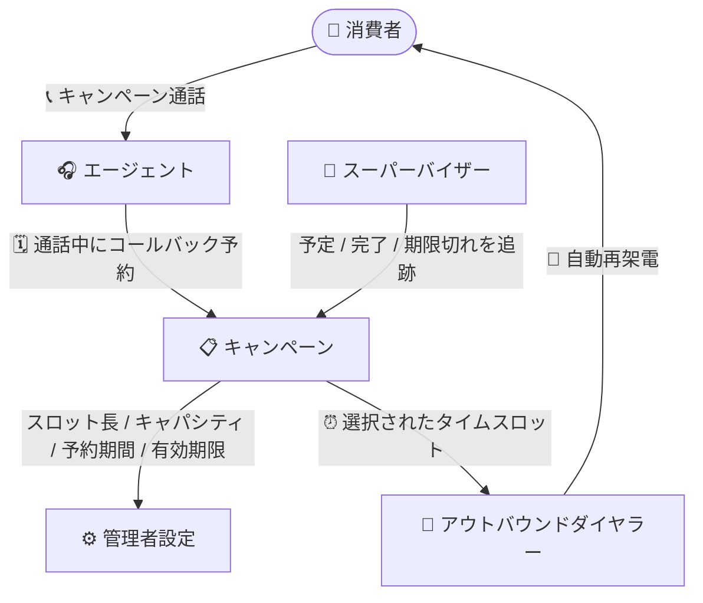

# Google Cloud Contact Center as a Service: バージョン 6.22 プレリリースノート

**リリース日**: 2026-10-13 (プレリリースノート公開日)

**サービス**: Google Cloud Contact Center as a Service (CCaaS)

**機能**: バージョン 6.22 プレリリースノート (キャンペーンベースのスケジュールコールバック、チャットトランスクリプト分割、多数のバグ修正)

**ステータス**: プレリリース (次期バージョンの事前公開情報)

📊 [このアップデートのインフォグラフィックを見る](https://takech9203.github.io/google-cloud-news-summary/20261013-ccaas-6-22-prerelease-notes.html)

## 概要

Google Cloud CCaaS の次期バージョン 6.22 のプレリリースノートが公開されました。**これは正式リリース前の事前公開情報であり、実際のリリース時には内容が変更される可能性があります。** Google は「このバージョンをリリースする際、新機能はここに示すとおりになる見込み」としています。

バージョン 6.22 では、2 つの新機能が予定されています。1 つ目は「キャンペーンベースのスケジュールコールバック」で、アウトバウンドキャンペーン通話中にエージェントがコールバックを予約できるようになります。コールバックは個々のエージェントではなくキャンペーンに帰属し、ダイヤラーが消費者の選択した時間帯に自動で再架電します。2 つ目は「チャットのトランスクリプト分割」で、1 セッションにつき 1 つの統合トランスクリプトではなく、チャットに参加した各参加者 (エージェント、仮想エージェント、スーパーバイザー) のセグメントごとに個別のトランスクリプトファイルを生成できるようになります。

また、本リリースでは 40 件以上のバグ修正が含まれます。キュー超過時の内線デフレクションで DAP (ダイレクトアクセスポイント) のあいさつメッセージが 2 回再生される問題、Salesforce ルックアップ失敗時の重複レコード作成、スキルベースキューのリアルタイムモニタリングで対応可能エージェント数が正しくカウントされない問題など、音声・チャット・レポーティング・CRM 連携にわたる広範な修正が予定されています。コンタクトセンターの管理者・スーパーバイザー・運用チームは、正式リリースに備えて内容を把握しておくことが推奨されます。

**アップデート前の課題**

- アウトバウンドキャンペーン通話中にコールバックをキャンペーン単位で予約・管理する仕組みがなく、消費者の都合に合わせた再架電をキャンペーンのワークフローとして運用できなかった
- チャットのトランスクリプトはセッションごとに 1 つの統合ファイルとして出力され、転送やエスカレーションが発生した会話でどの参加者がどの部分を担当したかを特定しにくかった
- DAP あいさつの二重再生、重複コールレコードによる誤った待ち時間表示、スキルベースキューでの可用エージェント数の誤表示など、多数の既知の不具合が存在していた

**アップデート後の改善**

- エージェントがキャンペーン通話中にコールバックを予約でき、ダイヤラーが消費者の選択したタイムスロットに自動で再架電する。管理者はキャンペーンごとにスロット長・キャパシティ・予約可能期間・有効期限を設定でき、スーパーバイザーはキャンペーンリストから予定・完了・期限切れのコールバックを追跡できる
- Settings > Chat > Chat Transcript で Transcript Separation を Per Segment に設定すると、参加者セグメントごとに個別のトランスクリプトファイルが生成される (消費者には従来どおり全体の統合トランスクリプトが提供される)
- 音声、チャット、レポーティング、CRM 連携、セキュリティ (Kubernetes / Google Cloud サービスアカウントの過剰権限) にわたる 40 件以上の不具合が修正される

## アーキテクチャ図

キャンペーンベースのスケジュールコールバックのフロー。コールバックは個々のエージェントではなくキャンペーンに帰属し、ダイヤラーが消費者の選んだ時間帯に自動で再架電します。

## サービスアップデートの詳細

### 主要機能

1. **キャンペーンベースのスケジュールコールバック**
   - エージェントはアウトバウンドキャンペーン通話中にコールバックを予約できる
   - コールバックは個々のエージェントではなくキャンペーンに帰属し、ダイヤラーが消費者の選択したタイムスロットに再架電する
   - 管理者はキャンペーンごとにスロット長、キャパシティ、予約可能期間 (booking window)、有効期限 (expiry) を設定できる
   - スーパーバイザーはキャンペーンリストから「予定」「完了」「期限切れ」のコールバックを追跡できる

2. **チャットのトランスクリプト分割 (Transcript Separation)**
   - セッションごとの統合トランスクリプトに代えて、参加者セグメントごとに個別のトランスクリプトファイルを配信するよう構成できる
   - Settings > Chat > Chat Transcript の Transcript Separation で Per Segment を選択する
   - チャットに参加した各エージェント、仮想エージェント、スーパーバイザーごとに個別ファイルが生成され、転送・エスカレーションされた会話でどの参加者がどの部分を担当したかを特定しやすくなる
   - この設定にかかわらず、消費者には従来どおり全チャットの統合トランスクリプトが提供される
   - デフォルトでは無効。有効化するには Google Cloud サポートへの連絡が必要

3. **バグ修正 (40 件以上)**
   - 主な修正内容は以下のとおり:
     - キュー超過により内線番号へデフレクションされた際、DAP (ダイレクトアクセスポイント) のあいさつメッセージが 2 回再生される問題
     - トップレベルメニューのセッションメタデータが、ユーザー設定言語ではなく英語で表示される問題
     - Salesforce ルックアップの失敗が「一致なし」として扱われ、重複レコードが作成される問題
     - 管理画面で非表示にしたインバウンド転送制限が有効なまま残り、キューが転送先として到達不能になる問題
     - ウォーム転送完了後も通話録音に保留音が流れ続ける問題
     - スキルベースキューの Real-time Monitoring Queues レポートで、スキル一致エージェントが正しくカウントされず利用可能エージェントが 0 と表示される問題
     - キュー投入後に外部番号へデフレクションされた通話が「顧客による放棄」として誤記録される問題
     - 1 件のインバウンド通話に対して重複したコールレコードが作成され、リアルタイムキュービューの待ち時間が不正確になる問題
     - 高いデータベースレイテンシにより着信が SIP 603 エラーで拒否される問題
     - ノルウェー、デンマークなど一部の国際地域で IVR カスタムコールバック番号に誤って +1 プレフィックスが付与される問題
     - 仮想エージェントから人間へのチャットエスカレーションで、エージェント割り当てに最大 300 秒の遅延が発生する問題
     - Kubernetes および Google Cloud サービスアカウントに過剰に広い権限が付与され、権限昇格を許す可能性があった問題
     - ピックアップとカスケードタイマー満了が重なった場合に 1 件の通話が 2 人のエージェントに同時割り当てされる問題
     - レポートのエクスポートがダウンロードされない、または処理中のまま進まない問題

## 技術仕様

### キャンペーンベースのスケジュールコールバックの設定項目

| 項目 | 詳細 |
|------|------|
| スロット長 (slot length) | コールバック時間枠の長さをキャンペーンごとに設定 |
| キャパシティ (capacity) | 各スロットで受け付けるコールバック数の上限 |
| 予約可能期間 (booking window) | コールバックを予約できる期間 |
| 有効期限 (expiry) | コールバックの有効期限 |
| 帰属先 | 個々のエージェントではなくキャンペーンに帰属 |
| 追跡 | スーパーバイザーがキャンペーンリストから予定・完了・期限切れを確認 |

### チャットトランスクリプト分割の設定

| 項目 | 詳細 |
|------|------|
| 設定場所 | Settings > Chat > Chat Transcript > Transcript Separation |
| 設定値 | Per Segment (参加者セグメントごとに個別ファイル生成) |
| 対象参加者 | エージェント、仮想エージェント、スーパーバイザー |
| 消費者向けトランスクリプト | 設定にかかわらず常に全チャットの統合版を受領 |
| デフォルト | 無効 (有効化には Google Cloud サポートへの連絡が必要) |

## メリット

### ビジネス面

- **コールバック運用のキャンペーン単位での一元管理**: コールバックが特定のエージェントに紐づかないため、エージェントのシフトや離席に左右されず、キャンペーン全体として確実に再架電できる。消費者は都合のよい時間帯を選択でき、接続率と顧客体験の向上が期待できる
- **スーパーバイザーの可視性向上**: 予定・完了・期限切れのコールバックをキャンペーンリストから追跡でき、キャンペーンの進捗管理と改善サイクルを回しやすくなる

### 技術面

- **転送・エスカレーション会話の分析性向上**: 参加者セグメントごとのトランスクリプトにより、品質管理 (QA) やコンプライアンス監査で各参加者の対応内容を正確に切り分けられる
- **安定性・セキュリティの向上**: SIP 603 エラー、イベントプロセッサのクラッシュ、重複レポーティングレコードなどの修正に加え、サービスアカウントの過剰権限 (権限昇格リスク) の是正が含まれる

## デメリット・制約事項

### 制限事項

- **プレリリースノートである点に注意**: 本内容は次期バージョンの予定機能であり、正式リリース時に変更される可能性がある。リリースノートの正式公開を待って本番適用の判断をすべき
- トランスクリプト分割機能はデフォルトで無効であり、有効化には Google Cloud サポートへの連絡が必要

### 考慮すべき点

- トランスクリプト分割を有効にすると、CRM や外部ストレージに配信されるトランスクリプトファイル数が増加するため、後続のファイル処理・保管フローへの影響を事前に確認する必要がある
- キャンペーンコールバックのスロット長・キャパシティ・予約可能期間・有効期限は管理者がキャンペーンごとに設計する必要があり、既存のキャンペーン運用設計の見直しが求められる

## ユースケース

### ユースケース 1: アウトバウンドセールスキャンペーンでの再架電予約

**シナリオ**: 保険商品のアウトバウンドキャンペーンで、消費者が「今は忙しいので明日の午後にかけ直してほしい」と希望した場合、エージェントが通話中にその時間帯のコールバックを予約する。

**効果**: コールバックはキャンペーンに帰属するため、翌日に当該エージェントが不在でもダイヤラーが指定スロットで自動的に再架電し、商談機会の喪失を防げる。スーパーバイザーは期限切れコールバックを監視し、未消化を検知できる。

### ユースケース 2: エスカレーションを含むチャットの品質監査

**シナリオ**: 仮想エージェントで開始されたチャットが人間のエージェントにエスカレーションされ、さらにスーパーバイザーがバージインした会話について、各参加者の対応品質を監査する。

**効果**: Per Segment 設定により、仮想エージェント・エージェント・スーパーバイザーそれぞれのトランスクリプトファイルが個別に生成され、どの参加者がどの部分を担当したかを明確に切り分けて評価できる。

## 料金

本プレリリースノートに料金に関する記載はありません。CCaaS の料金については公式ドキュメントを参照してください。

- [CCAI Platform ドキュメント](https://docs.cloud.google.com/contact-center/ccai-platform/docs)

## 関連サービス・機能

- **アウトバウンドダイヤラー / キャンペーンマネージャー**: Preview / Predictive / Progressive の各ダイヤリングモードを提供するキャンペーン管理機能。今回のスケジュールコールバックはこのキャンペーン基盤の上に追加される
- **チャットトランスクリプト / CRM 連携**: チャット終了後にトランスクリプトを Salesforce、Zendesk などの CRM や外部ストレージへアップロードする既存機能。今回の分割機能はこの配信単位を参加者セグメントごとに変更するもの
- **仮想エージェント (Virtual Agent)**: チャット・音声の自動応対。エスカレーション時の遅延修正やトランスクリプト分割の対象参加者として関連する

## 参考リンク

- 📊 [インフォグラフィック](https://takech9203.github.io/google-cloud-news-summary/20261013-ccaas-6-22-prerelease-notes.html)
- [公式リリースノート](https://docs.cloud.google.com/release-notes#October_13_2026)
- [CCaaS リリースノート](https://docs.cloud.google.com/contact-center/ccai-platform/docs/release-notes)
- [キャンペーン管理のドキュメント](https://docs.cloud.google.com/contact-center/ccai-platform/docs/campaign-management)
- [チャットトランスクリプトとチャット履歴のドキュメント](https://docs.cloud.google.com/contact-center/ccai-platform/docs/chat-transcripts-and-chat-history)

## まとめ

CCaaS 6.22 のプレリリースノートでは、キャンペーンベースのスケジュールコールバックとチャットトランスクリプトの参加者別分割という 2 つの新機能に加え、音声・チャット・レポーティング・セキュリティにわたる 40 件以上のバグ修正が予告されました。これは正式リリース前の事前情報であるため、内容は変更される可能性があります。CCaaS を運用するチームは、既知の不具合が自環境に該当するかを確認し、新機能 (特にトランスクリプト分割はサポート連絡が必要) の活用計画を正式リリースに向けて準備しておくことを推奨します。

---

**タグ**: #CCaaS #ContactCenter #CCAIPlatform #プレリリース #OutboundCampaign #ChatTranscript
