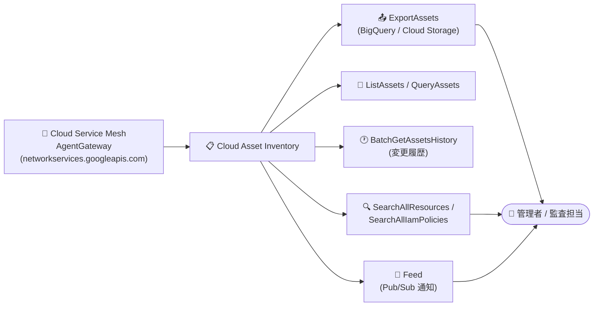

# Cloud Asset Inventory: Cloud Service Mesh の AgentGateway リソースタイプに対応

**リリース日**: 2026-10-13

**サービス**: Cloud Asset Inventory

**機能**: 新規リソースタイプ (Cloud Service Mesh: AgentGateway) のサポート

**ステータス**: 一般提供 (Publicly Available)

📊 [このアップデートのインフォグラフィックを見る](https://takech9203.github.io/google-cloud-news-summary/20261013-cloud-asset-inventory-service-mesh-resource-types.html)

## 概要

Cloud Asset Inventory で、新しいリソースタイプが主要な API 群 (`ExportAssets`、`ListAssets`、`BatchGetAssetsHistory`、`QueryAssets`、`Feed`、および Search API の `SearchAllResources` / `SearchAllIamPolicies`) を通じて一般公開されました。今回追加されたのは Cloud Service Mesh の **`networkservices.googleapis.com/AgentGateway`** リソースタイプです。

AgentGateway は、AI エージェント、MCP (Model Context Protocol) サーバー、ツールへの接続をガバナンス (統制) するための Cloud Service Mesh のリソースです。Google マネージドのデプロイモードに加え、既存の Application Load Balancer や Secure Web Proxy にアタッチするセルフマネージドモードをサポートします。今回のアップデートにより、組織内に作成された AgentGateway リソースを Cloud Asset Inventory の各種 API で一元的に棚卸し・検索・履歴追跡できるようになりました。

AI エージェント基盤を Google Cloud 上で運用する組織にとって、エージェントゲートウェイの構成をガバナンス・セキュリティ監査・コンプライアンスの観点から可視化できることは重要です。クラウド管理者、セキュリティチーム、SRE が主な対象ユーザーです。

**アップデート前の課題**

- Cloud Service Mesh の AgentGateway リソースは Cloud Asset Inventory の対象外であり、組織・フォルダ・プロジェクト横断での棚卸しができなかった
- AgentGateway の構成変更履歴を Cloud Asset Inventory の履歴 API で追跡できず、監査時には個別に Network Services API を照会する必要があった
- アセット検索 (`SearchAllResources`) や SQL クエリ (`QueryAssets`) で AgentGateway を他のリソースと合わせて横断検索できなかった

**アップデート後の改善**

- `ExportAssets` により AgentGateway を含むアセットを BigQuery や Cloud Storage へ一括エクスポートできるようになった
- `BatchGetAssetsHistory` で AgentGateway の構成変更履歴を取得できるようになった
- `Feed` により AgentGateway の変更を Pub/Sub でリアルタイムに監視できるようになった
- `SearchAllResources` / `SearchAllIamPolicies` / `QueryAssets` で組織横断の検索・SQL 分析が可能になった

## アーキテクチャ図



Cloud Service Mesh の AgentGateway リソースが Cloud Asset Inventory に取り込まれ、エクスポート・一覧・履歴・フィード・検索の各 API から利用できるようになった構成を示しています。

## サービスアップデートの詳細

### 主要機能

1. **対応 API**
   - `ExportAssets`: BigQuery / Cloud Storage へのアセット一括エクスポート
   - `ListAssets` / `QueryAssets`: アセットの一覧取得と SQL によるクエリ
   - `BatchGetAssetsHistory`: 指定期間におけるアセットの構成変更履歴の取得
   - `Feed`: Pub/Sub を介したアセット変更のリアルタイム通知
   - Search API (`SearchAllResources` / `SearchAllIamPolicies`): 組織・フォルダ・プロジェクト横断のリソース / IAM ポリシー検索

2. **追加されたリソースタイプ**
   - Cloud Service Mesh: `networkservices.googleapis.com/AgentGateway`

3. **AgentGateway リソースの概要** (Cloud Service Mesh / Network Services API)
   - AI エージェント・MCP サーバー・ツールへの接続を統制するゲートウェイリソース
   - デプロイモード: Google マネージド (`googleManaged`) またはセルフマネージド (`selfManaged`、既存の Application Load Balancer / Secure Web Proxy にアタッチ)
   - ガバナンス対象のアクセスパス: `AGENT_TO_ANYWHERE` (エージェントから宛先への接続) / `CLIENT_TO_AGENT` (エージェント・ツールへの接続の保護)
   - Agent Registry (`agentregistry.googleapis.com`) との連携、PSC-Interface 経由の Egress や DNS ピアリングなどのネットワーク構成をサポート

## 技術仕様

### 追加リソースタイプ

| 項目 | 詳細 |
|------|------|
| アセットタイプ | `networkservices.googleapis.com/AgentGateway` |
| 提供サービス | Cloud Service Mesh (Network Services API) |
| リソース名の形式 | `projects/*/locations/*/agentGateways/{agentGateway}` |
| 対応 API | ExportAssets, ListAssets, BatchGetAssetsHistory, QueryAssets, Feed, SearchAllResources, SearchAllIamPolicies |

### 検索・エクスポートの例

```bash
# 組織内の AgentGateway リソースを横断検索
gcloud asset search-all-resources \
  --scope="organizations/ORG_ID" \
  --asset-types="networkservices.googleapis.com/AgentGateway"

# AgentGateway を含むアセットを BigQuery へエクスポート
gcloud asset export \
  --organization="ORG_ID" \
  --content-type=resource \
  --asset-types="networkservices.googleapis.com/AgentGateway" \
  --bigquery-table="projects/PROJECT_ID/datasets/DATASET/tables/TABLE" \
  --output-bigquery-force
```

## メリット

### ビジネス面

- **AI エージェント基盤のガバナンス強化**: エージェントゲートウェイの配置状況を組織横断で可視化でき、シャドー IT 的なエージェント接続経路の検出に役立つ
- **監査・コンプライアンス対応の効率化**: 構成変更履歴 (`BatchGetAssetsHistory`) により、監査時のエビデンス収集を Cloud Asset Inventory に一本化できる

### 技術面

- **一元的なインベントリ管理**: 他の Google Cloud リソースと同じツール (gcloud asset、BigQuery エクスポート、SQL クエリ) で AgentGateway を扱える
- **リアルタイム変更検知**: Feed + Pub/Sub により、AgentGateway の作成・変更・削除を検知して自動対応 (通知、ポリシーチェックなど) を組める

## デメリット・制約事項

### 考慮すべき点

- 今回のリリースノートで公開が明記されたのは `networkservices.googleapis.com/AgentGateway` の 1 タイプのみ。各アセットタイプの API 対応状況 (分析 API での利用可否など) は[サポートされているアセットタイプ一覧](https://docs.cloud.google.com/asset-inventory/docs/asset-types)で最新情報を確認すること
- AgentGateway リソース自体の作成・管理は Cloud Service Mesh (Network Services API) 側の機能であり、Cloud Asset Inventory は読み取り (棚卸し・検索・履歴) のみを提供する

## ユースケース

### ユースケース 1: AI エージェントゲートウェイの組織横断棚卸し

**シナリオ**: 複数プロジェクトで AI エージェントや MCP サーバーを運用している組織が、どのプロジェクトにどの AgentGateway が存在するかを定期的に棚卸ししたい。

**実装例**:
```bash
gcloud asset search-all-resources \
  --scope="organizations/ORG_ID" \
  --asset-types="networkservices.googleapis.com/AgentGateway" \
  --format="table(name, location, createTime)"
```

**効果**: プロジェクトごとに Network Services API を照会する必要がなくなり、1 コマンドで組織全体の AgentGateway を把握できる。

### ユースケース 2: AgentGateway 構成変更のリアルタイム監視

**シナリオ**: セキュリティチームが、エージェント接続のガバナンスポイントである AgentGateway の構成変更 (作成・変更・削除) を即時に検知したい。

**効果**: Cloud Asset Inventory の Feed で AgentGateway の変更を Pub/Sub に通知し、Cloud Run functions などで検証・アラートを自動化できる。意図しないゲートウェイ構成の変更を早期に発見できる。

## 料金

Cloud Asset Inventory の利用に関する料金の詳細は公式ドキュメントを参照してください。なお、`ExportAssets` のエクスポート先 (BigQuery、Cloud Storage) や Feed で使用する Pub/Sub には、各サービスの料金が適用されます。

- [Cloud Asset Inventory ドキュメント](https://docs.cloud.google.com/asset-inventory/docs/overview)

## 関連サービス・機能

- **Cloud Service Mesh**: AgentGateway リソースを提供するサービス。エージェント・MCP サーバー・ツールへの接続のガバナンスを担う
- **BigQuery / Cloud Storage**: `ExportAssets` のエクスポート先として、アセットデータの分析・保管に利用
- **Pub/Sub**: Feed によるアセット変更通知の配信基盤
- **Security Command Center**: Cloud Asset Inventory のデータを活用した資産の可視化・セキュリティ分析と補完関係にある

## 参考リンク

- 📊 [インフォグラフィック](https://takech9203.github.io/google-cloud-news-summary/20261013-cloud-asset-inventory-service-mesh-resource-types.html)
- [公式リリースノート](https://docs.cloud.google.com/release-notes#October_13_2026)
- [サポートされているアセットタイプ一覧](https://docs.cloud.google.com/asset-inventory/docs/asset-types)
- [AgentGateway REST リファレンス (Network Services API)](https://docs.cloud.google.com/service-mesh/docs/reference/network-services/rest/v1/projects.locations.agentGateways)
- [Cloud Asset Inventory ドキュメント](https://docs.cloud.google.com/asset-inventory/docs/overview)

## まとめ

Cloud Service Mesh の AgentGateway が Cloud Asset Inventory の主要 API で扱えるようになり、AI エージェント基盤のゲートウェイ構成を組織横断で棚卸し・検索・履歴追跡できるようになりました。AI エージェントや MCP サーバーを運用している組織は、既存のアセット管理・監査ワークフロー (エクスポート、Feed、検索) に AgentGateway を組み込むことを推奨します。

---

**タグ**: Cloud Asset Inventory, Cloud Service Mesh, AgentGateway, ガバナンス, セキュリティ監査, AI エージェント, MCP
