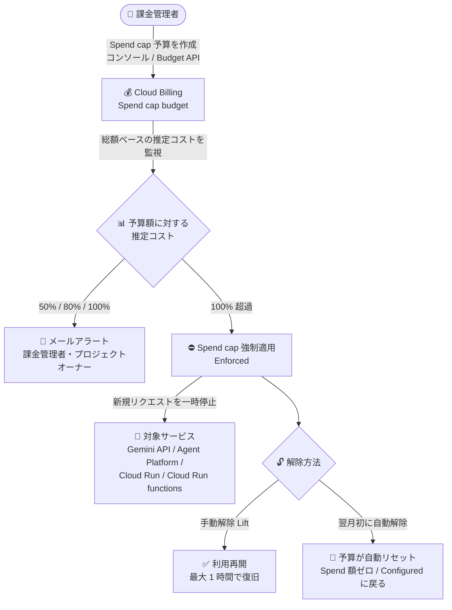

# Cloud Billing: Spend cap budgets (支出上限予算) が GA に

**リリース日**: 2026-10-13

**サービス**: Cloud Billing

**機能**: Spend cap budgets (支出上限予算)

**ステータス**: GA (一般提供・対象サービス限定)

📊 [このアップデートのインフォグラフィックを見る](https://takech9203.github.io/google-cloud-news-summary/20261013-cloud-billing-spend-cap-budgets-ga.html)

## 概要

Cloud Billing の Spend cap budgets (支出上限予算) が、一部の対象サービス向けに一般提供 (GA) になりました。対象サービスに対して Spend cap 予算を設定すると、総額ベースの推定コスト (gross, estimated costs) が設定した予算額を超えた時点で、指定プロジェクト内の該当サービスへの新規リクエストが自動的に一時停止され、それ以上の使用コストの発生が止まります。Spend cap 予算は Google Cloud コンソールの「予算とアラート」ページ、および Cloud Billing Budget API の両方から管理できます。

Spend cap はコスト管理のためのハードリミット機構です。使用コストが予算のターゲット金額を超えると強制適用 (enforce) され、適用中は指定プロジェクト内の対象サービスへの新規リクエストが一時停止されます。強制適用された Spend cap は手動で解除 (lift) するか、翌月初の予算期間開始時に自動解除されるまで継続します。現時点の対象サービスは Gemini API、Gemini Enterprise Agent Platform (旧 Vertex AI)、Cloud Run、Cloud Run functions の 4 つで、今後のリリースで対象サービスが拡大される予定です。

従来の予算アラートが「通知のみ」だったのに対し、本機能はプラットフォーム側で支出を強制的に止められるため、生成 AI API やサーバーレスのような従量課金サービスでの「コストの暴走 (runaway cost)」対策として、個人開発者から検証環境を多数運用する企業まで幅広いユーザーにとって重要なアップデートです。

**アップデート前の課題**

- Cloud Billing の予算 (Budgets) はしきい値超過時にアラートを送る「通知のみ」の仕組みで、支出そのものを自動的に止めるハードリミットではなかった
- コスト超過を強制的に止めるには、予算通知 (Pub/Sub) をトリガーに課金無効化や API 無効化を行う独自の自動化を構築・運用する必要があった
- 実際のコストがレポートに反映されるまでにはレイテンシがあり、コストが確定してから対処したのでは超過額が大きくなるリスクがあった
- Spend cap 相当の保護は AI Studio の Gemini API 向け機能などに限られ、Cloud Billing 全体の仕組みとしては提供されていなかった

**アップデート後の改善**

- 対象サービスについて、推定コストが予算額の 100% を超えると新規リクエストが自動的に一時停止され、追加の使用コスト発生を自動で止められるようになった
- 総額ベースの推定コスト (定価ベース、クレジット・割引を除外) を使用することで、実際のコストがレポートに反映されるより大幅に早く上限を適用できるようになった
- 予算額の 50% / 80% / 100% の時点で課金管理者とプロジェクトオーナーにメールアラートが自動送信され、コンソールにもバナーが表示されるようになった
- コンソールの「予算とアラート」ページに加えて、Cloud Billing Budget API (`spendCap` フィールド) でも Spend cap 予算を作成・管理・解除できるようになった

## アーキテクチャ図



Spend cap 予算が総額ベースの推定コストを監視し、予算額の 100% 超過で対象サービスの新規リクエストを自動停止するフローです。解除は手動 (Lift) または翌予算期間開始時の自動リセットで行われます。

## サービスアップデートの詳細

### 主要機能

1. **推定コストに基づく高速な上限適用**
   - 定価 (list price) ベースの総額・推定コスト (gross, estimated costs) を使用して、アラートと上限適用をトリガーする。クレジットや割引は含まれない
   - 実際のコストが課金レポートに反映されるよりも大幅に早く上限を適用できる (ただし即時ではなく、レイテンシによる超過分は通常どおり課金される)

2. **上限到達時の自動一時停止**
   - 推定コストが予算額の 100% を超えると、指定プロジェクト内の対象サービスへの新規リクエストが一時停止され、使用コストの発生が止まる
   - オンデマンド利用だけでなく、確約利用割引 (CUD) や Provisioned Throughput でカバーされる利用も停止対象
   - 処理中 (in-flight) のリクエストは完了まで処理され、リソースやデータが削除されることはない。他のプロジェクトや他のサービスには影響しない

3. **段階的なアラートとバナー通知**
   - 予算額の 50% / 80% / 100% 到達時に、すべての課金管理者とプロジェクトオーナーへメールアラートを送信
   - 強制適用時には、課金コンソールの「予算とアラート」ページと課金概要ページにバナーが表示され、解除方法が案内される

4. **手動解除と自動解除**
   - 強制適用中でも、予算を編集して「Lift spend cap」を選択すれば手動で解除できる (解除後、サービスが完全に復旧するまで最大 1 時間)
   - 手動解除した場合、同一予算期間内は予算額を増額しない限り再度トリガーされない
   - 翌予算期間の開始時 (通常は翌月 1 日) にはすべての Spend cap 予算が自動リセットされ、Spend 額がゼロ、ステータスが Configured に戻り、停止されていたサービスも自動的に再開する

5. **Cloud Billing Budget API 対応**
   - Budget リソースの `spendCap` フィールドで Spend cap 予算を作成・管理できる (`inputState: CONFIGURED` で作成、`AWAITING_NEXT_PERIOD` で手動解除)
   - `outputState` で現在の状態 (CONFIGURED / ENFORCED / AWAITING_NEXT_PERIOD) を確認できる

### 対象サービス (本リリース時点)

| サービス | サービス ID | API サービス名 |
|------|------|------|
| Gemini API | AEFD-7695-64FA | generativelanguage.googleapis.com |
| Gemini Enterprise Agent Platform (旧 Vertex AI) | C7E2-9256-1C43 | aiplatform.googleapis.com |
| Cloud Run | 152E-C115-5142 | run.googleapis.com |
| Cloud Run functions | 29E7-DA93-CA13 | cloudfunctions.googleapis.com |

対象サービスは今後のリリースで順次追加される予定です。

## 技術仕様

### 予算ステータス (Budgets ダッシュボードの Spend cap status)

| ステータス | 意味 |
|------|------|
| Not applicable | 通知のみの予算 (Spend cap なし) |
| Configured | Spend cap 予算が有効だが未適用 |
| Enforced | 推定コストが予算額を超過し、対象サービスの利用が一時停止中 |
| Lifted | 強制適用後に手動解除され、同一期間内は再トリガーされない状態 |

### Budget API におけるフィールド制約

Spend cap 予算では、通常の予算と異なり厳密なフィールド制約が適用されます。

| 項目 | 制約 |
|------|------|
| 課金アカウント | ファーストパーティの Cloud Billing アカウントのみ (リセラーアカウントは対象外) |
| スコープ (budgetFilter) | 1 つのプロジェクト + 1 つの対象サービスのみ。`resourceAncestors`、`creditTypes`、`subaccounts`、`labels` などの他のフィルタは指定不可 |
| 予算期間 | `calendarPeriod` は `MONTH` 固定 |
| クレジット処理 | `creditTypesTreatment` は `EXCLUDE_ALL_CREDITS` 必須 |
| 予算額 | `specifiedAmount` 必須 (通貨は課金アカウントの通貨と一致) |
| しきい値ルール | `thresholdPercent` 0.5 / 0.8 / 1.0 の 3 つちょうど、`spendBasis` は `CURRENT_SPEND` (`FORECASTED_SPEND` は非対応) |
| 通知ルール | `enableProjectLevelRecipients: true` 必須。その他の通知パラメータは非対応 |
| 所有スコープ | `OWNERSHIP_SCOPE_UNSPECIFIED` または `ALL_USERS` (`BILLING_ACCOUNT` は非対応) |
| 作成時の状態 | `spendCap.inputState` は `CONFIGURED` を指定 |

### Spend cap 予算の作成 (REST API の例)

```json
POST https://billingbudgets.googleapis.com/v1/billingAccounts/{billing-account-id}/budgets

{
  "displayName": "My Gemini API Spend Cap",
  "budgetFilter": {
    "projects": ["projects/budget-scope-project-id"],
    "services": ["services/AEFD-7695-64FA"],
    "creditTypesTreatment": "EXCLUDE_ALL_CREDITS",
    "calendarPeriod": "MONTH"
  },
  "amount": {
    "specifiedAmount": { "units": "100", "nanos": 0 }
  },
  "thresholdRules": [
    { "thresholdPercent": 0.5 },
    { "thresholdPercent": 0.8 },
    { "thresholdPercent": 1.0 }
  ],
  "notificationsRule": { "enableProjectLevelRecipients": true },
  "spendCap": { "inputState": "CONFIGURED" }
}
```

### 強制適用された Spend cap の手動解除 (REST API の例)

```json
PATCH https://billingbudgets.googleapis.com/v1/billingAccounts/{billing-account-id}/budgets/{budget-id}?updateMask=spendCap.inputState

{
  "spendCap": { "inputState": "AWAITING_NEXT_PERIOD" }
}
```

強制適用中 (`outputState: ENFORCED`) の予算は、まず Spend cap を解除しない限り他のフィールドを変更できず、変更しようとすると `FAILED_PRECONDITION` エラーになります。

## 設定方法

### 前提条件

1. ファーストパーティの Cloud Billing アカウント (リセラー経由の課金アカウントは対象外)
2. 対象サービス (Gemini API、Agent Platform、Cloud Run、Cloud Run functions のいずれか) を利用するプロジェクト
3. API で管理する場合は Cloud Billing Budget API の有効化

### 手順 (Google Cloud コンソール)

#### ステップ 1: 予算の作成を開始

「予算とアラート (Budgets & alerts)」ページで「Create new budget」をクリックし、Define セクションで「Alerts only」ではなく「**Spend cap enforcement**」を選択して予算名を入力します。

既存の通知のみの予算を Spend cap 予算に変換することはできません。同様のスコープで設定したい場合は、既存予算を削除して新規に Spend cap 予算を作成します。

#### ステップ 2: スコープの設定

Scope セクションで、対象の **プロジェクト 1 つ** と **対象サービス 1 つ** を選択します。期間 (Time range) は Monthly 固定で変更できません。

#### ステップ 3: 予算額の設定

Amount セクションでターゲット金額を入力します。コストレポートのレイテンシにより適用は即時ではないため、**絶対的な上限よりやや低めの金額を設定することが推奨**されています (レイテンシによる超過分は利用者の負担として通常どおり課金されます)。

#### ステップ 4: アクションの確認と保存

Actions セクションでは、50% / 80% / 100% 時に全課金管理者とプロジェクトオーナーへ通知する設定が自動構成されます (アラートと受信者のカスタマイズは不可)。「Finish」をクリックして予算を保存・有効化します。

## メリット

### ビジネス面

- **コスト暴走の防止**: 意図しないトラフィック急増、バグ、生成 AI API の過剰利用などによる想定外の課金を、プラットフォーム側で自動的に止められる
- **運用負荷の削減**: 従来必要だった予算通知 + Cloud Run functions などによる課金停止の独自自動化が不要になる
- **予算ガバナンスの強化**: 検証環境や個人・チーム単位のプロジェクトに対して、月次の支出上限を仕組みとして強制できる

### 技術面

- **高速な適用**: 定価ベースの推定コストを使うことで、実際のコスト確定を待たずに上限を適用できる
- **安全な停止動作**: リソースやデータは削除されず、処理中のリクエストは完了まで処理される。影響は指定プロジェクト内の対象サービスのみに限定される
- **API による自動化**: Budget API の `spendCap` フィールドで、作成・状態確認・解除を IaC や運用ツールに組み込める

## デメリット・制約事項

### 制限事項

- 対象サービスは現時点で Gemini API、Gemini Enterprise Agent Platform (旧 Vertex AI)、Cloud Run、Cloud Run functions の 4 つに限定される
- 1 つの Spend cap 予算は「1 プロジェクト × 1 対象サービス」のスコープのみ。フォルダ・組織・複数サービス横断の上限は設定できない
- 予算期間は月次 (カレンダー月) 固定。アラートしきい値 (50/80/100%) や通知先のカスタマイズは不可
- 既存の通知のみの予算を Spend cap 予算に変換できない (削除して新規作成が必要)
- リセラー経由の課金アカウントは対象外
- 強制適用中は Spend cap の解除以外の予算設定を編集できない
- 同一スコープの Spend cap 予算は重複作成できない (重複排除ポリシーあり)

### 考慮すべき点

- **適用は即時ではない**: コスト報告のレイテンシにより、上限適用までに発生した超過分は通常どおり課金される。絶対上限よりやや低めの予算額設定が推奨される
- **固定費は止まらない**: 永続リソース (コンピュートやストレージなど) に紐づく継続的な固定費用は停止されず、課金が継続する
- **本番環境では慎重に**: 上限到達時は対象サービスへの新規リクエストが失敗するため、可用性が求められる本番ワークロードへの適用はダウンタイム許容度を考慮して判断する
- **推定コストは定価ベース**: クレジット・割引を除外した総額で判定されるため、割引適用後の実コストより早く上限に達する場合がある
- **解除後の復旧に時間差**: Spend cap 解除後、サービスが完全に復旧するまで最大 1 時間かかる場合がある
- **Gemini API は AI Studio と二重管理に注意**: AI Studio と Cloud Billing の両方で Spend cap を設定した場合、先にコストを検知した側がトリガーされ、どちらで発動してもプロジェクトの Gemini API 利用は全プラットフォームで停止される
- **プロジェクト移管時の挙動**: プロジェクトを別の課金アカウントに移すと旧アカウントの Spend cap 予算はすべて削除され、強制適用中だった場合は自動解除される。新アカウントで再作成が必要

## ユースケース

### ユースケース 1: 生成 AI API の検証プロジェクトに月次ハードリミットを設定

**シナリオ**: 開発チームが Gemini API や Agent Platform (旧 Vertex AI) を使った PoC を多数のプロジェクトで実施しており、プロンプトの無限ループや想定外のバッチ実行で月数千ドル規模の予期せぬ課金が発生するリスクを抑えたい。

**実装例**:
```json
{
  "displayName": "PoC Gemini API Spend Cap",
  "budgetFilter": {
    "projects": ["projects/poc-project-id"],
    "services": ["services/AEFD-7695-64FA"],
    "creditTypesTreatment": "EXCLUDE_ALL_CREDITS",
    "calendarPeriod": "MONTH"
  },
  "amount": { "specifiedAmount": { "units": "100" } },
  "thresholdRules": [
    { "thresholdPercent": 0.5 },
    { "thresholdPercent": 0.8 },
    { "thresholdPercent": 1.0 }
  ],
  "notificationsRule": { "enableProjectLevelRecipients": true },
  "spendCap": { "inputState": "CONFIGURED" }
}
```

**効果**: 月 100 ドルを超える Gemini API 利用が自動停止され、PoC プロジェクトのコスト上限を仕組みとして保証できる。50% / 80% 時点のアラートで事前に利用状況を把握できる。

### ユースケース 2: 個人開発・学習用プロジェクトの Cloud Run コスト保護

**シナリオ**: 個人開発者が Cloud Run / Cloud Run functions で公開アプリを運用しており、バズや DoS 的なアクセスによる想定外のスケールアウトで高額請求が発生するのを防ぎたい。

**効果**: 推定コストが設定額に達すると Cloud Run への新規リクエストが自動停止され、請求額の上限を実質的に固定できる。翌月初には自動的にリセット・再開されるため、復旧作業も最小限で済む。(Cloud Run 側の詳細は [2026-10-12 の Cloud Run Budget spend caps レポート](./2026-10-12-cloud-run-budget-spend-caps.md) を参照)

### ユースケース 3: Budget API による Spend cap 予算の一括プロビジョニング

**シナリオ**: 社内の全サンドボックスプロジェクトに対して、対象サービスごとの月次支出上限を標準ポリシーとして一括適用したい。

**効果**: Budget API を使ってプロジェクト作成パイプラインに Spend cap 予算の作成を組み込むことで、ガードレールとしてのコスト上限を自動的に展開できる。`outputState` を監視すれば、強制適用中のプロジェクトを一覧把握することも可能。

## 関連サービス・機能

- **Cloud Billing Budgets (通知のみの予算)**: 従来からの予算アラート機能。Spend cap 非対象のサービスや、フォルダ・組織スコープの監視には引き続きこちらを使用する
- **Cloud Billing Budget API**: Spend cap 予算の作成・一覧・更新・解除をプログラムから行える API (`billingbudgets.googleapis.com`)
- **Cloud Run / Cloud Run functions**: Spend cap の対象サービス。上限到達時はサービス・ジョブ・ワーカープールが一時停止される (詳細は 10/12 の個別レポートを参照)
- **Gemini API / Gemini Enterprise Agent Platform (旧 Vertex AI)**: Spend cap の対象サービス。生成 AI ワークロードのコスト上限管理に利用できる
- **Google AI Studio の Spend cap**: AI Studio で提供されていた Gemini API 向けの支出上限と同等の保護を、Cloud Billing 側でより広いサービスに拡張したもの
- **確約利用割引 (CUD) / Provisioned Throughput**: これらでカバーされる利用も Spend cap 適用時には停止対象となる点に注意

## 参考リンク

- 📊 [インフォグラフィック](https://takech9203.github.io/google-cloud-news-summary/20261013-cloud-billing-spend-cap-budgets-ga.html)
- [公式リリースノート](https://docs.cloud.google.com/release-notes#October_13_2026)
- [ドキュメント: Create, edit, or delete spend cap budgets](https://docs.cloud.google.com/billing/docs/how-to/budgets-spend-caps)
- [ドキュメント: Using the Cloud Billing Budget API for spend cap budgets](https://docs.cloud.google.com/billing/docs/how-to/budget-api-spend-cap)
- [ドキュメント: Create, edit, or delete budgets and budget alerts (通知のみの予算)](https://docs.cloud.google.com/billing/docs/how-to/budgets)
- [AI Studio の Spend cap (Gemini API)](https://ai.google.dev/gemini-api/docs/billing#spend-caps)
- [関連レポート: Cloud Run Budget spend caps GA (2026-10-12)](./2026-10-12-cloud-run-budget-spend-caps.md)

## まとめ

Cloud Billing の Spend cap budgets の GA により、「通知のみ」だった Google Cloud の予算機能に、支出を自動停止するハードリミットが初めて標準機能として加わりました。まずは Gemini API、Agent Platform、Cloud Run、Cloud Run functions の 4 サービスが対象のため、生成 AI の検証プロジェクトやサーバーレス環境から適用を始め、適用レイテンシによる超過リスクを考慮して絶対上限よりやや低めの予算額を設定することを推奨します。

---

**タグ**: #CloudBilling #SpendCap #Budgets #FinOps #コスト管理 #GA #GeminiAPI #CloudRun
