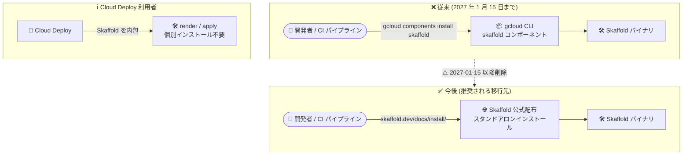

# Cloud SDK (gcloud CLI): 589.0.0 リリース - skaffold コンポーネントの非推奨化 (Breaking Change) と主要コマンドアップデート

**リリース日**: 2026-10-13

**サービス**: Cloud SDK (gcloud CLI)

**機能**: バージョン 589.0.0 - skaffold コンポーネント非推奨化、バンドル Python 3.14.8 更新、各種コマンドの GA 昇格・追加

**ステータス**: Breaking Change + 機能アップデート

📊 [このアップデートのインフォグラフィックを見る](https://takech9203.github.io/google-cloud-news-summary/20261013-cloud-sdk-589-skaffold-deprecation.html)

## 概要

Google Cloud CLI (gcloud CLI) バージョン 589.0.0 がリリースされました。今回のリリースで最も重要なのは、**skaffold コンポーネントの非推奨化 (Breaking Change)** です。skaffold コンポーネントは **2027 年 1 月 15 日以降の Google Cloud CLI リリースから削除**され、すでに `gcloud components install skaffold` の実行が一部エラーを返すようになっています。今後 Skaffold は [Skaffold 公式のインストール手順](https://skaffold.dev/docs/install/) に従って個別にインストールする必要があります。公式ドキュメントによると、2027 年 1 月 29 日には Skaffold の GitHub リポジトリがアーカイブされます (既存リリースは引き続き利用可能)。なお、Cloud Deploy は Skaffold を内包しているため、Cloud Deploy のパイプライン実行自体に Skaffold の個別インストールは不要です。

基盤面では、Linux / Windows および Alpine ベースの Docker イメージ (`:alpine`, `:VERSION-alpine`) のバンドル Python が 3.14.8 に更新され、TLS に使用する OpenSSL が 3.5.9 になりました。cryptography 46.0.7 はカスタムビルドではなく公式 PyPI ホイールからインストールされるようになり、Alpine イメージはシステム python3 を含まなくなりました。

機能面では、Cloud Alerting (`gcloud monitoring alerts`)、Cloud Firestore (`gcloud firestore change-streams`)、Apigee (`gcloud apigee apis delete`)、Compute Engine (`gcloud compute advice capacity` / `capacity-history`) など多数のコマンドが GA に昇格したほか、BigQuery の Azure Data Lake Storage URI 対応、Cloud Storage の再開可能アップロードにおけるサーバーサイドハッシュ検証のデフォルト化など、幅広いアップデートが含まれています。CI/CD パイプラインや開発環境で gcloud CLI を利用しているすべてのユーザー、特に `gcloud components install skaffold` に依存しているチームは早急な対応が必要です。

**アップデート前の課題**

- Skaffold は `gcloud components install skaffold` で gcloud CLI のコンポーネントとして配布されており、CI/CD スクリプトや開発環境構築がこの配布経路に依存していた
- Cloud Storage の `cp` / `mv` / `rsync` による再開可能アップロードでは、サーバーサイドのハッシュ検証がデフォルトで有効ではなかった
- `gcloud apigee apis import --from-template` で、テンプレートが feature を参照していると endpoints / targets が破棄される問題があった
- `gcloud monitoring alerts`、`gcloud firestore change-streams`、`gcloud compute advice capacity` などは GA 未満のリリースステージであり、本番運用での利用に制約があった
- Cloud Composer のストレージエクスポートコマンドで、`--destination` ディレクトリ外のオブジェクトが処理対象となり得た (パストラバーサルのリスク)

**アップデート後の改善**

- Skaffold のインストール経路が公式配布 (skaffold.dev) に一本化され、移行期限 (2027 年 1 月 15 日) とともに明確なマイグレーションパスが提示された
- バンドル Python 3.14.8 + OpenSSL 3.5.9 + 公式 PyPI ホイール由来の cryptography 46.0.7 により、セキュリティ基盤が最新化された
- Cloud Storage の再開可能アップロードでサーバーサイドハッシュ検証がデフォルト有効になり、データ整合性が強化された
- Cloud Alerting / Firestore change-streams / Apigee apis / Compute advice capacity などの GA 昇格により、本番環境で安心して利用可能になった
- Cloud Composer のエクスポートコマンドが `--destination` ディレクトリ外のオブジェクトをスキップするようになり、パストラバーサルが防止された

## アーキテクチャ図



skaffold コンポーネントの移行パスを示した図です。gcloud CLI 経由のインストールは 2027 年 1 月 15 日以降削除されるため、Skaffold 公式のインストール手順への移行が必要です。Cloud Deploy は Skaffold を内包しているため影響を受けません。

## サービスアップデートの詳細

### Breaking Change: skaffold コンポーネントの非推奨化

1. **非推奨化と削除スケジュール**
   - gcloud CLI の skaffold コンポーネントが非推奨 (deprecated) となった
   - **2027 年 1 月 15 日以降の Google Cloud CLI リリースから削除**される
   - すでに `gcloud components install skaffold` の実行が一部エラーを返す
   - 公式ドキュメントによると、2027 年 1 月 29 日に Skaffold の GitHub リポジトリがアーカイブされる (既存リリースは引き続き利用可能)

2. **必要なアクション**
   - [Skaffold 公式のインストール手順](https://skaffold.dev/docs/install/) に従い、スタンドアロンでインストールする方式に移行する
   - CI/CD パイプライン、Dockerfile、開発環境セットアップスクリプト内の `gcloud components install skaffold` を洗い出して置き換える
   - Cloud Deploy は Skaffold を内包しているため、Cloud Deploy のレンダリング / デプロイ処理自体には影響しない

### Google Cloud CLI 基盤の更新

1. **バンドル Python の更新**
   - Linux / Windows および Alpine ベースの Docker イメージのバンドル Python を 3.14.8 に更新
   - Python が TLS に使用する OpenSSL が 3.5.9 に更新
   - cryptography 46.0.7 をカスタムビルドではなく公式 PyPI ホイールからインストールするよう変更

2. **Alpine Docker イメージの変更**
   - `:alpine` および `:VERSION-alpine` イメージがバンドル Python を使用するようになり、システム python3 を含まなくなった
   - Alpine イメージ内でシステム python3 に依存している処理がある場合は注意が必要

### 主要コマンドアップデート

| サービス | アップデート内容 | ステージ |
|---------|----------------|---------|
| AlloyDB | `gcloud beta alloydb clusters create\|update` に `--enable-express` フラグを追加 | Beta |
| Apigee | `gcloud apigee apis delete` が GA に昇格 (API プロキシと全リビジョンを削除)。これにより `gcloud apigee apis` の全コマンドが GA に。`apis import --from-template` が endpoints / targets を破棄する問題を修正 | GA |
| BigQuery | インライン外部テーブル定義で Azure Data Lake Storage URI (`abfs://`, `abfss://`) をサポート。転送構成向けに `--dataplex_entry_group` フラグを追加 | - |
| Cloud Alerting | `gcloud monitoring alerts` コマンドグループが GA に昇格 | GA |
| Cloud DNS | `gcloud beta dns outbound-endpoints` コマンドグループを追加 | Beta |
| Cloud Firestore | `gcloud firestore change-streams` コマンドが GA に昇格 | GA |
| Cloud Storage | `cp` / `mv` / `rsync` の再開可能アップロードでサーバーサイドハッシュ検証がデフォルト有効に | - |
| Compute Engine | `gcloud compute advice capacity` / `capacity-history` が GA に昇格。ローカル SSD 暗号化の `CMEK_ENCRYPTION` オプション (Beta)。backend-services / forwarding-rules スキーマで `EXTERNAL_PASSTHROUGH` が GA に昇格 | GA / Beta |
| Database Migration | SQL Server の分散可用性グループ (DAG) 移行用フラグを追加 | - |
| Kubernetes Engine | クラスタ作成 / 更新時の Wiz Sensor 構成フラグを追加 | - |
| Cloud Composer | ストレージエクスポートコマンドが `--destination` ディレクトリ外のオブジェクトをスキップ (パストラバーサル防止) | - |

## 技術仕様

### skaffold コンポーネント非推奨化のタイムライン

| 日付 | イベント |
|------|---------|
| 2026-10-13 | gcloud CLI 589.0.0 で skaffold コンポーネントが非推奨化。`gcloud components install skaffold` の一部がエラーを返すように |
| 2027-01-15 | この日以降の Google Cloud CLI リリースから skaffold コンポーネントが削除 |
| 2027-01-29 | Skaffold の GitHub リポジトリがアーカイブ (既存リリースは引き続き利用可能) |

### gcloud CLI 589.0.0 の基盤更新

| 項目 | 詳細 |
|------|------|
| バンドル Python | 3.14.8 (Linux / Windows / Alpine Docker イメージ) |
| OpenSSL | 3.5.9 (Python の TLS 用) |
| cryptography | 46.0.7 (公式 PyPI ホイールからインストール) |
| Alpine イメージ | バンドル Python を使用、システム python3 を同梱しない |

## 設定方法

### 前提条件

1. gcloud CLI を利用している環境 (ローカル開発環境、CI/CD パイプライン、Docker イメージ)
2. `gcloud components install skaffold` への依存箇所の棚卸し

### 手順

#### ステップ 1: gcloud CLI を 589.0.0 に更新

```bash
gcloud components update
gcloud version
```

gcloud CLI を最新バージョンに更新し、バージョンを確認します。

#### ステップ 2: skaffold コンポーネントへの依存箇所を確認

```bash
# インストール済みコンポーネントの確認
gcloud components list

# CI/CD スクリプトなどから依存箇所を検索する例
grep -r "components install skaffold" .
```

skaffold コンポーネントがインストールされているか、スクリプトが `gcloud components install skaffold` に依存していないかを確認します。

#### ステップ 3: Skaffold を公式手順でインストール

```bash
# Linux (x86_64) の例: skaffold.dev の公式手順に従う
curl -Lo skaffold https://storage.googleapis.com/skaffold/releases/latest/skaffold-linux-amd64
chmod +x skaffold
sudo install skaffold /usr/local/bin/
skaffold version
```

[Skaffold 公式のインストール手順](https://skaffold.dev/docs/install/) に従い、プラットフォームに応じた方法でスタンドアロンインストールします。CI/CD パイプラインの Dockerfile やセットアップスクリプトも同様に置き換えます。

## メリット

### ビジネス面

- **移行計画が立てやすい**: 削除期限 (2027 年 1 月 15 日) が明示されており、約 3 か月の猶予をもって CI/CD パイプラインの移行を計画できる
- **GA 昇格による本番利用の安心感**: Cloud Alerting、Firestore change-streams、Apigee apis、Compute advice capacity などが GA となり、SLA を前提とした本番運用に組み込める

### 技術面

- **セキュリティ基盤の最新化**: Python 3.14.8 + OpenSSL 3.5.9 + 公式 PyPI ホイール由来の cryptography により、サプライチェーンと TLS のセキュリティが向上
- **データ整合性の強化**: Cloud Storage の再開可能アップロードでサーバーサイドハッシュ検証がデフォルト有効になり、アップロードデータの破損検知が標準化
- **パストラバーサル防止**: Cloud Composer のエクスポートコマンドが `--destination` 外のオブジェクトをスキップするようになり、セキュリティが向上

## デメリット・制約事項

### 制限事項

- `gcloud components install skaffold` はすでに一部でエラーを返すため、既存の自動化スクリプトが失敗する可能性がある
- 2027 年 1 月 15 日以降の gcloud CLI リリースでは skaffold コンポーネントが完全に削除される
- Alpine ベースの Docker イメージはシステム python3 を含まなくなったため、イメージ内でシステム python3 を前提としていた処理は修正が必要

### 考慮すべき点

- CI/CD パイプライン (Cloud Build、GitHub Actions など) の Skaffold インストール手順を期限前に移行すること
- Skaffold の GitHub リポジトリは 2027 年 1 月 29 日にアーカイブされるため、長期的な CI/CD 戦略として Cloud Deploy のマネージドなレンダリング / デプロイ機能の活用も検討に値する
- gcloud CLI のバージョン固定運用をしている場合も、セキュリティ更新 (Python / OpenSSL / cryptography) を考慮して更新計画を立てること

## ユースケース

### ユースケース 1: CI/CD パイプラインの Skaffold インストール移行

**シナリオ**: Cloud Build や GitHub Actions のパイプラインで `gcloud components install skaffold` を使って Skaffold をセットアップし、GKE へのデプロイを行っている。

**実装例**:
```yaml
# Before (非推奨 - 2027-01-15 以降は失敗する)
steps:
  - name: gcr.io/google.com/cloudsdktool/cloud-sdk
    entrypoint: bash
    args: ["-c", "gcloud components install skaffold && skaffold run"]

# After (公式配布からインストール)
steps:
  - name: gcr.io/google.com/cloudsdktool/cloud-sdk
    entrypoint: bash
    args:
      - -c
      - |
        curl -Lo /usr/local/bin/skaffold https://storage.googleapis.com/skaffold/releases/latest/skaffold-linux-amd64
        chmod +x /usr/local/bin/skaffold
        skaffold run
```

**効果**: 削除期限後もパイプラインが停止せず、Skaffold のバージョン管理を gcloud CLI のリリースサイクルから切り離して制御できる。

### ユースケース 2: GA 昇格コマンドの本番運用への組み込み

**シナリオ**: これまで Beta ステージのため本番の運用自動化に組み込めなかった `gcloud monitoring alerts` や `gcloud firestore change-streams` を、GA 昇格を機に運用スクリプトへ正式採用する。

**効果**: GA コマンドとして安定したインターフェースで、アラート管理や Firestore の変更ストリーム管理を自動化できる。

## 料金

gcloud CLI (Cloud SDK) 自体は無料で利用できます。今回のアップデートによる料金への直接的な影響はありません。各コマンドが操作する対象サービス (AlloyDB、BigQuery、Compute Engine など) の利用料金は、それぞれのサービスの料金体系に従います。

## 関連サービス・機能

- **Cloud Deploy**: Skaffold を内包しており、レンダリング (`skaffold render`) とデプロイ (`skaffold apply`) に使用。skaffold コンポーネント削除後も Cloud Deploy 自体の動作には個別インストール不要
- **Cloud Build**: CI/CD パイプラインで Skaffold をインストールして使用している場合、インストール手順の移行が必要
- **Google Kubernetes Engine (GKE)**: Skaffold の主要なデプロイ先。今回のリリースでは Wiz Sensor 構成フラグも追加
- **Cloud Monitoring**: `gcloud monitoring alerts` の GA 昇格により、アラート管理の CLI 操作が正式サポートに

## 参考リンク

- 📊 [インフォグラフィック](https://takech9203.github.io/google-cloud-news-summary/20261013-cloud-sdk-589-skaffold-deprecation.html)
- [公式リリースノート](https://docs.cloud.google.com/release-notes#October_13_2026)
- [Skaffold インストール手順 (公式)](https://skaffold.dev/docs/install/)
- [Cloud Deploy での Skaffold の使用](https://docs.cloud.google.com/deploy/docs/using-skaffold)
- [gcloud CLI コンポーネントの管理](https://docs.cloud.google.com/sdk/docs/components)

## まとめ

gcloud CLI 589.0.0 の最重要ポイントは skaffold コンポーネントの非推奨化です。2027 年 1 月 15 日以降のリリースで削除されるため、`gcloud components install skaffold` に依存する CI/CD パイプラインや開発環境は、期限前に [Skaffold 公式のインストール手順](https://skaffold.dev/docs/install/) への移行を完了させてください。あわせて、Cloud Alerting や Firestore change-streams などの GA 昇格コマンドの本番採用、Alpine Docker イメージのシステム python3 廃止の影響確認も推奨します。

---

**タグ**: Cloud SDK, gcloud CLI, Skaffold, Breaking Change, 非推奨化, Cloud Deploy, CI/CD, GA 昇格, Python, セキュリティ
