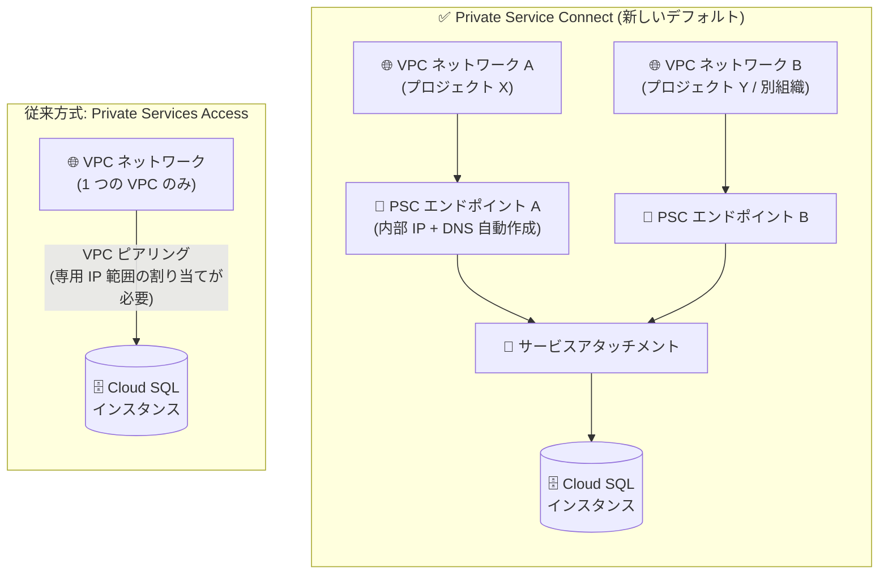

# Cloud SQL: Private Service Connect が新規プロジェクトのデフォルトプライベート IP 接続オプションに

**リリース日**: 2026-10-13

**サービス**: Cloud SQL for MySQL / Cloud SQL for PostgreSQL / Cloud SQL for SQL Server

**機能**: Private Service Connect のデフォルト化 (新規 Google Cloud プロジェクト)

**ステータス**: GA (Feature)

📊 [このアップデートのインフォグラフィックを見る](https://takech9203.github.io/google-cloud-news-summary/20261013-cloud-sql-private-service-connect-default.html)

## 概要

新しい Google Cloud プロジェクトで Cloud SQL インスタンス (MySQL / PostgreSQL / SQL Server) を作成する際、プライベート IP 接続のデフォルトオプションが **Private Service Connect (PSC)** になりました。従来のデフォルトであった Private Services Access (PSA、VPC ネットワークピアリングベース) に代わり、Google Cloud コンソールの「接続」設定でプライベート IP を選択すると、PSC が既定で選択されます。

Private Service Connect を使用すると、異なるグループ・チーム・プロジェクト・組織に属する複数の VPC ネットワークからインスタンスへプライベートに接続でき、エンドポイントと DNS レコードの自動プロビジョニングもサポートされます。公式ドキュメントでは、IP アドレス空間の管理、スケーラビリティ、セキュリティ制御の観点から、PSA よりも PSC が推奨されています。

なお、このアップデート後もプライベート IP の構成時に Private Services Access を選択すること、あるいは両方の接続オプションを併用することは引き続き可能です。既存プロジェクト・既存インスタンスの動作が変わるものではなく、新規プロジェクトにおけるデフォルト値の変更です。

**アップデート前の課題**

- 従来のデフォルトである Private Services Access は VPC ネットワークピアリングに基づくため、基本的に 1 つの VPC ネットワークからの接続しか許可されず、複数の VPC から接続するには追加構成 (中間プロキシなど) が必要だった
- Private Services Access ではサービスプロデューサー側のために専用の IP 範囲を事前に割り当てる必要があり、IP アドレス空間の管理が煩雑になりやすかった
- 推奨される接続方式が PSC であるにもかかわらずデフォルトは PSA であったため、新規ユーザーが意識的に PSC を選択する必要があった

**アップデート後の改善**

- 新規プロジェクトでは推奨方式である Private Service Connect がデフォルトで選択され、ベストプラクティスに沿った構成が初期状態で適用される
- 異なるプロジェクト・組織にまたがる複数の VPC ネットワークからの接続が、デフォルトの構成で実現可能になる
- サービス接続ポリシーを利用した PSC エンドポイントと DNS レコードの自動プロビジョニングにより、接続設定の手作業が削減される

## アーキテクチャ図



PSC では各 VPC ネットワークに作成したエンドポイント経由でサービスアタッチメントに接続するため、複数のプロジェクト・組織の VPC から同一インスタンスへ接続できます。従来の PSA は VPC ピアリングベースで、原則 1 つの VPC からの接続に限られます。

## サービスアップデートの詳細

### 主要機能

1. **新規プロジェクトでの PSC デフォルト化**
   - 新しい Google Cloud プロジェクトで Cloud SQL インスタンスを作成し、プライベート IP を構成すると、Private Service Connect がデフォルトの接続オプションとして選択される
   - MySQL、PostgreSQL、SQL Server の 3 エンジンすべてが対象
   - 従来どおり Private Services Access (PSA) の選択や、PSC と PSA の併用も可能

2. **複数 VPC ネットワークからのプライベート接続**
   - 異なるグループ・チーム・プロジェクト・組織に属する複数の VPC ネットワークから、同一の Cloud SQL インスタンス (プライマリまたはリードレプリカ) へ接続できる
   - 各 VPC ネットワークに PSC エンドポイント (サービスアタッチメントを参照する転送ルールに関連付けられた内部 IP アドレス) を作成して接続する

3. **エンドポイントと DNS レコードの自動プロビジョニング**
   - VPC ネットワークにサービス接続ポリシーを作成しておくと、インスタンス作成時に Cloud SQL が PSC エンドポイントを自動作成できる
   - DNS 自動化により、承認済みコンシューマー VPC ネットワーク内の DNS レコードを自動的にプロビジョニング・管理できる
   - エンドポイントを手動で作成する方法も引き続き利用可能

## 技術仕様

### PSC と Private Services Access の比較

| 項目 | Private Service Connect (新デフォルト) | Private Services Access (従来方式) |
|------|----------------------------------------|-----------------------------------|
| 接続基盤 | サービスアタッチメント + PSC エンドポイント | VPC ネットワークピアリング |
| 接続可能な VPC 数 | 複数 VPC (異なるプロジェクト・組織も可) | 1 つの VPC (複数 VPC には追加構成が必要) |
| IP アドレス管理 | エンドポイント用の内部 IP のみ (管理が容易) | サービスプロデューサー用の専用 IP 範囲の割り当てが必要 |
| エンドポイント / DNS 自動作成 | サポート (サービス接続ポリシー利用) | 該当なし |
| 公式の推奨 | 推奨 (IP 管理・スケーラビリティ・セキュリティ制御で優位) | 旧来の方式 |

### PSC の主な技術パラメータ

| 項目 | 詳細 |
|------|------|
| エンドポイント数の上限 | 1 インスタンスのサービスアタッチメントに対し最大 20 個 (超過時は NCC 経由の PSC エンドポイント伝播を利用) |
| 同時接続数 | PSC 経由で最大 64,512 接続 (2026 年 9 月 30 日以降に作成された 16 vCPU 以上のインスタンスでは、エンジンがサポートする場合最大 129,024 接続) |
| 接続先 | プライマリインスタンスおよびリードレプリカ |
| 必要なロール (手動エンドポイント作成時) | `compute.networkAdmin` |
| 推奨される接続方法 | DNS 名での接続 (ネットワークごとにエンドポイント IP が異なるため。Cloud SQL Auth Proxy は DNS 名が必須) |

## 設定方法

### 前提条件

1. エンドポイントを自動作成する場合: 接続元の VPC ネットワークにサービス接続ポリシーを作成しておく (サービスクラス・リージョン・VPC ネットワークの組み合わせごとに最大 1 ポリシー)
2. エンドポイントを手動作成する場合: `compute.networkAdmin` ロールと、エンドポイント用の内部 IP アドレスの予約

### 手順

#### ステップ 1: PSC 有効化インスタンスの作成 (エンドポイント自動作成)

```bash
gcloud sql instances create INSTANCE_NAME \
  --project=PROJECT_ID \
  --region=REGION_NAME \
  --enable-private-service-connect \
  --allowed-psc-projects=ALLOWED_PROJECTS \
  --no-assign-ip \
  --tier=MACHINE_TYPE \
  --database-version=DATABASE_VERSION \
  --psc-auto-connections=network=VPC_PSC_NETWORK_PATH,project=SERVICE_PROJECT
```

`--allowed-psc-projects` に PSC エンドポイントの作成を許可するプロジェクトをカンマ区切りで指定します。`--psc-auto-connections` を指定すると、サービス接続ポリシーが存在する VPC ネットワークに Cloud SQL がエンドポイントを自動作成します。

#### ステップ 2: 既存インスタンスへの PSC 有効化 (PSA と併用する場合)

```bash
gcloud sql instances patch INSTANCE_NAME \
  --project=PROJECT_ID \
  --enable-private-service-connect \
  --allowed-psc-projects=ALLOWED_PROJECTS \
  --psc-auto-connections=network=VPC_PSC_NETWORK_PATH,project=SERVICE_PROJECT
```

Private Services Access が有効な既存インスタンスに PSC を追加で有効化できます。この操作には約 8 分かかり、およそ 45 秒のダウンタイムが発生します。完了後は PSA と PSC の両方の接続経路が同一インスタンス上に共存します。

#### ステップ 3: DNS 名での接続

PSC 有効インスタンスでは、ネットワークごとにエンドポイントの IP アドレスが異なる可能性があるため、DNS 名での接続が推奨されます。DNS 名でサーバー ID 検証を行うには、サーバー CA 証明書のローテーションが必要になる場合があります。

## メリット

### ビジネス面

- **マルチプロジェクト / マルチ組織対応**: 複数のチーム・プロジェクト・組織が同一のデータベースにプライベート接続でき、組織横断のデータ共有基盤を構築しやすい
- **ベストプラクティスの標準化**: 新規プロジェクトでは推奨構成 (PSC) が初期選択されるため、設計レビューの手戻りや後からの接続方式移行コストを削減できる

### 技術面

- **IP アドレス空間管理の簡素化**: PSA のようなサービスプロデューサー用の専用 IP 範囲の割り当てが不要で、エンドポイント用の内部 IP のみ管理すればよい
- **自動プロビジョニング**: サービス接続ポリシーにより PSC エンドポイントと DNS レコードを自動作成でき、接続設定の運用負荷を軽減できる
- **スケーラビリティとセキュリティ制御**: 許可プロジェクトリスト (`--allowed-psc-projects`) により接続元を明示的に制御できる

## デメリット・制約事項

### 制限事項

- 1 インスタンスのサービスアタッチメントに接続できる PSC エンドポイントは最大 20 個 (超過時は NCC の PSC エンドポイント伝播を利用)
- PSC のみを有効化したインスタンスでは、外部 IP 接続や承認済みネットワーク (`--authorized-networks`) による IP ベースの許可リストは使用できない
- `gcloud sql connect` コマンド、Cloud Shell、Cloud Build、Datastream からは PSC 有効インスタンスに接続できない
- PSC 構成のインスタンスはクライアントの IP アドレスを把握できず、Query Insights / System Insights でのクライアント IP ベースの制御・ロギング・メトリクスは非サポート
- 旧 Cloud SQL ネットワークアーキテクチャのインスタンスを含むネットワークプロジェクトでは PSC インスタンスを作成できない (新アーキテクチャへのアップグレードが必要)

### 考慮すべき点

- このデフォルト変更は**新規 Google Cloud プロジェクト**が対象であり、既存プロジェクト・既存インスタンスの構成は変更されない
- Terraform や gcloud でインスタンス作成を自動化している場合、新規プロジェクトでのコンソール上のデフォルトとコード側の設定 (PSA 前提の `--network` 指定など) に差異が生じていないか確認するとよい
- PSC と PSA を併用しているインスタンスでは、PSA 側の関連 VPC ネットワークを変更できない
- 手動でエンドポイントを作成する場合、データベースアクセスが必要なすべての VPC ネットワークにエンドポイントを作成する必要があり、同一ネットワーク内の任意のリージョンからアクセスするにはグローバルアクセスの構成が必要

## ユースケース

### ユースケース 1: 組織横断の共有データベース基盤

**シナリオ**: 複数の事業部がそれぞれ独自のプロジェクト・VPC ネットワークを運用しており、共通のマスターデータを保持する Cloud SQL インスタンスに各 VPC からプライベートに接続したい。

**実装例**:
```bash
# データベース側: 接続を許可するプロジェクトを指定して PSC 有効インスタンスを作成
gcloud sql instances create shared-master-db \
  --project=db-platform-project \
  --region=asia-northeast1 \
  --enable-private-service-connect \
  --allowed-psc-projects=team-a-project,team-b-project \
  --no-assign-ip \
  --tier=db-custom-4-16384 \
  --database-version=POSTGRES_17
```

**効果**: VPC ピアリングの推移的制約を回避しつつ、各事業部の VPC から同一インスタンスへ安全にプライベート接続できる。接続元は許可プロジェクトリストで明示的に制御される。

### ユースケース 2: 新規プロジェクトでの標準構成としての PSC 採用

**シナリオ**: 新規サービス立ち上げに伴い新しい Google Cloud プロジェクトで Cloud SQL を構築する。将来のマルチ VPC 展開や組織再編を見据え、拡張性の高い接続方式を最初から採用したい。

**効果**: コンソールのデフォルトが PSC になったため、特別な設定変更なしに推奨構成でスタートできる。後から PSA から PSC へ移行する際のダウンタイム (PSC 追加有効化で約 45 秒) や構成変更作業を回避できる。

## 料金

このアップデート自体 (デフォルト値の変更) に伴う追加料金はありません。Cloud SQL インスタンスの料金および Private Service Connect の料金は、それぞれの料金ページを参照してください。

- [Cloud SQL の料金](https://cloud.google.com/sql/pricing)
- [Private Service Connect を含む VPC の料金](https://cloud.google.com/vpc/pricing)

## 関連サービス・機能

- **VPC (Private Service Connect)**: 本アップデートの基盤となるプライベート接続サービス。サービス接続ポリシー、エンドポイント、サービスアタッチメントを提供
- **Cloud DNS**: PSC 有効インスタンスへの DNS 名接続と、DNS レコードの自動プロビジョニングに利用
- **Cloud SQL Auth Proxy**: PSC 有効インスタンスへの接続に DNS 名を必須とするクライアントプロキシ
- **Network Connectivity Center (NCC)**: 20 エンドポイントを超えて多数の VPC から接続する場合の PSC エンドポイント伝播に利用
- **Shared VPC**: ホストプロジェクト / サービスプロジェクト構成での PSC エンドポイント作成に対応

## 参考リンク

- 📊 [インフォグラフィック](https://takech9203.github.io/google-cloud-news-summary/20261013-cloud-sql-private-service-connect-default.html)
- [公式リリースノート](https://docs.cloud.google.com/release-notes#October_13_2026)
- [プライベート IP 構成オプション (MySQL)](https://docs.cloud.google.com/sql/docs/mysql/private-ip)
- [Private Service Connect の概要 (MySQL)](https://docs.cloud.google.com/sql/docs/mysql/about-private-service-connect)
- [Private Service Connect の構成 (MySQL)](https://docs.cloud.google.com/sql/docs/mysql/configure-private-service-connect)
- [Private Service Connect の概要 (PostgreSQL)](https://docs.cloud.google.com/sql/docs/postgres/about-private-service-connect)
- [Private Service Connect の概要 (SQL Server)](https://docs.cloud.google.com/sql/docs/sqlserver/about-private-service-connect)
- [Cloud SQL の料金](https://cloud.google.com/sql/pricing)

## まとめ

Cloud SQL の全 3 エンジンで、新規プロジェクトにおけるプライベート IP 接続のデフォルトが推奨方式の Private Service Connect に変更されました。複数 VPC・複数組織からの接続やエンドポイント / DNS の自動プロビジョニングが標準構成で利用できるようになる一方、PSC 固有の制約 (`gcloud sql connect` 非対応、クライアント IP の不可視など) もあるため、新規プロジェクトでの構築時は接続要件と制限事項を確認した上で PSC / PSA / 併用を選択することを推奨します。

---

**タグ**: Cloud SQL, MySQL, PostgreSQL, SQL Server, Private Service Connect, PSC, ネットワーキング, プライベート IP, VPC, セキュリティ
