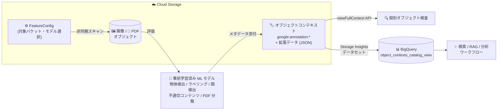

# Cloud Storage: オブジェクトエンリッチメントとオブジェクトコンテキスト拡張データ (Preview)

**リリース日**: 2026-10-13

**サービス**: Cloud Storage

**機能**: オブジェクトエンリッチメント / 拡張データ付きオブジェクトコンテキスト / Object Contexts Catalog ビュー

**ステータス**: Preview

📊 [このアップデートのインフォグラフィックを見る](https://takech9203.github.io/google-cloud-news-summary/20261013-cloud-storage-object-enrichments-contexts.html)

## 概要

Cloud Storage に、非構造化データの管理・活用を大きく進化させる 3 つの機能が Preview として発表されました。1 つ目の「オブジェクトエンリッチメント (Object enrichments)」は、バケット内の画像や PDF ドキュメントに対して Google の事前学習済み機械学習モデルを自動適用し、生成されたメタデータをオブジェクトコンテキストとしてオブジェクトに直接添付する機能です。カスタムの ML パイプラインを構築することなく、保存済みデータから構造化メタデータを自動生成できます。

2 つ目は「拡張データ (extended data) 付きオブジェクトコンテキスト」です。Google サービスが機械学習ラベリングなどの自動分析時にオブジェクトへ添付するコンテキストで、最大 128 KiB の構造化 JSON ペイロードを保持できます。コンテキストと拡張データの取得には新しい JSON API メソッド `viewFullContext` を使用します。

3 つ目は Storage Insights データセットに追加された「Object Contexts Catalog ビュー (`object_contexts_catalog_view`)」です。オブジェクトコンテキストと拡張データを BigQuery で SQL により大規模に分析でき、数百万〜数十億オブジェクトのメタデータを横断的にクエリできます。非構造化データの検索・キュレーション・ガバナンス、そして RAG などの生成 AI ワークフローの基盤整備を Cloud Storage ネイティブで実現する、ストレージと AI の統合を象徴するアップデートです。

**アップデート前の課題**

- 画像や PDF からメタデータを生成するには、Vision API や Document AI を呼び出すカスタム ML パイプライン (取り込み処理・コンピュートインフラ) を自前で構築・運用する必要があった
- オブジェクトコンテキストはキーと文字列値 (各最大 256 バイト) のみで構成され、バウンディングボックスや信頼度スコアのような構造化された詳細メタデータをオブジェクトに直接保持できなかった
- オブジェクトコンテキストを数百万オブジェクト規模で横断的に SQL 分析する専用のビューがなく、大規模なメタデータ分析が難しかった

**アップデート後の改善**

- Feature 設定 (`FeatureConfig`) を作成するだけで、Cloud Storage が対象バケットの画像・PDF を非同期にスキャンし、選択した ML モデル (物体検出、画像ラベリング、顔検出、不適切コンテンツ検出、PDF 分類) でメタデータを自動生成・添付できるようになった
- コンテキストに最大 128 KiB の構造化 JSON ペイロード (拡張データ) を保持できるようになり、`viewFullContext` API で ML ラベルや注釈の詳細を取得できるようになった
- Storage Insights データセットの `object_contexts_catalog_view` により、BigQuery の標準 SQL でラベル検索、カテゴリフィルタ、信頼度スコアによる絞り込みなどが大規模に実行可能になった

## アーキテクチャ図



FeatureConfig で指定したバケットの画像・PDF を Cloud Storage が非同期に ML モデルで評価し、結果をオブジェクトコンテキスト (拡張データ付き) として添付します。添付されたメタデータは `viewFullContext` API での個別検査、または Storage Insights データセット経由で BigQuery での大規模 SQL 分析に利用できます。

## サービスアップデートの詳細

### 主要機能

1. **オブジェクトエンリッチメント (Preview)**
   - Feature 設定 (`FeatureConfig`) で監視対象のバケットまたはプロジェクトと、適用する ML モデルを指定
   - Cloud Storage が対象オブジェクトを非同期にスキャンし、適格な画像・PDF を選択したモデルで評価、結果を `contexts.custom` 配下に `google:annotation:` プレフィックス付きのコンテキストキーで添付
   - カスタム取り込みパイプラインやコンピュートインフラが不要になり、Cloud Storage 内で直接メタデータを生成

2. **拡張データ付きオブジェクトコンテキスト (Preview)**
   - コンテキストはキー・文字列値・タイムスタンプに加え、最大 128 KiB の構造化 JSON ペイロード (拡張データ) を保持可能
   - 拡張データ付きコンテキストは Google サービスが自動分析時に添付する (ユーザーは `google:` プレフィックス付きコンテキストの作成・変更は不可)
   - 標準の get / list リクエストではキー・値・タイムスタンプと `extendedDataTypeUrl` フィールドのみが返り、拡張データ本体の取得には `viewFullContext` メソッド (`storage.objects.viewFullContext` 権限が必要) を使用

3. **Object Contexts Catalog ビュー (`object_contexts_catalog_view`)**
   - Storage Insights データセットのリンク済み BigQuery データセットに、オブジェクトコンテキストの最新メタデータ (拡張データ含む) を公開するビューを追加
   - ビューは 24 時間ごとに更新され、初回ロードには 24〜48 時間を要する
   - ラベル検索、顔検出結果のフィルタリング、バウンディングボックス座標の抽出などを標準 SQL で実行可能

### サポートされる ML モデル

| モデル | 検出内容 | 出力データ例 |
|------|------|------|
| 物体検出 (Object detection) | 画像内の複数の物体と位置・矩形境界 | Product、Animal、Person |
| 画像ラベリング (Image labeling) | 物体・場所・活動など幅広いカテゴリのエンティティ | Landscape、Urban、Night |
| 顔検出 (Face detection) | 顔のバウンディングポリゴン、ランドマーク、向き、表情の尤度 | 顔の数、ロール・チルト角 |
| 不適切コンテンツ検出 (Explicit content detection) | アダルト・暴力的コンテンツの評価 | 尤度レーティング |
| PDF 分類 (PDF classification) | PDF をビジネス・業界カテゴリに分類 | Finance、Taxes、Invoice (カテゴリとスコア) |

## 技術仕様

### 処理の仕様と制約

| 項目 | 詳細 |
|------|------|
| 処理ロケーション | `us`、`eu`、`asia` の 3 つの地理的ロケーションから選択 |
| オブジェクトサイズ上限 | 20 MiB 以下 (画像・PDF とも) |
| 対応画像形式 | BMP、GIF、ICO、JPEG、PNG、TIFF、WEBP |
| 対応ドキュメント形式 | PDF (`application/pdf`) |
| 適格性判定 | オブジェクトの `Content-Type` メタデータに基づく (無効・欠落時は処理されない) |
| 処理方式 | 非同期 (FeatureConfig の作成・更新の反映に最大 24 時間) |
| 拡張データ上限 | コンテキストあたり最大 128 KiB の JSON ペイロード |
| カタログビュー更新 | 24 時間ごと (初回ロードは 24〜48 時間) |

### viewFullContext API

```bash
GET https://storage.googleapis.com/storage/v1/b/BUCKET_NAME/o/OBJECT_NAME/viewFullContext?contextKey=KEY
```

レスポンス例 (顔検出コンテキストの場合):

```json
{
  "kind": "storage#objectFullContext",
  "type": "CUSTOM",
  "key": "google:annotation:face-detector-v1",
  "value": "SUCCESS",
  "createTime": "2025-09-29T17:20:00.000Z",
  "updateTime": "2025-09-29T17:20:00.000Z",
  "extendedData": {
    "@type": "type.googleapis.com/google.protobuf.Struct",
    "value": {
      "modelName": "face-detector",
      "modelVersion": "v1",
      "faceAnnotationGroup": {
        "faceAnnotations": [
          { "detectionConfidence": 0.9, "landmarkingConfidence": 0.8 }
        ]
      }
    }
  }
}
```

### 必要な IAM ロール・権限

| 操作 | ロール / 権限 |
|------|------|
| FeatureConfig の作成・管理 | `roles/storage.admin` (`storage.featureConfigs.create/list/get/update/delete`) |
| 基本的なコンテキストメタデータの閲覧 | `roles/storage.objectViewer` (`storage.objects.get`) |
| 拡張データの取得 (viewFullContext) | `roles/storage.objectUser` (`storage.objects.viewFullContext`) |
| rewrite 時のエンリッチメント破棄 | `roles/storage.objectAdmin` |

## 設定方法

### 前提条件

1. FeatureConfig の作成・管理に必要な `roles/storage.admin` ロールの付与
2. オブジェクトエンリッチメントのサービスエージェントにバケットへのアクセスを許可
3. (BigQuery で分析する場合) Storage Intelligence を構成し、Storage Insights データセットを設定して BigQuery にリンク

### 手順

#### ステップ 1: FeatureConfig の作成

スキャン対象のバケットと適用する ML モデルを指定する FeatureConfig リソースを作成します。バケット名は正確に指定する必要があり、正規表現やワイルドカードは使用できません。

#### ステップ 2: サービスエージェントへの権限付与

オブジェクトエンリッチメントのサービスエージェントが対象バケットのデータを読み取れるように認可します。

#### ステップ 3: エンリッチメントの確認

```bash
# 個別オブジェクトの完全なコンテキスト (拡張データ含む) を取得
curl -X GET \
  -H "Authorization: Bearer $(gcloud auth print-access-token)" \
  "https://storage.googleapis.com/storage/v1/b/BUCKET_NAME/o/OBJECT_NAME/viewFullContext?contextKey=google:annotation:label-detector-v1"
```

#### ステップ 4: BigQuery での大規模分析

信頼度スコア 0.75 超の特定ラベルが付いた画像を検索する例:

```sql
SELECT t.project, t.bucket, t.name, t.generation, label
FROM `PROJECT_ID.INSIGHTS_DATASET.object_contexts_catalog_view` AS t,
  UNNEST(t.contexts) AS context,
  UNNEST(JSON_QUERY_ARRAY(context.extendedData.labelAnnotationGroup.labelAnnotations)) AS label
WHERE context.key = "google:annotation:label-detector-v1"
  AND LOWER(STRING(label.description)) = 'car'
  AND FLOAT64(label.score) > 0.75;
```

## メリット

### ビジネス面

- **データカタログ構築の自動化**: 請求書・銀行取引明細・税務書類などの PDF や画像をコードを書かずに自動分類し、検索可能なデータカタログを構築できる
- **生成 AI 活用の加速**: ドキュメントカテゴリや画像ラベルを RAG の検索精度向上や生成 AI アプリケーションのグラウンディングに活用できる
- **コンテンツモデレーション**: アップロードされた画像の不適切コンテンツを自動検査し、安全ポリシーの運用を支援

### 技術面

- **アーキテクチャの簡素化**: カスタム取り込みパイプラインやコンピュートインフラが不要になり、Cloud Storage 内で直接メタデータを生成できる
- **ライフサイクルを通じたメタデータ永続化**: コンテキストはコピー・compose・リストア時にも維持される
- **大規模 SQL 分析**: 数百万〜数十億オブジェクトのコンテキストと拡張データ (ラベル、顔検出、バウンディングボックス) を BigQuery の標準 SQL で横断分析できる
- **ML トレーニングデータのキュレーション**: タクソノミーやビジュアルラベルで画像・ドキュメントをフィルタし、ファインチューニング用データセットを構築できる

## デメリット・制約事項

### 制限事項

- Preview 段階の機能であり、Pre-GA Offerings Terms が適用される (サポートが限定される可能性あり)
- オブジェクトサイズは 20 MiB 以下に限定され、`Content-Type` が無効・欠落しているオブジェクトは処理されない
- Rapid バケットおよび階層型名前空間 (HNS) が有効なバケットでは利用不可
- バケット再配置 (bucket relocation) と非互換 (再配置前に FeatureConfig から除外が必要)
- 顧客指定の暗号鍵 (CSEK) で暗号化されたオブジェクトは非対応
- 新規作成・再作成・再配置されたバケットは既存の FeatureConfig に自動追加されない
- `google:` プレフィックスのコンテキストはユーザーが作成・変更できず、削除には rewrite 操作時の `dropContextGroups` パラメータが必要

### 考慮すべき点

- エンリッチメント処理はオブジェクトデータの読み取りを伴うため、標準のデータアクセス料金が発生する
- Autoclass が有効なバケットでは、この読み取りがストレージクラス遷移をトリガーする
- 同一バケット・モデルに複数の処理ロケーションを設定すると、各ロケーションで処理・課金されるため、重複課金を避けるには 1 ロケーションのみ設定する
- 処理ロケーション (us / eu / asia) の選択時はコンプライアンス (データ主権) 要件を確認する
- BigQuery 分析には Storage Intelligence のサブスクリプション (Storage Insights データセット) が必要 (30 日間の無料トライアルあり)
- FeatureConfig の作成・更新の反映には最大 24 時間かかり、その間は以前の設定で処理が継続される場合がある

## ユースケース

### ユースケース 1: 非構造化ドキュメントの自動カタログ化と RAG 基盤整備

**シナリオ**: 大量の PDF (請求書、契約書、報告書) と画像が無秩序に保存されたバケット群を、生成 AI アプリケーションのナレッジベースとして活用したい。

**実装例**:
```text
1. FeatureConfig で対象バケットと PDF 分類・画像ラベリングモデルを指定
2. Cloud Storage が非同期にスキャンし、カテゴリ・ラベルをコンテキストとして添付
3. Storage Insights データセットの object_contexts_catalog_view を BigQuery で
   クエリし、カテゴリ別のドキュメントインデックスを構築
4. RAG の検索時にカテゴリ・ラベルでフィルタし、検索精度を向上
```

**効果**: カスタムコードなしで検索可能なデータカタログを構築し、生成 AI アプリケーションのグラウンディング品質を向上できる。

### ユースケース 2: コンテンツモデレーションと ML トレーニングデータのキュレーション

**シナリオ**: ユーザーがアップロードした画像を自動検査しつつ、モデルのファインチューニング用にドメイン特化のトレーニングデータセットを整備したい。

**効果**: 不適切コンテンツ検出モデルで安全ポリシーの運用を自動化し、画像ラベルや物体検出結果の信頼度スコアで SQL フィルタリングすることで、高品質なトレーニングデータセットを効率的に構築できる。

## 料金

オブジェクトエンリッチメント自体の個別料金は Preview 時点の公式ドキュメントでは確認できませんでした。関連して以下のコストが発生する点がドキュメントに明記されています。

- メタデータ生成時のオブジェクト読み取りには標準のデータアクセス料金が発生
- Storage Insights と BigQuery でのメタデータクエリには追加コストが発生する可能性あり (Storage Insights は Storage Intelligence サブスクリプションの機能)

詳細は [Cloud Storage の料金ページ](https://cloud.google.com/storage/pricing) および [BigQuery の料金ページ](https://cloud.google.com/bigquery/pricing) を参照してください。

## 利用可能リージョン

オブジェクトエンリッチメントの処理ロケーションは `us`、`eu`、`asia` の 3 つの地理的ロケーションから選択します。バケットのストレージリージョンに最も近い処理ロケーションの選択が推奨されています。

## 関連サービス・機能

- **Storage Insights データセット / Storage Intelligence**: オブジェクトコンテキストを BigQuery にエクスポートし、大規模 SQL 分析を可能にする基盤。Object Contexts Catalog ビューはこのデータセットの一部
- **BigQuery**: `object_contexts_catalog_view` を介したラベル検索・信頼度フィルタ・バウンディングボックス抽出などの SQL 分析
- **Storage バッチオペレーション**: オブジェクトコンテキストを数十億オブジェクト規模で一括管理可能
- **Cloud Monitoring**: エンリッチメント処理の進捗モニタリング
- **Vertex AI / Gemini**: バウンディングボックスやドキュメントカテゴリなどの構造化メタデータをマルチモーダルプロンプトのコンテキストとして活用

## 参考リンク

- 📊 [インフォグラフィック](https://takech9203.github.io/google-cloud-news-summary/20261013-cloud-storage-object-enrichments-contexts.html)
- [公式リリースノート](https://docs.cloud.google.com/release-notes#October_13_2026)
- [About object enrichments](https://docs.cloud.google.com/storage/docs/object-enrichments/overview)
- [Configure object enrichments](https://docs.cloud.google.com/storage/docs/object-enrichments/configure-object-enrichments)
- [Supported models and schemas](https://docs.cloud.google.com/storage/docs/object-enrichments/models)
- [Object contexts](https://docs.cloud.google.com/storage/docs/object-contexts)
- [viewFullContext JSON API](https://docs.cloud.google.com/storage/docs/json_api/v1/objects/viewFullContext)
- [Object contexts catalog スキーマ](https://docs.cloud.google.com/storage/docs/insights/dataset-tables-and-schemas#object-contexts-catalog-schema)
- [Analyze object contexts](https://docs.cloud.google.com/storage/docs/insights/configure-datasets#analyze-object-contexts)
- [料金ページ](https://cloud.google.com/storage/pricing)

## まとめ

今回のアップデートにより、Cloud Storage はカスタム ML パイプラインなしで画像・PDF から構造化メタデータを自動生成し、BigQuery で大規模に分析できるプラットフォームへと進化しました。非構造化データのカタログ化、RAG のグラウンディング、コンテンツモデレーションなど生成 AI 時代のデータ活用基盤を大幅に簡素化します。大量の画像・ドキュメントを保有する組織は、Preview の制約 (20 MiB 上限、対応バケットタイプ、処理ロケーション) を確認のうえ、Storage Intelligence の 30 日間トライアルと合わせた検証を推奨します。

---

**タグ**: `Cloud Storage` `Object Enrichments` `Object Contexts` `Storage Insights` `BigQuery` `機械学習` `メタデータ` `Preview` `生成AI` `RAG`
