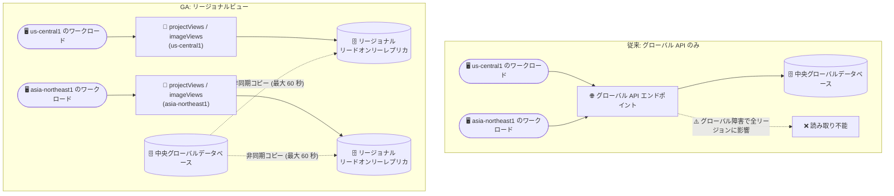

# Compute Engine: グローバルリソースのリージョナルビュー (projectViews / imageViews) が GA

**リリース日**: 2026-10-13

**サービス**: Compute Engine

**機能**: グローバルリソース (プロジェクト、OS イメージ) のリージョナルビュー

**ステータス**: GA (一般提供)

📊 [このアップデートのインフォグラフィックを見る](https://takech9203.github.io/google-cloud-news-summary/20261013-compute-engine-regional-views-ga.html)

## 概要

Compute Engine のグローバルリソースであるプロジェクトリソースと OS イメージリソースを、リージョナルな読み取り専用エンドポイント `projectViews` および `imageViews` 経由でクエリできる機能が一般提供 (GA) になりました。リージョナルビューをクエリすることで、コントロールプレーンへの読み取りリクエストを特定のリージョンに分離でき、グローバル API の障害発生時にもワークロードの可用性を維持できます。

従来のグローバル API エンドポイントは全リージョンにわたる強整合性を提供する一方、グローバルコントロールプレーンや遠隔リージョンでの一時的なレイテンシ上昇や障害が、ローカルサービスの遅延やブロックの原因となる可能性がありました。本機能により、各リージョンのリードオンリーレプリカからリソース定義を読み取ることで、リージョン単位の障害分離 (fault isolation) が実現され、グローバル障害の影響を受けにくい高可用なアプリケーションを構築できます。

オートスケーリングスクリプトや CI/CD パイプラインなど、グローバルリソース定義への読み取りに依存する自動化システムを運用するマルチリージョンアーキテクチャの利用者にとって、単一障害点を排除する重要なアップデートです。

**アップデート前の課題**

- プロジェクトや OS イメージなどのグローバルリソースのメタデータ読み取りは、グローバル API エンドポイント経由でしか行えなかった
- グローバルコントロールプレーンや他リージョンの障害・レイテンシ上昇が、ローカルリージョンで稼働するサービス (オートスケーリング、デプロイ自動化など) に波及し、単一障害点となり得た
- API レート制限がグローバルで共有されるため、あるリージョンのトラフィックスパイクや暴走スクリプトが他リージョンの読み取りクォータに影響する可能性があった

**アップデート後の改善**

- `projectViews` / `imageViews` エンドポイントにより、コントロールプレーンの読み取りリクエストを特定リージョンに分離できるようになった
- 他リージョンやグローバルコントロールプレーンの障害時でも、ローカルリージョンのレプリカから読み取りを継続でき、ワークロードの可用性が向上した
- リージョナルビューはリージョンごとの API 読み取りクォータを消費するため、リージョン間でクォータが分離され、あるリージョンの `429 Too Many Requests` が他リージョンに波及しなくなった

## アーキテクチャ図



従来はすべての読み取りが中央グローバルデータベースに依存していましたが、リージョナルビューにより各リージョンのリードオンリーレプリカから読み取ることで障害ドメインがリージョン単位に分離されます。

## サービスアップデートの詳細

### 主要機能

1. **projectViews エンドポイント (プロジェクトリソースのリージョナルビュー)**
   - グローバルなプロジェクトリソース (`compute.Project`) への読み取り専用アクセスをリージョン単位で提供
   - サポートされるメソッドは `Get` のみ (読み取り専用)
   - 標準のグローバル `compute.Project` リソースオブジェクトが返却される (リソース自体はグローバルのまま)

2. **imageViews エンドポイント (OS イメージリソースのリージョナルビュー)**
   - グローバルな OS イメージリソース (`compute.Image`) への読み取り専用アクセスをリージョン単位で提供
   - サポートされるメソッドは `Get` と `List`
   - プロジェクトで利用可能なグローバル OS イメージの一覧を、特定リージョンのエンドポイント経由で取得可能

3. **自動フォールバック**
   - リージョナルレプリカへのコピーが完了する前にリソースをリクエストした場合、Compute Engine は自動的に中央グローバルデータベースから直接読み取り、リクエストを成功させる

## 技術仕様

### グローバル API とリージョナルビュー API の比較

| 項目 | グローバル API | リージョナルビュー API |
|------|---------------|----------------------|
| エンドポイント | グローバル | リージョナル |
| プロジェクトのリソース URL | `/projects/PROJECT_ID` | `/projects/PROJECT_ID/regions/REGION/projectViews` |
| OS イメージのリソース URL | `/projects/PROJECT_ID/global/images` | `/projects/PROJECT_ID/regions/REGION/imageViews` |
| 障害ドメイン | グローバル | 指定リージョンに分離 |
| サポートメソッド | 読み取り・書き込み | 読み取り専用 (projectViews: `Get` / imageViews: `Get`, `List`) |
| API クォータ | グローバル API 読み書きクォータを消費 | リージョナル API 読み取りクォータを消費 |
| 整合性 | 強整合 (中央グローバルデータベースから読み取り) | 結果整合 (リージョナルレプリカから読み取り) |

### 必要な IAM 権限

事前定義ロール **Compute Instance Admin (v1)** (`roles/compute.instanceAdmin.v1`) に必要な権限が含まれます。個別権限は以下のとおりです。

| 操作 | 必要な権限 |
|------|-----------|
| プロジェクトのリージョナルビュー取得 | プロジェクトに対する `compute.projects.get` |
| OS イメージのリージョナルビュー取得 | プロジェクトまたは OS イメージに対する `compute.images.get` および `compute.images.list` |

## 設定方法

### 前提条件

1. Google Cloud CLI のインストールと認証設定 (`gcloud init`)
2. 上記の IAM 権限 (例: `roles/compute.instanceAdmin.v1`) の付与

### 手順

#### ステップ 1: プロジェクトのリージョナルビューを取得

```bash
gcloud compute project-views describe \
    --region=REGION \
    --project=PROJECT_ID
```

指定リージョンのコントロールプレーン経由でグローバルプロジェクトリソースを取得します。REST API の場合は `https://compute.googleapis.com/compute/v1/projects/PROJECT_ID/regions/REGION/projectViews` に GET リクエストを送信します。

#### ステップ 2: OS イメージをリージョナルエンドポイントで一覧取得

```bash
gcloud compute image-views list \
    --region=REGION \
    --project=PROJECT_ID
```

#### ステップ 3: 特定の OS イメージの詳細をリージョナルエンドポイントで取得

```bash
gcloud compute image-views describe IMAGE_NAME \
    --region=REGION \
    --project=PROJECT_ID
```

標準の `compute.Image` リソース表現がそのまま返却されるため、既存のパース処理を大きく変更せずに移行できます。

## メリット

### ビジネス面

- **可用性の向上**: グローバル API の障害時にもリージョン内のサービスが読み取りを継続でき、サービス停止リスクを低減
- **追加費用なし**: リージョナルビューエンドポイントへのリクエストに追加料金は発生しない

### 技術面

- **障害ドメインの分離**: 読み取りリクエストの障害ドメインが指定リージョンに限定され、他リージョンやグローバルコントロールプレーンの障害から保護される
- **クォータ分離**: API レート制限がリージョン単位で適用されるため、あるリージョンでのトラフィックスパイクが他リージョンのレート制限 (`429`) を誘発しない
- **互換性**: 返却されるのは標準の `compute.Project` / `compute.Image` オブジェクトであり、既存コードの変更が最小限で済む

## デメリット・制約事項

### 制限事項

- **読み取り専用**: 作成・更新・削除などの書き込み操作には対応していない。書き込みには従来どおりグローバル API を使用する必要がある
- **結果整合性**: グローバルでのリソースの作成・更新・削除が全リージョナルビューエンドポイントに反映されるまで最大 60 秒かかり、その間は古いデータが返却される可能性がある
- **対象リソースはプロジェクトと OS イメージのみ**: 現時点でリージョナルビューが提供されるのは `projectViews` (プロジェクト) と `imageViews` (OS イメージ) の 2 種類
- **quota 配列の非返却**: `projectViews` でプロジェクトを取得した場合、クロスリージョンのファンアウトを行わないため `quota` 配列はレスポンスに含まれない。クォータの設定値やリアルタイム使用量の確認にはグローバルの `projects.get` を使用する

### 考慮すべき点

- 更新が全リージョンに即時に見える必要があるアプリケーションでは、リージョナルビューエンドポイントを使用せず、標準のグローバル API を使用すること (公式ドキュメントで明示的に注意喚起)
- ワークロードが稼働しているリージョンと同一のリージョンにリクエストを送ること (ゾーンワークロードの場合は親リージョンを使用)。他リージョンへの読み取りを集中させるとホットスポットの原因になる
- 共有クライアントライブラリやデプロイテンプレートにリージョン文字列をハードコードせず、実行環境から動的に検出することで、マルチリージョンフェイルオーバーを透過的に機能させる

## ユースケース

### ユースケース 1: マルチリージョンのオートスケーリング / CI/CD パイプラインの耐障害性向上

**シナリオ**: 複数リージョンで稼働するオートスケーリングスクリプトや CI/CD パイプラインが、インスタンス作成前に OS イメージ定義をグローバル API から取得している。グローバル API 障害時にはすべてのリージョンでデプロイが停止してしまう。

**実装例**:
```bash
# 従来 (グローバルエンドポイント)
gcloud compute images list --project=PROJECT_ID

# 変更後 (ワークロードが稼働するリージョンのエンドポイント)
gcloud compute image-views list --region=us-central1 --project=PROJECT_ID
```

**効果**: 読み取りが各リージョンのレプリカに分離され、グローバル障害や他リージョン障害の影響を受けずにデプロイを継続できる。

### ユースケース 2: リージョン間のクォータ分離による安定運用

**シナリオ**: あるリージョンの監視スクリプトが暴走して大量の読み取り API を発行し、グローバルクォータを消費して他リージョンの重要ワークロードが `429 Too Many Requests` を受けている。

**効果**: リージョナルビューはリージョンごとの読み取りクォータバケットを消費するため、1 つのリージョンのトラフィックスパイクが他リージョンの API 可用性に影響しなくなる。

## 料金

リージョナルな読み取り専用 API エンドポイント経由でリージョナルビューにアクセスしても、追加料金は発生しません。標準のグローバル Compute Engine API リクエストと同様に、プロジェクトの標準 API クォータ (リージョナル API 読み取りクォータ) を消費しますが、課金はされません。

- 料金ページ: https://cloud.google.com/compute/pricing
- API クォータ: https://docs.cloud.google.com/compute/api-quota

## 関連サービス・機能

- **Compute Engine API クォータ**: リージョナルビューはリージョナル API 読み取りクォータバケットを消費するため、クォータ管理の設計と密接に関連する
- **OS イメージ (Compute Engine Images)**: `imageViews` の対象となるグローバルリソース。イメージベースのインスタンスデプロイ自動化で活用
- **Resource Manager (プロジェクトリソース)**: `projectViews` の対象となるプロジェクトリソースの管理階層
- **IAM**: `roles/compute.instanceAdmin.v1` などのロールによるアクセス制御が必要

## 参考リンク

- 📊 [インフォグラフィック](https://takech9203.github.io/google-cloud-news-summary/20261013-compute-engine-regional-views-ga.html)
- [公式リリースノート](https://docs.cloud.google.com/release-notes#October_13_2026)
- [Use regional views for resilient control-plane reads](https://docs.cloud.google.com/compute/docs/architecture/regional-views-global-resources)
- [Access global resources regionally for high availability](https://docs.cloud.google.com/compute/docs/architecture/access-global-resources-regionally)
- [Global, regional, and zonal resources](https://docs.cloud.google.com/compute/docs/regions-zones/global-regional-zonal-resources)
- [Troubleshoot regional views of global resources](https://docs.cloud.google.com/compute/docs/troubleshooting/troubleshoot-regional-views-global-resources)

## まとめ

グローバルリソースのリージョナルビュー (`projectViews` / `imageViews`) の GA により、プロジェクトおよび OS イメージのメタデータ読み取りをリージョン単位に分離し、グローバル API 障害に耐えるマルチリージョンアーキテクチャを追加費用なしで構築できるようになりました。オートスケーリングや CI/CD などの自動化システムを運用している場合は、読み取り系の API 呼び出しをワークロードと同一リージョンのリージョナルビューエンドポイントに切り替えることを推奨します。ただし結果整合性 (最大 60 秒の遅延) と読み取り専用である点に留意し、即時整合性が必要な処理や書き込み操作には引き続きグローバル API を使用してください。

---

**タグ**: #ComputeEngine #GA #HighAvailability #ControlPlane #RegionalViews #Resilience #API
