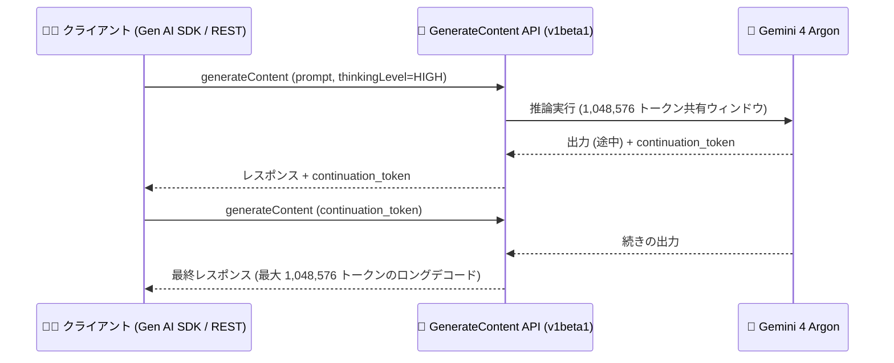

# Gemini Enterprise Agent Platform: Gemini 4 Argon / Gemini 4 Argon Cyber Permissive が GA、CodeMender でも利用可能に (Preview)

**リリース日**: 2026-10-13

**サービス**: Gemini Enterprise Agent Platform

**機能**: Gemini 4 Argon (GA)、Gemini 4 Argon Cyber Permissive (GA)、CodeMender での Gemini 4 Argon サポート (Preview)

**ステータス**: GA (モデル提供) / Preview (CodeMender サポート)

📊 [このアップデートのインフォグラフィックを見る](https://takech9203.github.io/google-cloud-news-summary/20261013-gemini-4-argon-ga.html)

## 概要

Google の最新フロンティアモデル **Gemini 4 Argon** (`gemini-4-argon`) が Gemini Enterprise Agent Platform で一般提供 (GA) になりました。Gemini 4 Argon は、コーディング、金融、法務、サイバーセキュリティ、科学といった複数ドメインにわたる複雑な実世界タスクでの「ディープワーク」に優れたモデルです。入力・思考 (thinking)・出力トークンで共有される 1,048,576 トークンのコンテキストウィンドウ、設定可能な思考レベル (LOW / MEDIUM / HIGH)、GenerateContent API の継続トークン (continuation token) を使った最大 1,048,576 トークンのロングデコード、そして GA となったエージェント型動画理解 (agentic video understanding) をサポートします。

同時に、防御的サイバーセキュリティ用途向けバージョンである **Gemini 4 Argon Cyber Permissive** (`gemini-4-argon-cyber-permissive`) も、Fairwind Program の許可リスト (allowlist) の対象顧客向けに GA となりました。

さらに、Gemini Enterprise Agent Platform 上のコードセキュリティエージェントである **CodeMender** が Gemini 4 Argon を Preview でサポートしました。`cm find`、`cm verify`、`cm fix` の各コマンドに `--model gemini-4-argon` を渡すことで利用できます (デフォルトモデルは引き続き Gemini 3.8 Flash)。

**アップデート前の課題**

- これまで最上位の推論モデルは Gemini 3.1 Pro であり、1M トークンコンテキストは持つものの、Gemini 4 世代のフロンティアモデルは利用できなかった
- 1 回の GenerateContent 呼び出しで生成できる出力トークン数は `maxOutputTokens` の上限に制約され、非常に長い出力を得るにはアプリケーション側で分割・再プロンプトの工夫が必要だった
- エージェント型動画理解は Preview 段階で、対応モデルも Flash 系 (Gemini 3.8 Flash、3.6 Flash、3.5 Flash Lite など) に限られていた
- CodeMender で選択できる最上位モデルは Gemini 3.x 世代であり、防御的サイバーセキュリティ向けの許可リスト対象モデルも Gemini 3.8 Flash Cyber だった

**アップデート後の改善**

- フロンティアモデル Gemini 4 Argon が GA となり、コーディング・金融・法務・サイバーセキュリティ・科学など複雑な実タスクに本番利用できるようになった
- 継続トークンにより、GenerateContent API (generateContent / streamGenerateContent) で最大 1,048,576 トークンのロングデコードが可能になった
- エージェント型動画理解が Gemini 4 Argon で GA となり、動画の内容に応じてモデルが動的にタイムラインを探索する処理を本番利用できるようになった
- 防御的サイバーセキュリティ用途向けの Gemini 4 Argon Cyber Permissive が Fairwind Program 許可リスト経由で GA になった
- CodeMender の脆弱性スキャン・検証・修正 (`cm find` / `cm verify` / `cm fix`) で Gemini 4 Argon を選択できるようになった (Preview)

## アーキテクチャ図



継続トークンを使ったロングデコードの API フロー。1 回のレスポンスで完結しない長い生成を、`continuation_token` を渡して継続することで最大 1,048,576 トークンまで出力できます (v1beta1 API のみ対応)。

## サービスアップデートの詳細

### 主要機能

1. **Gemini 4 Argon (`gemini-4-argon`) の GA**
   - コーディング、金融、法務、サイバーセキュリティ、科学などのドメインにまたがる複雑な実世界タスクでのディープワークに優れた Google のフロンティアモデル
   - 1,048,576 トークンのコンテキストウィンドウ (入力・思考・出力トークンで共有)
   - 思考レベル (thinking level) を LOW / MEDIUM / HIGH から設定可能

2. **継続トークンによるロングデコード**
   - GenerateContent API (`generateContent` / `streamGenerateContent`) で継続トークンを使い、最大 1,048,576 トークンの長い出力を生成可能
   - 既知の問題: ロングデコード (`continuation_token`) は **v1beta1 API のみ対応** (v1 は非対応)。Google Gen AI SDK はデフォルトで v1beta1 を使用するが、`http_options` で `api_version='v1'` を指定している場合は動作しない。REST を直接呼び出す場合は v1beta1 エンドポイントパスを使用する

3. **エージェント型動画理解の GA**
   - 固定フレームレート (1 FPS) で全フレームを抽出する静的処理とは異なり、モデルがプロンプトに応じて動画タイムラインを動的に探索し、必要なコンテンツのみを読み込む方式
   - 長尺動画では最大 88% の入力トークン削減と、長尺コンテンツで約 7% の品質向上が公式ドキュメントで示されている (従来対応モデルでの数値)

4. **Gemini 4 Argon Cyber Permissive (`gemini-4-argon-cyber-permissive`) の GA**
   - 防御的サイバーセキュリティ用途向けの Gemini 4 Argon のバージョン
   - Fairwind Program の許可リスト対象の顧客のみ利用可能

5. **CodeMender での Gemini 4 Argon サポート (Preview)**
   - CodeMender は Google DeepMind 発の自律型コードセキュリティエージェントで、コードベースの脆弱性をスキャン (find)・実行ベースで検証 (verify)・修正パッチ生成 (fix) する
   - `cm find`、`cm verify`、`cm fix` に `--model gemini-4-argon` を渡すことで利用可能
   - デフォルトモデルは引き続き Gemini 3.8 Flash

## 技術仕様

### Gemini 4 Argon のスペック

| 項目 | 詳細 |
|------|------|
| モデル ID | `gemini-4-argon` / `gemini-4-argon-cyber-permissive` |
| ステータス | GA (Cyber Permissive は Fairwind Program 許可リスト対象のみ) |
| コンテキストウィンドウ | 1,048,576 トークン (入力・思考・出力トークンで共有) |
| 思考レベル | LOW / MEDIUM / HIGH (設定可能) |
| ロングデコード | 継続トークンで最大 1,048,576 トークン (GenerateContent API、v1beta1 のみ) |
| 動画理解 | エージェント型動画理解 (GA) |
| 得意ドメイン | コーディング、金融、法務、サイバーセキュリティ、科学 |

### ロングデコードの API バージョン制約 (既知の問題)

| 呼び出し方法 | 対応状況 |
|------|------|
| v1beta1 API (REST 直接呼び出し) | 対応 (v1beta1 エンドポイントパスを使用) |
| v1 API | 非対応 |
| Google Gen AI SDK (デフォルト) | 対応 (デフォルトで v1beta1 を使用) |
| Google Gen AI SDK で `api_version='v1'` を明示指定 | 非対応 (指定を外す必要あり) |

## 設定方法

### 前提条件

1. Google Cloud プロジェクトで Gemini Enterprise Agent Platform が利用可能であること
2. Gemini 4 Argon Cyber Permissive を使う場合は Fairwind Program の許可リストに登録されていること
3. CodeMender で使う場合は CodeMender CLI (`cm`) のセットアップが完了していること

### 手順

#### ステップ 1: Gen AI SDK から Gemini 4 Argon を呼び出す

```python
from google import genai
from google.genai import types

client = genai.Client()  # デフォルトで v1beta1 を使用 (ロングデコード対応)

response = client.models.generate_content(
    model="gemini-4-argon",
    contents="大規模コードベースのリファクタリング計画を立案してください",
    config=types.GenerateContentConfig(
        thinking_config=types.ThinkingConfig(thinking_level="high")
    ),
)
print(response.text)
```

思考レベルは `low` / `medium` / `high` から選択できます。ロングデコード (継続トークン) を使う場合は、`http_options` で `api_version='v1'` を指定しないよう注意してください。

#### ステップ 2: CodeMender で Gemini 4 Argon を使う (Preview)

```bash
# 脆弱性スキャン
cm find --model gemini-4-argon

# 実行ベースの脆弱性検証
cm verify --model gemini-4-argon

# 修正パッチの生成
cm fix --model gemini-4-argon
```

`--model` を省略した場合、デフォルトの Gemini 3.8 Flash が使用されます。

## メリット

### ビジネス面

- **本番利用可能なフロンティアモデル**: GA により SLA を前提とした本番ワークロードに Gemini 4 Argon を採用できる。金融・法務・科学など専門性の高いドメインの業務にも適用可能
- **動画処理コストの削減**: エージェント型動画理解の GA により、長尺動画の分析で入力トークンを大幅に削減でき、コスト効率が向上する
- **セキュリティ修正の高速化**: CodeMender と組み合わせることで、脆弱性の発見から修正パッチ生成までを最上位モデルの推論能力で加速できる

### 技術面

- **ロングデコード**: 継続トークンにより、長大なコード生成・ドキュメント生成・大規模データの変換など、従来は分割が必要だった長い出力を API レベルで扱える
- **思考レベルの制御**: LOW / MEDIUM / HIGH の思考レベルで、レイテンシ・コストと推論の深さのトレードオフをタスクごとに最適化できる
- **1M トークン共有ウィンドウ**: 入力・思考・出力を合わせて 1,048,576 トークンまで扱えるため、大規模コードベースや長文ドキュメントを丸ごとコンテキストに載せられる

## デメリット・制約事項

### 制限事項

- ロングデコード (`continuation_token`) は v1beta1 API のみ対応。v1 API では利用できない (既知の問題)
- Gemini 4 Argon Cyber Permissive は Fairwind Program の許可リスト対象の顧客のみ利用可能
- CodeMender での Gemini 4 Argon サポートは Preview であり、Pre-GA 提供条件が適用される

### 考慮すべき点

- コンテキストウィンドウは入力・思考・出力トークンで**共有**されるため、思考レベルを HIGH にして長い出力を得る場合は、入力に使えるトークン数が実質的に減る点を設計時に考慮する
- Gen AI SDK で `http_options` に `api_version='v1'` を指定している既存コードは、ロングデコードを使う前に設定を見直す必要がある
- CodeMender のデフォルトモデルは Gemini 3.8 Flash のままなので、Gemini 4 Argon を使うには毎回 `--model` フラグの明示指定が必要

## ユースケース

### ユースケース 1: 大規模コードベースの脆弱性修正 (CodeMender + Gemini 4 Argon)

**シナリオ**: マルチ言語の大規模コードベースを持つ企業が、静的スキャナの誤検知に悩まされており、実際に悪用可能な脆弱性だけを優先して修正したい。

**実装例**:
```bash
cm find --model gemini-4-argon      # 深いスキャンで脆弱性を発見
cm verify --model gemini-4-argon    # PoC エクスプロイトの実行で悪用可能性を検証
cm fix --model gemini-4-argon       # 根本原因に対する修正パッチを生成
```

**効果**: フロンティアモデルの推論能力により、複雑な制御フロー・データパスをまたぐ深い脆弱性の発見・検証・修正の精度向上が期待できる。開発者はコード diff をレビュー・承認するだけでよい。

### ユースケース 2: 長文の成果物生成 (ロングデコード)

**シナリオ**: 大規模なレガシーコードの一括変換や、長大な技術仕様書の生成など、1 回のレスポンスに収まらない長い出力が必要。

**効果**: 継続トークンを使うことで、アプリケーション側で出力を分割・再結合するロジックを作り込まずに、最大 1,048,576 トークンの出力を取得できる。

### ユースケース 3: 長尺動画の分析 (エージェント型動画理解)

**シナリオ**: 講義・会議・監視カメラなどの長時間動画から、特定の瞬間の特定や内容の要約を行いたい。

**効果**: モデルが動画タイムラインを動的にナビゲートし、必要な部分だけを読み込むため、固定 1 FPS のフレーム抽出に比べてトークン消費を抑えつつ、長尺コンテンツでの回答品質を高められる。

## 料金

Gemini 4 Argon 固有の単価は公式料金ページで確認してください。Gemini Enterprise Agent Platform のモデル利用には、以下の消費オプションがあります。

| 消費オプション | 概要 |
|--------|-----------------|
| Provisioned Throughput | コミットメント期間 (1 週間〜1 年) でスループットを保証 |
| Standard PayGo | トークン単位の従量課金 (標準レート) |
| Priority PayGo | 優先処理による高信頼性 (プレミアムレート) |
| Flex PayGo | レイテンシ許容ワークロード向け (割引レート) |
| Batch inference | 大規模非同期処理向け (割引レート) |

詳細: [Gemini Enterprise Agent Platform の料金ページ](https://cloud.google.com/gemini-enterprise-agent-platform/generative-ai/pricing)

## 関連サービス・機能

- **CodeMender**: Gemini Enterprise Agent Platform 上の自律型コードセキュリティエージェント。今回のアップデートで Gemini 4 Argon を Preview サポート
- **Google AI Threat Defense**: Gemini・Wiz・CodeMender・Mandiant を統合した自律型セキュリティプラットフォーム。CodeMender はその中核のコードセキュリティエージェント
- **Fairwind Program**: 防御的サイバーセキュリティ用途向けモデル (Gemini 4 Argon Cyber Permissive など) の利用資格を審査する許可リストプログラム
- **Google Gen AI SDK**: Gemini 4 Argon の呼び出しに使用。デフォルトで v1beta1 API を使用するためロングデコードに対応
- **Model Garden**: Gemini Enterprise Agent Platform で利用可能なモデルのカタログ

## 参考リンク

- 📊 [インフォグラフィック](https://takech9203.github.io/google-cloud-news-summary/20261013-gemini-4-argon-ga.html)
- [公式リリースノート](https://docs.cloud.google.com/release-notes#October_13_2026)
- [Gemini Enterprise Agent Platform ドキュメント](https://docs.cloud.google.com/gemini-enterprise-agent-platform)
- [思考レベル (Thinking) のドキュメント](https://docs.cloud.google.com/gemini-enterprise-agent-platform/models/thinking)
- [ロングコンテキストのドキュメント](https://docs.cloud.google.com/gemini-enterprise-agent-platform/models/long-context)
- [エージェント型動画理解](https://docs.cloud.google.com/gemini-enterprise-agent-platform/models/capabilities/video-understanding)
- [CodeMender ドキュメント](https://docs.cloud.google.com/gemini-enterprise-agent-platform/codemender)
- [CodeMender 製品ページ](https://cloud.google.com/security/codemender)
- [Fairwind Program](https://deepmind.google/fairwind-program/)
- [料金ページ](https://cloud.google.com/gemini-enterprise-agent-platform/generative-ai/pricing)

## まとめ

Gemini 4 Argon の GA により、コーディングからサイバーセキュリティまで幅広いドメインのディープワークに本番利用できるフロンティアモデルが Gemini Enterprise Agent Platform に加わりました。1M トークンの共有コンテキストウィンドウ、継続トークンによるロングデコード、GA となったエージェント型動画理解は、エージェントワークロードの設計を大きく変える可能性があります。ロングデコードを使う場合は v1beta1 API の制約に注意しつつ、CodeMender ユーザーは `--model gemini-4-argon` での精度向上を検証してみることを推奨します。

---

**タグ**: Gemini Enterprise Agent Platform, Gemini 4 Argon, CodeMender, 生成 AI, GA, Preview, セキュリティ, ロングコンテキスト
