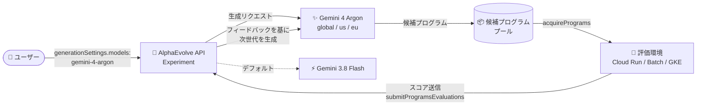

# Gemini Enterprise: AlphaEvolve で Gemini 4 Argon が利用可能に

**リリース日**: 2026-10-13

**サービス**: Gemini Enterprise

**機能**: AlphaEvolve における Gemini 4 Argon 対応

**ステータス**: Feature

📊 [このアップデートのインフォグラフィックを見る](https://takech9203.github.io/google-cloud-news-summary/20261013-gemini-enterprise-alphaevolve-gemini-4-argon.html)

## 概要

Gemini Enterprise の AlphaEvolve で、Google の最新モデルである **Gemini 4 Argon** が利用可能になりました。AlphaEvolve の実験 (experiment) において、`global`、`us`、`eu` の各リージョンで Gemini 4 Argon を使って候補プログラムを生成できます。利用するには、実験設定の `generationSettings` 内の `models` フィールドに `gemini-4-argon` を指定します。なお、デフォルトモデルは引き続き Gemini 3.8 Flash です。

AlphaEvolve は、進化的手法 (evolutionary methods) を用いてアルゴリズム探索・数理探索・組合せ最適化の課題を解決する特化型 AI コーディングエージェントです。NP 完全・NP 困難クラスの最適化問題に特に適しており、機能的に正しいコードを入力として、ユーザー定義の評価指標に基づき性能を段階的に改善する新しいプログラムを世代を重ねて発見します。候補プログラムの生成品質は使用する Gemini モデルに大きく依存するため、最新のフロンティアモデルである Gemini 4 Argon を選択できることは、より複雑な構造的推論を要する最適化課題に取り組むユーザーにとって重要なアップデートです。

**アップデート前の課題**

- AlphaEvolve で利用できるモデルは Gemini 3.8 Flash (デフォルト)、Gemini 3.7 Flash、Gemini 3.5 Flash、Gemini 3.1 Pro (Preview) に限られていた
- 上位モデルである Gemini 3.1 Pro (Preview) は `global` リージョンのみの提供で、`us` / `eu` リージョンに実験を作成する場合は Flash 系モデルしか選択できなかった
- 最新世代の Gemini 4 Argon を候補プログラムの生成に利用できなかった

**アップデート後の改善**

- `generationSettings.models` に `gemini-4-argon` を指定することで、Gemini 4 Argon による候補プログラム生成が可能になった
- Gemini 4 Argon は `global`、`us`、`eu` のすべての対応リージョンで利用でき、データロケーション要件のあるユーザーも最新モデルを選択できるようになった
- 既存実験への影響はなく、デフォルトは Gemini 3.8 Flash のまま維持されるため、明示的に指定しない限り挙動は変わらない

## アーキテクチャ図



AlphaEvolve の進化ループで、`generationSettings` に `gemini-4-argon` を指定すると候補プログラムの生成に Gemini 4 Argon が使われます。評価結果は API にフィードバックされ、次世代の候補生成に活用されます。

## サービスアップデートの詳細

### 主要機能

1. **Gemini 4 Argon による候補プログラム生成**
   - AlphaEvolve 実験の変異 (mutation) 生成に Gemini 4 Argon を利用可能
   - Google の最新マルチモーダルモデルであり、Agent Studio や Antigravity (Enterprise) でも提供されている `gemini-4-argon` と同じモデル識別子を使用

2. **全対応リージョンでの提供**
   - `global`、`us`、`eu` のすべての AlphaEvolve 対応リージョンで利用可能
   - 従来、Flash 系以外のモデル (Gemini 3.1 Pro Preview) は `global` のみだったため、`us` / `eu` リージョンで初めて上位モデルが選択可能に

3. **デフォルトは Gemini 3.8 Flash を維持**
   - `models` フィールドを省略した場合は引き続き Gemini 3.8 Flash が使用される
   - AlphaEvolve は実験作成時にデフォルトモデルを解決するため、既存の実験は設定に記録されたモデルを維持する

## 技術仕様

### AlphaEvolve でサポートされるモデル

| モデル名 | 提供リージョン | 備考 |
|------|------|------|
| `gemini-4-argon` | global, us, eu | **今回追加** |
| `gemini-3.8-flash` | global, us, eu | デフォルト |
| `gemini-3.7-flash` | global, us, eu | |
| `gemini-3.5-flash` | global, us, eu | |
| `gemini-3.1-pro-preview` | global | |

### generationSettings.models の制約

| 項目 | 詳細 |
|------|------|
| モデル数 | 1 実験あたり最大 2 つの異なるモデルを組み合わせ可能 |
| weight | 各モデルの生成呼び出しの比率。正の有限値が必須 (0 は不可) |
| temperature | 0.0〜2.0 の範囲 |
| バリデーション | 実験作成時に検証され、未サポートのモデル名やリージョン外のモデルは `INVALID_ARGUMENT` を返す |

### 設定例

```json
{
  "generationSettings": {
    "models": [
      { "name": "gemini-4-argon", "weight": 0.9 },
      { "name": "gemini-3.8-flash", "weight": 0.1 }
    ]
  }
}
```

weight は比率で指定するため合計が 1 になる必要はありません。上記の例では生成呼び出しの約 9 割を Gemini 4 Argon に、残りを Gemini 3.8 Flash に送ります。

## 設定方法

### 前提条件

1. 有効な Gemini Enterprise ライセンスが割り当てられていること
2. 呼び出し元に Discovery Engine Editor ロール (`roles/discoveryengine.editor`) または Admin ロール (`roles/discoveryengine.admin`) が付与されていること
3. プロジェクトで Vertex AI API (`aiplatform.googleapis.com`) が有効化されていること
4. 実験を `global`、`us`、`eu` のいずれかのロケーションに作成すること

### 手順

#### ステップ 1: 実験作成リクエストで Gemini 4 Argon を指定

```bash
curl -X POST \
  -H "Authorization: Bearer $(gcloud auth application-default print-access-token)" \
  -H "Content-Type: application/json" \
  "https://discoveryengine.googleapis.com/v1alpha/projects/PROJECT_ID/locations/global/collections/COLLECTION/engines/ENGINE/sessions/SESSION/alphaEvolveExperiments" \
  -d '{
    "config": {
      "title": "Optimization with Gemini 4 Argon",
      "problemDescription": "Optimize the custom_heuristic function.",
      "programLanguage": "python",
      "runSettings": { "maxPrograms": 250, "concurrency": 8 },
      "generationSettings": {
        "models": [ { "name": "gemini-4-argon", "weight": 1.0 } ]
      }
    }
  }'
```

AlphaEvolve の実験は Discovery Engine API (`v1alpha`) のセッション配下に作成します。`models` に `gemini-4-argon` を指定することで、候補プログラム生成に Gemini 4 Argon が使用されます。

#### ステップ 2: 実験の開始と進化ループの実行

```bash
# 実験を開始 (CREATED → RUNNING)
curl -X POST \
  -H "Authorization: Bearer $(gcloud auth application-default print-access-token)" \
  "https://discoveryengine.googleapis.com/v1alpha/EXPERIMENT_NAME:start"
```

開始後は `:acquirePrograms` で変異済み候補プログラムを取得し、評価結果を `submitProgramsEvaluations` で 1 件ずつ送信する進化ループを実行します。

## メリット

### ビジネス面

- **最新モデルによる探索品質の向上**: 複雑な最適化課題に対して、Google の最新フロンティアモデルの推論能力を進化的探索に適用できる
- **データロケーション要件への対応**: `us` / `eu` リージョンでも上位モデルが使えるようになり、リージョン要件を持つ組織でもモデル選択の幅が広がる

### 技術面

- **モデルミックスの柔軟性**: 最大 2 モデルの重み付き併用により、Gemini 4 Argon と Flash 系モデルを組み合わせてコストと品質のバランスを調整できる
- **既存実験への影響なし**: デフォルトは Gemini 3.8 Flash のままで、既存実験は作成時に記録されたモデル設定を維持するため、オプトイン方式で安全に移行できる

## デメリット・制約事項

### 制限事項

- 1 実験で組み合わせられるモデルは最大 2 つまで (重複指定は不可)
- AlphaEvolve 自体の対応ロケーションは `global`、`us`、`eu` のみ (他のロケーションでは `FAILED_PRECONDITION`)
- 1 プロジェクトあたり、ロケーションごとに同時アクティブ (STARTED / RUNNING) な実験は 30 件まで
- AlphaEvolve は Model Armor 統合をサポートしない
- Assured Workloads、FedRAMP、DoD コンプライアンス要件には対応していない (デフォルトではアクセス不可)

### 考慮すべき点

- デフォルトモデルは Gemini 3.8 Flash のままのため、Gemini 4 Argon を使うには `models` フィールドでの明示的な指定が必要
- 既存の実験は作成時のモデル設定を保持するため、Gemini 4 Argon に切り替えるには `models` を指定した新しい実験の作成が必要
- モデル生成トークンのクォータに達すると `RESOURCE_EXHAUSTED` が返るため、`runSettings` の `concurrency` を下げる、指数バックオフを実装するなどの対策を検討する

## ユースケース

### ユースケース 1: 複雑な構造的推論を要するアルゴリズム最適化

**シナリオ**: 組合せ最適化 (スケジューリング、経路探索など NP 困難な問題) のヒューリスティック関数を進化させる際、EVOLVE-BLOCK 周辺の不変コードを含めた複雑な構造的推論が必要なケース。

**実装例**:
```json
{
  "generationSettings": {
    "includeFullProgramInPrompt": true,
    "models": [ { "name": "gemini-4-argon", "weight": 1.0 } ]
  }
}
```

**効果**: `includeFullProgramInPrompt: true` と組み合わせることで、最新モデルの推論能力をフル活用した高品質な変異候補の生成が期待できる。

### ユースケース 2: コストと品質を両立するモデルミックス運用

**シナリオ**: 大量の候補生成 (例: `maxPrograms: 250`) を行う実験で、生成コストを抑えつつ探索品質を高めたい。

**効果**: Gemini 4 Argon と Gemini 3.8 Flash を重み付きで併用 (例: 1 : 9) し、大半の生成を Flash で処理しながら一部の生成に Argon の推論能力を注入することで、コスト効率と探索多様性のバランスを調整できる。

## 利用可能リージョン

Gemini 4 Argon は、AlphaEvolve が対応するすべてのロケーション (`global`、`us`、`eu`) で利用可能です。

## 関連サービス・機能

- **Gemini Enterprise**: AlphaEvolve の利用には有効な Gemini Enterprise ライセンスが必要。セキュリティコントロールも Gemini Enterprise のものが適用される (一部制限あり)
- **Discovery Engine API**: AlphaEvolve の実験は Discovery Engine API (`v1alpha`) 経由で作成・操作し、IAM ロールも Discovery Engine のロールを使用する
- **Vertex AI API**: AlphaEvolve の実行にはプロジェクトで `aiplatform.googleapis.com` の有効化が必要
- **Cloud Run / Batch / GKE**: 候補プログラムの評価基盤として利用。長時間評価や GPU/TPU が必要な場合は Cluster Toolkit + Batch + Pub/Sub による AlphaEvolve HPC ソリューションが提供されている
- **Antigravity / Agent Studio**: Gemini 4 Argon は Antigravity (Enterprise) や Agent Studio でも提供されており、AlphaEvolve スキルを使えばコーディングアシスタントから実験のワークフローを実行できる

## 参考リンク

- 📊 [インフォグラフィック](https://takech9203.github.io/google-cloud-news-summary/20261013-gemini-enterprise-alphaevolve-gemini-4-argon.html)
- [公式リリースノート](https://docs.cloud.google.com/release-notes#October_13_2026)
- [AlphaEvolve API リファレンス (Supported models / Generation settings)](https://docs.cloud.google.com/gemini/enterprise/docs/alphaevolve/reference-guide/api-reference)
- [AlphaEvolve 概要 (Developer Guide)](https://docs.cloud.google.com/gemini/enterprise/docs/alphaevolve/developer-guide/overview)
- [AlphaEvolve のコンプライアンス・セキュリティプロファイル](https://docs.cloud.google.com/gemini/enterprise/docs/alphaevolve/developer-guide/compliance-security-profile)

## まとめ

AlphaEvolve の候補プログラム生成に Google の最新モデル Gemini 4 Argon が選択可能になり、`us` / `eu` を含む全対応リージョンで利用できるようになりました。デフォルトは Gemini 3.8 Flash のままのため既存実験への影響はなく、複雑な最適化課題に取り組むユーザーは `generationSettings.models` に `gemini-4-argon` を指定して探索品質の向上を試すことを推奨します。コストが気になる場合は Flash 系モデルとの重み付きミックスから始めるのが良いでしょう。

---

**タグ**: Gemini Enterprise, AlphaEvolve, Gemini 4 Argon, 最適化, AI エージェント, Feature
