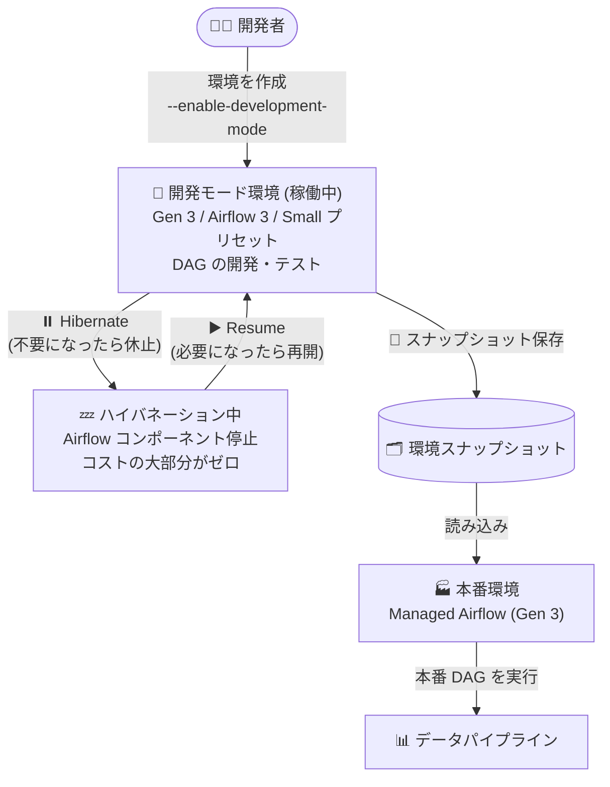

# Google Cloud Managed Service for Apache Airflow: 開発モード環境とハイバネーションが GA

**リリース日**: 2026-10-13

**サービス**: Google Cloud Managed Service for Apache Airflow (Managed Airflow)

**機能**: 開発モード環境 (Development mode environments) と環境ハイバネーション (Environment hibernation)

**ステータス**: GA (一般提供)

📊 [このアップデートのインフォグラフィックを見る](https://takech9203.github.io/google-cloud-news-summary/20261013-managed-airflow-development-mode-hibernation-ga.html)

## 概要

Google Cloud Managed Service for Apache Airflow (旧 Cloud Composer) において、**開発モード環境 (Development mode environments)** と**環境ハイバネーション (Environment hibernation)** が一般提供 (GA) になりました。Airflow 3 を使用する Managed Airflow (Gen 3) 環境を開発モードで作成し、本番環境へ公開する前の DAG のテスト・開発に利用できます。

開発モード環境は、不要になったタイミングでハイバネーション (休止) させることができます。ハイバネーション中は Airflow コンポーネントが完全に停止し、環境コストの大部分がゼロになります。必要になったら再開 (Resume) するだけで、環境の再作成なしに開発を続行できます。

Apache Airflow は DAG の強力な分離機構を提供しないため、本番環境とは別にテスト・開発用環境を維持することが公式に推奨されています。本アップデートにより、開発用環境を「使うときだけ起動し、使わないときはほぼゼロコストで保持する」運用が GA 機能として可能になり、データエンジニアリングチームの開発環境コストを大幅に削減できます。

**アップデート前の課題**

- Apache Airflow には強力な DAG 分離機構がなく、本番とは別のテスト・開発用環境の維持が推奨されるが、通常の環境は使用していない時間帯もスケジューラーや Web サーバーなどのコンポーネントが稼働し続け、コストが発生していた
- 開発用環境のコストを抑えるには環境を削除して再作成するしかなく、設定や接続情報の復元に手間がかかった
- 開発モード環境とハイバネーションは GA ではなかったため、本番ワークロードを支える開発フローへの正式採用がためらわれるケースがあった

**アップデート後の改善**

- Managed Airflow (Gen 3) + Airflow 3 の環境を開発モードで作成し、本番公開前の DAG のテスト・開発に利用できるようになった (GA)
- 開発モード環境をハイバネーションさせることで、Airflow コンポーネントを停止し、環境コストの大部分をゼロにできるようになった (ハイバネーション中は休止した環境コンポーネントの保存分の DCU のみを消費)
- Console のボタン操作、`gcloud beta composer environments hibernate` / `resume` コマンド、API (`environments:hibernate` / `environments:resume`) で簡単に休止・再開できる
- スナップショットの保存・読み込みに対応しており、開発モード環境と他の環境との間で DAG やデータを転送できる

## アーキテクチャ図



開発者は開発モード環境で DAG をテストし、不要なときはハイバネーションでコストをほぼゼロに抑えます。検証済みの DAG はスナップショットなどを通じて本番環境へ展開します。

## サービスアップデートの詳細

### 主要機能

1. **開発モード環境 (GA)**
   - 開発用途専用の環境タイプ。Managed Airflow (Gen 3) + Airflow 3 で作成する
   - Small 環境サイズのプリセットと標準レジリエンスモードで動作し、低コストで開発・テスト環境を用意できる
   - スナップショットの保存・読み込みに対応し、DAG やデータを他の環境と相互に転送できる

2. **環境ハイバネーション (GA)**
   - 開発モード環境を使用しない期間に休止させる機能
   - ハイバネーション中は Airflow コンポーネントが稼働せず、DAG 実行の作成・キュー・スケジュールは行われない。環境のバケットからの DAG のパース・同期も停止する
   - `composer-user-workloads` 名前空間の Pod も停止する
   - 休止した環境コンポーネントの保存分の DCU のみを消費し、環境コストの大部分がゼロになる

3. **簡単な休止・再開操作**
   - Google Cloud コンソールの環境詳細ページから「Hibernate」「Resume」ボタンで操作可能
   - `gcloud beta composer environments hibernate` / `resume` コマンド、または Cloud Composer API (`v1beta1` の `environments:hibernate` / `environments:resume`) でも操作可能

## 技術仕様

### 開発モード環境の制約

| 項目 | 詳細 |
|------|------|
| 対応世代 | Managed Airflow (Gen 3) のみ |
| 対応 Airflow バージョン | Airflow 3 のみ |
| レジリエンスモード | 標準 (standard) のみ |
| 環境サイズ | Small プリセット固定 (コンポーネント数・リソース上限の変更不可) |
| 既存環境からの変換 | 不可 (作成時に開発モードを指定する必要がある) |
| 用途 | 開発専用 (本番利用は非推奨) |
| スナップショット | 保存・読み込みに対応 |

### ハイバネーション中の動作

| 項目 | 詳細 |
|------|------|
| Airflow コンポーネント | 停止 (DAG 実行は作成・キュー・スケジュールされない) |
| DAG のパース・同期 | 停止 (環境のバケットから同期されない) |
| ユーザーワークロード | `composer-user-workloads` 名前空間の Pod は停止 |
| コスト | 休止した環境コンポーネントの保存分の DCU のみ消費 (大部分がゼロに) |
| メンテナンス | メンテナンスウィンドウ内の自動アップグレードは実行される場合がある |
| 更新・アップグレード | ハイバネーション中は不可 |

## 設定方法

### 前提条件

1. 環境を開発モードで作成していること (既存環境を開発モードに切り替えることはできない)
2. 環境の更新オペレーションを実行できるロールが Google アカウントに付与されていること

### 手順

#### ステップ 1: 開発モード環境の作成

```bash
gcloud beta composer environments create ENVIRONMENT_NAME \
  --location LOCATION \
  --enable-development-mode
```

`--enable-development-mode` フラグを指定して、Managed Airflow (Gen 3) + Airflow 3 の環境を開発モードで作成します。

#### ステップ 2: 環境のハイバネーション

```bash
gcloud beta composer environments hibernate ENVIRONMENT_NAME \
  --location LOCATION
```

Console の場合は、環境詳細ページで「Hibernate」(一時停止アイコン) をクリックします。API の場合は以下にリクエストします。

```
POST https://composer.googleapis.com/v1beta1/projects/PROJECT/locations/LOCATION/environments/ENVIRONMENT:hibernate
```

#### ステップ 3: 環境の再開

```bash
gcloud beta composer environments resume ENVIRONMENT_NAME \
  --location LOCATION
```

Console の場合は「Resume」(再生アイコン) をクリックします。API の場合は `environments:resume` にリクエストします。

## メリット

### ビジネス面

- **開発環境コストの大幅削減**: 使用しない夜間・週末などに環境を休止することで、環境コストの大部分をゼロにできる。環境の削除・再作成が不要なため運用負荷も削減できる
- **GA による正式サポート**: 一般提供となったことで、本番の開発フローに安心して組み込める

### 技術面

- **本番と分離した安全な DAG 開発**: Airflow は強力な DAG 分離を提供しないため、専用の開発モード環境でテストすることで本番 DAG への干渉を防げる
- **迅速な休止・再開**: Console のワンクリック、gcloud コマンド、API のいずれでも休止・再開でき、環境の状態 (DAG やデータ) は保持される
- **スナップショットによるデータ移行**: 開発モード環境と本番環境の間で DAG やデータをスナップショット経由で転送できる

## デメリット・制約事項

### 制限事項

- Managed Airflow (Gen 3) + Airflow 3 の組み合わせのみ対応
- 環境サイズは Small プリセット固定で、Airflow コンポーネント数やリソース上限は変更できない
- レジリエンスモードは標準のみ (高レジリエンスは利用不可)
- 既存の環境を開発モードに切り替えることはできない (新規作成時に指定が必要)
- ハイバネーション中は環境の更新・アップグレードができない
- 開発専用であり、本番用途での使用は非推奨

### 考慮すべき点

- DAG のスケジュールとキャッチアップ設定はハイバネーション期間を考慮する必要がある。キャッチアップを設定している場合、環境の再開後にハイバネーション期間分の DAG 実行が作成される可能性がある
- ハイバネーション中でも、メンテナンスウィンドウ内の自動アップグレードが実行される場合がある
- `hibernate` / `resume` コマンドは現時点で `gcloud beta` トラックで提供されている

## ユースケース

### ユースケース 1: 業務時間のみ稼働する DAG 開発環境

**シナリオ**: データエンジニアリングチームが平日の業務時間だけ DAG の開発・テストを行う。夜間や週末は開発環境が不要。

**実装例**:
```bash
# 業務終了時に休止
gcloud beta composer environments hibernate dev-airflow --location asia-northeast1

# 翌営業日に再開
gcloud beta composer environments resume dev-airflow --location asia-northeast1
```

**効果**: 環境を削除せずに非稼働時間のコストの大部分をゼロにでき、再開後は DAG や設定がそのまま利用できる。

### ユースケース 2: 本番公開前の DAG 検証パイプライン

**シナリオ**: 新しい DAG や Airflow 3 向けに書き換えた DAG を、本番環境に影響を与えずに検証したい。

**効果**: 開発モード環境で DAG をテストし、スナップショットを活用して検証済みの DAG やデータを本番環境へ転送できる。Airflow の DAG 分離の弱さに起因する本番への干渉リスクを回避できる。

## 料金

Managed Airflow の料金は DCU (コンピュートユニット) ベースの従量課金です。開発モード環境は Small 環境サイズのプリセットで動作します。

ハイバネーション中は、**休止した環境コンポーネントの保存分の DCU のみを消費**し、環境コストの大部分がゼロになります (公式ドキュメントより)。具体的な単価は料金ページを参照してください。

- 料金ページ: https://cloud.google.com/composer/pricing

## 関連サービス・機能

- **Cloud Storage**: 環境のバケットに DAG を格納。ハイバネーション中はバケットからの DAG 同期が停止する
- **環境スナップショット**: 開発モード環境と他の環境の間で DAG やデータを転送する手段として利用できる
- **Composer Local Development CLI tool**: ローカルマシン上で Airflow 環境を実行して DAG を開発・テストする補完的な手段。開発モード環境はクラウド上でのマネージドな開発環境を提供する
- **Google Cloud コンソール / gcloud CLI / Cloud Composer API**: ハイバネーションと再開の操作インターフェース

## 参考リンク

- 📊 [インフォグラフィック](https://takech9203.github.io/google-cloud-news-summary/20261013-managed-airflow-development-mode-hibernation-ga.html)
- [公式リリースノート](https://docs.cloud.google.com/release-notes#October_13_2026)
- [ドキュメント: Hibernate development mode environments](https://docs.cloud.google.com/composer/docs/composer-3/hibernate-environments)
- [ドキュメント: Create environments](https://docs.cloud.google.com/composer/docs/composer-3/create-environments)
- [gcloud リファレンス: composer environments hibernate](https://docs.cloud.google.com/sdk/gcloud/reference/beta/composer/environments/hibernate)
- [gcloud リファレンス: composer environments resume](https://docs.cloud.google.com/sdk/gcloud/reference/beta/composer/environments/resume)
- [料金ページ](https://cloud.google.com/composer/pricing)

## まとめ

開発モード環境とハイバネーションの GA により、Managed Airflow (Gen 3) で「使うときだけ稼働し、使わないときはほぼゼロコスト」の DAG 開発環境を正式に運用できるようになりました。本番とは別の開発環境を常時稼働させているチームは、開発モード環境への移行とハイバネーション運用の導入を検討することで、環境コストを大幅に削減できます。導入時は、Airflow 3 / Small プリセット固定などの制約と、再開後のキャッチアップ実行の挙動に注意してください。

---

**タグ**: #ManagedAirflow #CloudComposer #Airflow3 #DevelopmentMode #Hibernation #コスト最適化 #GA #DataEngineering
