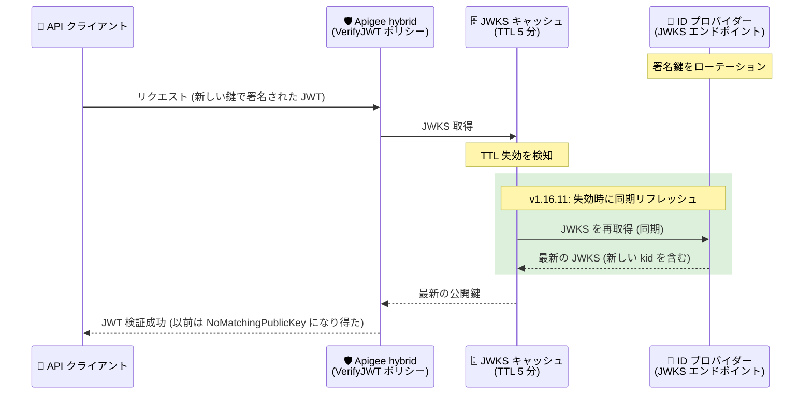

# Apigee hybrid: v1.16.11 パッチリリース (VerifyJWT JWKS キャッシュ修正・セキュリティ修正)

**リリース日**: 2026-10-14

**サービス**: Apigee hybrid

**機能**: v1.16.11 パッチリリース

**ステータス**: GA (パッチリリース)

📊 [このアップデートのインフォグラフィックを見る](https://takech9203.github.io/google-cloud-news-summary/20261014-apigee-hybrid-v1-16-11.html)

## 概要

2026 年 10 月 14 日、Apigee hybrid ソフトウェアの更新バージョン v1.16.11 がリリースされた。本リリースはパッチリリースであり、VerifyJWT ポリシーの JWKS キャッシュに関する不具合修正 (Bug ID: 565072374) を中心とした複数のバグ修正と、`apigee-fluent-bit` をはじめとする複数コンポーネントのセキュリティ修正 (多数の CVE 対応) が含まれる。

特に注目すべきは VerifyJWT ポリシーの修正である。JWKS を `uriRef` で参照する構成において、ID プロバイダー (IdP) が鍵をローテーションした際、5 分間の JWKS キャッシュ TTL が失効した直後の最初のリクエストで `steps.jwt.NoMatchingPublicKey` エラーが返ることがあった。本リリースにより、キャッシュは失効時に同期的にリフレッシュされるようになり、鍵ローテーション時の一時的な認証エラーが解消される。

パッチリリースのコンテナイメージは Apigee hybrid の Helm チャートに統合されているため、Helm チャート経由でパッチにアップグレードするとイメージも自動的に更新される。手動でのイメージ変更は通常不要である。Apigee hybrid を運用するプラットフォームチーム・API 管理者は、セキュリティ修正の観点からも早期の適用が推奨される。

**アップデート前の課題**

- VerifyJWT ポリシーで JWKS を `uriRef` 参照している場合、IdP の鍵ローテーション後、5 分間の JWKS キャッシュ TTL 失効後の最初のリクエストが `steps.jwt.NoMatchingPublicKey` で失敗することがあった
- `apigee-fluent-bit`、`apigee-mart-server`、`apigee-runtime` など複数のコンポーネントイメージに既知の脆弱性 (CVE) が存在していた
- Extension Processor (`ext_proc`) の拒否時に、ポリシーや FaultRule が生成したステータス・ボディではなく常に HTTP 500 が返されていた
- `apigee-connect-agent` のコントロールプレーン接続がネットワーク中間機器により暗黙的に切断された場合、最大 2 時間ハングすることがあった
- SemanticCacheLookup ポリシーが Vertex AI Vector Search の Private Service Connect (PSC) エンドポイントと互換性がなく、また URL ホスト検証に SSRF 脆弱性が存在していた
- LLMTokenQuota ポリシーで API プロダクトのオペレーションレベルのトークンクォータ値がランタイムで適用されず、プロダクトレベルの値が適用されていた

**アップデート後の改善**

- JWKS キャッシュが TTL 失効時に同期的にリフレッシュされるようになり、鍵ローテーション直後のリクエストでも正しい公開鍵で JWT 検証が行われる
- `apigee-fluent-bit` (CVE-2026-35189 ほか 20 件)、`apigee-kube-rbac-proxy`、`apigee-mart-server`、`apigee-runtime`、`apigee-synchronizer` など各コンポーネントの脆弱性が修正された
- `ext_proc` 拒否時にポリシー/FaultRule が生成したステータスとボディがそのまま返されるようになった
- 15 秒の TCP キープアライブが復元され、`apigee-connect-agent` の接続ハングが解消された
- `<PrivateServiceConnect><GrpcEndpoint>` による gRPC トランスポートサポートが追加され、SemanticCacheLookup が Vertex AI Vector Search PSC エンドポイントで利用可能になった
- LLMTokenQuota ポリシーのオペレーションレベルのトークンクォータ値が正しく適用されるようになった

## アーキテクチャ図



VerifyJWT ポリシーの JWKS キャッシュが TTL 失効時に同期的にリフレッシュされる修正後のフロー。鍵ローテーション直後の最初のリクエストでも最新の JWKS が取得され、検証エラーが発生しなくなる。

## サービスアップデートの詳細

### 主要な修正内容

1. **VerifyJWT の JWKS キャッシュ同期リフレッシュ (Bug ID: 565072374)**
   - JWKS を `uriRef` で参照する VerifyJWT ポリシーにおいて、5 分間のキャッシュ TTL 失効後の最初のリクエストで `steps.jwt.NoMatchingPublicKey` が返る問題を修正
   - キャッシュが失効時に同期的にリフレッシュされるようになり、IdP の鍵ローテーション時にも安定して検証可能に

2. **apigee-fluent-bit などのセキュリティ修正 (多数の CVE 対応)**
   - `apigee-fluent-bit`: CVE-2026-35189、CVE-2026-35191、CVE-2026-42772、CVE-2026-5450、CVE-2026-54872、CVE-2026-54873、CVE-2026-54875、CVE-2026-58050、CVE-2026-58051、CVE-2026-5928、CVE-2026-66032、CVE-2026-66033、CVE-2026-66034、CVE-2026-66035、CVE-2026-72897、CVE-2026-75804、CVE-2026-75805、CVE-2026-75806、CVE-2026-77696、CVE-2026-84782、CVE-2026-84784 の計 21 件に対応
   - `apigee-kube-rbac-proxy`: CVE-2026-33818、CVE-2026-39821、CVE-2026-46600、CVE-2026-56853 ほか計 14 件に対応
   - `apigee-mart-server` / `apigee-mint-task-scheduler`: CVE-2024-6763、CVE-2025-46392、CVE-2026-10050 ほか計 9 件に対応
   - `apigee-runtime`、`apigee-synchronizer`、`apigee-prom-prometheus`、`apigee-prometheus-adapter`、`apigee-hybrid-cassandra-client` にもセキュリティ修正を適用

3. **SemanticCacheLookup ポリシーの修正 (Bug ID: 556680325 / 502540992)**
   - URL ホスト検証における SSRF (サーバーサイドリクエストフォージェリ) 脆弱性を修正
   - `<PrivateServiceConnect><GrpcEndpoint>` による gRPC トランスポートサポートを追加し、Vertex AI Vector Search の PSC エンドポイントとの非互換を解消

4. **その他のランタイム修正**
   - Bug ID: 535395491 — Extension Processor (`ext_proc`) の拒否時に、ポリシーや FaultRule が生成したステータスとボディを返すように修正 (従来は常に HTTP 500)
   - Bug ID: 513032450 — 15 秒の TCP キープアライブを復元し、`apigee-connect-agent` のコントロールプレーン接続が最大 2 時間ハングする問題を修正
   - Bug ID: 492042425 — LLMTokenQuota ポリシーで API プロダクトのオペレーションレベルのトークンクォータ値が適用されない問題を修正

## 技術仕様

### リリース概要

| 項目 | 詳細 |
|------|------|
| バージョン | v1.16.11 |
| リリース種別 | パッチリリース |
| リリース日 | 2026 年 10 月 14 日 |
| 配布方法 | Helm チャート (Google Artifact Registry: `oci://us-docker.pkg.dev/apigee-release/apigee-hybrid-helm-charts`) |
| コンテナイメージ | Helm チャートに統合済み。チャートのアップグレードで自動更新 |

### JWKS キャッシュの動作 (VerifyJWT)

| 項目 | 詳細 |
|------|------|
| JWKS キャッシュ TTL | 300 秒 (5 分) |
| 修正前の動作 | TTL 失効後の最初のリクエストで、IdP の鍵ローテーション後に `steps.jwt.NoMatchingPublicKey` が発生し得た |
| 修正後の動作 | キャッシュ失効時に同期的に JWKS を再取得してから検証を実行 |

## 設定方法

### 前提条件

1. Apigee hybrid v1.16.x を運用中であること (旧マイナーバージョンからの場合はアップグレードガイドに従う)
2. Helm チャートによる管理を行っていること
3. アップグレード前に既存の Helm チャートディレクトリと Cassandra データベースのバックアップを取得していること

### 手順

#### ステップ 1: v1.16.11 の Helm チャートを取得

```bash
export CHART_REPO=oci://us-docker.pkg.dev/apigee-release/apigee-hybrid-helm-charts
export CHART_VERSION=1.16.11
helm pull $CHART_REPO/apigee-operator --version $CHART_VERSION --untar
helm pull $CHART_REPO/apigee-datastore --version $CHART_VERSION --untar
helm pull $CHART_REPO/apigee-env --version $CHART_VERSION --untar
helm pull $CHART_REPO/apigee-ingress-manager --version $CHART_VERSION --untar
helm pull $CHART_REPO/apigee-org --version $CHART_VERSION --untar
helm pull $CHART_REPO/apigee-redis --version $CHART_VERSION --untar
helm pull $CHART_REPO/apigee-telemetry --version $CHART_VERSION --untar
helm pull $CHART_REPO/apigee-virtualhost --version $CHART_VERSION --untar
```

Google Artifact Registry から v1.16.11 の全チャートをローカルに取得する。

#### ステップ 2: CRD の更新

```bash
# dry-run で検証
kubectl apply -k apigee-operator/etc/crds/default/ \
  --server-side --force-conflicts --validate=false --dry-run=server

# 適用
kubectl apply -k apigee-operator/etc/crds/default/ \
  --server-side --force-conflicts --validate=false
```

Apigee CRD を更新する。この手順にはクラスタの昇格された権限が必要。

#### ステップ 3: 各チャートのアップグレード

```bash
# 例: Operator のアップグレード (dry-run 後に実行)
helm upgrade operator apigee-operator/ \
  --install \
  --namespace APIGEE_NAMESPACE \
  -f OVERRIDES_FILE
```

`apigee-operator` → `apigee-datastore` → `apigee-telemetry` → `apigee-redis` → `apigee-ingress-manager` → `apigee-org` → `apigee-env` (環境ごと) → `apigee-virtualhost` (環境グループごと) の順にアップグレードする。パッチリリースのため、コンテナイメージはチャートのアップグレードで自動的に更新される。詳細は[アップグレードガイド](https://docs.cloud.google.com/apigee/docs/hybrid/v1.16/upgrade)を参照。

## メリット

### ビジネス面

- **認証エラーによるサービス断の回避**: IdP の鍵ローテーション時に発生していた一時的な JWT 検証エラーが解消され、API コンシューマーへの影響が低減される
- **セキュリティコンプライアンスの維持**: 多数の CVE に対応したイメージへ更新することで、脆弱性スキャンの指摘事項を削減し、コンプライアンス要件を満たしやすくなる

### 技術面

- **鍵ローテーション運用の簡素化**: JWKS キャッシュの同期リフレッシュにより、鍵ローテーションのタイミングを Apigee 側のキャッシュ TTL に合わせて調整するといった回避策が不要になる
- **コントロールプレーン接続の安定化**: TCP キープアライブの復元により、ネットワーク中間機器による切断時のハング (最大 2 時間) が解消される
- **AI 系ポリシーの改善**: SemanticCacheLookup の PSC (gRPC) 対応と SSRF 修正、LLMTokenQuota のオペレーションレベルクォータの正常化により、AI ゲートウェイ用途での利用が改善される

## デメリット・制約事項

### 考慮すべき点

- Apigee hybrid はセルフマネージドのため、アップグレード作業 (チャート取得、CRD 更新、各コンポーネントの順次アップグレード) は利用者自身が実施する必要がある
- アップグレード前に Helm チャートディレクトリと Cassandra のバックアップ取得が推奨される
- アップグレード中に新しい環境を作成してはならない
- 問題発生時は旧バージョンのチャートを使って `apigee-virtualhost` から `apigee-operator` へ逆順にロールバックする必要がある

## ユースケース

### ユースケース 1: IdP の定期的な鍵ローテーションを行う API 基盤

**シナリオ**: 外部 IdP (OIDC プロバイダー) が発行する JWT を VerifyJWT ポリシーで検証しており、セキュリティポリシーに基づき署名鍵を定期的にローテーションしている。従来はローテーション直後に一部リクエストが `steps.jwt.NoMatchingPublicKey` で失敗することがあった。

**実装例**:
```xml
<VerifyJWT name="JWT-Verify-RS256">
  <Algorithm>RS256</Algorithm>
  <Source>json.jwt</Source>
  <PublicKey>
    <JWKS uriRef="variable-containing-a-uri-that-returns-a-jwks"/>
  </PublicKey>
</VerifyJWT>
```

**効果**: v1.16.11 へのアップグレードにより、キャッシュ失効時に JWKS が同期的に再取得されるため、鍵ローテーション直後でも検証エラーが発生しない。

### ユースケース 2: 脆弱性スキャン指摘への対応

**シナリオ**: コンテナイメージの脆弱性スキャンで `apigee-fluent-bit` や `apigee-mart-server` などに CVE の指摘があり、対応が求められている。

**効果**: Helm チャートを v1.16.11 にアップグレードするだけで、修正済みのコンテナイメージへ自動的に更新され、該当 CVE の指摘を解消できる。

## 関連サービス・機能

- **Apigee (SaaS 版)**: Google がフルマネージドで提供する API 管理プラットフォーム。hybrid はランタイムプレーンを自社の Kubernetes クラスタで運用する形態
- **Google Kubernetes Engine (GKE) / Anthos / OpenShift**: Apigee hybrid ランタイムの稼働基盤となる Kubernetes プラットフォーム
- **Vertex AI Vector Search**: SemanticCacheLookup ポリシーの検索バックエンド。本リリースで PSC エンドポイント (gRPC) への対応が追加された
- **Helm / Google Artifact Registry**: Apigee hybrid のチャート配布・デプロイに使用

## 参考リンク

- 📊 [インフォグラフィック](https://takech9203.github.io/google-cloud-news-summary/20261014-apigee-hybrid-v1-16-11.html)
- [公式リリースノート](https://docs.cloud.google.com/release-notes#October_14_2026)
- [Apigee hybrid v1.16 へのアップグレード](https://docs.cloud.google.com/apigee/docs/hybrid/v1.16/upgrade)
- [VerifyJWT ポリシー リファレンス](https://docs.cloud.google.com/apigee/docs/api-platform/reference/policies/verify-jwt-policy)
- [JWT ポリシーの概要 (JWKS の利用)](https://docs.cloud.google.com/apigee/docs/api-platform/reference/policies/jwt-policies-overview)
- [料金ページ](https://cloud.google.com/apigee/pricing)

## まとめ

Apigee hybrid v1.16.11 は、VerifyJWT の JWKS キャッシュ問題の修正と多数の CVE 対応を含む重要なパッチリリースである。特に外部 IdP の鍵ローテーションを運用している環境や、脆弱性スキャンの指摘に対応する必要がある環境では、早期のアップグレードを推奨する。パッチリリースのため、Helm チャートのアップグレードのみでコンテナイメージも自動更新され、適用の負担は比較的小さい。

---

**タグ**: #ApigeeHybrid #Apigee #セキュリティ #CVE #JWT #JWKS #パッチリリース #APIManagement
