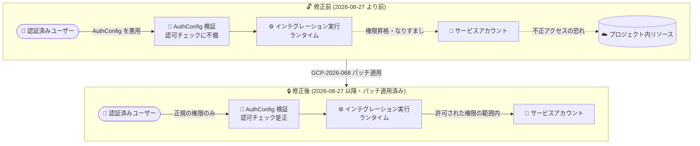

# Application Integration: セキュリティ情報 GCP-2026-068 (AuthConfig 検証における Incorrect Authorization 脆弱性)

**リリース日**: 2026-10-14

**サービス**: Application Integration

**機能**: セキュリティ脆弱性の修正 (GCP-2026-068 / CVE-2026-85298)

**ステータス**: セキュリティ情報 (修正済み・顧客対応不要)

📊 [このアップデートのインフォグラフィックを見る](https://takech9203.github.io/google-cloud-news-summary/20261014-application-integration-security-gcp-2026-068.html)

## 概要

Google Cloud は 2026 年 10 月 14 日、Application Integration に関するセキュリティ情報 **GCP-2026-068** を公開しました。2026 年 8 月 27 日より前のバージョンの Application Integration において、**AuthConfig (認証プロファイル) の検証処理とインテグレーション実行ランタイムに Incorrect Authorization (不適切な認可) の脆弱性**が存在していました。この脆弱性には **CVE-2026-85298** が割り当てられており、重大度は **Critical (重大)** と評価されています。

この脆弱性が悪用された場合、**認証済みのユーザーが権限を昇格させ、Google Cloud プロジェクト内のサービスアカウントになりすます**ことが可能でした。Application Integration の認証プロファイル (AuthConfig) はサービスアカウントや OAuth 2.0、JWT などの認証情報を保持してインテグレーションのタスク実行時に利用される仕組みであるため、この認可検証の不備は、本来許可されていないサービスアカウント権限での操作につながる恐れがありました。

**この脆弱性は 2026 年 8 月 27 日にパッチが適用済みであり、ユーザー側での対応は不要です。** Application Integration はフルマネージドサービスであるため、修正はサービス側で自動的に展開されています。本レポートは、Application Integration を利用する組織のセキュリティ担当者や Solutions Architect が、影響範囲と背景を把握するための情報を整理したものです。

**アップデート前の課題 (脆弱性の内容)**

- 2026 年 8 月 27 日より前のバージョンでは、AuthConfig の検証処理とインテグレーション実行ランタイムに不適切な認可 (Incorrect Authorization) の欠陥が存在した
- 認証済みユーザーが本来の権限を超えて権限昇格を行い、プロジェクト内のサービスアカウントになりすますことが可能だった
- 重大度は Critical と評価されており、サービスアカウントの権限を介したプロジェクト内リソースへの不正アクセスにつながる恐れがあった

**アップデート後の改善 (修正内容)**

- 2026 年 8 月 27 日にサービス側でパッチが適用され、脆弱性は解消済み
- フルマネージドサービスのため、ユーザー側での対応 (アップグレードや設定変更) は一切不要
- AuthConfig の検証と実行ランタイムにおける認可チェックが是正され、意図しないサービスアカウントのなりすましが防止される

## アーキテクチャ図

修正前は AuthConfig 検証と実行ランタイムの認可不備により、認証済みユーザーがサービスアカウントになりすましてプロジェクト内リソースへアクセスできる恐れがありました。パッチ適用後は認可チェックが是正され、このセキュリティ境界の侵害が防止されます。

## サービスアップデートの詳細

### 脆弱性の概要

1. **脆弱性の種類: Incorrect Authorization (不適切な認可)**
   - Application Integration の AuthConfig (認証プロファイル) の検証処理と、インテグレーション実行ランタイムに存在
   - 2026 年 8 月 27 日より前のバージョンが影響を受ける

2. **想定される影響: 権限昇格とサービスアカウントのなりすまし**
   - 認証済みユーザーが権限を昇格させ、Google Cloud プロジェクト内のサービスアカウントになりすますことが可能だった
   - AuthConfig はサービスアカウント・OAuth 2.0・JWT などの認証情報を保持し、タスク実行時の外部接続やGoogle API 呼び出しに使用されるため、認可不備は保持された認証情報の権限での不正操作につながり得る

3. **対応状況: パッチ適用済み・顧客対応不要**
   - 2026 年 8 月 27 日にサービス側で修正が適用済み
   - フルマネージドサービスのため、ユーザーによるアップグレードや設定変更は不要

## 技術仕様

### セキュリティ情報の詳細

| 項目 | 詳細 |
|------|------|
| セキュリティ情報 ID | GCP-2026-068 |
| 公開日 | 2026-10-14 |
| CVE | CVE-2026-85298 |
| 重大度 | Critical (重大) |
| 影響を受けるサービス | Application Integration |
| 影響を受けるバージョン | 2026 年 8 月 27 日より前のバージョン |
| 脆弱性の種類 | Incorrect Authorization (不適切な認可) |
| 影響箇所 | AuthConfig 検証、インテグレーション実行ランタイム |
| パッチ適用日 | 2026-08-27 |
| 必要な顧客対応 | なし |

### AuthConfig (認証プロファイル) について

AuthConfig は、Application Integration のタスクが外部アプリケーションやサービス、データソースに接続する際の認証情報を保存・管理する仕組みです。以下の認証タイプをサポートしています。

- Auth token (Basic / Bearer / MAC)
- Google OIDC ID Token (サービスアカウントベース)
- JSON Web Token (JWT)
- OAuth 2.0 (認可コード / クライアントクレデンシャル / リソースオーナーパスワード)
- SSL/TLS クライアント証明書
- サービスアカウント

AuthConfig の管理には `roles/integrations.integrationAdmin` または `roles/integrations.integrationEditor` などの IAM ロールが必要です。

## 推奨される対応

### 必須の対応

- **なし。** 本脆弱性は 2026 年 8 月 27 日にサービス側でパッチが適用済みであり、ユーザー側での対応は不要です。

### 推奨されるセキュリティレビュー (任意)

本件を機に、以下の確認を行うことを推奨します。

1. **AuthConfig の棚卸し**: Application Integration の「Auth Profiles」ページで、使用中の認証プロファイルと、紐づくサービスアカウントの権限を確認する
2. **最小権限の確認**: 認証プロファイルで使用するサービスアカウントに過剰な権限 (特に `roles/owner` や `roles/editor` などの広範なロール) が付与されていないか確認する
3. **監査ログの確認**: 必要に応じて Cloud Audit Logs でサービスアカウントの利用状況に不審なアクティビティがないか確認する
4. **セキュリティ情報の購読**: Google Cloud セキュリティ速報の XML フィード (https://cloud.google.com/feeds/google-cloud-security-bulletins.xml) を購読し、今後の情報を迅速に把握する

## メリット

### ビジネス面

- **対応コストゼロ**: フルマネージドサービス側で修正が完了しており、ユーザー側の計画停止やアップグレード作業が不要
- **透明性の確保**: CVE 採番とセキュリティ速報による公開で、組織のセキュリティ・コンプライアンス報告に必要な情報が得られる

### 技術面

- **認可境界の強化**: AuthConfig 検証と実行ランタイムの認可チェックが是正され、サービスアカウントなりすましの経路が遮断された
- **自動的な保護**: 全ユーザーに修正が自動展開されるため、パッチ未適用の環境が残らない

## デメリット・制約事項

### 考慮すべき点

- 本脆弱性は「認証済みユーザー」による悪用が前提であり、プロジェクト内の内部ユーザーの権限管理 (最小権限の原則) の重要性を再認識する必要がある
- パッチ適用 (2026 年 8 月 27 日) 以前の期間における悪用有無については、セキュリティ速報には記載がない。懸念がある場合は監査ログの確認を検討する

## 関連サービス・機能

- **IAM (Identity and Access Management)**: サービスアカウントの権限管理と最小権限の原則の適用。なりすまし被害の影響範囲は、サービスアカウントに付与された IAM ロールに依存する
- **Cloud Audit Logs**: サービスアカウントの利用状況やインテグレーション実行の監査証跡の確認に使用
- **Integration Connectors**: Application Integration と組み合わせて外部システムに接続する際にも認証設定を使用するサービス
- **GCP-2026-066**: 同じく Application Integration の Email Task コンポーネントに関するセキュリティ情報 (2026-09-28 公開、6 月 30 日修正済み)。Application Integration では近接した時期に複数のセキュリティ修正が公開されている

## 参考リンク

- 📊 [インフォグラフィック](https://takech9203.github.io/google-cloud-news-summary/20261014-application-integration-security-gcp-2026-068.html)
- [公式リリースノート](https://docs.cloud.google.com/release-notes#October_14_2026)
- [セキュリティ速報 GCP-2026-068](https://cloud.google.com/support/bulletins#gcp-2026-068)
- [Application Integration ドキュメント: 認証プロファイルの管理](https://docs.cloud.google.com/application-integration/docs/configure-authentication-profiles)
- [Application Integration の IAM ロールと権限](https://docs.cloud.google.com/application-integration/docs/integrations-access-permissions)

## まとめ

Application Integration の AuthConfig 検証と実行ランタイムに存在した Critical の認可脆弱性 (CVE-2026-85298) は、2026 年 8 月 27 日にサービス側で修正済みであり、ユーザー側の対応は不要です。ただし、認証済みユーザーによる権限昇格とサービスアカウントなりすましが可能だったという内容を踏まえ、認証プロファイルに紐づくサービスアカウントの権限が最小権限になっているかを確認する良い機会といえます。セキュリティ速報フィードを購読し、今後の情報も継続的に把握することを推奨します。

---

**タグ**: #ApplicationIntegration #セキュリティ #脆弱性 #CVE-2026-85298 #GCP-2026-068 #サービスアカウント #IAM
