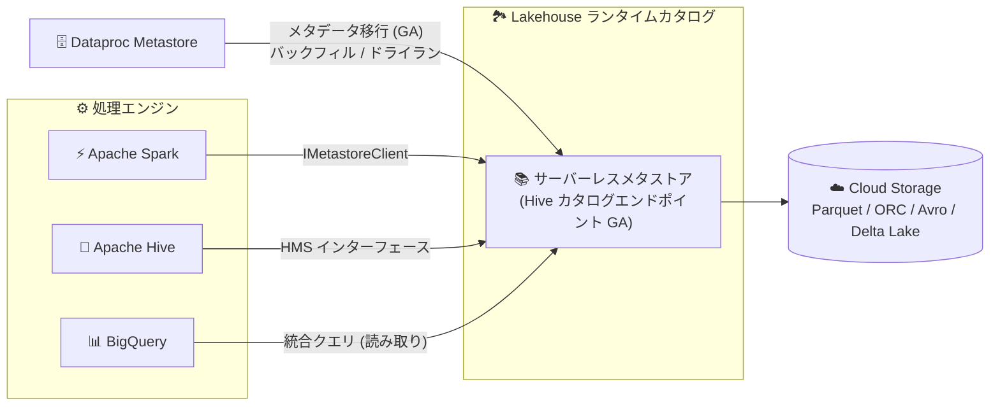

# BigQuery: Lakehouse ランタイムカタログの Hive エンドポイント GA と Conversational Analytics の機能拡張

**リリース日**: 2026-10-14

**サービス**: BigQuery

**機能**: Lakehouse ランタイムカタログ (Hive カタログエンドポイント / Dataproc Metastore からのメタデータ移行)、Conversational Analytics (マルチプロジェクト会話 / Gemini Enterprise への公開)、AI.AGG 関数の output_schema 引数

**ステータス**: GA (一般提供)

📊 [このアップデートのインフォグラフィックを見る](https://takech9203.github.io/google-cloud-news-summary/20261014-bigquery-lakehouse-catalog-conversational-analytics.html)

## 概要

2026 年 10 月 14 日、BigQuery に関する 5 件の機能が一般提供 (GA) になりました。大きく分けて「Lakehouse ランタイムカタログ関連」「Conversational Analytics 関連」「AI 関数関連」の 3 領域のアップデートです。

Lakehouse ランタイムカタログでは、Apache Hive カタログエンドポイントが GA になり、サーバーレスで一元化されたメタデータレイヤーとしてメタストアを利用できるようになりました。これにより Apache Spark、Apache Hive、BigQuery の間でシームレスなデータ共有と統合クエリが可能になります。あわせて、Dataproc Metastore から Lakehouse (Apache Iceberg REST カタログエンドポイントまたは Hive カタログエンドポイント) へのメタデータ移行機能も GA になり、Google Cloud コンソール、gcloud CLI、REST API から一度限りのバックフィル移行またはドライランを実行できます。

Conversational Analytics では、複数プロジェクトのすべてのデータソースを対象にした会話や、データセット単位の会話の作成が GA になりました。さらに、BigQuery の Conversational Analytics エージェントを Gemini Enterprise に公開する機能も GA になり、ビジネスユーザーが Gemini Enterprise 内から自然言語でデータ分析を行えるようになりました。加えて、AI.AGG 関数が `output_schema` 引数をサポートし (GA)、関数出力のスキーマをカンマ区切りのフィールドリストとして指定できるようになりました。

**アップデート前の課題**

- Spark や Hive のワークロードでは、セルフホストの Hive Metastore や Dataproc Metastore を自前で運用する必要があり、メタストア管理の運用負荷が発生していた
- Dataproc Metastore から Lakehouse ランタイムカタログへメタデータを移行する公式の GA 手段が整っておらず、モダナイゼーションの移行パスが限られていた
- Conversational Analytics の会話は限定的なスコープでしか作成できず、複数プロジェクトにまたがるデータを横断的に質問することが難しかった
- BigQuery で作成したデータエージェントをビジネスユーザー向けの Gemini Enterprise で利用する公式な公開手段が GA ではなかった
- AI.AGG 関数の出力は STRING 値であり、構造化された出力を得るには後処理が必要だった

**アップデート後の改善**

- Hive カタログエンドポイントにより、サーバーレスのフルマネージドメタストアで Spark / Hive / BigQuery 間のデータ共有と統合クエリが可能になった
- Dataproc Metastore からのワンタイムバックフィル移行とドライランが、コンソール / gcloud CLI / REST API から GA 機能として実行可能になった
- 複数プロジェクトの全データソースやデータセット単位での会話作成が GA になり、横断的なデータ探索が容易になった
- Conversational Analytics エージェントを Gemini Enterprise に公開でき、ビジネスユーザーが使い慣れたインターフェースからデータに質問できるようになった
- AI.AGG の `output_schema` 引数により、STRUCT 形式の構造化出力を直接取得できるようになった

## アーキテクチャ図



Dataproc Metastore のメタデータを Lakehouse ランタイムカタログへ移行し、Hive カタログエンドポイントを介して Spark / Hive / BigQuery がメタデータを共有し、実データは Cloud Storage に保存されるデータフローを示しています。

## サービスアップデートの詳細

### 主要機能

1. **Apache Hive カタログエンドポイント (GA)**
   - Lakehouse ランタイムカタログがサーバーレスの統合メタストアとして機能し、セルフホスト Hive Metastore の管理を不要にする
   - Apache Spark の `ExternalCatalog` 互換に最適化され、Hive Metastore インターフェースのサブセットをサポート。Spark は標準の `IMetastoreClient` インターフェース経由で接続する
   - Hive SerDes や Spark データソースを使用する標準的な Apache Hive / Spark テーブルを管理 (Apache Iceberg テーブルは Iceberg REST カタログエンドポイントを使用)
   - Parquet、ORC、Avro、Delta Lake などのストレージ形式と、Cloud Storage 上のデータに対する CMEK (顧客管理の暗号鍵) をサポート
   - Managed Service for Apache Spark のランタイムイメージには必要なクライアントライブラリが事前構成済み

2. **Dataproc Metastore から Lakehouse へのメタデータ移行 (GA)**
   - Dataproc Metastore サービスから Apache Iceberg REST カタログエンドポイントまたは Hive カタログエンドポイントへの一度限りのバックフィル移行を実行可能
   - 実際に書き込まずに移行を検証するドライランモードをサポート
   - Google Cloud コンソール、gcloud CLI (`gcloud beta metastore services migrations start`)、REST API (`startMigration`) から実行可能
   - 重複エントリのスキップまたは上書きを選択できる競合ポリシー付き
   - 移行完了後、`summary.json` と `full_report.json` の詳細レポートが Cloud Storage に出力される

3. **Conversational Analytics: マルチプロジェクト / データセット会話 (GA)**
   - 複数プロジェクト内のすべてのデータソースを対象にした会話を作成可能。BigQuery の Agents ページでプロジェクトを複数選択して横断的に質問できる
   - テーブル、ビュー、データセット、プロジェクト、グラフをナレッジソースとして直接会話を開始できる

4. **Conversational Analytics エージェントの Gemini Enterprise 公開 (GA)**
   - BigQuery で作成したデータエージェントを Gemini Enterprise に公開し、ビジネスユーザーが自然言語でデータをクエリ・分析できる
   - 推奨される公開方法は Agent Registry 経由。代替として A2A カード JSON による公開も可能
   - Agent Gateway の構成が必要で、BigQuery データエージェントのストレージリージョン (US / EU / Global) と Gemini Enterprise 側の Agent Registry バインディングのリージョンが一致している必要がある

5. **AI.AGG 関数の output_schema 引数 (GA)**
   - 出力スキーマをカンマ区切りのフィールドリスト (名前、データ型、オプションの説明) で指定可能
   - `output_schema` を指定しない場合は STRING 値、指定した場合はスキーマに準拠した STRUCT 値を返す
   - サポートするデータ型は STRING、INT64、FLOAT64、BOOL、ARRAY、STRUCT。フィールドに `NOT NULL` も指定可能

## 技術仕様

### Lakehouse ランタイムカタログのエンドポイント比較

| 項目 | Hive カタログエンドポイント | Iceberg REST カタログエンドポイント |
|------|---------------------------|-----------------------------------|
| 対象テーブル | 標準の Hive / Spark テーブル | Apache Iceberg V2 (GA) / V3 (Preview) テーブル |
| ストレージ | Cloud Storage (Parquet / ORC / Avro など) | Cloud Storage |
| OSS エンジンからのアクセス | 読み取り / 書き込み (Spark、Hive) | 読み取り / 書き込み (Spark、Flink、Trino) |
| BigQuery からのアクセス | 読み取りのみ | 読み取り / 書き込み (書き込みは Preview) |
| 主なユースケース | 既存 Spark / Hive ワークロードのフルマネージドメタストアへの移行 | オープンレイクハウスでのエンジン間相互運用 |

### AI.AGG の output_schema 指定例

```sql
SELECT
  t.by,
  AI.AGG(
    t.text,
    'These are the blog posts of a single user. Tell me what topics the user talks about the most. Keep it concise.',
    output_schema => 'topics ARRAY<STRUCT<name STRING NOT NULL, explanation STRING NOT NULL>>'
  ) AS common_topic
FROM sample_data AS t
GROUP BY t.by;
```

## 設定方法

### 前提条件

1. (メタデータ移行) 移行元となるアクティブな Dataproc Metastore サービスが存在すること
2. (メタデータ移行) 移行先の Hive カタログまたは Iceberg カタログが存在し、移行元テーブルのデータ / メタデータが置かれている Cloud Storage バケットまたはパスを含むこと
3. (メタデータ移行) 移行を開始するユーザーに `roles/metastore.editor`、カタログ作成に `roles/biglake.admin` などの IAM ロールが付与されていること
4. (Conversational Analytics) BigQuery、Gemini Data Analytics、Gemini for Google Cloud の各 API が有効化されており、`roles/geminidataanalytics.dataAgentUser` などの必要なロールが付与されていること

### 手順

#### ステップ 1: Dataproc Metastore から Lakehouse への移行を開始

```bash
gcloud beta metastore services migrations start SERVICE_ID \
  --location=REGION \
  --hive-catalog="projects/PROJECT_ID/catalogs/HIVE_CATALOG_ID" \
  --hive-databases="HIVE_DB_1,HIVE_DB_2" \
  --async
```

Hive カタログと Iceberg カタログの両方へ同時に移行することも可能です。`--hive-databases` に `*` を指定すると全データベースを移行します。

#### ステップ 2: 移行の進行状況を確認

```bash
gcloud beta metastore services migrations describe MIGRATION_EXECUTION_ID \
  --service=SERVICE_ID \
  --location=REGION
```

移行完了後、指定した Cloud Storage パス (未指定の場合はサービスのアーティファクトバケット) に出力される `summary.json` / `full_report.json` で結果を検証します。

#### ステップ 3: マルチプロジェクト会話の作成 (Conversational Analytics)

1. Google Cloud コンソールで BigQuery の「Agents」ページに移動する
2. 質問入力フィールドの横にあるプロジェクト名のドロップダウンから複数のプロジェクトを選択する
3. 質問を送信すると、選択したプロジェクト内のすべてのデータソースを参照する会話が開始される

## メリット

### ビジネス面

- **運用コストの削減**: セルフホスト Hive Metastore や Dataproc Metastore の運用から解放され、サーバーレスでスケーリングするフルマネージドカタログに移行できる
- **データ活用の民主化**: Conversational Analytics エージェントを Gemini Enterprise に公開することで、SQL を書けないビジネスユーザーも自然言語でデータ分析が可能になる
- **ガバナンスの統一**: メタデータを単一の信頼できる情報源に集約し、データ検出とポリシー適用を簡素化できる

### 技術面

- **マルチエンジン相互運用**: Spark、Hive、BigQuery がファイルを複製することなく同一テーブルのメタデータを共有できる
- **安全な移行パス**: ドライランと詳細レポートにより、本番移行前に移行の妥当性を検証できる
- **構造化 AI 出力**: AI.AGG の `output_schema` により LLM の出力を型付きの STRUCT として直接取得でき、後続処理での文字列パースが不要になる

## デメリット・制約事項

### 制限事項

- Hive カタログエンドポイント経由のテーブルは BigQuery からは読み取り専用 (書き込みは Spark / Hive などの OSS エンジンから)
- Hive カタログエンドポイントは Hive Metastore インターフェースのサブセットをサポート。トランザクション、コンパクション、Kerberos などの機能に依存するワークロードは事前に機能比較の確認が必要
- メタデータ移行は一度限りのバックフィルのみをサポート。移行後に移行元 Dataproc Metastore へ加えられた変更は自動的には伝播せず、同期には移行の再実行が必要
- Dataproc Metastore のテーブル / データベースに対する権限は Lakehouse へ移行されない
- 移行先カタログに移行元データの Cloud Storage バケット / パスが含まれていない場合、テーブル移行は失敗する
- AI.AGG の関数出力はグループあたり 10,000 トークンが上限

### 考慮すべき点

- Lakehouse ランタイムカタログのテーブルに対する BigQuery からのクエリ性能は、標準 BigQuery テーブルと比べて低下する可能性がある (概ね Cloud Storage からの読み取りと同等)
- Gemini Enterprise への公開では、データエージェントのストレージリージョンと Agent Gateway の Agent Registry バインディングのリージョンを一致させる必要があり、エージェント保存後はリージョンを変更できない
- Conversational Analytics は質問に答えるために自動でクエリを実行するため、大きなテーブル、JOIN、AI 関数の頻繁な呼び出しはクエリコストを増加させる可能性がある
- AI.AGG の `output_schema` では、LLM が NULL を返すのを避けるため、ほとんどのフィールドに `NOT NULL` を指定することが推奨される

## ユースケース

### ユースケース 1: オンプレミス Hive ワークロードのサーバーレスモダナイゼーション

**シナリオ**: Dataproc Metastore を使って Spark / Hive の ETL パイプラインを運用しているデータエンジニアリングチームが、メタストアの運用負荷を削減しつつ BigQuery からの直接分析を実現したい。

**実装例**:
```bash
# 1. ドライランで移行を検証 (コンソールの「Migrate to Lakehouse」でも可)
# 2. バックフィル移行を実行
gcloud beta metastore services migrations start my-metastore \
  --location=us-central1 \
  --hive-catalog="projects/my-project/catalogs/my-hive-catalog" \
  --hive-databases="*" \
  --async
# 3. 移行レポート (summary.json / full_report.json) を確認
```

**効果**: メタストアのインフラ管理が不要になり、Spark で作成したテーブルを BigQuery から直接クエリできる統合レイクハウスが実現する。

### ユースケース 2: ビジネスユーザー向けセルフサービス分析

**シナリオ**: データアナリストが BigQuery で Conversational Analytics エージェント (検証済みクエリ、用語集、エージェント指示を設定済み) を構築し、営業部門のユーザーに Gemini Enterprise 経由で提供する。

**効果**: 営業部門のユーザーは BigQuery コンソールに触れることなく、Gemini Enterprise 上で「先月の地域別売上は?」のような自然言語の質問だけでガバナンスの効いたデータ分析を実行できる。

### ユースケース 3: AI.AGG による構造化サマリーの生成

**シナリオ**: 大量のユーザーレビューをユーザーごとに集約し、主要トピックとその説明を型付きの構造化データとして BI ダッシュボードに取り込みたい。

**実装例**:
```sql
SELECT
  user_id,
  AI.AGG(
    review_text,
    'Summarize the main topics this user writes about.',
    output_schema => 'topics ARRAY<STRUCT<name STRING NOT NULL, explanation STRING NOT NULL>>'
  ) AS topic_summary
FROM reviews
GROUP BY user_id;
```

**効果**: LLM の出力を STRUCT として直接取得できるため、文字列パースなどの後処理なしで下流の分析やダッシュボードに利用できる。

## 料金

- Conversational Analytics の会話やデータエージェント利用時に実行されるクエリは、BigQuery のコンピューティング料金 (オンデマンドまたはエディション) で課金されます
- Lakehouse ランタイムカタログのテーブルは標準テーブルと同じクォータと上限の対象です
- 詳細は以下の料金ページを参照してください
  - [BigQuery の料金](https://cloud.google.com/bigquery/pricing)
  - [データエージェントの料金](https://cloud.google.com/products/data-agents/pricing)

## 関連サービス・機能

- **Managed Service for Apache Spark**: ランタイムイメージに Hive カタログエンドポイント用のクライアントライブラリが事前構成されており、Spark ジョブからシームレスに接続できる
- **Dataproc Metastore**: 今回 GA になった移行機能の移行元。既存の HMS ワークロードを Lakehouse へモダナイズする起点となる
- **Cloud Storage**: Lakehouse ランタイムカタログ管理下のテーブルデータ / メタデータの保存先。CMEK による暗号化もサポート
- **Gemini Enterprise**: Conversational Analytics エージェントの公開先。Agent Gateway / Agent Registry を介してエージェントを配布する
- **Vertex AI**: AI.AGG 関数のバックエンド。Gemini モデルを呼び出して集約処理を実行する
- **BigLake metastore (classic)**: レガシー機能とされており、Lakehouse ランタイムカタログの利用が推奨されている

## 参考リンク

- 📊 [インフォグラフィック](https://takech9203.github.io/google-cloud-news-summary/20261014-bigquery-lakehouse-catalog-conversational-analytics.html)
- [公式リリースノート](https://docs.cloud.google.com/release-notes#October_14_2026)
- [Hive カタログエンドポイントについて](https://docs.cloud.google.com/lakehouse/docs/about-spark-hive-metastore)
- [Lakehouse ランタイムカタログと Spark / Hive のセットアップ](https://docs.cloud.google.com/lakehouse/docs/use-spark-hive-metastore)
- [Dataproc Metastore から Lakehouse へのメタデータ移行](https://docs.cloud.google.com/lakehouse/docs/migrate-dataproc-metastore)
- [会話によるデータ分析 (Conversational Analytics)](https://docs.cloud.google.com/bigquery/docs/create-conversations)
- [データエージェントの作成と Gemini Enterprise への公開](https://docs.cloud.google.com/bigquery/docs/create-data-agents)
- [AI.AGG 関数リファレンス](https://docs.cloud.google.com/bigquery/docs/reference/standard-sql/bigqueryml-syntax-ai-agg)
- [BigQuery の料金](https://cloud.google.com/bigquery/pricing)

## まとめ

今回の GA 群は、Lakehouse ランタイムカタログを中核としたオープンレイクハウス戦略 (Hive エンドポイント GA と Dataproc Metastore からの移行パス確立) と、Conversational Analytics によるデータ活用の民主化 (マルチプロジェクト会話と Gemini Enterprise 公開) の両輪を本番利用可能にする重要なアップデートです。セルフホストメタストアや Dataproc Metastore を運用中のチームはドライラン機能で移行の実現可能性を検証し、Hive エンドポイントの機能比較と制限事項 (BigQuery からは読み取り専用など) を確認したうえで移行計画を立てることを推奨します。

---

**タグ**: BigQuery, Lakehouse, Hive, Dataproc Metastore, Conversational Analytics, Gemini Enterprise, AI.AGG, GA
