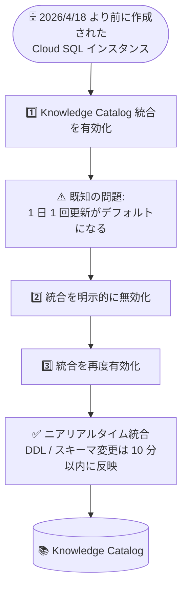

# Cloud SQL for MySQL / PostgreSQL: Knowledge Catalog 統合有効化時に 1 日 1 回更新となる既知の問題

**リリース日**: 2026-10-14

**サービス**: Cloud SQL for MySQL / Cloud SQL for PostgreSQL

**機能**: 2026 年 4 月 18 日より前に作成されたインスタンスで Knowledge Catalog (旧 Dataplex Universal Catalog) 統合を有効化した際に、ニアリアルタイム同期ではなく 1 日 1 回更新がデフォルトとなる既知の問題

**ステータス**: Issue (既知の問題)

📊 [このアップデートのインフォグラフィックを見る](https://takech9203.github.io/google-cloud-news-summary/20261014-cloud-sql-knowledge-catalog-integration-issue.html)

## 概要

2026 年 4 月 18 日より前に作成された Cloud SQL for MySQL および Cloud SQL for PostgreSQL のインスタンスで Knowledge Catalog (旧 Dataplex Universal Catalog) 統合を有効化すると、本来期待されるニアリアルタイム同期ではなく、1 日 1 回の更新がデフォルトになるという既知の問題が公表されました。既存インスタンスにおける「有効化と同時のニアリアルタイム更新」は、すべての既存インスタンスではまだ利用可能になっておらず、利用可能になった時点で改めてアナウンスされる予定です。

この問題は、[2026 年 10 月 9 日に発表された既存インスタンス向けニアリアルタイム同期機能](./2026-10-09-cloud-sql-knowledge-catalog-near-real-time-sync.md) に関するものです。10 月 9 日のリリースノートにも本問題への注記が追記されており、既存インスタンスで統合を有効化してニアリアルタイム同期を期待していたユーザーは注意が必要です。

公式ドキュメントには回避策が記載されており、適格インスタンス (MySQL 8.0 以降 / PostgreSQL 14.0 以降、新ネットワークアーキテクチャ) であれば、統合を有効化した後に一度明示的に無効化し、再度有効化することでニアリアルタイム統合に切り替えられます。

**問題の内容**

- 2026 年 4 月 18 日より前に作成されたインスタンスで Knowledge Catalog 統合を有効化すると、ニアリアルタイムではなく 1 日 1 回の更新がデフォルトになる
- 有効化と同時のニアリアルタイム更新は、すべての既存インスタンスではまだ利用できない
- 本機能が利用可能になった際には、新しいアナウンスが公開される予定

**回避策 (公式ドキュメント記載)**

- 統合を有効化する
- 更新完了後、統合を明示的に無効化する
- 統合を再度有効化する (ニアリアルタイム統合に切り替わる)

## アーキテクチャ図



既存インスタンスで統合を有効化しただけでは 1 日 1 回更新となるため、無効化 → 再有効化の追加操作によってニアリアルタイム統合へ切り替えます。

## 問題の詳細

### 影響を受けるインスタンス

| 項目 | 内容 |
|------|------|
| 対象サービス | Cloud SQL for MySQL / Cloud SQL for PostgreSQL |
| 対象インスタンス | 2026 年 4 月 18 日より前に作成されたインスタンス |
| 事象 | Knowledge Catalog 統合の有効化時に、ニアリアルタイムではなく 1 日 1 回更新がデフォルトになる |
| 恒久対応 | 全既存インスタンスでの有効化時ニアリアルタイム更新は未提供。利用可能になり次第、新たなアナウンスが公開される |

### 前提: ニアリアルタイム統合の適格条件

回避策でニアリアルタイム統合に切り替えられるのは、以下の条件をすべて満たすインスタンスです。条件を満たさないインスタンス (MySQL 8.0 未満 / PostgreSQL 14.0 未満、または旧ネットワークアーキテクチャ) は、統合を有効化しても従来どおり 1 日 1 回更新となります。

| 項目 | Cloud SQL for MySQL | Cloud SQL for PostgreSQL |
|------|---------------------|--------------------------|
| データベースバージョン | MySQL 8.0 以降 | PostgreSQL 14.0 以降 |
| ネットワークアーキテクチャ | 新ネットワークアーキテクチャ | 新ネットワークアーキテクチャ |

## 回避策の手順

公式ドキュメントに記載された回避策は以下のとおりです。

#### ステップ 1: 統合を有効化

```bash
gcloud sql instances patch INSTANCE_NAME \
    --enable-dataplex-integration
```

#### ステップ 2: 更新完了後、統合を明示的に無効化

```bash
gcloud sql instances patch INSTANCE_NAME \
    --no-enable-dataplex-integration
```

#### ステップ 3: 統合を再度有効化

```bash
gcloud sql instances patch INSTANCE_NAME \
    --enable-dataplex-integration
```

ニアリアルタイム統合への切り替え後は、新しい DDL とスキーマ変更は 10 分以内に Knowledge Catalog へ反映され、インスタンス上の既存リソースは 24 時間以内に登録されます。

## 考慮すべき点

- 既存インスタンスで統合を有効化しただけでは 1 日 1 回更新になるため、ニアリアルタイム同期を期待する場合は、有効化後に同期の鮮度を確認し、必要に応じて回避策 (無効化 → 再有効化) を実施する
- 1 日 1 回のバッチ抽出は、小さいマシンタイプかつ大規模スキーマ (10,000 テーブル以上) のインスタンスで CPU 使用率が最大 40% に達することがあるため、意図せず 1 日 1 回更新のまま運用しないよう注意する
- 再有効化後、既存リソースのカタログ登録には最大 24 時間かかる
- 有効化と同時のニアリアルタイム更新が全既存インスタンスで利用可能になった時点で新しいアナウンスが公開されるため、リリースノートの続報を確認する

## 関連サービス・機能

- **Knowledge Catalog (Dataplex)**: Cloud SQL のメタデータを統合管理するカタログサービス。本問題の対象となる統合先
- **Cloud SQL 新ネットワークアーキテクチャ**: ニアリアルタイム統合の前提条件。旧アーキテクチャのインスタンスはアップグレードが必要

## 参考リンク

- 📊 [インフォグラフィック](https://takech9203.github.io/google-cloud-news-summary/20261014-cloud-sql-knowledge-catalog-integration-issue.html)
- [公式リリースノート](https://docs.cloud.google.com/release-notes#October_14_2026)
- [Cloud SQL for MySQL の Knowledge Catalog 統合](https://docs.cloud.google.com/sql/docs/mysql/dataplex-catalog-integration)
- [Cloud SQL for PostgreSQL の Knowledge Catalog 統合](https://docs.cloud.google.com/sql/docs/postgres/dataplex-catalog-integration)
- [新ネットワークアーキテクチャへのアップグレード (MySQL)](https://docs.cloud.google.com/sql/docs/mysql/upgrade-cloud-sql-instance-new-network-architecture)
- [関連レポート: 既存インスタンスの Knowledge Catalog ニアリアルタイム同期対応 (2026-10-09)](./2026-10-09-cloud-sql-knowledge-catalog-near-real-time-sync.md)

## まとめ

2026 年 4 月 18 日より前に作成された Cloud SQL for MySQL / PostgreSQL インスタンスでは、Knowledge Catalog 統合を有効化してもニアリアルタイム同期にならず、1 日 1 回更新がデフォルトとなる既知の問題が公表されました。適格インスタンス (MySQL 8.0+ / PostgreSQL 14.0+、新ネットワークアーキテクチャ) であれば、統合の有効化 → 無効化 → 再有効化という回避策でニアリアルタイム統合に切り替え可能です。10 月 9 日の発表を受けて統合を有効化した場合は、同期方式を確認のうえ必要に応じて回避策を実施し、恒久対応のアナウンスを待つことを推奨します。

---

**タグ**: #CloudSQL #MySQL #PostgreSQL #KnowledgeCatalog #Dataplex #KnownIssue #MetadataSync #NearRealTime #GoogleCloud
