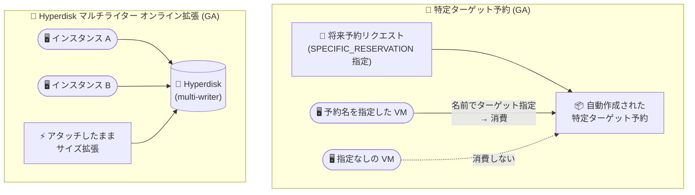

# Compute Engine: 将来予約の特定ターゲット予約配信と Hyperdisk マルチライターのオンラインサイズ変更が GA

**リリース日**: 2026-10-14

**サービス**: Compute Engine

**機能**: 将来予約リクエストの特定ターゲット予約 (Specifically Targeted Reservations) 配信 / Hyperdisk マルチライターボリュームのオンラインサイズ変更

**ステータス**: GA (一般提供)

📊 [このアップデートのインフォグラフィックを見る](https://takech9203.github.io/google-cloud-news-summary/20261014-compute-engine-targeted-reservations-hyperdisk-resize.html)

## 概要

Compute Engine で 2 つの機能が一般提供 (GA) になりました。1 つ目は、将来予約リクエスト (Future Reservation Requests) を使用して容量を予約する際に、予約済み容量を「特定ターゲット予約 (Specifically Targeted Reservations)」として配信できるようになったことです。特定ターゲット予約を使うと、どの Compute Engine インスタンスが予約済み容量を消費するかを追跡・制御できます。

2 つ目は、マルチライターモードの Google Cloud Hyperdisk ボリュームについて、複数のインスタンスにアタッチされたままの状態でサイズを拡張できるようになったことです。従来は、サイズ変更の前にすべてのインスタンスからボリュームをデタッチする必要がありました。

前者は大規模な容量計画を行うキャパシティプランナーや管理者に、後者は SQL Server FCI やクラスタファイルシステムなど共有ブロックストレージを運用するインフラ担当者に、それぞれ運用上の大きな改善をもたらします。

**アップデート前の課題**

- 将来予約で自動作成される予約は自動消費 (ANY_RESERVATION) として扱う場合、プロパティが一致する任意の VM が予約を消費するため、意図した VM・ワークロードに確実に容量を割り当てる制御が難しかった
- マルチライターモードの Hyperdisk ボリュームは、サイズを拡張する前にすべてのインスタンスからデタッチする必要があり、クラスタ全体の停止やダウンタイムを伴うメンテナンス作業が発生していた

**アップデート後の改善**

- 将来予約リクエストで、自動作成される予約を特定ターゲット予約として配信するよう指定できるようになり、予約容量を消費するインスタンスを明示的に追跡・制御できるようになった
- マルチライターモードの Hyperdisk ボリュームを、複数インスタンスにアタッチしたままオンラインでサイズ拡張できるようになり、デタッチ作業と関連するダウンタイムが不要になった

## アーキテクチャ図



左は特定ターゲット予約の消費モデル (予約名を明示的に指定した VM のみが容量を消費) を、右は複数インスタンスにアタッチされたままの Hyperdisk ボリュームをオンラインで拡張できる新しい動作を示しています。

## サービスアップデートの詳細

### 主要機能

1. **将来予約リクエストの特定ターゲット予約 (SPECIFIC_RESERVATION) 配信**
   - 将来予約リクエストの予約アフィニティとして「特定ターゲット (SPECIFIC_RESERVATION)」を指定可能
   - 自動作成された予約を消費するには、VM が予約を名前でターゲット指定し、かつ VM のプロパティが予約のプロパティと一致している必要がある。一致しない場合は VM の作成が失敗する
   - 自動消費 (ANY_RESERVATION) の場合、Compute Engine は total count を容量目標として扱い、既存の一致する予約や VM を差し引いて残量分の予約を作成する。一方、特定ターゲット予約の場合は total count を追加容量として扱い、既存の予約や実行中の VM を差し引かずにリクエストした全数をプロビジョニングする
   - 開始時刻 (start time) になっても、既存の VM が自動作成された予約を自動的に消費することはなく、予約名をターゲット指定した VM を作成して消費する必要がある

2. **Hyperdisk マルチライターボリュームのオンラインサイズ変更**
   - マルチライターモード (READ_WRITE_MANY) の Hyperdisk ボリュームを、複数インスタンスにアタッチしたままサイズ拡張できる
   - 従来はすべてのインスタンスからデタッチしてからサイズ変更する必要があった
   - マルチライターモードのボリュームでは、サイズ拡張に加えて、プロビジョンド IOPS / スループットの変更や追加インスタンスへのアタッチもアタッチ状態のまま実行可能

## 技術仕様

### 将来予約リクエストの予約アフィニティ比較

| 項目 | 自動消費 (ANY_RESERVATION) | 特定ターゲット (SPECIFIC_RESERVATION) |
|------|---------------------------|--------------------------------------|
| 消費方法 | プロパティが一致する VM が自動的に消費 | VM が予約を名前でターゲット指定して消費 |
| total count の扱い | 容量目標 (既存の一致する予約・VM を差し引く) | 追加容量 (全数をプロビジョニング) |
| 既存 VM の扱い | 開始時刻に一致する既存 VM が自動消費を開始 | 既存 VM は自動消費しない |
| 削除時の注意 | 予約削除後も VM は継続稼働 | 予約を削除する前に、消費中の VM をすべて停止・サスペンド・削除する必要がある |

**注意**: 特定ターゲット予約を消費する VM を停止・サスペンドした後に予約を削除すると、その VM は再起動・再開できなくなります。再起動するには、削除した予約と同じ名前・オーナープロジェクト・ゾーン・プロパティで新しい特定ターゲット予約を作成する必要があります。

### Hyperdisk マルチライターモードの対応タイプと上限

| Hyperdisk タイプ | マルチライターモード | 最大同時アタッチ数 |
|------------------|---------------------|-------------------|
| Hyperdisk Balanced | 対応 | 8 インスタンス |
| Hyperdisk Balanced High Availability | 対応 | 8 インスタンス |
| Hyperdisk Extreme | 対応 | 16 インスタンス |
| Hyperdisk ML | 非対応 (読み取り専用モードは対応) | - |
| Hyperdisk Throughput | 非対応 | - |

## 設定方法

### 前提条件

1. 特定ターゲット予約: 将来予約リクエストの作成権限と、Google Cloud によるリクエストの承認が必要
2. Hyperdisk マルチライター: マルチライターモードに対応した Hyperdisk タイプ (Balanced / Balanced HA / Extreme) と対応マシンシリーズ (C3、C4、M3 など) を使用していること

### 手順

#### ステップ 1: 将来予約リクエストの確認 (特定ターゲット予約)

```bash
gcloud compute future-reservations describe FUTURE_RESERVATION_NAME \
    --zone=ZONE
```

特定ターゲット予約の場合、`totalCount` に指定した全数が開始時刻にプロビジョニングされます。

#### ステップ 2: 特定ターゲット予約を消費する VM の作成

```bash
gcloud compute instances create VM_NAME \
    --zone=ZONE \
    --machine-type=MACHINE_TYPE \
    --reservation-affinity=specific \
    --reservation=RESERVATION_NAME
```

予約名をターゲット指定し、VM のプロパティが予約のプロパティと一致している必要があります。

#### ステップ 3: Hyperdisk マルチライターボリュームのオンライン拡張

```bash
gcloud compute disks resize DISK_NAME \
    --zone=ZONE \
    --size=NEW_SIZE
```

複数インスタンスにアタッチされたままのマルチライターモードの Hyperdisk ボリュームに対して実行できます。

## メリット

### ビジネス面

- **容量ガバナンスの強化**: 特定ターゲット予約により、予約済み容量をどのワークロード・インスタンスが消費するかを明示的に管理でき、重要ワークロード向けの容量を確実に確保できる
- **ダウンタイムの削減**: 共有ディスクのサイズ拡張時にクラスタの停止・デタッチ作業が不要になり、SQL Server FCI などの高可用性システムの可用性を維持できる

### 技術面

- **追加容量の確実なプロビジョニング**: 特定ターゲット予約では既存の予約や VM を差し引かず、リクエストした全数が追加容量としてプロビジョニングされる
- **オンライン運用の一貫性**: マルチライターモードの Hyperdisk は、サイズ拡張・プロビジョンド性能変更・追加アタッチをすべてアタッチ状態のまま実行できるようになった

## デメリット・制約事項

### 制限事項

- 特定ターゲット予約は、VM が予約名をターゲット指定しない限り消費されない。消費されない予約も課金対象となるため、予約に対応する VM の作成を忘れないよう注意が必要
- 特定ターゲット予約を削除するには、それを消費するすべての VM を事前に停止・サスペンド・削除する必要がある
- Hyperdisk マルチライターモードには引き続き制約がある: ブートディスクとして使用不可、イメージ作成不可、自動削除 (auto-delete) 有効化不可、アタッチ中のインスタンスのマシンタイプ変更不可など

### 考慮すべき点

- マルチライターモードの Hyperdisk でプロビジョンド性能の変更や追加アタッチを行うと、Compute Engine が全アタッチインスタンス間で性能を再配分する。この処理には最大 6 時間かかる場合がある
- EXT4、XFS、NTFS などの単一インスタンス向けファイルシステムをマルチライターモードで共有すると、データ破損のリスクがある。OCFS2、GFS2 などのクラスタファイルシステムや、SCSI Persistent Reservations による I/O フェンシングの使用が推奨される
- ゾーン Hyperdisk の場合、アタッチする全インスタンスは同一ゾーンに存在する必要がある

## ユースケース

### ユースケース 1: 大規模トレーニングジョブ向けの容量確保と消費制御

**シナリオ**: 数か月後に開始する大規模な ML トレーニング用に GPU 搭載 VM の容量を将来予約で確保する。他チームの一般ワークロードが誤って予約容量を消費しないようにしたい。

**実装例**:
```bash
# 将来予約リクエスト作成時に特定ターゲット予約として配信するよう指定し、
# トレーニングジョブの VM 作成時に予約名をターゲット指定する
gcloud compute instances create training-vm-01 \
    --zone=us-central1-a \
    --reservation-affinity=specific \
    --reservation=ml-training-reservation
```

**効果**: 予約容量を消費できるのは予約名を明示的に指定した VM のみとなり、容量の消費状況を正確に追跡・制御できる。

### ユースケース 2: SQL Server FCI の共有ディスクを無停止で拡張

**シナリオ**: Hyperdisk Balanced のマルチライターボリュームを共有ディスクとして使用する SQL Server Failover Cluster Instance で、データ増加によりディスク容量の拡張が必要になった。

**効果**: 従来必要だった全ノードからのデタッチ (= クラスタ停止) なしに、オンラインでディスクを拡張でき、サービスの可用性を維持したままストレージを増強できる。

## 料金

今回の GA に伴う新たな料金は発表されていません。予約 (将来予約を含む) は、予約した容量に対して VM 実行時と同等の料金が発生し、消費されていない予約も課金対象です。Hyperdisk はプロビジョニングした容量・IOPS・スループットに基づいて課金されます。詳細は料金ページを参照してください。

- [Compute Engine の料金](https://cloud.google.com/compute/all-pricing)
- [ディスクの料金 (Hyperdisk)](https://cloud.google.com/compute/disks-image-pricing)

## 関連サービス・機能

- **Compute Engine 予約 (Reservations)**: オンデマンド予約と将来予約の 2 種類があり、今回のアップデートは将来予約の予約アフィニティ指定を拡張するもの
- **共有予約 (Shared Reservations)**: 将来予約は最大 100 のコンシューマープロジェクトと共有可能で、組織内の複数プロジェクトで容量を共有できる
- **Hyperdisk Storage Pools**: マルチライターモードの Hyperdisk Balanced ボリュームはストレージプールでも利用可能 (Balanced HA / Extreme は非対応)
- **Filestore / Cloud Storage**: 共有ファイルストレージが主目的の場合は、マルチライターディスクではなくこれらのマネージドサービスの利用が推奨される

## 参考リンク

- 📊 [インフォグラフィック](https://takech9203.github.io/google-cloud-news-summary/20261014-compute-engine-targeted-reservations-hyperdisk-resize.html)
- [公式リリースノート](https://docs.cloud.google.com/release-notes#October_14_2026)
- [将来予約リクエストについて](https://docs.cloud.google.com/compute/docs/instances/future-reservations-overview)
- [インスタンス間でのディスク共有](https://docs.cloud.google.com/compute/docs/disks/sharing-disks-between-vms)
- [Hyperdisk ボリュームのサイズまたはプロビジョンド性能の変更](https://docs.cloud.google.com/compute/docs/disks/modify-hyperdisks)
- [料金ページ](https://cloud.google.com/compute/all-pricing)

## まとめ

今回のアップデートにより、将来予約で確保した容量の消費先を厳密に制御できるようになり、マルチライター Hyperdisk の拡張も無停止で行えるようになりました。大規模な容量計画を運用しているチームは特定ターゲット予約の採用を、共有ディスクベースの HA クラスタを運用しているチームはオンライン拡張を前提としたストレージ運用手順の見直しを検討することをおすすめします。

---

**タグ**: Compute Engine, Reservations, Future Reservations, Hyperdisk, Multi-writer, GA, ストレージ, キャパシティプランニング
