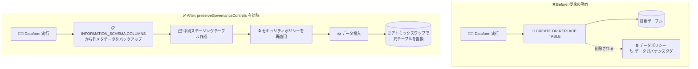

# Dataform: preserveGovernanceControls による BigQuery ガバナンス制御の自動保持

**リリース日**: 2026-10-14

**サービス**: Dataform

**機能**: preserveGovernanceControls オプションによるデータポリシー・データガバナンスタグの自動保持

**ステータス**: GA (一般提供) ※保持対象の BigQuery データガバナンスタグ自体は Preview

📊 [このアップデートのインフォグラフィックを見る](https://takech9203.github.io/google-cloud-news-summary/20261014-dataform-preserve-governance-controls.html)

## 概要

Dataform で、テーブルまたはワークフロー構成に `preserveGovernanceControls` オプションを有効化することで、Dataform の実行をまたいで BigQuery のデータポリシーとデータガバナンスタグ (Preview) を自動的に保持できるようになりました。この機能は一般提供 (GA) です。

Dataform がワークフローアクションを実行してオブジェクト (標準テーブル、ビュー、フルリフレッシュ時の増分テーブルなど) を再作成する際、BigQuery では通常 `CREATE OR REPLACE` ステートメントが生成されます。BigQuery のデフォルト動作では、テーブル置換操作により既存の列レベルアクセス制御メタデータ (データポリシーや、外部データガバナンスシステムによって適用されたデータガバナンスタグなど) が自動的に削除されてしまいます。本アップデートにより、タグなし (tagless) データポリシーを含む既存の BigQuery データポリシーとデータガバナンスタグを、ワークフロー実行をまたいで自動的に保持するよう Dataform を構成できます。

機密データを扱う ELT パイプラインを Dataform で運用しており、BigQuery の列レベルセキュリティやデータマスキングを併用しているデータエンジニアリングチーム、データガバナンスチームにとって重要なアップデートです。

**アップデート前の課題**

- Dataform がテーブルを再作成 (`CREATE OR REPLACE`) するたびに、BigQuery の列レベルアクセス制御メタデータ (データポリシー、データガバナンスタグ) が削除されていた
- 外部データガバナンスシステムで適用したタグも、ワークフロー実行のたびに失われていた
- セキュリティポリシーを維持するには、実行後に再適用する運用上の工夫が必要だった

**アップデート後の改善**

- `preserveGovernanceControls: true` を設定するだけで、データポリシー (タグなしデータポリシーを含む) とデータガバナンスタグがワークフロー実行をまたいで自動保持される
- テーブル単位 (SQLX の config ブロック) とリポジトリ全体 (workflow_settings.yaml) の両方で設定でき、個別テーブルでのオーバーライドも可能
- 中間ステージングテーブルへのポリシー再適用とアトミックなテーブルスワップにより、安全に置換が行われる

## アーキテクチャ図



従来はテーブル置換時に列レベルアクセス制御メタデータが失われていましたが、本機能を有効化すると、メタデータのバックアップ → ステージングテーブルへのポリシー再適用 → データ投入 → アトミックスワップという順序で実行され、ガバナンス制御が保持されます。

## サービスアップデートの詳細

### 主要機能

1. **データポリシー・データガバナンスタグの自動保持**
   - BigQuery データポリシー (タグなしデータポリシーを含む) とデータガバナンスタグ (Preview) を、Dataform のワークフロー実行をまたいで自動保持
   - 外部データガバナンスシステムによって適用されたタグも保持対象

2. **安全な置換シーケンス**
   - 有効化すると、Dataform は実行時に次の順序で処理を行う:
     1. `INFORMATION_SCHEMA.COLUMNS` ビューから既存の列メタデータをバックアップ
     2. 中間の空ステージングテーブルを作成
     3. ステージングテーブルにセキュリティポリシーを再適用
     4. テーブルにデータを投入
     5. アトミックなテーブルスワップで元のテーブルを置換

3. **柔軟な設定スコープ**
   - テーブル・増分テーブル・ビュー単位: SQLX 定義ファイルの config ブロックで設定
   - リポジトリ全体: `workflow_settings.yaml` でプロジェクト全体のデフォルトとして設定
   - グローバル有効化時も、個別テーブルの config ブロックで `false` を設定してオーバーライド可能

## 技術仕様

### 要件と保持対象

| 項目 | 詳細 |
|------|------|
| 必要な Dataform core バージョン | 3.0.62 以降 |
| 対象オブジェクト | テーブル、増分テーブル、ビュー |
| 保持されるもの | BigQuery データポリシー (タグなしデータポリシーを含む)、データガバナンスタグ (Preview) |
| 保持されないもの | 行アクセスポリシー (post_operations での再適用が必要)、レガシーポリシータグ |
| 設定スコープ | テーブル単位 (SQLX config)、リポジトリ全体 (workflow_settings.yaml) |

## 設定方法

### 前提条件

1. Dataform core 3.0.62 以降を使用していること
2. Dataform のリポジトリと開発ワークスペースが作成済みであること

### 手順

#### ステップ 1: 個別テーブルで有効化する

開発ワークスペースの Files ペインで `definitions/` を展開し、SQLX テーブル定義ファイルの config ブロックに `preserveGovernanceControls: true` を追加します。

```sqlx
config {
  type: "table",
  preserveGovernanceControls: true
}
SELECT customer_id, email, phone_number FROM ${ref("raw_customers")}
```

#### ステップ 2: リポジトリ全体で有効化する (任意)

リポジトリの `workflow_settings.yaml` に `preserveGovernanceControls: true` を追加すると、すべてのテーブル・増分テーブル・ビューに対するプロジェクト全体のデフォルト動作として有効化できます。

```yaml
defaultProject: my-gcp-project-id
defaultDataset: my_dataform_dataset
defaultLocation: US
defaultAssertionDataset: my_dataform_assertions
dataformCoreVersion: 3.0.62
preserveGovernanceControls: true
```

グローバルに有効化した場合でも、特定のテーブルの config ブロックで `preserveGovernanceControls: false` を設定すれば、そのテーブルのみ保持を無効化できます。

#### ステップ 3: 行アクセスポリシーを post_operations で再適用する (必要な場合)

本機能は列レベルのメタデータを保護しますが、行アクセスポリシーは自動復元されません。オブジェクト置換により行レベルセキュリティルールは削除されるため、SQLX テーブル定義ファイルの `post_operations` ブロック内に SQL DDL を定義して、テーブル作成後に行アクセスポリシーを再適用します。

```sqlx
config {
  type: "table",
}
SELECT bike_id, start_time, duration FROM ${ref("raw_trips")}

post_operations {
  CREATE ROW ACCESS POLICY my_policy
  ON ${self()}
  GRANT TO ('serviceAccount:sa-name@example-gcp-project.iam.gserviceaccount.com')
  FILTER USING (bike_id LIKE 'US-%');
}
```

## メリット

### ビジネス面

- **ガバナンスとコンプライアンスの維持**: 機密列に対するデータマスキングやアクセス制御が、パイプライン実行のたびに失われるリスクを排除し、継続的なコンプライアンスを担保できる
- **運用負荷の削減**: 実行のたびにポリシーを手動または独自の仕組みで再適用する必要がなくなる

### 技術面

- **宣言的な設定**: config ブロックまたは workflow_settings.yaml に 1 行追加するだけで有効化できる
- **アトミックなテーブルスワップ**: ステージングテーブルにポリシーを再適用してからデータを投入し、アトミックに置換するため、安全に移行できる
- **外部ガバナンスシステムとの親和性**: 外部データガバナンスシステムが適用したデータガバナンスタグも保持される

## デメリット・制約事項

### 制限事項

- Dataform core 3.0.62 以降が必要
- 行アクセスポリシーは自動保持されない (post_operations での再適用が必要)
- レガシーポリシータグは保持できない (公式ドキュメントは、列レベルセキュリティにはポリシータグではなく BigQuery データガバナンスタグ (Preview) の使用を推奨)

### 考慮すべき点

- 保持対象であるデータガバナンスタグ自体は Preview 段階の機能であり、Pre-GA 利用規約が適用される
- 有効化すると実行シーケンスにメタデータのバックアップ、ステージングテーブル作成、ポリシー再適用のステップが追加される

## ユースケース

### ユースケース 1: 機密データを含む ELT パイプラインでの列レベルセキュリティ維持

**シナリオ**: 顧客のメールアドレスや電話番号を含むテーブルを Dataform で日次再構築しており、BigQuery のデータポリシーでマスキングを適用している。従来は再構築のたびにポリシーが失われていた。

**実装例**:
```sqlx
config {
  type: "table",
  preserveGovernanceControls: true
}
SELECT customer_id, email, phone_number FROM ${ref("raw_customers")}
```

**効果**: 日次実行後もデータポリシーとデータガバナンスタグが維持され、機密列のマスキングが途切れなく適用され続ける。

### ユースケース 2: リポジトリ全体でのガバナンス統制の標準化

**シナリオ**: 多数のテーブル定義を持つ Dataform リポジトリで、ガバナンス制御の保持をチーム標準として一括適用したい。

**効果**: `workflow_settings.yaml` に `preserveGovernanceControls: true` を 1 行追加するだけで全テーブル・ビューに適用され、個別テーブルで `false` によるオーバーライドも可能なため、柔軟に統制を標準化できる。

## 料金

本アップデートに固有の料金情報はリリースノートに記載されていません。Dataform および BigQuery の料金は以下を参照してください。

- [Dataform の料金](https://cloud.google.com/dataform/pricing)
- [BigQuery の料金](https://cloud.google.com/bigquery/pricing)

## 関連サービス・機能

- **BigQuery データポリシー**: 列レベルのデータマスキングやアクセス制御を実現する仕組み。本機能の保持対象 (タグなしデータポリシーを含む)
- **BigQuery データガバナンスタグ (Preview)**: Resource Manager タグの一種で、機密列に付与してデータポリシーと組み合わせることで条件付きアクセスを実現する。本機能の保持対象
- **BigQuery 行アクセスポリシー**: 行レベルのセキュリティルール。本機能では自動保持されないため、Dataform の post_operations で再適用する

## 参考リンク

- 📊 [インフォグラフィック](https://takech9203.github.io/google-cloud-news-summary/20261014-dataform-preserve-governance-controls.html)
- [公式リリースノート](https://docs.cloud.google.com/release-notes#October_14_2026)
- [ドキュメント: Preserve access controls metadata](https://docs.cloud.google.com/dataform/docs/create-tables#preserve-access-controls)
- [ドキュメント: BigQuery データガバナンスタグ](https://docs.cloud.google.com/bigquery/docs/tags#data-governance-tags)
- [ドキュメント: データマスキングの概要](https://docs.cloud.google.com/bigquery/docs/column-data-masking-intro)

## まとめ

Dataform の `preserveGovernanceControls` オプションにより、テーブル再作成のたびに BigQuery のデータポリシーとデータガバナンスタグが失われるという長年の運用課題が解消されます。機密データを扱う Dataform パイプラインを運用しているチームは、Dataform core 3.0.62 以降へ更新のうえ、workflow_settings.yaml または対象テーブルの config ブロックで本オプションの有効化を検討してください。行アクセスポリシーは保持対象外のため、post_operations での再適用を併せて設計することを推奨します。

---

**タグ**: #Dataform #BigQuery #DataGovernance #ColumnLevelSecurity #DataMasking #GA
