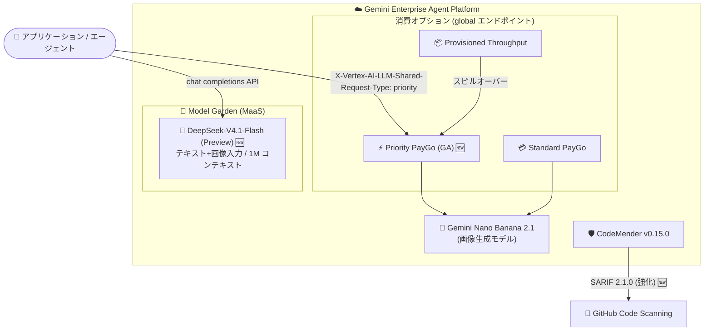

# Gemini Enterprise Agent Platform: モデル関連アップデート (Priority PayGo GA / CodeMender v0.15.0 / DeepSeek-V4.1-Flash Preview)

**リリース日**: 2026-10-14

**サービス**: Gemini Enterprise Agent Platform

**機能**: Gemini Nano Banana 2.1 の Priority PayGo GA、CodeMender v0.15.0 アップデート、DeepSeek-V4.1-Flash の Public Preview 提供

**ステータス**: GA (Priority PayGo) / Fixed (CodeMender v0.15.0) / Public Preview (DeepSeek-V4.1-Flash)

📊 [このアップデートのインフォグラフィックを見る](https://takech9203.github.io/google-cloud-news-summary/20261014-gemini-enterprise-agent-platform-model-updates.html)

## 概要

2026 年 10 月 14 日、Gemini Enterprise Agent Platform で 3 件のアップデートが発表されました。(1) 画像生成モデル Gemini Nano Banana 2.1 (`gemini-nano-banana-2.1`) に対する Priority Pay-as-you-go (Priority PayGo) のグローバルエンドポイントでの GA 提供、(2) セキュリティエージェント CodeMender の v0.15.0 リリース (SARIF 2.1.0 レポーティング強化など)、(3) DeepSeek の最新モデル DeepSeek-V4.1-Flash の Model Garden におけるフルマネージドモデル (MaaS) としての Public Preview 提供です。

Priority PayGo は、Provisioned Throughput のような事前コミットメントなしに、Standard PayGo よりも安定したパフォーマンスを得られる従量課金の消費オプションです。今回の GA により、画像生成を担う Gemini Nano Banana 2.1 をビジネスクリティカルなワークロードで利用しやすくなりました。また、DeepSeek-V4.1-Flash はテキストと画像の入力に対応し、エージェント処理やコーディングタスクを対象とした最大 100 万トークンのコンテキストウィンドウを持つモデルで、インフラ管理不要の MaaS として利用できます。

本アップデートは、生成 AI の画像生成ワークロードを本番運用するチーム、CI/CD でのセキュリティスキャンに CodeMender を利用する開発チーム、そしてオープンモデルの選択肢を広げたい AI 開発者が対象です。

**アップデート前の課題**

- Gemini Nano Banana 2.1 の消費オプションは Standard PayGo と Provisioned Throughput のみで、事前コミットなしで安定したパフォーマンスを得る選択肢がなかった
- CodeMender の SARIF 出力はルール記述子や重大度プロパティ、アーティファクトの場所の表現が GitHub Code Scanning との統合において最適化されておらず、`cm stats` ではモデル呼び出し回数を確認できなかった
- CodeMender でエラーまたはキャンセルによる終了時に、完了済みターンのトークン使用量がセッションログから欠落する問題があった
- Model Garden の DeepSeek MaaS モデルには、テキストと画像のマルチモーダル入力と 1M トークンコンテキストを兼ね備えたエージェント / コーディング向けモデルがなかった

**アップデート後の改善**

- Gemini Nano Banana 2.1 でリクエストヘッダーを付与するだけで Priority PayGo を利用でき、トラフィックが変動するビジネスクリティカルな画像生成ワークロードでも安定した性能を確保できるようになった
- CodeMender の `cm report` の SARIF 2.1.0 出力が標準化されたルール記述子・重大度プロパティ・リポジトリ相対のアーティファクトロケーションに対応し、GitHub Code Scanning との互換性が向上した
- `cm stats --json` にモデル呼び出しメトリクス (合計 / セッション単位 / ターン単位) が追加され、利用状況の可視化が可能になった
- DeepSeek-V4.1-Flash をインフラのプロビジョニングなしで API として即座に利用でき、最大 1M トークンのコンテキストでエージェント / コーディングタスクを処理できるようになった

## アーキテクチャ図



Gemini Nano Banana 2.1 への Priority PayGo アクセス経路、Model Garden MaaS 経由の DeepSeek-V4.1-Flash 利用、CodeMender から GitHub Code Scanning への SARIF 連携という 3 つのアップデートの位置付けを示しています。

## サービスアップデートの詳細

### 主要機能

1. **Gemini Nano Banana 2.1 の Priority PayGo サポート (GA)**
   - Priority PayGo は、Provisioned Throughput の事前コミットなしで Standard PayGo より安定したパフォーマンスを提供する従量課金オプション。トークン単価は Standard PayGo より高めに設定されている
   - `gemini-nano-banana-2.1` のグローバルエンドポイントで GA として利用可能
   - リクエストに `X-Vertex-AI-LLM-Shared-Request-Type: priority` ヘッダーを付与するだけで利用でき、Provisioned Throughput のクォータを使い切った際のスピルオーバー先としても構成できる
   - 顧客向けバーチャルアシスタント、エージェント間連携ワークフローなど、トラフィックが変動するビジネスクリティカルな用途に適する

2. **CodeMender v0.15.0 アップデート**
   - **SARIF 2.1.0 レポーティング強化**: `cm report` の SARIF 出力に標準化されたルール記述子、重大度プロパティ、リポジトリ相対のアーティファクトロケーションを導入し、GitHub Code Scanning との互換性を改善
   - **モデル呼び出しメトリクス**: `cm stats --json` にモデル呼び出しのトラッキングを追加し、合計 / セッション単位 / ターン単位の呼び出し回数を取得可能に
   - **バグ修正**: エラーまたはキャンセルによる終了パスで、完了済みターンのトークン使用量がセッションログから欠落する問題を修正

3. **DeepSeek-V4.1-Flash の Public Preview 提供 (MaaS)**
   - DeepSeek 製のマルチモーダル Mixture-of-Experts (MoE) モデル。テキストと画像の入力に対応し、エージェント処理とコーディングタスクを対象とする
   - コンテキストウィンドウは最大 1M (1,048,576) トークン。プリフィル時には 552B パラメータのバックボーンのうちトークンあたり 8B のみをアクティベートし、入力の多いエージェントワークロードでもコスト効率を維持
   - Model Garden からフルマネージドモデル (MaaS) として利用でき、インフラのプロビジョニングや管理が不要。セルフデプロイも選択可能

## 技術仕様

### Priority PayGo (Gemini Nano Banana 2.1)

| 項目 | 詳細 |
|------|------|
| 対象モデル | `gemini-nano-banana-2.1` (GA: 2026-10-06) |
| 対応エンドポイント | global |
| ステータス | GA |
| 利用方法 | `X-Vertex-AI-LLM-Shared-Request-Type: priority` ヘッダーを付与 |
| 課金 | トークン単位の従量課金 (Standard PayGo より高いレート) |
| モデルのコンテキストウィンドウ | 131,072 トークン (最大出力 32,768 トークン) |
| レスポンスの識別 | `usageMetadata.trafficType` が `ON_DEMAND_PRIORITY` となる |

### DeepSeek-V4.1-Flash (MaaS)

| 項目 | 詳細 |
|------|------|
| モデル ID | `deepseek-v4.1-flash-maas` |
| ステータス | Public Preview (リリース日: 2026-10-14) |
| モダリティ | テキスト (入出力)、画像 (入力のみ)。音声・動画は非対応 |
| コンテキスト長 / 最大出力 | 1,048,576 トークン / 1,048,576 トークン (global) |
| アーキテクチャ | MoE (バックボーン 552B、プリフィル時はトークンあたり 8B をアクティベート) |
| 対応機能 | Function calling、構造化出力、Thinking |
| 消費オプション | Standard PayGo のみ (Provisioned Throughput、バッチ推論、固定クォータは非対応) |
| 対応リージョン | global |
| エンドポイント提供期間 | 少なくとも 2026 年 11 月 28 日まで (利用状況により延長の可能性あり) |

### Priority PayGo のリクエスト例 (REST)

```bash
curl -X POST \
  -H "Authorization: Bearer $(gcloud auth print-access-token)" \
  -H "Content-Type: application/json; charset=utf-8" \
  -H "X-Vertex-AI-LLM-Shared-Request-Type: priority" \
  "https://aiplatform.googleapis.com/v1/projects/PROJECT_ID/locations/global/publishers/google/models/gemini-nano-banana-2.1:generateContent" -d \
  $'{
    "contents": {
      "role": "user",
      "parts": { "text": "PROMPT_TEXT" }
    }
  }'
```

Provisioned Throughput を使わず Priority PayGo のみを使用する場合は、`X-Vertex-AI-LLM-Request-Type: shared` ヘッダーも併せて付与します。

### CodeMender の SARIF 出力 (CI/CD での利用例)

```bash
# プルリクエストブランチを main と比較してスキャンし、SARIF を出力
cm find . --diff=origin/main --format=sarif --output=results.sarif \
  --fail-on=CRITICAL,HIGH

# モデル呼び出しメトリクスを含む統計情報を JSON で取得 (v0.15.0 で拡張)
cm stats --json
```

## 設定方法

### 前提条件

1. Google Cloud プロジェクトで Gemini Enterprise Agent Platform (Agent Platform API) が有効化されていること
2. DeepSeek-V4.1-Flash を利用する場合は、Model Garden のモデルカードからモデルへのアクセスを有効化すること (Preview 機能のため Pre-GA 利用規約が適用される)

### 手順

#### ステップ 1: Priority PayGo を Python SDK で利用する

```python
from google import genai
from google.genai.types import HttpOptions

client = genai.Client(
    vertexai=True,
    project="your_project_id",
    location="global",
    http_options=HttpOptions(
        api_version="v1",
        headers={"X-Vertex-AI-LLM-Shared-Request-Type": "priority"},
    ),
)
```

クライアント初期化時にヘッダーを設定すれば、以降のリクエストはすべて Priority PayGo (Provisioned Throughput クォータがあればそちらを優先) で処理されます。

#### ステップ 2: DeepSeek-V4.1-Flash を MaaS として呼び出す

Model Garden の [DeepSeek-V4.1-Flash モデルカード](https://console.cloud.google.com/agent-platform/publishers/deepseek-ai/model-garden/deepseek-v4.1-flash-maas)からモデルを有効化し、エンドポイント (`deepseek-v4.1-flash-maas`) に対して直接リクエストを送信します。MaaS のためインフラのプロビジョニングは不要で、レスポンスは SSE によるストリーミングにも対応しています。

## メリット

### ビジネス面

- **コミットメント不要の安定性能**: Priority PayGo により、Provisioned Throughput の事前契約なしでビジネスクリティカルな画像生成ワークロードの安定稼働を実現できる
- **モデル選択肢の拡大**: DeepSeek-V4.1-Flash の MaaS 提供により、サードパーティモデルをインフラコストや運用負荷なしで評価・採用できる

### 技術面

- **ヘッダーのみで切り替え可能**: Priority PayGo はリクエストヘッダーの追加だけで利用でき、アプリケーションコードの大幅な変更が不要。Provisioned Throughput からのスピルオーバー構成も可能
- **CI/CD セキュリティ統合の強化**: CodeMender の SARIF 2.1.0 出力改善により、GitHub Code Scanning のアノテーションへの取り込み精度が向上し、`cm stats --json` でモデル利用状況の監視も可能になった
- **長大コンテキストのエージェント処理**: DeepSeek-V4.1-Flash の 1M トークンコンテキストと MoE アーキテクチャ (プリフィル時 8B アクティブ) により、入力の多いエージェント / コーディングワークロードをコスト効率よく処理できる

## デメリット・制約事項

### 制限事項

- Priority PayGo のトークン単価は Standard PayGo より高く設定されている
- DeepSeek-V4.1-Flash は Public Preview であり、Pre-GA Offerings Terms が適用される。Provisioned Throughput、バッチ推論、固定クォータには非対応で、消費オプションは Standard PayGo のみ
- DeepSeek-V4.1-Flash の入力は テキストと画像のみで、音声・動画には対応しない
- `deepseek-v4.1-flash-maas` エンドポイントの提供は「少なくとも 2026 年 11 月 28 日まで」とされており、Preview モデルの最低提供期間ポリシーに従う

### 考慮すべき点

- Gemini Nano Banana 2.1 および DeepSeek-V4.1-Flash (MaaS) はいずれも global エンドポイントでの提供であり、リージョン固定のデータレジデンシー要件がある場合は注意が必要
- DeepSeek モデルは Google 製品ではなく、Service Specific Terms の「Separate Offerings」条項とモデルカード記載の個別規約が適用される
- CodeMender の SARIF 出力形式が変わるため、既存の GitHub Code Scanning / Cloud Build 連携パイプラインでは v0.15.0 へ更新後の出力を確認することを推奨

## ユースケース

### ユースケース 1: 顧客向け画像生成サービスの安定運用

**シナリオ**: EC サイトで商品画像のバリエーション生成に Gemini Nano Banana 2.1 を使用している。セール期間などトラフィックが大きく変動するため、Provisioned Throughput の固定契約はコスト効率が悪い。

**実装例**:
```python
client = genai.Client(
    vertexai=True,
    project="your_project_id",
    location="global",
    http_options=HttpOptions(
        api_version="v1",
        headers={
            "X-Vertex-AI-LLM-Request-Type": "shared",
            "X-Vertex-AI-LLM-Shared-Request-Type": "priority",
        },
    ),
)
```

**効果**: 事前コミットなしで Standard PayGo より安定した性能を確保でき、トラフィック変動の大きい本番ワークロードでもユーザー体験を維持できる。

### ユースケース 2: 大規模リポジトリに対するエージェント型コーディング支援

**シナリオ**: 大規模なモノレポのコード理解・リファクタリング支援に、長大なコンテキストを扱えるモデルが必要。マルチモーダル入力でアーキテクチャ図やスクリーンショットも併せて解釈させたい。

**効果**: DeepSeek-V4.1-Flash の 1M トークンコンテキストにより大量のソースコードを一度に投入でき、MaaS のためインフラ管理なしで Function calling や構造化出力を活用したエージェントを構築できる。

### ユースケース 3: プルリクエストごとのセキュリティゲート

**シナリオ**: GitHub Actions で CodeMender の diff スキャンを実行し、結果を GitHub Code Scanning に取り込んで PR 上にアノテーション表示したい。

**実装例**:
```bash
cm find . --diff="origin/$BASE_REF" --fail-on=CRITICAL,HIGH \
  --format=sarif --output=codemender.sarif
```

**効果**: v0.15.0 の SARIF 2.1.0 強化 (リポジトリ相対パス、標準化されたルール記述子) により、Code Scanning 上での指摘箇所の表示が正確になり、レビュー効率が向上する。

## 料金

- **Priority PayGo**: トークン使用量に応じた従量課金で、Standard PayGo より高いレートが適用される。具体的な単価は料金ページを参照
- **DeepSeek-V4.1-Flash (MaaS)**: Standard PayGo による従量課金。具体的な単価は料金ページを参照

詳細は [Gemini Enterprise Agent Platform の生成 AI 料金ページ](https://cloud.google.com/gemini-enterprise-agent-platform/generative-ai/pricing) を参照してください。

## 利用可能リージョン

- **Gemini Nano Banana 2.1 (Priority PayGo)**: global エンドポイント
- **DeepSeek-V4.1-Flash (MaaS)**: global (ML 処理も global)

## 関連サービス・機能

- **Model Garden**: DeepSeek-V4.1-Flash をはじめとするサードパーティ / オープンモデルの検索・有効化・デプロイのハブ。MaaS とセルフデプロイの両方を選択できる
- **Provisioned Throughput**: 固定スループットを事前購入する消費オプション。Priority PayGo はそのクォータ超過分のスピルオーバー先として併用できる
- **GitHub Code Scanning / Cloud Build**: CodeMender の SARIF 出力の取り込み先。CI/CD パイプラインでのセキュリティゲートを構成できる
- **Model Armor**: MaaS モデルを本番利用する際に、プロンプトとレスポンスをセキュリティ / 安全性リスクからスクリーニングする補完サービス

## 参考リンク

- 📊 [インフォグラフィック](https://takech9203.github.io/google-cloud-news-summary/20261014-gemini-enterprise-agent-platform-model-updates.html)
- [公式リリースノート](https://docs.cloud.google.com/release-notes#October_14_2026)
- [Priority PayGo ドキュメント](https://docs.cloud.google.com/gemini-enterprise-agent-platform/models/priority-paygo)
- [Gemini Nano Banana 2.1 モデルページ](https://docs.cloud.google.com/gemini-enterprise-agent-platform/models/gemini/nano-banana-2-1)
- [DeepSeek-V4.1-Flash ドキュメント](https://docs.cloud.google.com/gemini-enterprise-agent-platform/models/maas/deepseek/deepseek-v41-flash)
- [CodeMender CI/CD 統合ガイド](https://docs.cloud.google.com/gemini-enterprise-agent-platform/agents/codemender/integrate-with-cicd)
- [料金ページ](https://cloud.google.com/gemini-enterprise-agent-platform/generative-ai/pricing)

## まとめ

今回のアップデートは、画像生成モデルの消費オプション拡充 (Priority PayGo GA)、セキュリティエージェントの CI/CD 統合強化 (CodeMender v0.15.0)、サードパーティモデルの選択肢拡大 (DeepSeek-V4.1-Flash Preview) という 3 つの軸で Gemini Enterprise Agent Platform の実運用性を高めるものです。トラフィック変動の大きい画像生成ワークロードを運用しているチームは Priority PayGo の採用を、長大コンテキストのエージェント / コーディング用途を検討しているチームは DeepSeek-V4.1-Flash の Preview 評価を検討することを推奨します。

---

**タグ**: Gemini Enterprise Agent Platform, Priority PayGo, Gemini Nano Banana 2.1, CodeMender, SARIF, DeepSeek-V4.1-Flash, Model Garden, MaaS, 生成AI, GA, Public Preview
