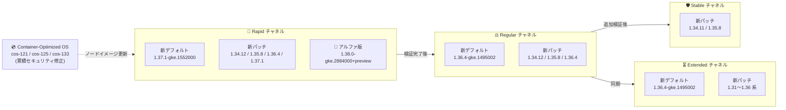

# Google Kubernetes Engine (GKE): バージョンアップデート 2026-R44

**リリース日**: 2026-10-14

**サービス**: Google Kubernetes Engine (GKE)

**機能**: クラスタバージョンの更新・セキュリティアップデート・GKE Sandbox の不具合修正 (2026-R44)

**ステータス**: Change + Security + Fixed (Version Update / Security Update / Bug Fix)

📊 [このアップデートのインフォグラフィックを見る](https://takech9203.github.io/google-cloud-news-summary/20261014-gke-2026-r44-version-updates.html)

## 概要

Google Kubernetes Engine (GKE) の全リリースチャネル (Rapid, Regular, Stable, Extended, No channel) において、クラスタバージョンが更新された。今回の 2026-R44 アップデートでは、Rapid チャネルのデフォルトバージョンが Kubernetes 1.37 系の 1.37.1-gke.1552000 に引き上げられ、Regular / Extended / No channel のデフォルトバージョンが 1.36.4-gke.1495002 に更新された。Rapid チャネルには 1.34.12 / 1.35.8 / 1.36.4 系の新パッチと 1.37.1-gke.1697000 が追加され、アルファクラスタ向けには Kubernetes 1.38 系の新しいアルファ版 1.38.0-gke.2884000+preview が利用可能になった。Stable チャネルには 1.34.11-gke.1102000 と 1.35.8-gke.1439001 が追加され、Extended チャネルには 1.31〜1.36 系の多数の新パッチが追加されている。

セキュリティアップデート (2026-R44) として、更新された Container-Optimized OS イメージを使用する新しい GKE バージョンもリリースされた。これらのイメージは前回の GKE リリース以降に公開されたすべての Container-Optimized OS のセキュリティ修正を累積的に含んでおり、今回は cos-121 / cos-125 / cos-133 のイメージが 1.31.14 / 1.35.8 / 1.37.1 / 1.38.0 系の新バージョンに適用されている。

さらに、GKE Sandbox で Cloud Storage FUSE CSI ドライバを使用する Pod が Terminating 状態のまま無期限にスタックする不具合が修正された。解消にはノードプールを GKE 1.37.1-gke.1552000 以降にアップグレードし、Pod または Deployment のメタデータに `dev.gvisor.fuse.abort-on-teardown: "true"` アノテーションを追加する必要がある。このアップデートは、GKE クラスタを運用するすべてのプラットフォーム管理者およびインフラエンジニアに影響する。

**アップデート前の課題**

- 前回までのバージョンには、直近の Container-Optimized OS セキュリティ修正が含まれていなかった
- Rapid チャネルの新規クラスタのデフォルトは 1.36.4 系であり、1.37 系が標準適用されていなかった
- Regular / Extended / No channel のデフォルトは旧パッチ (1.36.4-gke.1391002) のままだった
- GKE Sandbox 上で Cloud Storage FUSE CSI ドライバを使用する Pod が Terminating 状態のままスタックすることがあった

**アップデート後の改善**

- Rapid チャネルのデフォルトが Kubernetes 1.37 系の 1.37.1-gke.1552000 に更新され、新規クラスタに 1.37 系が標準適用されるようになった
- Regular / Extended / No channel のデフォルトが 1.36.4-gke.1495002 に更新された
- 各チャネルに 1.31〜1.37 系の新パッチが追加され、自動アップグレードターゲットも更新された
- 累積的なセキュリティ修正を含む Container-Optimized OS イメージ (cos-121 / cos-125 / cos-133) が新バージョンに適用され、ノード OS の脆弱性リスクが低減された
- アルファ版 1.38.0-gke.2884000+preview により、次期マイナーバージョンの早期検証が可能になった
- GKE Sandbox + Cloud Storage FUSE CSI ドライバ環境での Pod スタック問題が、1.37.1-gke.1552000 以降とアノテーション追加により解消された

## アーキテクチャ図



GKE のリリースチャネルは、Rapid で導入されたバージョンが検証を経て Regular、Stable へと段階的に展開されるパイプラインとして機能する。今回は Rapid チャネルのデフォルトが Kubernetes 1.37 系に引き上げられ、累積的なセキュリティ修正を含む新しい Container-Optimized OS イメージが各バージョンに組み込まれている。

## サービスアップデートの詳細

### チャネル別バージョン一覧

| チャネル | デフォルトバージョン | 新規追加バージョン | 非推奨・提供終了バージョン |
|---------|---------------------|-------------------|-----------------|
| Rapid | 1.37.1-gke.1552000 (新デフォルト) | 1.34.12-gke.1209000, 1.35.8-gke.1975000, 1.36.4-gke.2377000, 1.37.1-gke.1697000、アルファクラスタ向け 1.38.0-gke.2884000+preview | 非推奨: 1.36.4-gke.2202002, 1.36.4-gke.2304000 (90 日以内に削除)。提供終了: 1.34.12-gke.1011000, 1.35.8-gke.1796000, 1.36.4-gke.2046002, 1.37.0-gke.3503000, 1.38.0-gke.1002000+preview |
| Regular | 1.36.4-gke.1495002 (新デフォルト) | 1.34.12-gke.1011000, 1.35.8-gke.1796000, 1.36.4-gke.1495003, 1.36.4-gke.2046002, 1.36.4-gke.2046003 | 提供終了: 1.34.11-gke.1102000, 1.35.8-gke.1439001, 1.36.4-gke.1391002 |
| Stable | 変更なし | 1.34.11-gke.1102000, 1.35.8-gke.1439001 | 非推奨: 1.34.9-gke.1655001 (90 日以内に削除) |
| Extended | 1.36.4-gke.1495002 (新デフォルト) | 1.31.14-gke.2825000, 1.31.14-gke.2963000, 1.32.13-gke.2567000, 1.32.13-gke.2701000, 1.33.13-gke.1815000, 1.33.13-gke.1952000, 1.34.12-gke.1011000, 1.35.8-gke.1796000, 1.36.4-gke.1495003, 1.36.4-gke.2046002, 1.36.4-gke.2046003 | 非推奨: 1.31.14-gke.2704000, 1.31.14-gke.2925000, 1.32.13-gke.2427000, 1.32.13-gke.2662000, 1.33.13-gke.1647000, 1.33.13-gke.1915000 (90 日以内に削除)。提供終了: 1.34.11-gke.1102000, 1.35.8-gke.1439001, 1.36.4-gke.1391002 |
| No channel (非推奨) | 1.36.4-gke.1495002 (新デフォルト) | 1.34.12-gke.1209000, 1.35.8-gke.1975000, 1.36.4-gke.1495003, 1.36.4-gke.2046003, 1.36.4-gke.2377000 (ノード版はさらに 1.31.14-gke.2963000, 1.32.13-gke.2701000, 1.33.13-gke.1952000) | 非推奨: 1.34.9-gke.1655001, 1.35.8-gke.1225000, 1.36.4-gke.1495000, 1.36.4-gke.2202002, 1.36.4-gke.2304000 (90 日以内に削除) |

### 自動アップグレードターゲット

各チャネルで、対象マイナーバージョンのクラスタに新しい自動アップグレードターゲットが設定された。

**マイナーバージョンアップグレード (メンテナンス除外や非推奨 API などの阻害要因がない場合)**

| チャネル | 現在のマイナーバージョン | アップグレード先 |
|---------|------------------------|------------------|
| Rapid | 1.33 | 1.34.12-gke.1153000 |
| Rapid | 1.34 | 1.35.8-gke.1919000 |
| Rapid | 1.35 | 1.36.4-gke.2326000 |
| Regular | 1.33 | 1.34.11-gke.1209000 |
| Regular | 1.34 | 1.35.8-gke.1626001 |
| Stable | 1.33 | 1.34.11-gke.1056000 |
| Extended | 1.30 | 1.31.14-gke.2759000 |
| Extended | 1.31 | 1.32.13-gke.2504000 |
| No channel | 1.33 | 1.34.11-gke.1209000 |

**パッチバージョンアップグレード (マイナーアップグレードが利用できない、または阻害要因がある場合)**

| チャネル | 対象マイナーバージョン → アップグレード先 |
|---------|------------------------------------------|
| Rapid | 1.34 → 1.34.12-gke.1153000、1.35 → 1.35.8-gke.1919000、1.36 → 1.36.4-gke.2326000、1.37 → 1.37.1-gke.1552000 |
| Regular | 1.34 → 1.34.11-gke.1209000、1.35 → 1.35.8-gke.1626001、1.36 → 1.36.4-gke.1495003 |
| Stable | 1.34 → 1.34.11-gke.1056000 |
| Extended | 1.31 → 1.31.14-gke.2759000、1.32 → 1.32.13-gke.2504000、1.33 → 1.33.13-gke.1721000、1.34 → 1.34.11-gke.1209000、1.35 → 1.35.8-gke.1626001、1.36 → 1.36.4-gke.1495003 |
| No channel | 1.34 → 1.34.11-gke.1209000、1.36 → 1.36.4-gke.1495002 |

### セキュリティアップデート (2026-R44)

新しい GKE バージョンでは、更新された Container-Optimized OS イメージが使用される。これらのイメージは前回の GKE リリース以降のセキュリティ修正を累積的に含む。

| GKE バージョン | Container-Optimized OS バージョン |
|---------------|----------------------------------|
| 1.31.14-gke.2963000 | cos-121-18867-624-8 |
| 1.35.8-gke.1975000 | cos-125-19216-700-23 |
| 1.37.1-gke.1697000 | cos-133-19999-44-85 |
| 1.38.0-gke.2884000+preview | cos-133-19999-44-85 |

解決された個別の脆弱性は、各 Container-Optimized OS イメージのセキュリティリリースノートで確認できる。

### 不具合修正: GKE Sandbox + Cloud Storage FUSE CSI ドライバ

GKE Sandbox で Cloud Storage FUSE CSI ドライバを使用する Pod が、Terminating 状態のまま無期限にスタックする不具合が修正された。

**解消手順:**

1. ノードプールを GKE バージョン 1.37.1-gke.1552000 以降にアップグレードする
2. Pod または Deployment のメタデータに以下のアノテーションを追加する

```yaml
metadata:
  annotations:
    dev.gvisor.fuse.abort-on-teardown: "true"
```

詳細は [Cloud Storage FUSE CSI driver for GKE](https://docs.cloud.google.com/kubernetes-engine/docs/concepts/cloud-storage-fuse-csi-driver) および [GKE Known Issues](https://docs.cloud.google.com/kubernetes-engine/docs/troubleshooting/known-issues) を参照。

### 主要な変更点

1. **Rapid チャネルのデフォルトが Kubernetes 1.37 系 (1.37.1-gke.1552000) に更新**
   - Rapid チャネルの新規クラスタが 1.37 系で作成されるように
   - 新パッチ 1.34.12-gke.1209000 / 1.35.8-gke.1975000 / 1.36.4-gke.2377000 / 1.37.1-gke.1697000 が追加され、1.36.4-gke.2202002 / 1.36.4-gke.2304000 が非推奨化

2. **アルファ版 1.38.0-gke.2884000+preview が利用可能に**
   - Rapid チャネルのアルファクラスタで Kubernetes 1.38 系の早期検証が可能
   - 旧アルファ版 1.38.0-gke.1002000+preview は提供終了

3. **Regular / Extended / No channel のデフォルトが 1.36.4-gke.1495002 に更新**
   - 新規クラスタに 1.36.4 系の修正済みパッチが標準適用されるように
   - 旧デフォルトの 1.36.4-gke.1391002 は Regular / Extended で提供終了

4. **Stable チャネルに 1.34.11-gke.1102000 / 1.35.8-gke.1439001 が追加**
   - 安定性重視の環境向けに 1.34.11 / 1.35.8 系の新パッチが利用可能に
   - 1.34.9-gke.1655001 が非推奨化

5. **Container-Optimized OS のセキュリティ修正を累積適用**
   - cos-121 (M121) / cos-125 (M125) / cos-133 (M133) のイメージを更新
   - 1.31.14 / 1.35.8 / 1.37.1 / 1.38.0 系の新バージョンにそれぞれ適用

6. **GKE Sandbox での Pod スタック問題を修正**
   - Cloud Storage FUSE CSI ドライバ使用時に Pod が Terminating のままスタックする問題を 1.37.1-gke.1552000 以降で修正
   - `dev.gvisor.fuse.abort-on-teardown: "true"` アノテーションの追加が必要

## 技術仕様

### バージョンロールアウトの注意点

- リリースノート公開時点でロールアウトは進行中であり、全ゾーンへの展開完了まで数日を要する場合がある
- 非推奨バージョンは 90 日後、またはサポート終了時のいずれか早い時点で削除される
- Rapid チャネルのバージョンは GKE SLA の対象外
- No channel (リリースチャネル未登録) 構成は非推奨
- アルファ版 (1.38.0-gke.2884000+preview) はアルファクラスタ専用

## 設定方法

### 前提条件

1. Google Cloud プロジェクトで GKE API が有効であること
2. `gcloud` CLI がインストール・認証済みであること
3. クラスタに対する適切な IAM 権限 (`container.admin` ロールなど) を保持していること

### 手順

#### ステップ 1: 現在のクラスタバージョンとチャネルを確認

```bash
gcloud container clusters list \
  --format="table(name,location,currentMasterVersion,releaseChannel.channel)"
```

#### ステップ 2: 利用可能なバージョンを確認

```bash
gcloud container get-server-config \
  --flatten="channels" \
  --filter="channels.channel=RAPID" \
  --format="yaml(channels.channel,channels.defaultVersion,channels.validVersions)" \
  --location=asia-northeast1
```

#### ステップ 3: 手動アップグレード (必要な場合)

```bash
# コントロールプレーンのアップグレード
gcloud container clusters upgrade CLUSTER_NAME \
  --master \
  --cluster-version=1.37.1-gke.1552000 \
  --location=LOCATION

# ノードプールのアップグレード
gcloud container clusters upgrade CLUSTER_NAME \
  --node-pool=NODE_POOL_NAME \
  --cluster-version=1.37.1-gke.1552000 \
  --location=LOCATION
```

## メリット

### ビジネス面

- **セキュリティリスクの低減**: 累積的なセキュリティ修正を含む Container-Optimized OS イメージへの更新により、ノード OS の脆弱性露出時間を短縮
- **運用の安定性向上**: GKE Sandbox + Cloud Storage FUSE CSI ドライバ環境の Pod スタック問題解消により、デプロイ・スケールイン時の運用トラブルを回避

### 技術面

- **1.37 系が Rapid チャネルの標準に**: 新規クラスタで Kubernetes 1.37 の機能を標準利用でき、1.38 系アルファ版での早期検証も可能
- **複数チャネルでデフォルトバージョンを更新**: Rapid (1.37.1-gke.1552000)、Regular / Extended / No channel (1.36.4-gke.1495002) の新規クラスタに修正済みパッチが標準適用
- **累積的なセキュリティ修正**: COS イメージは前回リリース以降の修正をすべて含むため、途中のパッチをスキップしても最新のセキュリティ状態に到達可能

## デメリット・制約事項

### 制限事項

- ロールアウトは段階的に行われるため、一部のゾーンでは新バージョンがまだ利用できない場合がある
- コントロールプレーンのマイナーバージョンのスキップアップグレードは不可 (1 バージョンずつ順次アップグレードが必要)
- Rapid チャネルの最新バージョンは GKE SLA の対象外であり、既知の回避策がない問題を含む可能性がある
- アルファ版 1.38.0-gke.2884000+preview はアルファクラスタ専用で、本番ワークロードには使用できない
- GKE Sandbox の不具合修正は、バージョンアップグレードに加えてアノテーションの明示的な追加が必要 (自動では適用されない)

### 考慮すべき点

- Rapid チャネルで 1.36.4-gke.2202002 / 1.36.4-gke.2304000 が非推奨化されており、対象クラスタは 90 日以内に後継パッチへの移行が必要
- Stable チャネルで 1.34.9-gke.1655001 が非推奨化されており、対象クラスタは 1.34.11-gke.1102000 以降への移行計画を早期に策定すること
- Extended チャネルでは 1.31 / 1.32 / 1.33 系の複数の旧パッチが非推奨化されており、新パッチ (1.31.14-gke.2825000 / 1.32.13-gke.2567000 / 1.33.13-gke.1815000 以降) への移行が必要
- Rapid チャネルの 1.35 系クラスタは 1.36.4-gke.2326000 への自動アップグレード対象となるため、Kubernetes 1.36 の非推奨 API への対応状況を事前に確認すること
- ノードのバージョンスキューポリシー (コントロールプレーンとノードの差は最大 2 マイナーバージョン) に注意

## ユースケース

### ユースケース 1: GKE Sandbox 環境での Pod スタック問題の解消

**シナリオ**: GKE Sandbox 上で Cloud Storage FUSE CSI ドライバを使用するワークロードを運用しており、Pod が Terminating のままスタックする事象が発生している。

**実装例**:
```bash
# ノードプールを修正済みバージョンへアップグレード
gcloud container clusters upgrade my-sandbox-cluster \
  --node-pool=sandbox-pool \
  --cluster-version=1.37.1-gke.1552000 \
  --location=asia-northeast1
```

```yaml
# Deployment にアノテーションを追加
apiVersion: apps/v1
kind: Deployment
metadata:
  name: my-app
spec:
  template:
    metadata:
      annotations:
        dev.gvisor.fuse.abort-on-teardown: "true"
```

**効果**: Pod 終了時に FUSE 接続が適切に中断されるようになり、Terminating 状態でのスタックを回避できる。

### ユースケース 2: セキュリティ修正の迅速な適用

**シナリオ**: セキュリティポリシーにより、ノード OS の脆弱性修正を速やかに適用する必要があるプロダクションクラスタを運用している。

**実装例**:
```bash
# 該当ノードプールを COS 更新済みバージョンへ手動アップグレード (Rapid チャネルの例)
gcloud container clusters upgrade my-prod-cluster \
  --node-pool=default-pool \
  --cluster-version=1.35.8-gke.1975000 \
  --location=asia-northeast1
```

**効果**: cos-125-19216-700-23 の累積セキュリティ修正が適用されたノードイメージに更新され、脆弱性の露出時間を最小化できる。

### ユースケース 3: アルファクラスタでの Kubernetes 1.38 早期検証

**シナリオ**: 次期マイナーバージョン 1.38 の新機能と非推奨 API の影響を、本番環境への展開前に検証したい。

**実装例**:
```bash
# アルファクラスタを 1.38 のプレビュー版で作成
gcloud container clusters create test-138-alpha \
  --enable-kubernetes-alpha \
  --release-channel=rapid \
  --cluster-version=1.38.0-gke.2884000 \
  --location=us-central1
```

**効果**: 1.38 系が全クラスタに提供される前にワークロードの互換性を確認でき、将来のアップグレード計画を前倒しで策定できる。

## 料金

GKE のバージョンアップデート自体には追加料金は発生しない。

| 項目 | 料金 |
|------|------|
| GKE クラスタ管理費 (Standard) | $0.10 / クラスタ / 時間 |
| GKE クラスタ管理費 (Autopilot) | 管理費無料 (Pod リソース課金) |
| Extended サポート追加料金 | 拡張サポート期間に入ったクラスタに追加費用が発生 |
| ノードのコンピューティング費用 | 通常の Compute Engine 料金 |

詳細は [GKE 料金ページ](https://cloud.google.com/kubernetes-engine/pricing) を参照。

## 利用可能リージョン

GKE バージョンアップデートは全リージョンで利用可能。ただし、新バージョンのロールアウトはゾーンごとに段階的に行われ、完了まで数日を要する場合がある。

```bash
gcloud container get-server-config --location=LOCATION
```

## 関連サービス・機能

- **Container-Optimized OS**: GKE ノードの OS イメージ。今回のセキュリティアップデートの中核であり、GKE バージョンと連動して更新される
- **GKE Sandbox (gVisor)**: ワークロードを分離するサンドボックス環境。今回の Cloud Storage FUSE CSI ドライバ関連の不具合修正の対象
- **Cloud Storage FUSE CSI ドライバ**: Cloud Storage バケットをファイルシステムとして Pod にマウントする CSI ドライバ
- **Cloud Monitoring / Cloud Logging**: クラスタのアップグレード状態やイベントの監視・記録
- **メンテナンスウィンドウ / メンテナンス除外**: 自動アップグレードのタイミング制御に利用

## 参考リンク

- 📊 [このアップデートのインフォグラフィック](https://takech9203.github.io/google-cloud-news-summary/20261014-gke-2026-r44-version-updates.html)
- [公式リリースノート](https://docs.cloud.google.com/release-notes#October_14_2026)
- [GKE リリースノート](https://docs.cloud.google.com/kubernetes-engine/docs/release-notes)
- [GKE バージョニングとサポート](https://docs.cloud.google.com/kubernetes-engine/versioning)
- [リリースチャネルの概要](https://docs.cloud.google.com/kubernetes-engine/docs/concepts/release-channels)
- [クラスタアップグレードのベストプラクティス](https://docs.cloud.google.com/kubernetes-engine/docs/best-practices/upgrading-clusters)
- [Cloud Storage FUSE CSI driver for GKE](https://docs.cloud.google.com/kubernetes-engine/docs/concepts/cloud-storage-fuse-csi-driver)
- [GKE Known Issues](https://docs.cloud.google.com/kubernetes-engine/docs/troubleshooting/known-issues)
- [Container-Optimized OS リリースノート (M121)](https://docs.cloud.google.com/container-optimized-os/docs/release-notes/m121)
- [Container-Optimized OS リリースノート (M125)](https://docs.cloud.google.com/container-optimized-os/docs/release-notes/m125)
- [Container-Optimized OS リリースノート (M133)](https://docs.cloud.google.com/container-optimized-os/docs/release-notes/m133)
- [料金ページ](https://cloud.google.com/kubernetes-engine/pricing)

## まとめ

GKE 2026-R44 アップデートにより、Rapid チャネルのデフォルトが Kubernetes 1.37 系の 1.37.1-gke.1552000 に、Regular / Extended / No channel のデフォルトが 1.36.4-gke.1495002 に更新され、各チャネルに 1.31〜1.37 系の新パッチとアルファクラスタ向けの 1.38.0-gke.2884000+preview が追加された。あわせて累積的なセキュリティ修正を含む Container-Optimized OS イメージ (cos-121 / cos-125 / cos-133) が新バージョンに適用され、GKE Sandbox で Cloud Storage FUSE CSI ドライバを使用する Pod が Terminating のままスタックする不具合も修正された。クラスタ管理者は、非推奨化されたバージョンからの移行計画を早期に策定し、GKE Sandbox 環境では 1.37.1-gke.1552000 以降へのアップグレードと `dev.gvisor.fuse.abort-on-teardown` アノテーションの追加を検討することを推奨する。

---

**タグ**: #GKE #Kubernetes #VersionUpdate #SecurityUpdate #ReleaseChannel #ContainerOptimizedOS #GKESandbox #CloudStorageFUSE #2026-R44
