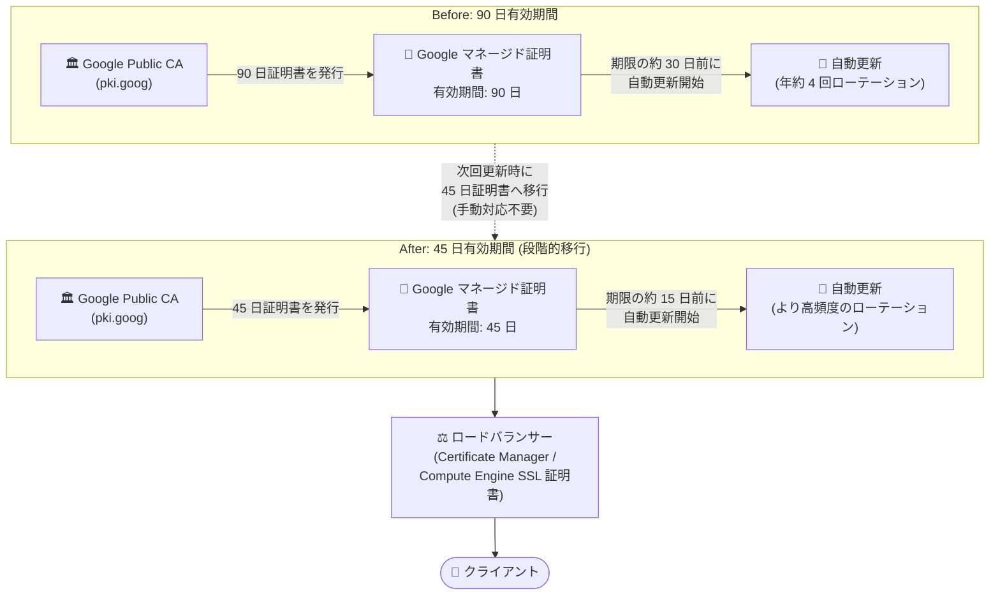

# Certificate Manager / Cloud Load Balancing: Google マネージド公開 SSL 証明書の有効期間が 90 日から 45 日に段階的に移行

**リリース日**: 2026-10-14

**サービス**: Certificate Manager / Cloud Load Balancing (Compute Engine SSL 証明書)

**機能**: Google Public CA (pki.goog) 発行の Google マネージド公開 SSL 証明書の有効期間短縮 (90 日 → 45 日)

**ステータス**: Change (段階的移行)

📊 [このアップデートのインフォグラフィックを見る](https://takech9203.github.io/google-cloud-news-summary/20261014-google-managed-ssl-45-day-validity.html)

## 概要

Google Public CA (pki.goog) が署名する Google マネージド公開 SSL 証明書の有効期間が、従来の 90 日から 45 日へ段階的に移行されることが発表されました。この変更は、証明書のライフスパンを短縮するという業界全体のモダンなセキュリティ標準に合わせたもので、証明書のローテーション頻度を高めることでロードバランサー全体のセキュリティ態勢を強化します。

この変更は Certificate Manager と Compute Engine SSL 証明書 (Cloud Load Balancing で使用) の両方に適用されるクロスサービスの変更です。発行と更新は Google Cloud が自動的に管理するため、ユーザー側での手動対応や設定変更は一切不要です。既存の 90 日証明書は、次回の更新までは 90 日間の有効期間のまま有効です。

対象ユーザーは、グローバル外部アプリケーション ロードバランサー、クラシック アプリケーション ロードバランサー、外部プロキシ ネットワーク ロードバランサーなどで Google マネージド証明書を利用しているすべてのユーザーです。なお、Let's Encrypt CA (letsencrypt.org) が発行する証明書は引き続き 90 日の有効期間です。

**アップデート前の課題**

- Google Public CA 発行の Google マネージド証明書は一律 90 日の有効期間であり、証明書の秘密鍵が長期間使い回されるリスク (漏えい時の影響期間) が相対的に大きかった
- 証明書ライフスパン短縮という業界全体の潮流 (CA/Browser Forum などが推進する短命証明書化) に対して、有効期間が長いままだった

**アップデート後の改善**

- Google Public CA 発行の証明書が 45 日有効期間となり、より頻繁にローテーションされることで、鍵漏えい時の影響期間が短縮され、セキュリティ態勢が向上した
- 新しい有効期間への移行は Google Cloud が発行・更新を完全自動で管理するため、ユーザー側の手動対応や設定変更が不要
- Certificate Manager と Compute Engine SSL 証明書の両方で一貫して適用され、サービス間で管理方法を変える必要がない

## アーキテクチャ図



Google Public CA 発行の証明書が次回更新のタイミングで 90 日から 45 日の有効期間に切り替わり、更新開始タイミングも期限の約 30 日前から約 15 日前に変わります。ローテーション頻度が上がることでセキュリティが向上し、移行はすべて自動で行われます。

## サービスアップデートの詳細

### 主要機能

1. **有効期間の 45 日への短縮 (段階的移行)**
   - Google Public CA (pki.goog) 発行の Google マネージド公開 SSL 証明書が、90 日から 45 日の有効期間へ段階的に移行
   - 既存の 90 日証明書は次回の更新までそのまま有効 (強制的な即時失効はなし)
   - 公開 Google マネージド証明書のデフォルト有効期間はユーザー側で変更不可

2. **完全自動の発行・更新 (手動対応不要)**
   - Certificate Manager と Compute Engine SSL 証明書の両方で、発行・更新を Google Cloud が自動管理
   - 移行に伴うユーザー側の設定変更・手動介入は一切不要
   - 更新プロセスは有効期間の約 3 分の 1 が残った時点で自動開始 (45 日証明書は期限の約 15 日前、90 日証明書は約 30 日前)

3. **発行 CA ごとの有効期間の違い**
   - Google Public CA (pki.goog): 90 日 → 45 日へ段階的移行
   - Let's Encrypt CA (letsencrypt.org): 90 日のまま変更なし
   - Media CDN の EDGE_CACHE スコープ: 従来どおり 30 日

## 技術仕様

### 有効期間と更新タイミング

| 項目 | 変更前 | 変更後 |
|------|--------|--------|
| Google Public CA (pki.goog) 発行証明書の有効期間 | 90 日 | 45 日 (段階的移行) |
| Google Public CA 発行証明書の自動更新開始 | 期限の約 30 日前 | 期限の約 15 日前 |
| Let's Encrypt CA (letsencrypt.org) 発行証明書の有効期間 | 90 日 | 90 日 (変更なし) |
| 既存の 90 日証明書 | - | 次回更新まで 90 日間有効 |
| ユーザー側の対応 | - | 不要 (自動管理) |
| 有効期間のカスタマイズ | 不可 | 不可 |

### 更新時の CA 選択

- 更新時には、ドメインの CAA (Certification Authority Authorization) DNS レコードに含まれ、かつ Google Cloud がサポートする CA の中から選択される
- 更新に使用される CA は、以前のバージョンの証明書を発行した CA と異なる場合がある
- CAA レコードを設定しない場合、デフォルトでは pki.goog と letsencrypt.org の両方が許可される

```
# CAA レコードの例 (両方の CA を許可する推奨構成)
DOMAIN. CAA 0 issue "pki.goog"
DOMAIN. CAA 0 issue "letsencrypt.org"
```

## デメリット・制約事項

### 制限事項

- 公開 Google マネージド証明書のデフォルト有効期間はユーザー側で変更できない (90 日のまま維持することは不可)
- Let's Encrypt CA 発行の証明書は本変更の対象外 (90 日のまま)

### 考慮すべき点

- **DNS 構成の正確性がより重要に**: 更新頻度が約 2 倍になるため、更新時のドメイン検証 (MPIC: Multi-Perspective Issuance Corroboration) が失敗する構成 (A/AAAA レコードにロードバランサー以外の IP が含まれる、GeoDNS によるリージョンごとの異なる応答、CDN 経由の間接アクセスなど) を放置していると、証明書の期限切れに遭遇する機会が増える
- **証明書ピンニングの再確認**: 証明書やその公開鍵をクライアント側でピンニングしている場合、更新のたびに新しい秘密鍵が生成されるため、ローテーション頻度の増加の影響を受けやすくなる (Google マネージド証明書では従来からピンニングは非推奨)
- **監視の見直し**: 証明書の有効期限を監視している場合、45 日サイクルを前提としたアラートしきい値への見直しを推奨

## 料金

本変更による料金への影響に関する発表はありません。Certificate Manager および Compute Engine SSL 証明書の料金詳細は料金ページを参照してください。

- [Certificate Manager の料金](https://cloud.google.com/certificate-manager/pricing)

## 関連サービス・機能

- **Certificate Manager**: Google マネージド証明書の発行・更新・デプロイを一元管理。本変更の対象サービスの 1 つ
- **Cloud Load Balancing / Compute Engine SSL 証明書**: ロードバランサーのフロントエンドで使用する Google マネージド証明書も本変更の対象
- **Google Public CA (pki.goog)**: 本変更で有効期間が 45 日に短縮される証明書の発行元 CA
- **Cloud DNS**: CAA レコードや A/AAAA レコードの管理。更新時のドメイン検証を確実に成功させるために正確な設定が重要
- **Media CDN**: EDGE_CACHE スコープの証明書は従来から 30 日の有効期間で、本変更とは別枠

## 参考リンク

- 📊 [インフォグラフィック](https://takech9203.github.io/google-cloud-news-summary/20261014-google-managed-ssl-45-day-validity.html)
- [公式リリースノート](https://docs.cloud.google.com/release-notes#October_14_2026)
- [Google-managed certificates (Certificate Manager)](https://docs.cloud.google.com/certificate-manager/docs/core-components#google-managed-certificates)
- [Use Google-managed certificates (ベストプラクティス)](https://docs.cloud.google.com/certificate-manager/docs/certificate-manager-best-practices#use_google_managed_certificates)
- [Renew a Google-managed SSL certificate (Cloud Load Balancing)](https://docs.cloud.google.com/load-balancing/docs/ssl-certificates/google-managed-certs#renewal)
- [Google Public CA](https://docs.cloud.google.com/certificate-manager/docs/public-ca)
- [料金ページ (Certificate Manager)](https://cloud.google.com/certificate-manager/pricing)

## まとめ

Google Public CA 発行の Google マネージド公開 SSL 証明書が 90 日から 45 日の有効期間へ段階的に移行し、より頻繁なローテーションによってロードバランサーのセキュリティ態勢が強化されます。移行は完全自動で手動対応は不要ですが、更新頻度の増加に備えて、DNS の A/AAAA レコードや CAA レコードがドメイン検証に失敗しない構成になっているかをこの機会に点検することを推奨します。

---

**タグ**: #CertificateManager #CloudLoadBalancing #SSL #TLS #GooglePublicCA #セキュリティ #証明書管理
