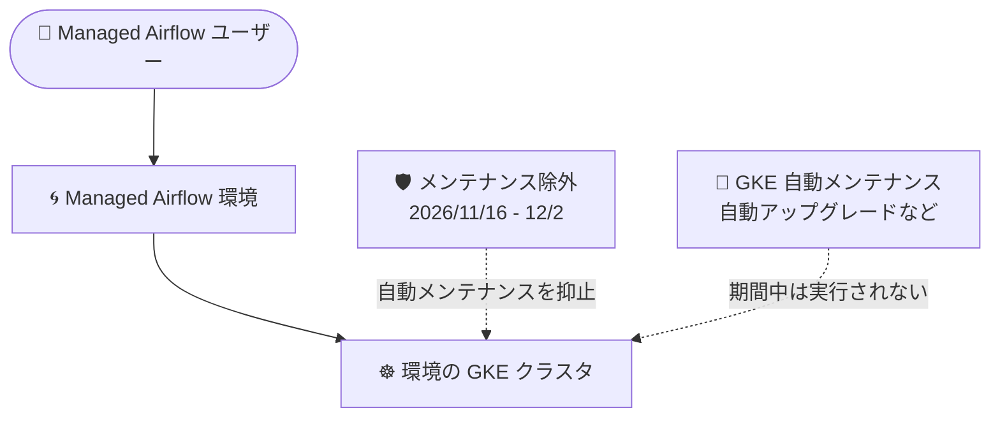

# Managed Service for Apache Airflow: GKE クラスタのメンテナンス除外期間の設定 (2026 年 11 月 16 日〜12 月 2 日)

**リリース日**: 2026-10-14

**サービス**: Managed Service for Apache Airflow (旧 Cloud Composer)

**機能**: 環境の GKE クラスタに対するメンテナンス除外期間の設定

**ステータス**: 発表 (Announcement)

📊 [このアップデートのインフォグラフィックを見る](https://takech9203.github.io/google-cloud-news-summary/20261014-managed-airflow-maintenance-exclusions.html)

## 概要

Google Cloud は、すべての Managed Service for Apache Airflow (Managed Airflow) 環境の GKE クラスタに対して、**2026 年 11 月 16 日から 2026 年 12 月 2 日まで**のメンテナンス除外期間 (Maintenance Exclusion) を設定することを発表しました。

メンテナンス除外は GKE の機能で、指定した期間中に GKE クラスタの自動メンテナンス (ノードやコントロールプレーンの自動アップグレードなど) が実行されないようにするものです。Managed Airflow 環境は内部的に GKE クラスタ上で動作しているため、この設定により、対象期間中は環境を支える GKE クラスタへの自動メンテナンスが抑止されます。

Managed Airflow (Cloud Composer) では、年末商戦や休暇シーズンなどワークロードが安定稼働すべき時期に合わせて、同様のメンテナンス除外期間が定期的に設定されてきました (例: 2025 年 11 月 8 日〜12 月 2 日、2025 年 12 月 4 日〜2026 年 1 月 2 日)。今回の発表はその 2026 年版にあたる運用アナウンスです。

**ポイント**

- 対象: **すべての** Managed Airflow 環境の GKE クラスタ
- 期間: 2026 年 11 月 16 日〜2026 年 12 月 2 日
- 期間中は GKE クラスタの自動メンテナンスが実行されず、メンテナンス起因の中断リスクが低減される
- ユーザー側での設定作業は不要 (Google Cloud 側で自動的に設定される)

## アーキテクチャ図

Managed Airflow 環境を支える GKE クラスタにメンテナンス除外が設定され、期間中は自動メンテナンス (アップグレードなど) が実行されません。

## サービスアップデートの詳細

### 発表内容

1. **メンテナンス除外の自動設定**
   - すべての Managed Airflow 環境の GKE クラスタに、2026 年 11 月 16 日〜12 月 2 日のメンテナンス除外が設定される
   - ユーザーによる操作は不要で、Google Cloud 側で一律に適用される

2. **メンテナンス除外 (Maintenance Exclusion) とは**
   - GKE で特定の期間に自動メンテナンスを実行させないようにする仕組み
   - 詳細は GKE の [メンテナンス ウィンドウとメンテナンス除外](https://cloud.google.com/kubernetes-engine/docs/concepts/maintenance-windows-and-exclusions#exclusions) を参照

## 運用上の考慮点

- 期間中は GKE クラスタの自動メンテナンスが行われないため、クラスタのアップグレードなどは除外期間終了後に実施される
- 除外期間終了後 (2026 年 12 月 2 日以降) に保留されていたメンテナンスが実施される可能性があるため、年末年始の運用計画に織り込んでおくとよい
- 環境自体の変更 (イメージ/ビルドのアップグレードや DAG のデプロイなど、ユーザーが行う操作) が制限されるものではない

## 利用可能リージョン

すべての Managed Airflow 環境が対象です (リージョンの限定なし)。

## 関連サービス・機能

- **Google Kubernetes Engine (GKE)**: Managed Airflow 環境の実行基盤。メンテナンス除外は GKE の機能として適用される
- **Cloud Composer (Gen 2 / Gen 3)**: Managed Service for Apache Airflow の旧称。リリースノートは共通で提供されている

## 参考リンク

- 📊 [インフォグラフィック](https://takech9203.github.io/google-cloud-news-summary/20261014-managed-airflow-maintenance-exclusions.html)
- [公式リリースノート](https://docs.cloud.google.com/release-notes#October_14_2026)
- [Managed Airflow (Cloud Composer) リリースノート](https://docs.cloud.google.com/composer/docs/release-notes)
- [GKE メンテナンス ウィンドウとメンテナンス除外](https://cloud.google.com/kubernetes-engine/docs/concepts/maintenance-windows-and-exclusions#exclusions)

## まとめ

2026 年 11 月 16 日から 12 月 2 日まで、すべての Managed Airflow 環境の GKE クラスタで自動メンテナンスが抑止されます。ユーザー側の対応は不要ですが、除外期間終了後にメンテナンスが再開されることを踏まえ、年末のクラスタアップグレードや環境運用のスケジュールを確認しておくことを推奨します。

---

**タグ**: #ManagedAirflow #CloudComposer #GKE #MaintenanceExclusion #運用
