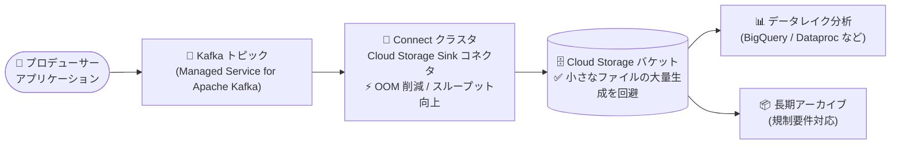

# Google Cloud Managed Service for Apache Kafka: Cloud Storage Sink コネクタのパフォーマンス改善

**リリース日**: 2026-10-14

**サービス**: Google Cloud Managed Service for Apache Kafka

**機能**: Cloud Storage Sink コネクタのパフォーマンス改善

**ステータス**: Feature (機能改善)

📊 [このアップデートのインフォグラフィックを見る](https://takech9203.github.io/google-cloud-news-summary/20261014-managed-kafka-gcs-sink-performance.html)

## 概要

Google Cloud Managed Service for Apache Kafka の Kafka Connect で提供されている **Cloud Storage Sink コネクタ** のパフォーマンスが改善されました。今回の改善には、Out of Memory (OOM) エラーの削減、最大スループットの向上、そして大量の小さなファイルの生成の回避が含まれます。

Cloud Storage Sink コネクタは、Kafka トピックのデータを Cloud Storage バケットにストリーミングするコネクタで、データレイクへの取り込みや規制要件を満たすためのデータアーカイブなどに利用されます。今回の改善により、大量データを Cloud Storage に流し込むパイプラインの安定性と効率が向上し、追加の設定変更やコード修正なしでメリットを享受できます。

Kafka から Cloud Storage へのデータ連携を運用しているデータエンジニアや、データレイク / ロングターム アーカイブ基盤を設計する Solutions Architect にとって注目のアップデートです。

**アップデート前の課題**

- 高負荷時にコネクタタスクで Out of Memory (OOM) エラーが発生することがあった
- コネクタの最大スループットに制約があり、大量データのストリーミングでボトルネックになり得た
- 大量の小さなファイルが Cloud Storage に生成されることがあり、後続のバッチ処理や分析クエリの効率低下につながっていた

**アップデート後の改善**

- OOM エラーが削減され、コネクタタスクの安定性が向上した
- 最大スループットが向上し、より大規模なデータストリーミングに対応できるようになった
- 大量の小さなファイルの生成を回避するようになり、Cloud Storage 上のオブジェクト構成が効率化された

## アーキテクチャ図



Kafka トピックから Cloud Storage Sink コネクタを経由して Cloud Storage バケットへデータが流れるパイプラインです。今回の改善はコネクタ部分 (OOM 削減・スループット向上) と出力ファイル構成 (小さなファイルの回避) に効いています。

## サービスアップデートの詳細

### 主要機能

1. **Out of Memory (OOM) エラーの削減**
   - コネクタタスクで発生していた OOM エラーが削減された
   - タスクの異常終了・再起動が減ることで、パイプラインの安定稼働につながる

2. **最大スループットの向上**
   - コネクタが処理できる最大スループットが向上した
   - 高トラフィックな Kafka トピックからのデータ取り込みでボトルネックが緩和される

3. **大量の小さなファイル生成の回避**
   - Cloud Storage に大量の小さなファイルが作成される事象を回避するようになった
   - オブジェクト数の削減は、後続の分析処理 (ファイルスキャン) やオブジェクト管理の効率化に寄与する

## 技術仕様

### Cloud Storage Sink コネクタの概要

| 項目 | 詳細 |
|------|------|
| コネクタクラス | `io.aiven.kafka.connect.gcs.GcsSinkConnector` |
| 出力形式 | CSV、JSON (`json` / `jsonl`)、Parquet |
| 出力フィールド | `key`、`value`、`headers`、`timestamp` (`format.output.fields` で指定) |
| 認証 | Managed Kafka サービスアカウント (`gcs.credentials.default: true`) |
| 必要な IAM ロール (作成者) | Managed Kafka Connector Editor (`roles/managedkafka.connectorEditor`) |
| 必要な IAM ロール (サービスアカウント) | Storage Object User (`roles/storage.objectUser`) |

### 設定ファイルの例

```yaml
connector.class: "io.aiven.kafka.connect.gcs.GcsSinkConnector"
gcs.bucket.name: "BUCKET_NAME"
gcs.credentials.default: "true"
format.output.type: "json"
key.converter: "org.apache.kafka.connect.storage.StringConverter"
value.converter: "org.apache.kafka.connect.json.JsonConverter"
value.converter.schemas.enable: "false"
topics: "TOPIC_LIST"
tasks.max: "3"
```

## 設定方法

### 前提条件

1. Managed Service for Apache Kafka クラスタ (ソースクラスタ) を作成済みであること
2. コネクタをホストする Connect クラスタを作成済みであること
3. データの書き込み先となる Cloud Storage バケットを作成済みであること
4. ソースクラスタ内に Kafka トピックを作成・構成済みであること
5. Managed Kafka サービスアカウント (`service-PROJECT_NUMBER@gcp-sa-managedkafka.iam.gserviceaccount.com`) にバケットへの `roles/storage.objectUser` を付与していること

### 手順

#### ステップ 1: コネクタ設定ファイルを作成

```bash
cat <<EOF > gcs-sink-config.yaml
connector.class: "io.aiven.kafka.connect.gcs.GcsSinkConnector"
gcs.bucket.name: "my-data-lake-bucket"
gcs.credentials.default: "true"
format.output.type: "jsonl"
key.converter: "org.apache.kafka.connect.storage.StringConverter"
value.converter: "org.apache.kafka.connect.json.JsonConverter"
value.converter.schemas.enable: "false"
topics: "my-topic"
tasks.max: "3"
EOF
```

出力形式 (`format.output.type`) は `csv` / `json` / `jsonl` / `parquet` から選択できます。

#### ステップ 2: コネクタを作成

```bash
gcloud managed-kafka connectors create my-gcs-sink-connector \
  --location=us-central1 \
  --connect-cluster=my-connect-cluster \
  --config-file=gcs-sink-config.yaml
```

コネクタは Google Cloud コンソール、Terraform (`google_managed_kafka_connector`)、クライアントライブラリ (Java / Python / Go) からも作成できます。既存のコネクタはパフォーマンス改善をマネージドサービス側で自動的に享受します。

## メリット

### ビジネス面

- **運用コストの削減**: OOM エラーによるタスク再起動・障害対応の工数が減り、パイプラインの運用負荷が下がる
- **データレイク活用の促進**: 小さなファイルの大量生成が回避されることで、Cloud Storage 上のデータが後続の分析に適した形で蓄積される

### 技術面

- **安定性の向上**: メモリ起因の障害が減り、大量データのストリーミングでも安定稼働しやすくなる
- **スループットの向上**: コネクタあたりの最大処理能力が上がり、高トラフィックなトピックにも対応しやすくなる
- **オブジェクト効率の改善**: ファイル数が抑制されることで、ファイルリスティングやスキャンのオーバーヘッドが減少する

## デメリット・制約事項

### 考慮すべき点

- 本改善はマネージドサービス側で提供されるものであり、改善の内部実装や具体的な性能数値 (スループットの向上率など) は公表されていない
- 実際の性能はトピックのパーティション数、`tasks.max`、出力形式、レコードサイズなどの構成に依存するため、本番相当のワークロードでの検証を推奨

## ユースケース

### ユースケース 1: データレイクへの取り込み

**シナリオ**: アプリケーションのイベントストリームを Kafka で受け、長期保存とバッチ分析のために Cloud Storage のデータレイクに蓄積する。

**効果**: スループット向上により高トラフィックでも遅延なく取り込みができ、小さなファイルの回避により BigQuery や Dataproc からの読み取り効率が向上する。

### ユースケース 2: 規制要件のためのデータアーカイブ

**シナリオ**: 金融・医療などの規制業界で、Kafka 上のメッセージを監査・コンプライアンス要件のために Cloud Storage へアーカイブする。

**効果**: OOM エラーの削減によりアーカイブパイプラインの欠損リスクが低減し、安定した長期アーカイブ運用が可能になる。

## 料金

今回のパフォーマンス改善自体に追加料金はありません。Managed Service for Apache Kafka は、クラスタ (vCPU・RAM を抽象化した DCU 単位のコンピュート、ストレージ、ネットワーキング) に対して課金され、Connect クラスタのリソースも同様に課金対象です。コンピュート利用には 1 年 (20% 割引) / 3 年 (40% 割引) の確約利用割引 (CUD) も利用できます。

詳細は [Managed Service for Apache Kafka の料金ページ](https://cloud.google.com/managed-service-for-apache-kafka/pricing) を参照してください。

## 関連サービス・機能

- **Cloud Storage**: コネクタの書き込み先。データレイクやアーカイブのストレージとして機能する
- **BigQuery**: Kafka Connect には BigQuery Sink コネクタもあり、Cloud Storage 経由または直接の分析パイプラインを構成できる
- **Cloud Monitoring / Cloud Logging**: コネクタと Connect クラスタのメトリクス・ログの監視に使用し、スループットやエラーの状況を可視化できる
- **Pub/Sub**: Kafka Connect でソース / シンクとして連携可能なメッセージングサービス

## 参考リンク

- 📊 [インフォグラフィック](https://takech9203.github.io/google-cloud-news-summary/20261014-managed-kafka-gcs-sink-performance.html)
- [公式リリースノート](https://docs.cloud.google.com/release-notes#October_14_2026)
- [Cloud Storage Sink コネクタの作成 (公式ドキュメント)](https://docs.cloud.google.com/managed-service-for-apache-kafka/docs/connect-cluster/create-cloud-storage-connector)
- [Managed Service for Apache Kafka 概要](https://docs.cloud.google.com/managed-service-for-apache-kafka/docs/overview)
- [料金ページ](https://cloud.google.com/managed-service-for-apache-kafka/pricing)

## まとめ

Cloud Storage Sink コネクタの OOM エラー削減・スループット向上・小さなファイル生成の回避は、Kafka から Cloud Storage へのデータパイプラインの安定性と効率を底上げするアップデートです。既存のコネクタ利用者は追加設定なしで恩恵を受けられるため、これまでメモリ不足や小さなファイルの大量発生に悩まされていた場合は、現行構成のまま性能を再評価することをおすすめします。

---

**タグ**: #ManagedKafka #ApacheKafka #KafkaConnect #CloudStorage #DataPipeline #Performance
