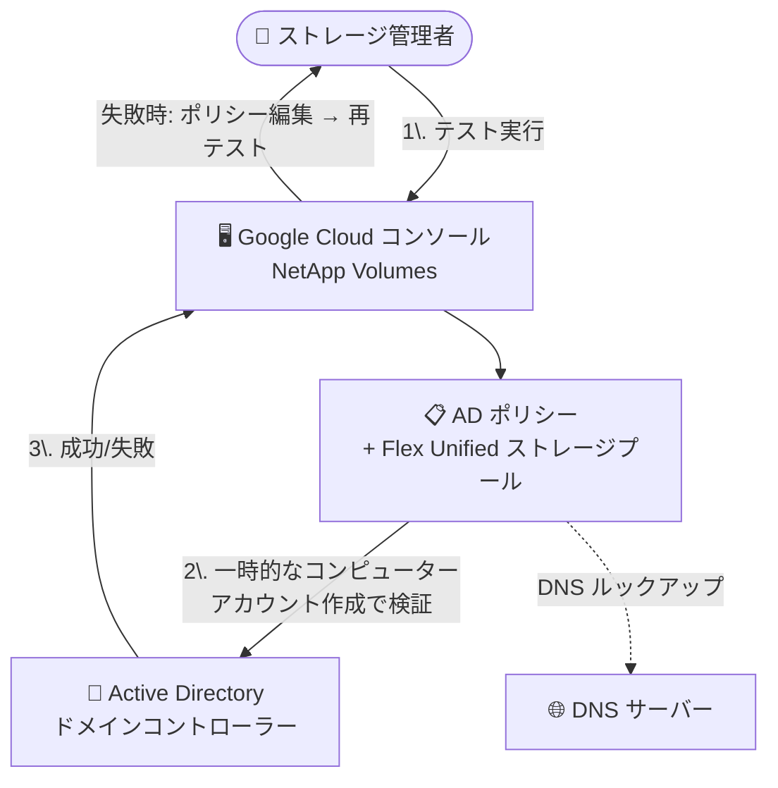

# Google Cloud NetApp Volumes: Flex Unified サービスレベルでの Active Directory ポリシー接続テスト (Preview)

**リリース日**: 2026-10-14

**サービス**: Google Cloud NetApp Volumes

**機能**: Flex Unified サービスレベルでの Active Directory ポリシー接続テスト

**ステータス**: Preview

📊 [このアップデートのインフォグラフィックを見る](https://takech9203.github.io/google-cloud-news-summary/20261014-netapp-volumes-ad-policy-connection-test.html)

## 概要

Google Cloud NetApp Volumes で、**Flex Unified サービスレベル**のストレージプールに関連付けた Active Directory (AD) ポリシーの接続テストが Preview として利用可能になりました。Google Cloud コンソールから、AD ポリシーが Active Directory サービスに正しく接続されているかを検証し、構成エラーのトラブルシューティングを行えます。

従来、この接続テスト機能は Standard、Premium、Extreme の各サービスレベルで提供されていましたが、今回のアップデートにより Flex Unified サービスレベルでも利用できるようになりました (Flex File サービスレベルは引き続き非対応で、SMB ボリュームの作成によって接続を検証します)。

AD 連携は SMB ボリュームや Kerberos 認証付き NFS ボリュームの作成に必須の構成要素であり、DNS・ドメインコントローラー・権限などの設定ミスはボリューム作成失敗の原因になります。ボリューム作成前に接続を検証できることで、ストレージ管理者の構成確認作業が大幅に効率化されます。

**アップデート前の課題**

- Flex Unified サービスレベルでは AD ポリシーの接続テスト機能が提供されておらず、設定の正しさを事前に検証する手段がなかった
- AD ポリシーの設定ミス (DNS IP アドレスの誤り、ドメインコントローラーへの到達不可、権限不足など) は、実際にボリュームを作成するまで発覚しないことがあった

**アップデート後の改善**

- Flex Unified サービスレベルでも、Google Cloud コンソールから AD ポリシーの接続テストを実行できるようになった (Preview)
- ボリューム作成前に DNS 設定、ドメインコントローラーの到達性、管理ユーザー権限、組織単位 (OU) 設定などの構成エラーを特定し、修正できるようになった

## アーキテクチャ図

管理者はコンソールから AD ポリシーの接続テストを実行し、ドメインへの一時的なコンピューターアカウント作成によってドメイン参加が検証されます。失敗時はポリシーを編集して再テストできます。

## サービスアップデートの詳細

### 主要機能

1. **コンソールからの接続テスト (Flex Unified で Preview)**
   - NetApp Volumes の「Active Directory policies」画面から、ポリシーに関連付けられたストレージプールごとに「Test Active Directory Connection」を実行できる
   - テストは一度に 1 つのポリシーに対してのみ実行可能
   - テストは任意だが、トラブルシューティングのために推奨される

2. **検出できる構成エラー**
   - DNS IP アドレスの誤り、または DNS サーバーに到達できない
   - ドメインコントローラーのルックアップ失敗、またはサイト設定の誤り
   - ドメインコントローラーに到達できない
   - Active Directory 管理ユーザーの権限不足
   - マシンアカウント用の組織単位 (OU) の指定誤り

3. **一時的なコンピューターアカウントによる検証**
   - テストはドメイン内に一時的なコンピューターアカウントを作成することでドメイン参加を検証する
   - ドメイン参加ユーザーに削除権限がある場合、テスト後に一時アカウントは即座に削除される
   - 削除権限がない場合は一時アカウントが残るため、ドメイン管理者による手動削除が必要

## 技術仕様

### サービスレベル別の対応状況

| サービスレベル | AD ポリシー接続テスト |
|------|------|
| Standard / Premium / Extreme | 対応 (GA) |
| Flex Unified | **対応 (Preview)** ← 今回のアップデート |
| Flex File | 非対応 (SMB ボリューム作成で検証) |

### 留意点

- テストはあくまで実行時点での接続を検証するもの。ドメインコントローラーやネットワーク構成は NetApp Volumes の管理外のため、DNS サーバーの廃止、ネットワークやファイアウォール設定の変更などにより、後から接続が失われる可能性がある
- Flex Unified の ONTAP モードでは、SMB アクセス設定後に ONTAP の「discovered servers」情報を確認する

## 設定方法

### 前提条件

1. AD ポリシーのパラメータが正しく入力されていること
2. AD ポリシーが Flex Unified (または Standard、Premium、Extreme) サービスレベルのストレージプールに関連付けられていること

### 手順

1. Google Cloud コンソールで「NetApp Volumes」ページに移動する
2. 「Active Directory policies」を選択し、テストしたいポリシー名をクリックする
3. ポリシーにストレージプールが関連付けられていない場合は「Associated storage pools」セクションで「Assign」をクリックしてプールを割り当てる
4. 「Associated storage pools」リストで、対象プールの「Test Active Directory Connection」をクリックする
5. テストが失敗した場合は「Edit Active Directory Policy」から設定を修正して再テストする。成功した場合は、他の関連付けられたストレージプールについても接続テストを続けることが推奨される

## メリット

### ビジネス面

- **デプロイの手戻り削減**: ボリューム作成前に AD 構成の問題を発見できるため、本番展開時のトラブルを未然に防げる
- **トラブルシューティング時間の短縮**: 失敗原因 (DNS、権限、OU など) を切り分けやすくなり、運用負荷を軽減できる

### 技術面

- **ボリューム作成前の事前検証**: Flex Unified ではドメイン参加は AD を必要とする最初のボリューム作成時に行われるため、事前テストにより作成失敗を回避できる
- **コンソール完結の操作**: 追加ツール不要で、Google Cloud コンソールから接続検証を実行できる

## デメリット・制約事項

### 制限事項

- Flex Unified サービスレベルでは Preview 段階の機能
- Flex File サービスレベルでは利用不可 (SMB ボリュームを作成して接続を検証する)
- 一度にテストできるポリシーは 1 つのみ

### 考慮すべき点

- テストは実行時点のスナップショットにすぎず、その後のインフラ変更による接続喪失は検知できない
- ドメイン参加ユーザーにコンピューターアカウントの削除権限がない場合、テストで作成された一時アカウントが AD に残留する

## ユースケース

### ユースケース 1: Flex Unified プールでの SMB ボリューム展開前の事前検証

**シナリオ**: Flex Unified ストレージプールに AD ポリシーを関連付けて SMB ボリュームを展開する前に、DNS 設定やドメイン参加ユーザーの権限が正しいかを確認したい。

**効果**: ボリューム作成失敗を未然に防ぎ、展開作業をスムーズに進められる。

### ユースケース 2: AD 構成エラーのトラブルシューティング

**シナリオ**: ボリューム作成が AD 関連のエラーで失敗した際、原因が DNS なのか、ドメインコントローラーへの到達性なのか、OU 指定の誤りなのかを切り分けたい。

**効果**: コンソールからの接続テストで原因を特定し、ポリシー編集 → 再テストのサイクルで迅速に修正できる。

## 料金

接続テスト機能自体に関する追加料金の記載はありません。NetApp Volumes の料金詳細は[料金ページ](https://cloud.google.com/netapp/volumes/pricing)を参照してください。

## 関連サービス・機能

- **Managed Service for Microsoft Active Directory**: NetApp Volumes は Managed Microsoft AD と連携可能 (ドメインピアリングが必要)。Flex Unified では DNS サーバー IP に 169.254.169.254 を使用する
- **Cloud DNS**: Windows ドメインの DNS リクエストを AD の DNS サーバーに転送するプライベート転送ゾーンの構成に使用
- **SMB / NFS (Kerberos) ボリューム**: AD ポリシーは SMB 認証、NFSv3 拡張グループ、NFSv4.x の Kerberos 認証・セキュリティプリンシパルのマッピングに使用される

## 参考リンク

- 📊 [インフォグラフィック](https://takech9203.github.io/google-cloud-news-summary/20261014-netapp-volumes-ad-policy-connection-test.html)
- [公式リリースノート](https://docs.cloud.google.com/release-notes#October_14_2026)
- [Test the Active Directory policy connection](https://docs.cloud.google.com/netapp/volumes/docs/configure-and-use/active-directory/test-ad-policy-connection)
- [Google Cloud NetApp Volumes Active Directory integration](https://docs.cloud.google.com/netapp/volumes/docs/configure-and-use/active-directory/about-ad)
- [Create an Active Directory policy](https://docs.cloud.google.com/netapp/volumes/docs/configure-and-use/active-directory/create-ad-policy)
- [料金ページ](https://cloud.google.com/netapp/volumes/pricing)

## まとめ

Flex Unified サービスレベルでも AD ポリシーの接続テストが可能になり、SMB / Kerberos NFS ボリューム展開前に構成エラーを事前検出できるようになりました。Flex Unified で AD 連携ボリュームを運用・計画しているチームは、ボリューム作成前に本機能で接続検証を行うワークフローの採用を推奨します。

---

**タグ**: NetApp Volumes, Active Directory, Flex Unified, SMB, ストレージ, Preview
