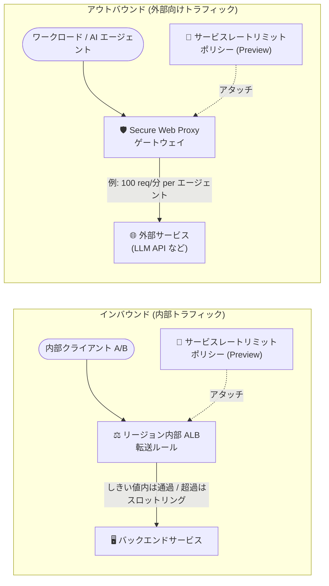

# Cloud Load Balancing / Cloud Armor / Secure Web Proxy: サービスレートリミットポリシー (Preview)

**リリース日**: 2026-10-14

**サービス**: Cloud Load Balancing / Google Cloud Armor / Secure Web Proxy

**機能**: サービスレートリミットポリシー (Service rate limiting policies)

**ステータス**: Preview

📊 [このアップデートのインフォグラフィックを見る](https://takech9203.github.io/google-cloud-news-summary/20261014-service-rate-limiting-preview.html)

## 概要

Google Cloud は、**サービスレートリミットポリシー (Service rate limiting policies)** を Preview として発表しました。本機能は、リージョン内部アプリケーションロードバランサ (regional internal Application Load Balancer) と Secure Web Proxy の 2 つのターゲットで利用でき、Cloud Armor もサービスレートリミットをサポートします。信頼できるクライアントが過剰なリソースを消費する状況でも、サービスの可用性を維持することを目的とした、複数サービスにまたがる新しいレート制御の仕組みです。

従来の Cloud Armor のレートリミット (rate-based rules) が「ネットワークエッジで信頼できないクライアントによる DDoS 攻撃を防ぐ」ことを主眼としていたのに対し、サービスレートリミットは「内部アプリケーションロードバランサや Secure Web Proxy 上で、信頼できるが行儀の悪い (misbehaving) クライアントを管理し、重要なトラフィックの可用性を最大化する」ための仕組みです。過負荷時に重要なクライアントトラフィックを優先し、事前定義したしきい値を超えたクライアントをスロットリングします。

対象ユーザーは、マイクロサービス間の内部通信で特定クライアントによるリソース枯渇を防ぎたいプラットフォームチームや、Secure Web Proxy 経由のアウトバウンド通信 (LLM API 呼び出しなど) のコストと流量を制御したいセキュリティ・ネットワーク管理者です。

**アップデート前の課題**

- Cloud Armor のレートリミットは外部向けロードバランサのエッジでの不正クライアント対策が中心で、内部アプリケーションロードバランサを通る「信頼できる内部クライアント」同士の公平なリソース配分を制御する仕組みがなかった
- Secure Web Proxy では、アウトバウンド Web トラフィックに対してクライアント別・サービス全体のレート制限を適用する手段がなく、特定のワークロードが外部サービス (LLM プロバイダなど) への呼び出しを大量に行い、コスト増や外部先の過負荷を招くリスクがあった
- サービス過負荷時に、重要なクライアントのトラフィックを優先しつつ過剰消費クライアントのみを抑制する、サービスレベルの優先制御が利用できなかった

**アップデート後の改善**

- リージョン内部アプリケーションロードバランサの転送ルール (forwarding rule) にサービスレートリミットポリシーをアタッチし、しきい値を超えたクライアントをスロットリングして重要トラフィックを優先できるようになった
- Secure Web Proxy のゲートウェイにポリシーをアタッチし、アウトバウンド Web トラフィックの過負荷防止とコスト管理 (例: LLM トークンコスト) が可能になった。認可ポリシー (authorization policy) とゲートウェイセキュリティポリシー (gateway security policy) のどちらを使うゲートウェイでも利用できる
- Cloud Armor セキュリティポリシー (不正クライアントの明示的な遮断) と組み合わせることで、「エッジでの不正クライアント対策」と「サービスレベルでの信頼クライアント管理」の多層的なレート制御を実現できるようになった
- mTLS のクライアント証明書 Common Name や送信元 IP アドレスなどのクライアント識別子単位で、リクエスト数ベースのレート制限を設定できるようになった

## アーキテクチャ図



サービスレートリミットポリシーは、リージョン内部アプリケーションロードバランサの転送ルールまたは Secure Web Proxy ゲートウェイにアタッチします。しきい値を超えたクライアントのリクエストはスロットリングされ、重要なトラフィックの可用性が維持されます。

## サービスアップデートの詳細

### 主要機能

1. **リージョン内部アプリケーションロードバランサでのサービスレートリミット (Preview)**
   - サービスレートリミットポリシーを転送ルールにアタッチし、過剰にリソースを消費する信頼済みクライアントをスロットリング
   - サービス過負荷時に重要なクライアントトラフィックを優先し、サービス可用性を維持
   - リクエストに適用されるフィルタの 1 種として、他のフィルタと所定の順序で評価される

2. **Secure Web Proxy でのサービスレートリミット (Preview)**
   - アウトバウンド Web トラフィックにクライアント別・サービス全体のレート制限を適用し、外部宛先の過負荷防止とコスト管理を実現
   - 認可ポリシー、ゲートウェイセキュリティポリシーのいずれを使用するゲートウェイにもアタッチ可能
   - mTLS プリンシパル (クライアント証明書 Common Name) や送信元 IP アドレスなどのクライアント識別子に基づく、リクエスト/分単位の制限を設定可能

3. **Cloud Armor によるサービスレートリミットのサポート (Preview)**
   - Cloud Armor レートリミット (エッジでの DDoS・不正クライアント対策) とサービスレートリミット (信頼クライアントの管理) を使い分け・併用可能
   - Cloud Armor セキュリティポリシーで不正クライアントを明示的に遮断しつつ、サービスレートリミットで信頼クライアントの過剰消費を抑制する多層防御を構成できる

## 技術仕様

### サービスレートリミットポリシーの上限 (リージョン内部アプリケーションロードバランサ)

| 項目 | 上限 | 備考 |
|------|------|------|
| サービスレートリミットポリシー数 | クォータによる | リージョンごと、プロジェクトごと |
| 1 ポリシーが参照できる転送ルール/ゲートウェイ数 | 50 | ポリシーごと |
| 転送ルール/ゲートウェイごとのポリシー数 | 1 | 転送ルールまたはゲートウェイごと |
| ポリシーごとの HTTP ルール数 | 5 | ポリシーごと |
| マッチャー数 (principal 以外の各マッチングタイプ) | 10 | ポリシー内の全 HTTP ルール合計 |
| principal マッチングのマッチャー数 | 30 | ポリシー内の全 HTTP ルール合計 |
| ポリシーごとのレートリミットバケット数 | 10 | ポリシーごと |
| HTTP ルールごとのレートリミットアクション数 | 10 | HTTP ルールごと |
| バケットごとのキー数 | 3 (最小 1) | バケットごと |
| バケットごとのユーザーオーバーライド数 | 10 | バケットごと |

### Cloud Armor レートリミットとサービスレートリミットの使い分け

| 項目 | Cloud Armor レートリミット | サービスレートリミット |
|------|---------------------------|------------------------|
| 適用場所 | ロードバランサ (ネットワークエッジ) | リージョン内部 ALB / Secure Web Proxy |
| 主な目的 | 信頼できないクライアントからの DDoS 攻撃の防止 | 信頼できるが過剰消費するクライアントの管理、重要トラフィックの可用性最大化 |
| 併用 | 可能 (セキュリティポリシーで不正クライアントを遮断し、サービスレートリミットで信頼クライアントを制御) | 同左 |

## 設定方法

### 前提条件

1. 以下の API を有効化する
   - Network Security API (`networksecurity.googleapis.com`)
   - Network Services API (`networkservices.googleapis.com`)
2. リージョン内部アプリケーションロードバランサの場合: 対象のロードバランサを事前に構成しておく
3. Secure Web Proxy の場合: アクティブな Secure Web Proxy インスタンスが必要。クライアント証明書 ID (`CLIENT_CERT_COMMON_NAME` など) でレート制限する場合はフロントエンド mTLS の構成が必要

### 手順 (Secure Web Proxy の例)

#### ステップ 1: API の有効化

```bash
gcloud services enable \
    networksecurity.googleapis.com \
    networkservices.googleapis.com
```

#### ステップ 2: ポリシーを YAML で定義

LLM プロバイダ (`foo.com`) への送信を、クライアント証明書の Common Name で識別したエージェントごとに毎分 100 リクエストに制限する例です。

```yaml
name: "projects/PROJECT_ID/locations/LOCATION/rateLimitPolicies/test-policy"
description: "Simple agent for LLM rate limiting."
httpRules:
  - to:
      destination:
        hosts:
          - exact: "foo.com"
    rateLimitActions:
      - rateLimitBucket: "rl_default_rpm_limit"
rateLimitBuckets:
  - name: "rl_default_rpm_limit"
    keys:
      - keyType: PRINCIPAL
        principalType: CLIENT_CERT_COMMON_NAME
    defaultLimit:
      countLimit:
        count: 100
        interval: 1
        intervalUnit: MINUTES
targets:
  - resource: "projects/PROJECT_ID/locations/LOCATION/gateways/GATEWAY_NAME"
```

#### ステップ 3: ポリシーのインポート

```bash
gcloud alpha network-security rate-limit-policies import test-policy \
    --source=my-rate-limit-policy.yaml \
    --location=LOCATION
```

YAML ファイルをインポートすると、`targets` に指定した Secure Web Proxy ゲートウェイにポリシーが適用されます。

#### ステップ 4: スロットリングの監視 (ログベースアラート)

Cloud Logging で、サービスレートリミットポリシーによってスロットリングされたリクエストを検知するアラートを構成できます。

```text
logName="projects/PROJECT_ID/logs/networkservices.googleapis.com%2Fgateway_requests"
resource.type="networkservices.googleapis.com/Gateway"
jsonPayload.rateLimitPolicyInfo.overallResult="THROTTLED"
```

## メリット

### ビジネス面

- **サービス可用性の維持**: 一部クライアントによる過剰なリソース消費時にも、重要なクライアントのトラフィックを優先してサービス全体の停止を防げる
- **アウトバウンドコストの管理**: Secure Web Proxy 経由の外部 API 呼び出し (LLM トークンコストなど) に上限を設け、予期しないコスト増を抑制できる

### 技術面

- **信頼クライアント向けのきめ細かな制御**: mTLS プリンシパルや送信元 IP などのクライアント識別子単位でリクエスト数の制限を設定でき、エージェントやワークロードごとの公平なリソース配分が可能
- **多層的なレート制御**: Cloud Armor セキュリティポリシー (エッジでの不正クライアント遮断) とサービスレートリミット (サービスレベルでの信頼クライアント管理) を組み合わせられる
- **運用の可観測性**: Cloud Logging にスロットリング結果が記録され、ログベースアラートで検知できる

## デメリット・制約事項

### 制限事項

- Preview 段階の機能であり、Pre-GA Offerings Terms が適用される。サポートが限定される可能性があり、本番環境での利用は慎重に判断する必要がある
- 対応ターゲットはリージョン内部アプリケーションロードバランサと Secure Web Proxy に限定される
- 転送ルール/ゲートウェイごとにアタッチできるサービスレートリミットポリシーは 1 つ、ポリシーごとの HTTP ルールは 5 つまでなど、各種上限がある (技術仕様の表を参照)
- Secure Web Proxy のポリシーインポートは `gcloud alpha` コマンドで提供される

### 考慮すべき点

- サービスレートリミットは「信頼できるクライアントの管理」用であり、不正クライアントや DDoS 対策には従来どおり Cloud Armor セキュリティポリシー / レートリミットを使用する必要がある
- クライアント証明書ベースの識別 (`CLIENT_CERT_COMMON_NAME`) を使う場合は、事前にフロントエンド mTLS の構成が必要
- レートリミットの適用は近似的な動作となる場合があるため、厳密なクォータやライセンス制御の用途ではなく、過負荷防止・可用性維持の用途で使用することが推奨される (Cloud Armor レートリミットに関する公式ドキュメントの推奨事項)

## ユースケース

### ユースケース 1: 内部マイクロサービスにおける重要トラフィックの優先

**シナリオ**: 複数の内部クライアント (バッチ処理、分析ジョブ、オンライン API) が同一のバックエンドサービスをリージョン内部アプリケーションロードバランサ経由で呼び出している。バッチ処理が大量のリクエストを発行すると、オンライン API のレイテンシが悪化する。

**実装例**: サービスレートリミットポリシーを内部 ALB の転送ルールにアタッチし、クライアント識別子ごとにしきい値を設定。しきい値を超えたバッチ処理クライアントのみスロットリングする。

**効果**: サービス過負荷時でもオンライン API などの重要トラフィックが優先され、サービス全体の可用性が維持される。

### ユースケース 2: AI エージェントの LLM API 呼び出しコスト制御

**シナリオ**: 多数の AI エージェントが Secure Web Proxy 経由で外部 LLM プロバイダの API を呼び出しており、特定のエージェントの暴走によるトークンコストの急増や、外部 API のクォータ枯渇が懸念される。

**実装例**: クライアント証明書の Common Name でエージェントを識別し、エージェントごとに毎分 100 リクエストの上限を設定したサービスレートリミットポリシーを Secure Web Proxy ゲートウェイにアタッチする (設定方法のステップ 2 参照)。

**効果**: エージェント単位で外部 API 呼び出しが制限され、暴走時のコスト増と外部サービスへの過負荷を防止できる。スロットリング発生はログベースアラートで検知できる。

## 料金

本アップデートに固有の料金情報はリリースノートおよび確認したドキュメントには記載されていません。詳細は各サービスの料金ページを参照してください。

- [Cloud Load Balancing の料金](https://cloud.google.com/vpc/network-pricing)
- [Google Cloud Armor の料金](https://cloud.google.com/armor/pricing)
- [Secure Web Proxy の料金](https://cloud.google.com/secure-web-proxy/pricing)

## 関連サービス・機能

- **Google Cloud Armor セキュリティポリシー / レートリミット**: ネットワークエッジで不正クライアントを遮断する従来のレートリミット。サービスレートリミットと併用し、多層的なレート制御を構成できる
- **Cloud Logging**: スロットリング結果 (`rateLimitPolicyInfo.overallResult="THROTTLED"`) がリクエストログに記録され、ログベースアラートを構成できる
- **Certificate Manager / mTLS**: クライアント証明書によるクライアント識別 (`CLIENT_CERT_COMMON_NAME`) を使う場合、Secure Web Proxy のフロントエンド mTLS 構成が前提となる
- **Network Security API / Network Services API**: サービスレートリミットポリシーの管理に必要な API

## 参考リンク

- 📊 [インフォグラフィック](https://takech9203.github.io/google-cloud-news-summary/20261014-service-rate-limiting-preview.html)
- [公式リリースノート](https://docs.cloud.google.com/release-notes#October_14_2026)
- [Service rate limiting overview (Cloud Load Balancing)](https://docs.cloud.google.com/load-balancing/docs/srl-policy/service-rate-limiting-overview)
- [Set up service rate limiting policies for regional internal Application Load Balancers](https://docs.cloud.google.com/load-balancing/docs/srl-policy/set-up-srl-policy-reg-int-app-lb)
- [Cloud Armor rate limiting overview (サービスレートリミットとの比較)](https://docs.cloud.google.com/armor/docs/rate-limiting-overview)
- [Configure service rate limiting policies (Secure Web Proxy)](https://docs.cloud.google.com/secure-web-proxy/docs/configure-service-rate-limiting-policies)
- [Cloud Load Balancing quotas and limits (Service rate limiting policy)](https://docs.cloud.google.com/load-balancing/docs/quotas)

## まとめ

サービスレートリミットポリシーの Preview 提供により、エッジでの DDoS 対策 (Cloud Armor) に加えて、内部アプリケーションロードバランサと Secure Web Proxy という「サービスレベル」での信頼クライアント管理が可能になりました。特に AI エージェントからの LLM API 呼び出しコスト制御や、内部マイクロサービスの公平なリソース配分といった現代的な課題に直接応える機能です。Preview 段階のため本番適用は慎重に判断しつつ、まずは検証環境でポリシー設計とログベースアラートの構成を試すことをお勧めします。

---

**タグ**: #CloudLoadBalancing #CloudArmor #SecureWebProxy #RateLimiting #Networking #Security #Preview
