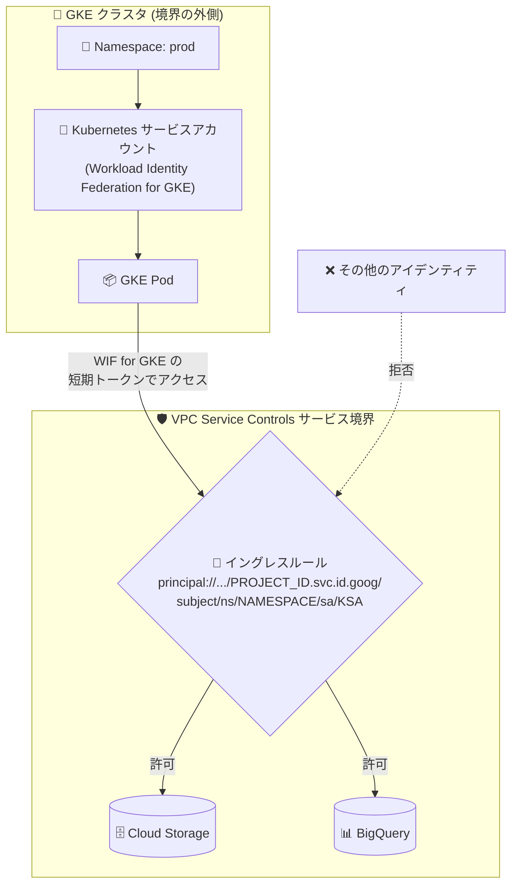

# VPC Service Controls: Workload Identity Federation for GKE のイングレス/エグレスルール対応 (Preview)

**リリース日**: 2026-10-14

**サービス**: VPC Service Controls

**機能**: Workload Identity Federation for GKE プリンシパルをイングレス/エグレスルールで指定可能に

**ステータス**: Preview

📊 [このアップデートのインフォグラフィックを見る](https://takech9203.github.io/google-cloud-news-summary/20261014-vpc-service-controls-wif-gke.html)

## 概要

VPC Service Controls のイングレスルールおよびエグレスルールで、Workload Identity Federation for GKE のプリンシパルを指定できるようになりました (Preview)。これにより、サービス境界 (service perimeter) で保護されたリソースへのアクセスを、GKE Pod の Kubernetes アイデンティティ (Kubernetes サービスアカウント、Namespace、クラスタ) 単位で許可できます。

指定できる Workload Identity Federation for GKE プリンシパルは以下の 3 種類です。

- Kubernetes サービスアカウントを使用するすべての GKE Pod (サービスアカウント名または ID で指定)
- 特定の Kubernetes Namespace 内のすべての GKE Pod
- 特定のクラスタ内のすべての GKE Pod

GKE 上のワークロードから境界をまたいで保護リソースにアクセスする構成を設計するセキュリティ管理者や、サービス境界を運用するプラットフォームチームにとって、よりきめ細かな最小権限のアクセス制御を実現できるアップデートです。

**アップデート前の課題**

- VPC Service Controls のイングレス/エグレスルールでは、GKE Pod の Kubernetes アイデンティティ (Kubernetes サービスアカウントなど) を直接プリンシパルとして指定できなかった
- GKE ワークロードに境界をまたぐアクセスを許可するには、中間の IAM サービスアカウントへの impersonation (サービスアカウントの借用) を構成し、その IAM サービスアカウントをルールで指定する必要があった
- Namespace やクラスタといった Kubernetes の論理単位でアクセス制御の粒度を揃えることができなかった

**アップデート後の改善**

- GKE Pod の Kubernetes サービスアカウント (名前または ID)、Namespace、クラスタをイングレス/エグレスルールのプリンシパルとして直接指定できるようになった
- 中間の IAM サービスアカウント impersonation を介さずに、境界をまたぐアクセス (cross-perimeter access) を許可できるようになった
- Kubernetes の運用単位 (Namespace、クラスタ) に沿った最小権限のアクセスポリシーを定義できるようになった

## アーキテクチャ図



サービス境界の外側にある GKE Pod が、Workload Identity Federation for GKE のアイデンティティ (Kubernetes サービスアカウント / Namespace / クラスタ) を根拠に、イングレスルールで許可された保護リソースへアクセスする構成です。ルールに合致しないアイデンティティからのアクセスは境界で拒否されます。

## サービスアップデートの詳細

### 主要機能

1. **Kubernetes サービスアカウント単位のプリンシパル指定**
   - 特定の Kubernetes サービスアカウントを使用するすべての GKE Pod を、サービスアカウント名または ID (UID) で指定可能
   - Pod 単位ではなくアイデンティティ単位で制御するため、Pod の再作成やスケールに影響されない

2. **Namespace 単位のプリンシパル指定**
   - サービスアカウントやクラスタを問わず、特定の Kubernetes Namespace 内のすべての GKE Pod を `principalSet` で一括指定可能
   - チームや環境 (prod / staging など) を Namespace で分離している場合に、その単位でアクセスを許可できる

3. **クラスタ単位のプリンシパル指定**
   - 特定の GKE クラスタ内のすべての Pod を `principalSet` で一括指定可能
   - クラスタ全体を信頼単位としたシンプルなポリシー設計が可能

4. **IAM 形式と SPIFFE 形式の両方をサポート**
   - 完全な IAM プリンシパル識別子形式と、等価な SPIFFE 形式のどちらでも指定可能
   - SPIFFE 構文で作成したルールを含むサービス境界を describe / 取得すると、アイデンティティは SPIFFE 形式で返される

## 技術仕様

### 指定可能なプリンシパル形式

| プリンシパルタイプ | 識別子形式 |
|------|------|
| Kubernetes サービスアカウント名で指定 (単一) | `principal://iam.googleapis.com/projects/PROJECT_NUMBER/locations/global/workloadIdentityPools/PROJECT_ID.svc.id.goog/subject/ns/NAMESPACE/sa/KUBERNETES_SERVICE_ACCOUNT` |
| Kubernetes サービスアカウント ID で指定 (単一) | `principal://iam.googleapis.com/projects/PROJECT_NUMBER/locations/global/workloadIdentityPools/PROJECT_ID.svc.id.goog/kubernetes.serviceaccount.uid/SERVICEACCOUNT_ID` |
| Namespace 内のすべての Pod | `principalSet://iam.googleapis.com/projects/PROJECT_NUMBER/locations/global/workloadIdentityPools/PROJECT_ID.svc.id.goog/namespace/NAMESPACE` |
| クラスタ内のすべての Pod | `principalSet://iam.googleapis.com/projects/PROJECT_NUMBER/locations/global/workloadIdentityPools/PROJECT_ID.svc.id.goog/kubernetes.cluster/https://container.googleapis.com/v1/projects/PROJECT_ID/locations/LOCATION/clusters/CLUSTER_NAME` |
| SPIFFE 形式 (サービスアカウント指定の例) | `principal://PROJECT_ID.svc.id.goog/ns/NAMESPACE/sa/KUBERNETES_SERVICE_ACCOUNT` |

### イングレスルールでの指定例

```yaml
# ingress-policy.yaml (イングレスルールの例)
- ingressFrom:
    identities:
    - principal://iam.googleapis.com/projects/PROJECT_NUMBER/locations/global/workloadIdentityPools/PROJECT_ID.svc.id.goog/subject/ns/prod/sa/app-reader
    sources:
    - resource: projects/GKE_PROJECT_NUMBER
  ingressTo:
    operations:
    - serviceName: storage.googleapis.com
      methodSelectors:
      - method: "*"
    resources:
    - "*"
```

## 設定方法

### 前提条件

1. GKE クラスタで Workload Identity Federation for GKE が有効化されていること (有効化すると `PROJECT_ID.svc.id.goog` 形式の Workload Identity Pool がプロジェクトに作成される)
2. VPC Service Controls のサービス境界が構成済みで、アクセスポリシーを管理する権限があること
3. イングレス/エグレスルールの仕様 (Ingress and egress rules) を理解していること

### 手順

#### ステップ 1: イングレス (またはエグレス) ポリシーファイルを作成

```bash
cat > ingress-policy.yaml <<EOF
- ingressFrom:
    identities:
    - principalSet://iam.googleapis.com/projects/PROJECT_NUMBER/locations/global/workloadIdentityPools/PROJECT_ID.svc.id.goog/namespace/prod
    sources:
    - resource: projects/GKE_PROJECT_NUMBER
  ingressTo:
    operations:
    - serviceName: storage.googleapis.com
      methodSelectors:
      - method: "*"
    resources:
    - "*"
EOF
```

Workload Identity Federation for GKE プリンシパルを `identities` 属性に指定します。

#### ステップ 2: サービス境界を更新

```bash
gcloud access-context-manager perimeters update PERIMETER_NAME \
  --set-ingress-policies=ingress-policy.yaml \
  --policy=POLICY_ID
```

更新後、`gcloud access-context-manager perimeters describe` でルールが反映されたことを確認します (SPIFFE 構文で作成したルールは SPIFFE 形式で返されます)。

## メリット

### ビジネス面

- **最小権限の徹底によるリスク低減**: 境界をまたぐアクセスを、必要なワークロードのアイデンティティ (サービスアカウント / Namespace / クラスタ) に限定でき、データ流出リスクを抑えられる
- **運用コストの削減**: 中間 IAM サービスアカウントの作成・管理・impersonation 構成が不要になり、構成の複雑さと管理対象が減る

### 技術面

- **Kubernetes ネイティブな粒度での制御**: Kubernetes の運用単位 (サービスアカウント、Namespace、クラスタ) にそのまま対応したポリシーを記述できる
- **キーレス認証との一貫性**: Workload Identity Federation for GKE の短期トークンに基づくキーレス認証を、VPC Service Controls の境界制御までエンドツーエンドで活用できる
- **柔軟な識別子形式**: IAM プリンシパル識別子形式と SPIFFE 形式の両方で指定可能

## デメリット・制約事項

### 制限事項

- Preview 段階の機能であり、Pre-GA Offerings Terms が適用される (サポートが限定される可能性がある)
- アクセスポリシーあたり Workload Identity Federation for GKE プリンシパルは 1,000 個までという上限がある
- Workload Identity Federation for GKE プリンシパルは、削除済みプリンシパル構文 (deleted principal syntax) をサポートしない
- Workload Identity Federation for GKE を含むサードパーティ系アイデンティティは、サービス境界のイングレス/エグレスルールでのみ指定可能で、Access Context Manager のアクセスレベルでは使用できない

### 考慮すべき点

- クラスタや Namespace 単位の `principalSet` は便利な一方、許可範囲が広くなるため、機密性の高いリソースへはサービスアカウント単位の指定を検討する
- 前提として GKE クラスタで Workload Identity Federation for GKE を有効化しておく必要がある

## ユースケース

### ユースケース 1: 境界外の GKE アプリから保護された Cloud Storage への限定アクセス

**シナリオ**: データ分析基盤のプロジェクトを VPC Service Controls で保護しており、別プロジェクトの GKE クラスタで稼働するバッチアプリケーションから保護された Cloud Storage バケットへ読み取りアクセスさせたい。

**実装例**:
```yaml
- ingressFrom:
    identities:
    - principal://iam.googleapis.com/projects/PROJECT_NUMBER/locations/global/workloadIdentityPools/PROJECT_ID.svc.id.goog/subject/ns/batch/sa/gcs-reader
    sources:
    - resource: projects/GKE_PROJECT_NUMBER
  ingressTo:
    operations:
    - serviceName: storage.googleapis.com
      methodSelectors:
      - method: "*"
    resources:
    - "*"
```

**効果**: 中間 IAM サービスアカウントの impersonation 構成なしで、特定の Kubernetes サービスアカウントを使う Pod のみに境界内リソースへのアクセスを許可できる。

### ユースケース 2: Namespace 単位でのチーム別アクセス許可

**シナリオ**: マルチテナントの GKE クラスタで、チームごとに Namespace を分離して運用している。prod Namespace のワークロードにのみ、境界で保護された BigQuery へのアクセスを許可したい。

**効果**: `principalSet://.../namespace/prod` を指定することで、サービスアカウントやクラスタを個別に列挙せずに Namespace 単位で一括許可でき、チームの追加・変更時のポリシー管理が簡素化される。

## 料金

VPC Service Controls のイングレス/エグレスルール機能自体に関する個別の料金情報は、今回のリリースノートには記載されていません。詳細は公式ドキュメントを参照してください。

- [VPC Service Controls ドキュメント](https://cloud.google.com/vpc-service-controls/docs)

## 関連サービス・機能

- **Workload Identity Federation for GKE**: GKE ワークロードがサービスアカウントキーなしで Google Cloud API に認証するための仕組み。本アップデートのプリンシパルの基盤であり、クラスタで有効化すると `PROJECT_ID.svc.id.goog` の Workload Identity Pool が作成される
- **Access Context Manager**: サービス境界やアクセスレベルを管理するサービス。なお、Workload Identity Federation for GKE プリンシパルはアクセスレベルでは使用できず、イングレス/エグレスルールでのみ指定可能
- **IAM Workload Identity Federation / Workforce Identity Federation**: 外部ワークロード・人材のアイデンティティ連携。これらのプールのプリンシパルも同様にイングレス/エグレスルールで指定できる
- **GKE (Google Kubernetes Engine)**: 本機能の対象となるワークロード実行環境

## 参考リンク

- 📊 [インフォグラフィック](https://takech9203.github.io/google-cloud-news-summary/20261014-vpc-service-controls-wif-gke.html)
- [公式リリースノート](https://docs.cloud.google.com/release-notes#October_14_2026)
- [Supported identities for ingress and egress rules](https://docs.cloud.google.com/vpc-service-controls/docs/supported-identities)
- [Configure identity groups and third-party identities in ingress and egress rules](https://docs.cloud.google.com/vpc-service-controls/docs/configure-identity-groups)
- [Ingress and egress rules](https://docs.cloud.google.com/vpc-service-controls/docs/ingress-egress-rules)
- [Workload Identity Federation for GKE](https://docs.cloud.google.com/kubernetes-engine/docs/concepts/workload-identity)
- [VPC Service Controls の割り当てと上限](https://docs.cloud.google.com/vpc-service-controls/quotas)

## まとめ

VPC Service Controls のイングレス/エグレスルールで Workload Identity Federation for GKE プリンシパルを直接指定できるようになり、GKE ワークロードの境界をまたぐアクセスを中間 IAM サービスアカウントなしで最小権限に制御できるようになりました。GKE とサービス境界を併用している環境では、既存の impersonation ベースの構成を簡素化できる可能性があるため、Preview 段階で評価を始めることを推奨します。本番適用にあたっては、アクセスポリシーあたり 1,000 プリンシパルの上限と Pre-GA 利用条件に留意してください。

---

**タグ**: #VPCServiceControls #GKE #WorkloadIdentityFederation #セキュリティ #Preview #ゼロトラスト
