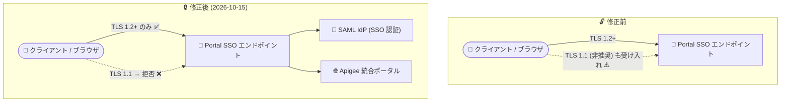

# Apigee Edge for Public Cloud / Apigee Integrated Portal: SSO アップデートと Portal SSO エンドポイントの TLS 1.2+ 強制化

**リリース日**: 2026-10-15

**サービス**: Apigee Edge for Public Cloud / Apigee Integrated Portal

**機能**: SSO アップデートのリリースと Portal SSO エンドポイントの TLS 1.2+ 厳格化 (Bug ID: 560310696)

**ステータス**: リリース済み (Announcement / Fixed)

📊 [このアップデートのインフォグラフィックを見る](https://takech9203.github.io/google-cloud-news-summary/20261015-apigee-edge-portal-sso-tls-update.html)

## 概要

2026 年 10 月 15 日、Google Cloud は Apigee Edge for Public Cloud 向けの Single Sign-On (SSO) アップデートのリリースを開始するとともに、Apigee Integrated Portal (統合ポータル) の新バージョンをリリースしました。両プロダクトのリリースノートに共通して含まれる修正 (Bug ID: 560310696) として、Portal SSO エンドポイントが非推奨の TLS 1.1 接続を誤って受け入れていた問題が修正され、エンドポイントは TLS 1.2 以上を厳格に強制するようになりました。

TLS 1.0 / 1.1 は既知の脆弱性を持つ非推奨プロトコルであり、業界標準 (IETF RFC 8996) でも廃止が宣言されています。今回の修正により、Apigee の開発者ポータルの SSO 認証経路における通信は、モダンな暗号化プロトコルのみで保護されることが保証されます。Apigee Edge for Public Cloud や統合ポータルで SAML などの SSO 認証を利用している組織の管理者、およびポータルを利用する開発者が対象です。

**アップデート前の課題**

- Portal SSO エンドポイントが、非推奨の TLS 1.1 による接続を意図せず受け入れていた
- 古い TLS プロトコルを許容することで、認証フロー (資格情報やトークンのやり取り) がダウングレード攻撃などのリスクに晒される可能性があった
- セキュリティ標準 (TLS 1.2 未満の廃止) への準拠が不完全な状態だった

**アップデート後の改善**

- Portal SSO エンドポイントが TLS 1.2 以上の接続のみを厳格に受け入れるようになった
- SSO 認証経路の通信が非推奨プロトコルから保護され、セキュリティポスチャが向上した
- 利用者側の設定変更なしで、サーバー側で自動的に適用される修正である

## アーキテクチャ図



修正前は Portal SSO エンドポイントが非推奨の TLS 1.1 接続を誤って受け入れていましたが、修正後は TLS 1.2 以上のみが許可され、SSO 認証のセキュリティ境界が強化されました。

## サービスアップデートの詳細

### 主要なアップデート内容

1. **Apigee Edge for Public Cloud: SSO アップデートのリリース開始 (Announcement)**
   - 2026 年 10 月 15 日より、Apigee Edge for Public Cloud 向けの Single Sign-On (SSO) アップデートのリリースが開始された
   - 対象は Apigee Edge の SSO コンポーネント

2. **Apigee Integrated Portal: 新バージョンのリリース (Announcement)**
   - 2026 年 10 月 15 日に Apigee 統合ポータルの新バージョンがリリースされた

3. **Portal SSO エンドポイントの TLS 1.2+ 強制化 (Fixed, Bug ID: 560310696)**
   - Portal SSO エンドポイントが非推奨の TLS 1.1 接続を誤って受け入れていた問題を修正
   - エンドポイントは TLS 1.2 以上を厳格に強制するようになった
   - 本修正は Apigee Edge for Public Cloud (SSO コンポーネント) と Apigee Integrated Portal の両方のリリースノートに記載されている

## 技術仕様

### TLS プロトコルの受け入れ可否

| プロトコル | 修正前 | 修正後 |
|------------|--------|--------|
| TLS 1.1 (非推奨) | 受け入れ (意図しない動作) | 拒否 |
| TLS 1.2 | 受け入れ | 受け入れ |
| TLS 1.3 | 受け入れ | 受け入れ |

## デメリット・制約事項

### 考慮すべき点

- TLS 1.1 以下でしか通信できない古いクライアント (レガシーブラウザ、古い OS、組み込みの HTTP クライアントなど) から Portal SSO エンドポイントに接続している場合、修正適用後は接続が拒否される
- 社内の自動化スクリプトや監視ツールが古い TLS ライブラリを使用している場合は、TLS 1.2 以上に対応したバージョンへの更新が必要

## ユースケース

### ユースケース 1: クライアント側 TLS バージョンの事前確認

**シナリオ**: 開発者ポータルの SSO を利用する社内ユーザーやスクリプトが、TLS 1.2 以上で接続できるかを確認したい。

**実装例**:
```bash
# TLS 1.2 で SSO エンドポイントに接続できることを確認 (接続成功を期待)
openssl s_client -connect {portal-sso-host}:443 -tls1_2 < /dev/null
```

**効果**: 修正の影響を受けるレガシークライアントを事前に特定し、認証エラーの発生を未然に防げる。

### ユースケース 2: コンプライアンス要件への対応

**シナリオ**: PCI DSS などのセキュリティ基準により、TLS 1.2 未満のプロトコルの無効化が求められている組織が、API 開発者ポータルの認証経路を監査する。

**効果**: Portal SSO エンドポイントがサーバー側で TLS 1.2+ を強制するため、認証経路に関する監査要件を満たしやすくなる。

## 関連サービス・機能

- **Apigee Edge SAML 認証 (Identity Zone)**: Apigee Edge では Identity Zone を構成することで SAML IdP による SSO 認証を利用できる。今回の SSO アップデートはこの認証基盤に関連する
- **Apigee Integrated Portal の ID プロバイダ設定**: 統合ポータルでは SAML ID プロバイダを構成して開発者の SSO 認証を実現できる。今回修正された Portal SSO エンドポイントはこの認証フローの入り口にあたる
- **Cloud Load Balancing / Certificate Manager**: Google Cloud 全体でも TLS 証明書の有効期間短縮など、通信セキュリティ強化の取り組みが進んでいる

## 参考リンク

- 📊 [インフォグラフィック](https://takech9203.github.io/google-cloud-news-summary/20261015-apigee-edge-portal-sso-tls-update.html)
- [公式リリースノート (2026-10-15)](https://docs.cloud.google.com/release-notes#October_15_2026)
- [Apigee Integrated Portal リリースノート](https://docs.cloud.google.com/apigee/docs/api-platform/publish/portal/release-notes)
- [Apigee Edge: SAML 概要](https://docs.apigee.com/api-platform/system-administration/saml-overview)
- [Apigee Edge: SAML 認証の有効化](https://docs.apigee.com/api-platform/system-administration/enabling-saml-authentication-edge)
- [統合ポータルの ID プロバイダ設定 (Apigee X)](https://cloud.google.com/apigee/docs/api-platform/publish/portal/portal-identity-provider)

## まとめ

今回のアップデートは、Apigee の開発者ポータル SSO 認証経路から非推奨の TLS 1.1 を排除し、TLS 1.2 以上を厳格に強制するセキュリティ修正です。利用者側での設定変更は不要ですが、レガシーな TLS ライブラリを使うクライアントやスクリプトが SSO エンドポイントに接続している場合は、TLS 1.2 以上への対応状況を確認することを推奨します。

---

**タグ**: Apigee, Apigee Edge, Apigee Integrated Portal, SSO, SAML, TLS, セキュリティ, Fixed
