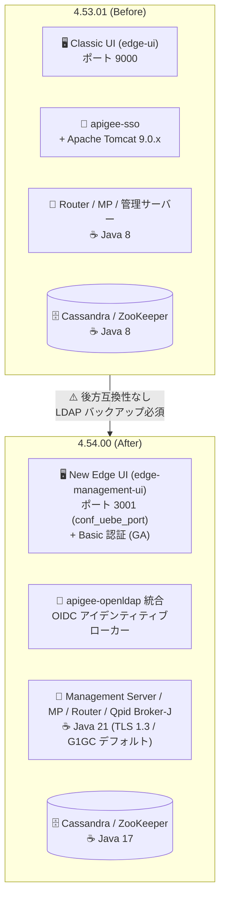

# Apigee Edge for Private Cloud: 4.54.00 リリース (LTS)

**リリース日**: 2026-10-15

**サービス**: Apigee Edge for Private Cloud

**機能**: 4.54.00 リリース (LTS、Java 17/21 移行、New Edge UI、SSO アーキテクチャ刷新)

**ステータス**: GA (LTS リリース)

📊 [このアップデートのインフォグラフィックを見る](https://takech9203.github.io/google-cloud-news-summary/20261015-apigee-edge-private-cloud-4-54-00.html)

## 概要

Apigee Edge for Private Cloud 4.54.00 がリリースされた。本リリースは長期サポート (LTS) リリースに指定されており、18 ヶ月のフルサポート (2028 年 4 月まで) と、その後 18 ヶ月のメンテナンス期間 (2029 年 10 月まで) が提供される。2029 年 10 月以降、4.54.00.00 はソフトウェアアップデート、セキュリティ緩和策、テクニカルサポートの対象外となる。なお、以降の 4.54 系マイナーリリースやパッチを適用してもこれらの期日は変わらないため、サポートライフサイクルを延長するには次の LTS リリースへのアップグレードが必要となる。

本リリースはプラットフォーム基盤の大規模な刷新を含む。Java 8 が Java 17 および Java 21 に置き換えられ、Classic UI と `apigee-sso` コンポーネントが削除され、バンドルされる Cassandra、Postgres、OpenLDAP、ZooKeeper、Qpid Broker-J、Nginx、Consul の各バージョンが更新された。**これらの変更には後方互換性がない** ため、オンプレミスで Apigee Edge を運用する Solutions Architect・運用チームは、アップグレード前に破壊的変更の影響範囲を必ず評価する必要がある。

破壊的変更 (Breaking Changes) として、(1) Apigee SSO 有効環境での SSO アーキテクチャの刷新 (スタンドアロンの `apigee-sso` + Apache Tomcat 9.0.x から、`apigee-openldap` に統合された OIDC アイデンティティブローカーへの置き換え)、(2) Java の混在モード実行 (Cassandra/ZooKeeper は Java 17、Management Server/Message Processor/Router/Qpid Broker-J は Java 21) が含まれる。カスタム JavaCallout ポリシーやカスタムリソース JAR を使用する API プロキシは Java 21 で動作しなくなる可能性がある。あわせて、New Edge UI への Basic 認証追加 (GA)、`apigee-setup`/`apigee-service` への自動プリフライト検証チェック追加 (GA)、Message Processor のデフォルト GC の G1GC 化、TLS 1.3 デフォルト化などの機能追加・変更が含まれる。

**アップデート前の課題**

- 4.53.x まではプラットフォームが Java 8 (Oracle JDK 8 / OpenJDK 8) 上で動作しており、新しい Java のパフォーマンス・セキュリティ改善を利用できなかった
- Apigee SSO を利用するにはスタンドアロンの `apigee-sso` コンポーネントと Apache Tomcat 9.0.x の運用が必要だった
- New Edge UI へのサインインには IdP (SAML/OIDC/Apigee SSO) の構成が必要で、IdP なしの簡易なサインイン手段がなかった
- コンポーネントのインストール前に環境構成の問題を自動検出する仕組みがなく、インストール後に問題が顕在化し得た
- 4.53.01 では Message Processor に `useG1GC` と `useStringDeduplication` がデフォルトで設定されていなかった

**アップデート後の改善**

- Java 17 / Java 21 ベースの実行基盤に刷新され、コンポーネントアップグレードを通じて複数のセキュリティ脆弱性が修正された
- SSO が `apigee-openldap` 統合の OIDC アイデンティティブローカーに一本化され、スタンドアロンの `apigee-sso` と Tomcat の運用が不要になった
- New Edge UI に Basic 認証が追加され (GA)、IdP を構成せずにサインインできるようになった (SAML/OIDC/Apigee SSO も引き続きサポート)
- `apigee-setup` と `apigee-service` に自動プリフライト検証チェックが追加され (GA)、コンポーネントインストール前に環境構成の問題を検出できるようになった
- Message Processor のデフォルト GC が G1GC になり (`useG1GC=true`、`useStringDeduplication=true`)、TLS 1.3 がデフォルトで有効化された (JEP 332)

## アーキテクチャ図



4.53.01 と 4.54.00 のコンポーネントスタック比較。UI・SSO・Java ランタイムが全面的に刷新され、Java 17 (Cassandra/ZooKeeper) と Java 21 (その他ランタイムコンポーネント) の混在モードで動作する。

## サービスアップデートの詳細

### 主要機能

1. **LTS リリース指定とサポートライフサイクル**
   - 4.54.00.00 は LTS リリースとして、18 ヶ月のフルサポート (2028 年 4 月終了) + 18 ヶ月のメンテナンス (2029 年 10 月終了) が提供される
   - 2029 年 10 月以降はソフトウェアアップデート、セキュリティ緩和策、テクニカルサポートが提供されない
   - 後続の 4.54 系マイナーリリース (4.54.01 は 2027 年 Q1 末目標) やパッチを適用してもサポート期日は変わらない。延長には次の LTS へのアップグレードが必要

2. **プラットフォーム基盤の刷新 (後方互換性なし)**
   - Java 8 を Java 17 および Java 21 に置き換え (Oracle JDK / OpenJDK の両方をサポート、JDK 8 はサポート終了)
   - Classic UI (`edge-ui`) と `apigee-sso` コンポーネントを削除
   - バンドルされる Cassandra、Postgres、OpenLDAP、ZooKeeper、Qpid Broker-J、Nginx、Consul のバージョンを更新 (4.53.01 との対応は [Supported software](https://docs.apigee.com/release/supported-software) を参照)

3. **New Edge UI への全面移行**
   - Classic UI (`edge-ui`) は New Edge UI (`edge-management-ui`) に置き換えられ、4.54.00 で唯一の管理 UI としてデフォルトでインストールされる
   - Classic UI を利用中のデプロイメントは、アップグレード前に New Edge UI へ移行しておく必要がある
   - デフォルトポートが 9000 から 3001 に変更 (`conf_uebe_port` で変更可能)。ポート 9000 を参照するファイアウォールルールやロードバランサーのターゲットポートは更新するまで疎通しない
   - Classic UI のカスタムプロパティは自動では引き継がれない
   - Basic 認証が GA として追加され、IdP を構成せずにサインイン可能 (Apigee SSO、SAML/OIDC などの外部 IdP も引き続き構成可能)

4. **SSO アーキテクチャの刷新 (Breaking)**
   - Apigee SSO 有効環境では、`apigee-openldap` に統合された OIDC アイデンティティブローカーが、スタンドアロンの `apigee-sso` と Apache Tomcat 9.0.x を置き換える
   - 既存の `apigee-sso` 構成は自動では移行されない。アップグレード前に完全かつ検証済みの LDAP バックアップの取得が必須
   - Apigee SSO を使用していないデプロイメントは対応不要

5. **運用性・ランタイムの改善**
   - `apigee-setup` と `apigee-service` に自動プリフライト検証チェックを追加 (GA)。コンポーネントインストール前に環境構成の問題を検出
   - Edge Router の Nginx を 1.30.0 にアップグレード (1.20.x からのアップグレード時は変更一覧の確認を推奨)
   - Message Processor のデフォルト GC を G1GC に変更 (`useG1GC=true`、`useStringDeduplication=true` がデフォルト。4.53.01 ではいずれも未設定)
   - 本リリースのコンポーネントアップグレードにより複数のセキュリティ脆弱性を修正

## 技術仕様

### Java ランタイムの混在モード

| コンポーネント | 4.53.01 | 4.54.00 |
|------|------|------|
| Cassandra | Java 8 | **Java 17** |
| ZooKeeper | Java 8 | **Java 17** |
| Management Server | Java 8 | **Java 21** |
| Message Processor | Java 8 | **Java 21** |
| Router | Java 8 | **Java 21** |
| Qpid Broker-J | Java 8 | **Java 21** |

- Oracle JDK / OpenJDK の両方を上記バージョンでサポート。Oracle JDK 8 / OpenJDK 8 はサポート終了
- 4.54.00 ではブートストラップ時の Java 自動インストールは行われず、Java 17 と Java 21 の両方がインストールされていることを検出・検証する

### Message Processor の TLS デフォルト変更 (Java 21 暗号ベースライン)

| 項目 | 詳細 |
|------|------|
| TLS バージョン | TLS 1.3 がデフォルトで有効 ([JEP 332](https://openjdk.org/jeps/332))。アウトバウンドのバックエンド接続で TLS 1.3 を優先し、TLS 1.2 にフォールバック |
| 無効化される暗号スイート | 前方秘匿性のない静的 RSA 鍵交換スイート (`TLS_RSA_*`) が無効化 |
| 対応不要なケース | ターゲットサーバー・ロードバランサーが TLS 1.3、または前方秘匿性のある (ECDHE) 暗号スイートで TLS 1.2 をネゴシエートできる場合 |
| 障害が発生するケース | `conf_http_HTTPTransport.ssl.cipher.suites.whitelist` または `conf_message-processor-communication_local.http.ssl.ciphers` を静的 RSA スイートのみでオーバーライドしている場合、バックエンド呼び出しが `no cipher suites in common` で失敗し、Router が Message Processor と TLS ハンドシェイクを完了できない |
| 修復方法 | `TLS_RSA_*` エントリをモダンな暗号スイートに置き換え、Message Processor を再起動 ([Legacy TLS remediation](https://docs.apigee.com/private-cloud/v4.54.00/changes-privatecloud-45400#legacy-tls-remediation)) |

### Message Processor のデフォルト GC 変更

| 設定 | 4.53.01 | 4.54.00 |
|------|------|------|
| `useG1GC` | 未設定 | `true` (デフォルト) |
| `useStringDeduplication` | 未設定 | `true` (デフォルト) |

## 設定方法

### 前提条件

1. 4.54.00 へは 4.53.00 または 4.53.01 からの直接アップグレードがサポートされる
2. すべての Edge コンポーネントをアップグレードする必要がある (複数バージョンのコンポーネントが混在する構成はサポートされない)
3. アップグレードは Edge を最初にインストールした人物、または root 権限で実行する
4. Java 17 と Java 21 の両方を事前にインストールしておく (4.54.00 はブートストラップ時に Java を自動インストールしない)
5. Classic UI を利用中の場合は、アップグレード前に New Edge UI へ移行しておく
6. Apigee SSO 有効環境では、アップグレード前に完全かつ検証済みの LDAP バックアップを取得する

### 手順

#### ステップ 1: 事前確認 (Pre-read)

アップグレード前に以下の公式ドキュメントを確認する。

- [Changes in Edge for Private Cloud 4.54.00](https://docs.apigee.com/private-cloud/v4.54.00/changes-privatecloud-45400) — TLS・JavaCallout の事前準備が必要な変更
- [New Edge UI](https://docs.apigee.com/private-cloud/v4.54.00/new-edge-ui) / [Migrate to the New Edge UI](https://docs.apigee.com/private-cloud/v4.54.00/migrate-ui)
- [Apigee SSO の新アーキテクチャ](https://docs.apigee.com/private-cloud/v4.54.00/idp-overview#new-sso-design)
- [Nginx 1.30 changes](https://docs.apigee.com/private-cloud/v4.54.00/nginx-45400)
- [Known issues](https://docs.apigee.com/release/known-issues#private-cloud-known-issues)

#### ステップ 2: 影響評価と準備

- カスタム JavaCallout ポリシーおよびカスタムリソース JAR の Java 21 互換性を確認する (互換性がない場合、公式ドキュメントではメンテナンスウィンドウ方式や、新環境を用意して 4.53.x MP と 4.54.00 MP を併存させるゼロダウンタイム移行戦略が案内されている)
- Message Processor の暗号スイートのオーバーライド (`conf_http_HTTPTransport.ssl.cipher.suites.whitelist` など) に `TLS_RSA_*` のみが設定されていないか確認する
- ポート 9000 を参照するファイアウォールルール・ロードバランサーのターゲットポートを 3001 (または `conf_uebe_port` の設定値) に更新する計画を立てる
- Apigee SSO 有効環境では LDAP の完全バックアップを取得・検証する

#### ステップ 3: アップグレードの実行

[Update Apigee Edge 4.53.00 or 4.53.01 to 4.54.00](https://docs.apigee.com/private-cloud/v4.54.00/update-apigee-edge-4530x-45400) の手順に従う。注意点:

- 4.54.00 ではコンポーネントのアップグレード順序が従来バージョンから変更されている ([Order of machine update](https://docs.apigee.com/private-cloud/v4.54.00/update-apigee-edge-4530x-45400#orderofmachineupdate) を参照)
- Apigee のアップグレードと OS のメジャーバージョンアップグレードは同時に行わない (どちらかを完了させてからもう一方を実施)
- Cassandra のメジャーアップグレードを含むため、データセンターごとに 1 つずつアップグレードすることが推奨される
- 新規インストールの場合は [New installation overview](https://docs.apigee.com/private-cloud/v4.54.00/installation-overview) を参照

## メリット

### ビジネス面

- **サポートライフサイクルの明確化**: LTS 指定によりフルサポート 2028 年 4 月まで、メンテナンス 2029 年 10 月までというサポート期日が明示され、中長期の運用・移行計画を立てやすくなった
- **セキュリティリスクの低減**: Java 8 (EOL が進むランタイム) からの脱却と、コンポーネントアップグレードによる複数の脆弱性修正により、オンプレミス API 基盤のセキュリティ態勢が向上する

### 技術面

- **モダンな Java ランタイム**: Java 17/21 への移行により、TLS 1.3 (JEP 332) や G1GC + 文字列重複排除がデフォルトで有効になる
- **運用の簡素化**: SSO が `apigee-openldap` 統合ブローカーに一本化され、スタンドアロン `apigee-sso` + Tomcat の運用が不要になる。New Edge UI の Basic 認証により IdP なしのサインインも可能
- **インストール品質の向上**: `apigee-setup`/`apigee-service` の自動プリフライト検証チェックにより、環境構成の問題をインストール前に検出できる

## デメリット・制約事項

### 制限事項

- **後方互換性なし**: Java 8 の置き換え、Classic UI と `apigee-sso` の削除、バンドルコンポーネントの更新は後方互換性がない
- Oracle JDK 8 / OpenJDK 8 はサポートされない
- Classic UI のカスタムプロパティは New Edge UI へ自動では引き継がれない
- 既存の `apigee-sso` 構成は自動では移行されない
- 4.54 系のマイナーリリース・パッチを適用してもサポート期日 (2028 年 4 月 / 2029 年 10 月) は延長されない

### 考慮すべき点

- **カスタム JavaCallout / カスタムリソース JAR**: Java 21 上で動作しなくなる可能性があるため、アップグレード前に互換性検証が必須
- **TLS 設定のオーバーライド**: 静的 RSA スイート (`TLS_RSA_*`) のみを指定している場合、`no cipher suites in common` でバックエンド呼び出しが失敗する。モダンな暗号スイートへの置き換えと MP 再起動が必要
- **UI ポート変更**: デフォルトポートが 9000 → 3001 に変わるため、ファイアウォールルール・LB ターゲットポートの更新が必要
- **LDAP バックアップ**: Apigee SSO 有効環境では、アップグレード前の完全かつ検証済みの LDAP バックアップ取得が必須
- **アップグレード順序の変更**: 4.54.00 ではコンポーネントのアップグレード順序が従来から変更されている
- **Cassandra メジャーアップグレード**: データセンター単位で 1 つずつアップグレードすることが推奨される
- **OS アップグレードとの分離**: Apigee と OS のメジャーアップグレードは同時に実施しない

## ユースケース

### ユースケース 1: 4.53.x からの LTS 移行計画の策定

**シナリオ**: 4.53.01 でオンプレミス API 基盤を運用中の企業が、サポート継続のため 4.54.00 LTS への移行を計画する。

**実装例**:
```text
1. Changes in 4.54.00 / Known issues を確認し、影響評価を実施
2. カスタム JavaCallout・リソース JAR の Java 21 互換性をテスト環境で検証
3. TLS 暗号スイートのオーバーライド設定を棚卸し (TLS_RSA_* のみの設定を是正)
4. Classic UI 利用中なら New Edge UI へ事前移行、ポート 9000 → 3001 のネットワーク変更を準備
5. SSO 有効環境は LDAP の完全バックアップを取得・検証
6. 変更後の順序に従い、データセンターごとにアップグレードを実行
```

**効果**: 2028 年 4 月までのフルサポート、2029 年 10 月までのメンテナンスを確保し、計画的な次期 LTS 移行までの運用継続性を担保できる。

### ユースケース 2: Java 21 非互換の JavaCallout を抱える環境のゼロダウンタイム移行

**シナリオ**: ミッションクリティカルな本番環境で、Java 8 と Java 21 の両方で同時に動作させられない JavaCallout を使用している。

**効果**: 公式ドキュメントの移行戦略 (新しい環境を用意し、4.53.x Message Processor には Java 8 互換プロキシ、4.54.00 Message Processor には Java 21 互換プロキシをデプロイして、ロードバランサーで段階的にトラフィックを切り替える方式) に従うことで、ダウンタイムなしで 4.54.00 へ移行できる。

## 料金

Apigee Edge for Private Cloud 本体のソフトウェアリリースであり、本アップデートに伴う料金変更の情報はリリースノートに記載されていない。ライセンス・料金の詳細は [Apigee の料金ページ](https://cloud.google.com/apigee/pricing) を参照。

## 利用可能リージョン

Apigee Edge for Private Cloud はお客様自身のデータセンター/インフラストラクチャにインストールして運用するオンプレミス製品であり、Google Cloud リージョンの概念は適用されない。

## 関連サービス・機能

- **Apigee X / Apigee (Google Cloud 版)**: Google Cloud マネージドの API 管理サービス。オンプレミス要件がない場合の移行先候補
- **Apache Cassandra / ZooKeeper / Qpid Broker-J / OpenLDAP / Postgres / Nginx / Consul**: Edge for Private Cloud にバンドルされるコンポーネント群。本リリースで一括更新された
- **Apigee SSO / SAML / OIDC**: New Edge UI の認証オプション。4.54.00 では OIDC アイデンティティブローカーが `apigee-openldap` に統合された

## 参考リンク

- 📊 [インフォグラフィック](https://takech9203.github.io/google-cloud-news-summary/20261015-apigee-edge-private-cloud-4-54-00.html)
- [公式リリースノート](https://docs.cloud.google.com/release-notes#October_15_2026)
- [Apigee Edge for Private Cloud release notes](https://docs.cloud.google.com/apigee/docs/edge-private-cloud/release-notes)
- [Changes in Edge for Private Cloud 4.54.00](https://docs.apigee.com/private-cloud/v4.54.00/changes-privatecloud-45400)
- [Update Apigee Edge 4.53.00 or 4.53.01 to 4.54.00](https://docs.apigee.com/private-cloud/v4.54.00/update-apigee-edge-4530x-45400)
- [Apigee Edge for Private Cloud release and lifecycle policy](https://docs.apigee.com/release/private-cloud-release-lifecycle-policy)
- [Supported software and supported versions](https://docs.apigee.com/release/supported-software)
- [New Edge UI](https://docs.apigee.com/private-cloud/v4.54.00/new-edge-ui) / [Migrate to the New Edge UI](https://docs.apigee.com/private-cloud/v4.54.00/migrate-ui)
- [Nginx 1.30 changes in Apigee Edge 4.54.00](https://docs.apigee.com/private-cloud/v4.54.00/nginx-45400)
- [Known issues with Edge for Private Cloud](https://docs.apigee.com/release/known-issues#private-cloud-known-issues)

## まとめ

Apigee Edge for Private Cloud 4.54.00 は、Java 17/21 への移行、New Edge UI への一本化、SSO アーキテクチャの刷新を含む後方互換性のない大型 LTS リリースであり、2029 年 10 月までのサポートライフサイクルが明示された。オンプレミスで Apigee Edge を運用するチームは、カスタム JavaCallout の Java 21 互換性検証、TLS 暗号スイート設定の棚卸し、UI ポート変更 (9000 → 3001) への対応、SSO 環境での LDAP バックアップ取得を含むアップグレード計画の策定に早期に着手することを推奨する。

---

**タグ**: Apigee, Apigee Edge for Private Cloud, LTS, Java 21, Java 17, New Edge UI, OIDC, TLS 1.3, G1GC, Breaking Change, アップグレード
