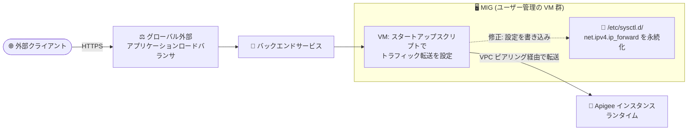

# Apigee X: MIG スタートアップスクリプトの IP フォワーディング設定永続化の修正

**リリース日**: 2026-10-15

**サービス**: Apigee X

**機能**: MIG (マネージドインスタンスグループ) スタートアップスクリプトの修正 (Bug ID 466116259)

**ステータス**: 修正 (Fixed)

📊 [このアップデートのインフォグラフィックを見る](https://takech9203.github.io/google-cloud-news-summary/20261015-apigee-x-mig-ip-forward-fix.html)

## 概要

Apigee X で、外部トラフィックを Apigee にルーティングするマネージドインスタンスグループ (MIG) のスタートアップスクリプトが更新されました (Bug ID 466116259)。カーネルパラメータ `net.ipv4.ip_forward` が `/etc/sysctl.d/` に書き込まれるようになり、再起動や OS アップデートで設定がリセットされてもインスタンスがトラフィック転送を停止しなくなります。

MIG ベースの northbound ルーティングは、VPC ピアリング構成の Apigee で外部アプリケーションロードバランサからのトラフィックを Apigee インスタンスへ中継するための標準的な構成です。MIG の VM 自体はユーザーが管理する (スケーリング、パッチ適用、メンテナンスはユーザーの責任) 一方、トラフィックをルーティングするための設定を行うスタートアップスクリプトは Apigee が提供しており、今回はこの提供スクリプトが修正されました。

MIG ベースのルーティングで外部トラフィックを受けているすべての Apigee X ユーザーが対象です。修正は既存インスタンスに自動では反映されず、**インスタンスの次回の再起動または再作成時に適用されます**。

**アップデート前の課題**

- `net.ipv4.ip_forward` の設定が永続化されておらず、MIG インスタンスの再起動や OS アップデートで設定がリセットされることがあった
- 設定がリセットされると、インスタンスがロードバランサから Apigee へのトラフィック転送を停止し、API トラフィックに影響する可能性があった

**アップデート後の改善**

- `net.ipv4.ip_forward` が `/etc/sysctl.d/` に書き込まれるようになり、再起動や OS アップデート後も IP フォワーディング設定が維持される
- スクリプトは無関係な iptables NAT ルールには変更を加えないため、既存のネットワーク設定への副作用がない

## アーキテクチャ図



外部クライアントからのリクエストはグローバル外部アプリケーションロードバランサを経由して MIG に到達し、MIG の VM が Apigee インスタンスへトラフィックを転送します。今回の修正により、転送に必要な `net.ipv4.ip_forward` が `/etc/sysctl.d/` に永続化され、再起動後も転送が継続されます。

## サービスアップデートの詳細

### 主要な修正内容

1. **`net.ipv4.ip_forward` の永続化**
   - MIG 用スタートアップスクリプトが `net.ipv4.ip_forward` を `/etc/sysctl.d/` に書き込むように変更された
   - 再起動や OS アップデートでカーネルパラメータがリセットされても、インスタンスがトラフィック転送を停止しなくなった

2. **無関係な iptables NAT ルールへの非干渉**
   - スクリプトは無関係な iptables NAT ルールを変更しない
   - MIG VM 上でユーザーが独自に設定している NAT ルールに影響を与えない

3. **適用タイミング**
   - 既存インスタンスには自動適用されない
   - インスタンスが次回再起動または再作成されたタイミングで修正が反映される

## 技術仕様

### MIG ベースの northbound ルーティング構成

| 項目 | 詳細 |
|------|------|
| 対象構成 | VPC ピアリング構成の Apigee で MIG を使った外部ルーティング |
| スタートアップスクリプト | `gs://apigee-5g-saas/apigee-envoy-proxy-release/latest/conf/startup-script.sh` (インスタンステンプレートの `startup-script-url` メタデータで指定) |
| 修正内容 | `net.ipv4.ip_forward` を `/etc/sysctl.d/` に書き込み、再起動後も永続化 |
| VM の管理責任 | スケーリング、パッチ適用、メンテナンスはユーザー責任 (スクリプトは Apigee が提供) |
| 標準的な VM 構成 | e2-medium、Debian 12、ブートディスク 20 GB (ドキュメントの推奨手順) |
| 修正の適用 | インスタンスの再起動または再作成時 |

### 参考: MIG 作成時のインスタンステンプレート例 (公式ドキュメントより)

```bash
gcloud compute instance-templates create $MIG_NAME \
  --project $PROJECT_ID \
  --region $REGION \
  --network $VPC_NAME \
  --subnet $VPC_SUBNET \
  --tags=https-server,apigee-mig-proxy,gke-apigee-proxy \
  --machine-type e2-medium --image-family debian-12 \
  --image-project debian-cloud --boot-disk-size 20GB \
  --no-address \
  --metadata ENDPOINT=$APIGEE_ENDPOINT,startup-script-url=gs://apigee-5g-saas/apigee-envoy-proxy-release/latest/conf/startup-script.sh
```

## 運用上の対応 (修正の反映方法)

リリースノートに記載のとおり、既存の MIG インスタンスは **次回の再起動または再作成時** に修正されたスタートアップスクリプトの動作を取り込みます。修正を能動的に反映したい場合は、MIG のインスタンスを再作成します。

```bash
# MIG のインスタンスをローリング置換して修正を反映する例
gcloud compute instance-groups managed rolling-action replace $MIG_NAME \
  --project $PROJECT_ID --region $REGION
```

MIG は通常複数台 (ドキュメントの手順では最小 2 台) で構成されるため、ローリング置換によりトラフィックへの影響を抑えながら反映できます。

## メリット

### ビジネス面

- **可用性リスクの低減**: 再起動や OS アップデートを契機とした API トラフィック断のリスクが解消され、API 基盤の安定性が向上する
- **運用負荷の軽減**: 再起動後に IP フォワーディング設定を手動で復旧するといった対処が不要になる

### 技術面

- **設定の永続化**: `/etc/sysctl.d/` への書き込みにより、OS 標準の仕組みでカーネルパラメータが再起動後も維持される
- **副作用のない修正**: 無関係な iptables NAT ルールには手を加えないため、既存のカスタムネットワーク設定と共存できる

## デメリット・制約事項

### 制限事項

- 修正は既存インスタンスに自動反映されず、インスタンスの再起動または再作成が必要
- 対象は MIG ベースの northbound ルーティングを使用している構成のみ (Private Service Connect ベースの構成ではそもそも MIG が不要)

### 考慮すべき点

- MIG の VM はユーザー管理のため、修正の反映タイミング (再起動・再作成の実施) はユーザー側でコントロールする必要がある
- 長期的には、MIG ベースの構成から Private Service Connect ベースの northbound ルーティングへの移行も選択肢となる (公式移行手順あり)

## ユースケース

### ユースケース 1: OS アップデートを安全に実施したい運用チーム

**シナリオ**: MIG VM の定期的な OS パッチ適用や再起動を実施すると、IP フォワーディング設定がリセットされて API トラフィックが停止するリスクがあった。

**効果**: 設定が `/etc/sysctl.d/` に永続化されるため、再起動を伴うメンテナンスを行ってもトラフィック転送が継続され、安心してパッチ運用ができる。

### ユースケース 2: 過去にトラフィック断を経験した環境の恒久対策

**シナリオ**: MIG インスタンスの再起動後に Apigee へのトラフィックが流れなくなる事象が発生し、暫定対処をしていた。

**実装例**:

```bash
# ローリング置換で全インスタンスを再作成し、修正済みスクリプトの動作を反映
gcloud compute instance-groups managed rolling-action replace $MIG_NAME \
  --project $PROJECT_ID --region $REGION
```

**効果**: 恒久対策として修正済みの動作が反映され、以降の再起動・OS アップデートでも転送が維持される。

## 料金

今回の修正自体に追加料金はありません。MIG の VM は従来どおりユーザーのプロジェクトで Compute Engine の料金が課金されます。

- [Compute Engine の料金](https://cloud.google.com/compute/all-pricing)
- [Apigee の料金](https://cloud.google.com/apigee/pricing)

## 関連サービス・機能

- **Compute Engine (MIG / インスタンステンプレート)**: northbound ルーティング用 VM の実行基盤。スタートアップスクリプトはインスタンステンプレートのメタデータで指定される
- **Cloud Load Balancing (グローバル外部アプリケーションロードバランサ)**: 外部クライアントからのトラフィックを MIG バックエンドに分散する
- **Private Service Connect (PSC)**: MIG を使わない northbound ルーティングの代替手段。MIG ベース構成からの移行手順も公式に提供されている
- **VPC ネットワークピアリング**: MIG ベース構成の前提となる、ユーザー VPC と Apigee VPC の接続方式

## 参考リンク

- 📊 [インフォグラフィック](https://takech9203.github.io/google-cloud-news-summary/20261015-apigee-x-mig-ip-forward-fix.html)
- [公式リリースノート (2026-10-15)](https://docs.cloud.google.com/release-notes#October_15_2026)
- [Apigee のルーティング構成 (External routing (MIG))](https://docs.cloud.google.com/apigee/docs/api-platform/get-started/install-cli#configure-routing)
- [Apigee のネットワーキングオプション](https://docs.cloud.google.com/apigee/docs/api-platform/get-started/networking-options)
- [northbound ルーティングの Private Service Connect への移行](https://docs.cloud.google.com/apigee/docs/api-platform/system-administration/migrate-from-mig-to-psc)
- [Apigee の料金ページ](https://cloud.google.com/apigee/pricing)

## まとめ

MIG ベースの northbound ルーティングを使用する Apigee X 環境における、再起動・OS アップデート起因のトラフィック転送停止という運用リスクを恒久的に解消する修正です。修正はインスタンスの再起動または再作成時に反映されるため、該当構成を運用しているチームは、計画的なローリング置換などで早期に修正を取り込むことを推奨します。

---

**タグ**: Apigee X, MIG, ロードバランサ, ネットワーキング, バグ修正, ip_forward, sysctl
