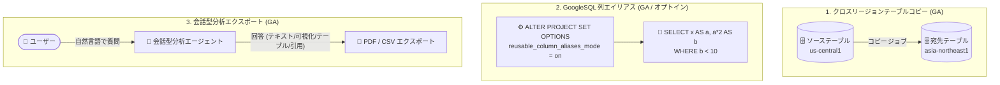

# BigQuery: クロスリージョンテーブルコピー / GoogleSQL 列エイリアス / 会話型分析エクスポートが GA

**リリース日**: 2026-10-15

**サービス**: BigQuery

**機能**: クロスリージョンテーブルコピー、GoogleSQL 列エイリアス (再利用可能カラムエイリアス)、会話型分析エージェント回答の PDF/CSV エクスポート

**ステータス**: GA (一般提供)

📊 [このアップデートのインフォグラフィックを見る](https://takech9203.github.io/google-cloud-news-summary/20261015-bigquery-cross-region-copy-column-aliases.html)

## 概要

2026 年 10 月 15 日、BigQuery に関する 3 つの機能が一般提供 (GA) になりました。(1) テーブルをリージョン間でコピーする「クロスリージョンテーブルコピー」、(2) SELECT 句で定義したエイリアスを同一クエリブロック内で即座に参照できる「GoogleSQL 列エイリアス」、(3) 会話型分析 (Conversational Analytics) エージェントの回答を PDF または CSV ファイルにエクスポートする機能です。

クロスリージョンテーブルコピーは、テーブル、テーブルスナップショット、テーブルクローンを BigQuery のあるリージョン (またはマルチリージョン) から別のリージョンへ直接コピーできる機能です。データのリージョン移行や、特定リージョンでのデータ活用 (分析基盤の地域展開など) をシンプルなコピージョブとして実行できます。

GoogleSQL 列エイリアスは、SELECT 句の式に付けたエイリアスを、同じ SELECT リストの後続の式や同一クエリブロックの WHERE 句から参照できるようにする機能です。Snowflake や Teradata といった他のデータウェアハウスの SQL 構文をサポートすることで、移行作業を効率化します。GA ですがオプトイン方式であり、利用には事前の有効化が必要です。

**アップデート前の課題**

- クロスリージョンのテーブルコピーは Preview として提供されており、GA 水準の SLA・サポートを前提とした本番利用の判断が難しかった
- GoogleSQL では SELECT 句で定義したエイリアスを同じ SELECT リストや WHERE 句から参照できず (GROUP BY / ORDER BY / HAVING のみ参照可能)、複雑な式を繰り返し記述するかサブクエリでラップする必要があった
- Snowflake や Teradata など、列エイリアスの再利用を許容する SQL 方言からの移行時に、クエリの書き換えが必要だった
- 会話型分析エージェントの回答 (テキスト、可視化、テーブル、引用) を、ファイルとして保存・共有する標準的な手段がなかった

**アップデート後の改善**

- クロスリージョンテーブルコピーが GA となり、リージョン間のテーブル・スナップショット・クローンのコピーを本番ワークロードで安心して利用できるようになった
- 列エイリアスを有効化すると、SELECT 句で定義したエイリアスを同一 SELECT リスト内の後続式や WHERE 句で再利用でき、クエリの可読性が向上しサブクエリの多用が不要になった
- Snowflake / Teradata の構文がサポートされ、他データウェアハウスからの移行がスムーズになった
- エージェントの回答をテキスト・可視化・テーブル・引用を含めて PDF / CSV にエクスポートでき、分析結果の共有・保存が容易になった

## アーキテクチャ図



3 つの GA 機能の全体像です。リージョン間のテーブルコピー、オプトインで有効化する列エイリアスの再利用、エージェント回答のファイルエクスポートをそれぞれ示しています。

## サービスアップデートの詳細

### 主要機能

1. **クロスリージョンテーブルコピー (GA)**
   - テーブル、テーブルスナップショット、テーブルクローンを BigQuery のリージョンまたはマルチリージョン間でコピーできる
   - 顧客管理暗号鍵 (CMEK) が適用されたテーブルのコピーにも対応 (ただし宛先データセットとの CMEK 構成の組み合わせには制約あり)
   - リージョン間のコピーにはデータ転送料金が別途発生する

2. **GoogleSQL 列エイリアス / 再利用可能カラムエイリアス (GA、オプトイン)**
   - SELECT 句の式に定義したエイリアスを、同一 SELECT リストの後続の式 (左から右の順) や同一クエリブロックの WHERE 句で参照可能
   - `reusable_column_aliases_mode` オプションを `ALTER ORGANIZATION SET OPTIONS` または `ALTER PROJECT SET OPTIONS` で `on` に設定して有効化する (リージョンスコープのオプション)
   - Snowflake や Teradata のエイリアス構文をサポートし、BigQuery Migration Service と組み合わせた移行を効率化

3. **会話型分析エージェント回答の PDF / CSV エクスポート (GA)**
   - エージェントの回答 (テキスト、可視化、テーブル、引用を含む) をダウンロードボタンから PDF または CSV として保存できる
   - PDF は各テーブル最大 20 行、詳細 PDF は最大 1,000 行、CSV は最大 5,000 行を含められる

## 技術仕様

### 列エイリアスの名前解決の優先順位

列エイリアスを有効化すると、名前解決の優先順位が以下のようになります。既存クエリの結果が変わる可能性があるため、有効化前に影響評価が推奨されます。

| 優先順位 | 解決対象 |
|------|------|
| 1 | 物理的な列名 (テーブルの列が常に優先) |
| 2 | 列エイリアス |
| 3 | 外側のクエリの列 |
| 4 | UDF / TVF の引数 |
| 5 | スクリプト変数 |

### 列エイリアスの有効化 (DDL)

```sql
-- プロジェクトレベルで有効化 (リージョンスコープ)
ALTER PROJECT my_project
SET OPTIONS (
  `region-us.reusable_column_aliases_mode` = "on"
);
```

### エクスポート形式と行数上限

| 形式 | テーブルあたりの行数上限 |
|------|------|
| PDF | 最大 20 行 |
| 詳細 PDF | 最大 1,000 行 |
| CSV | 最大 5,000 行 |

## 設定方法

### 前提条件

1. 列エイリアスの有効化には BigQuery Admin ロール、または `bigquery.projects.update` / `bigquery.organizations.update` 権限が必要
2. 会話型分析の利用には Gemini Data Analytics Data Agent User などのロールと、対象データへの BigQuery Data Viewer / BigQuery Job User 等のアクセス権が必要

### 手順

#### ステップ 1: クロスリージョンテーブルコピーの実行

```bash
# bq コマンドでリージョンをまたいでテーブルをコピー
bq cp \
  --cross_region_copy \
  source_project:source_dataset.source_table \
  dest_project:dest_dataset.dest_table
```

テーブルコピージョブとしてリージョン間コピーを実行します。コンソール、bq コマンドライン、API、クライアントライブラリから利用できます (オプションの詳細は公式ドキュメントを参照してください)。

#### ステップ 2: 列エイリアスの有効化と利用

```sql
-- 有効化後、エイリアスを同一クエリブロック内で再利用
SELECT
  net_price * 1.23 AS gross_price,
  gross_price * 0.5 AS discounted_gross_price
FROM product
WHERE discounted_gross_price < 10.0;
```

`gross_price` を同じ SELECT リスト内で参照し、`discounted_gross_price` を WHERE 句で参照しています。従来はサブクエリ化が必要だったパターンです。

#### ステップ 3: エージェント回答のエクスポート

1. BigQuery の会話型分析で、保存したいエージェントの回答に移動する
2. ダウンロードボタンをクリックし、形式 (PDF / 詳細 PDF / CSV) を選択する
3. ブラウザ経由でファイルがダウンロードされる

## メリット

### ビジネス面

- **移行コストの削減**: Snowflake / Teradata の SQL 構文との互換性により、データウェアハウス移行時のクエリ書き換え工数を削減できる
- **分析結果の共有促進**: エージェントの回答を PDF / CSV として配布でき、非技術者を含むステークホルダーへのレポーティングが容易になる
- **本番利用の安心感**: クロスリージョンコピーが GA となり、リージョン移行やマルチリージョン展開を GA 水準のサポートのもとで計画できる

### 技術面

- **クエリの簡素化**: 複雑な式の繰り返しやサブクエリのネストが不要になり、SQL の可読性と保守性が向上する
- **シンプルなリージョン間データ移動**: コピージョブだけでテーブル単位のリージョン間移動が完結し、エクスポート/インポートのパイプライン構築が不要になる

## デメリット・制約事項

### 制限事項

- **クロスリージョンコピー**: 開始後のコピー操作は停止できない (ジョブをキャンセルしてもデータ転送料金と宛先リージョンのストレージ料金が発生)。コピージョブのクォータ・上限の対象となる
- **列エイリアス**: 集計・ウィンドウ関数を参照するエイリアスは WHERE 句や他の集計関数内で使用できない。パイプ構文および Graph Query Language (GQL) では未サポート。同一 SELECT リスト内の前方参照は不可 (左から右の順でのみ参照可能)
- **エクスポート**: 形式ごとにテーブルの行数上限がある (PDF: 20 行、詳細 PDF: 1,000 行、CSV: 5,000 行)。会話は 180 日間更新がないと自動削除される

### 考慮すべき点

- 列エイリアスの有効化は名前解決の優先順位を変更するため、エイリアスが外側クエリの列・関数引数・スクリプト変数と同名の場合、既存クエリの結果が暗黙的に変わる可能性がある。有効化前に既存ワークロードへの影響評価を行うこと
- クロスリージョンコピーはデータ転送料金が発生するため、大規模テーブルや頻繁なコピーではコストを事前に見積もること
- CMEK 暗号化テーブルのクロスリージョンコピーには宛先側の CMEK 構成に関する制約があるため、暗号化要件のある環境では事前確認が必要

## ユースケース

### ユースケース 1: 分析基盤のリージョン移行・地域展開

**シナリオ**: 米国リージョンに蓄積した BigQuery テーブルを、日本国内の分析チーム向けに asia-northeast1 へ複製したい。

**実装例**:
```bash
bq cp --cross_region_copy \
  myproject:us_dataset.sales \
  myproject:tokyo_dataset.sales
```

**効果**: エクスポート/インポートのパイプラインを構築せずに、コピージョブのみでテーブルをリージョン間移動でき、運用がシンプルになる。

### ユースケース 2: Snowflake / Teradata からの SQL 移行

**シナリオ**: Snowflake で運用していたクエリ資産を BigQuery に移行する。既存クエリは SELECT 句のエイリアスを WHERE 句や後続の式で再利用している。

**効果**: 列エイリアスを有効化することで、エイリアス再利用を前提としたクエリをほぼそのまま移行でき、BigQuery Migration Service の SQL 変換と合わせて書き換え工数を大幅に削減できる。

### ユースケース 3: 会話型分析の結果を経営層へレポート

**シナリオ**: データアナリストが会話型分析エージェントで売上動向を分析し、その回答 (グラフ・テーブル・考察を含む) を経営会議の資料として配布したい。

**効果**: 回答をワンクリックで PDF にエクスポートでき、BigQuery へのアクセス権を持たない関係者にも分析結果をそのまま共有できる。

## 料金

- **クロスリージョンテーブルコピー**: リージョン間のデータ転送料金が BigQuery の料金体系 (データレプリケーション料金) に従って発生します。コピージョブを完了前にキャンセルした場合でも転送分の料金が発生します。詳細は [BigQuery の料金ページ](https://cloud.google.com/bigquery/pricing#data_replication) を参照してください。
- **列エイリアス / エクスポート機能**: 機能固有の追加料金に関する公式情報は確認できていません。通常のクエリ料金・Gemini in BigQuery の料金体系に従います。

## 関連サービス・機能

- **BigQuery Migration Service**: Snowflake / Teradata からの SQL 変換を支援するサービス。列エイリアスのサポートと組み合わせることで移行がさらに容易になる
- **BigQuery データセットレプリケーション**: データセット単位でセカンダリリージョンにレプリカを作成する機能。継続的なリージョン間レプリケーションが必要な場合はこちらを検討
- **Gemini in BigQuery / Conversational Analytics API**: 会話型分析エージェントの基盤。データエージェントの作成やコンテキスト定義により回答精度を高められる
- **Cloud KMS (CMEK)**: クロスリージョンコピーは CMEK 適用テーブルにも対応するが、宛先側の暗号化構成に制約がある

## 参考リンク

- 📊 [インフォグラフィック](https://takech9203.github.io/google-cloud-news-summary/20261015-bigquery-cross-region-copy-column-aliases.html)
- [公式リリースノート](https://docs.cloud.google.com/release-notes#October_15_2026)
- [ドキュメント: テーブルのコピー (クロスリージョン)](https://docs.cloud.google.com/bigquery/docs/managing-tables)
- [ドキュメント: 列エイリアス](https://docs.cloud.google.com/bigquery/docs/column-aliases)
- [ドキュメント: 会話型分析の概要](https://docs.cloud.google.com/bigquery/docs/conversational-analytics)
- [ドキュメント: 会話でデータを分析する](https://docs.cloud.google.com/bigquery/docs/create-conversations)
- [料金ページ](https://cloud.google.com/bigquery/pricing)

## まとめ

今回の BigQuery アップデートは、データのリージョン間移動 (クロスリージョンコピー)、SQL 開発体験と他 DWH からの移行性 (列エイリアス)、分析結果の共有 (PDF/CSV エクスポート) という 3 つの観点で実務に直結する GA です。特に列エイリアスはオプトイン方式で名前解決の挙動が変わるため、既存クエリへの影響を評価したうえで組織・プロジェクト単位の有効化を検討してください。Snowflake / Teradata からの移行を計画中のチームは、BigQuery Migration Service と合わせて活用することを推奨します。

---

**タグ**: #BigQuery #GA #DataWarehouse #GoogleSQL #CrossRegionCopy #ConversationalAnalytics #Migration #Snowflake #Teradata
