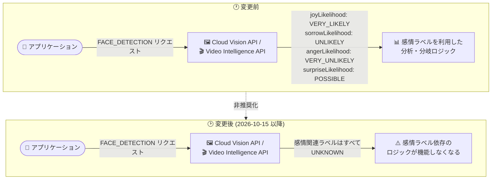

# Cloud Vision API / Video Intelligence API: 感情ラベルレスポンスの非推奨化

**リリース日**: 2026-10-15

**サービス**: Cloud Vision API / Video Intelligence API

**機能**: 感情ラベル (emotion label) レスポンスの非推奨化

**ステータス**: Deprecated (非推奨)

📊 [このアップデートのインフォグラフィックを見る](https://takech9203.github.io/google-cloud-news-summary/20261015-cloud-vision-video-intelligence-emotion-label-deprecation.html)

## 概要

2026 年 10 月 15 日、Google Cloud は Cloud Vision API と Video Intelligence API の 2 つの姉妹 API において、感情ラベル (emotion label) レスポンスの非推奨化を同時に発表しました。両 API で同一内容の変更であり、今後は感情に関連するすべてのラベルについて `UNKNOWN` が返されるようになります。

Cloud Vision API 側は顔検出モデルの更新 (Face detection model update) として発表されており、`FACE_DETECTION` フィーチャーのレスポンスに含まれる感情関連ラベルが対象です。公式ドキュメントでは、顔検出のレスポンス (`FaceAnnotation`) に `joyLikelihood` (喜び)、`sorrowLikelihood` (悲しみ)、`angerLikelihood` (怒り)、`surpriseLikelihood` (驚き) といった感情の尤度フィールドが含まれることが示されており、これらが `UNKNOWN` を返すようになります。

Video Intelligence API 側も同様に、API の感情ラベルレスポンスが非推奨となり、感情に関連するすべてのラベルで `UNKNOWN` が返されます。顔検出や感情推定の結果を業務ロジックに組み込んでいる既存アプリケーションは、この変更の影響を直接受けるため、利用状況の棚卸しと対応の検討が必要です。

**アップデート前の課題 (変更前の動作)**

- Cloud Vision API の `FACE_DETECTION` では、検出した顔ごとに `joyLikelihood` / `sorrowLikelihood` / `angerLikelihood` / `surpriseLikelihood` が `VERY_UNLIKELY` 〜 `VERY_LIKELY` の尤度として返されていた
- Video Intelligence API でも感情に関連するラベルがレスポンスとして返されていた
- アプリケーション側はこれらの感情ラベルの値を前提としたロジック (分岐、集計、分析など) を実装できていた

**アップデート後の変更点**

- Cloud Vision API の `FACE_DETECTION` は、感情に関連するすべてのラベルで `UNKNOWN` を返すようになる
- Video Intelligence API も、感情に関連するすべてのラベルで `UNKNOWN` を返すようになる
- レスポンスのフィールド構造自体は維持されるため API 呼び出しはエラーにならないが、感情ラベルの値は実質的に意味を持たなくなる

## アーキテクチャ図



変更前は顔検出レスポンスに感情の尤度ラベルが含まれていましたが、変更後は両 API とも感情関連ラベルがすべて `UNKNOWN` となり、感情ラベルに依存するアプリケーションロジックは機能しなくなります。

## サービスアップデートの詳細

### 主要な変更内容

1. **Cloud Vision API: 顔検出モデルの更新に伴う感情ラベルの非推奨化**
   - `FACE_DETECTION` フィーチャーの感情ラベルレスポンスが非推奨 (Deprecated) となった
   - 今後、感情に関連するすべてのラベルについて `UNKNOWN` が返される

2. **Video Intelligence API: 感情ラベルレスポンスの非推奨化**
   - API の感情ラベルレスポンスが非推奨 (Deprecated) となった
   - 今後、感情に関連するすべてのラベルについて `UNKNOWN` が返される

3. **両 API で同一の変更**
   - 同日に発表された、画像 (Vision) と動画 (Video Intelligence) の姉妹 API に対する同一内容の変更
   - 顔検出機能そのもの (顔の位置、バウンディングボックス、ランドマークなど) の廃止ではなく、感情ラベルの応答のみが対象

## 技術仕様

### Cloud Vision API の感情関連フィールド

公式ドキュメント (顔検出のレスポンス例) で示されている `FaceAnnotation` の感情尤度フィールドは以下のとおりです。

| フィールド | 意味 |
|------|------|
| `joyLikelihood` | 喜びの尤度 |
| `sorrowLikelihood` | 悲しみの尤度 |
| `angerLikelihood` | 怒りの尤度 |
| `surpriseLikelihood` | 驚きの尤度 |

これらの尤度フィールドは、従来 `VERY_UNLIKELY` / `UNLIKELY` / `POSSIBLE` / `LIKELY` / `VERY_LIKELY` などの値を返していましたが、今回の変更により感情関連ラベルはすべて `UNKNOWN` を返すようになります。

### 変更後のレスポンスイメージ (Cloud Vision API)

```json
{
  "faceAnnotations": [
    {
      "boundingPoly": { "...": "変更なし (顔の位置情報)" },
      "landmarks": [ { "...": "変更なし (顔のランドマーク)" } ],
      "detectionConfidence": 0.98,
      "joyLikelihood": "UNKNOWN",
      "sorrowLikelihood": "UNKNOWN",
      "angerLikelihood": "UNKNOWN",
      "surpriseLikelihood": "UNKNOWN"
    }
  ]
}
```

### Video Intelligence API の顔検出

Video Intelligence API の顔検出 (`FACE_DETECTION`) は、`FaceDetectionConfig` の `includeAttributes` を有効にすることで、検出した顔の属性 (`DetectedAttribute`) を返します。公式ドキュメントでは `smiling` (笑顔) など表情に関わる属性が記載されています。今回の非推奨化により、感情に関連するラベルはすべて `UNKNOWN` が返されます。

## 既存アプリケーションへの影響

### 影響を受けるケース

- Cloud Vision API の `FACE_DETECTION` レスポンスの `joyLikelihood` / `sorrowLikelihood` / `angerLikelihood` / `surpriseLikelihood` を参照しているアプリケーション
- Video Intelligence API のレスポンスに含まれる感情関連ラベルを参照しているアプリケーション
- 感情ラベルの値をもとに分岐、スコアリング、集計、レポーティングを行っているパイプライン

### 影響を受けないケース

- 顔の検出有無、バウンディングボックス、ランドマーク座標など、感情ラベル以外の顔検出結果のみを利用しているアプリケーション (リリースノートで非推奨とされているのは感情ラベルレスポンスのみ)

### 考慮すべき点 (移行の観点)

- API 呼び出し自体はエラーにならないため、障害としては顕在化しにくい。感情ラベルが `UNKNOWN` 固定になることで、分析結果やダッシュボードの値が静かに変化 (劣化) する点に注意が必要
- 感情ラベルを尤度として扱っているコードでは、`UNKNOWN` の扱い (フォールバック処理) を明確にしておく必要がある
- 感情ラベルに依存した機能を提供している場合は、機能自体の見直し (提供停止、仕様変更など) の検討が必要
- リリースノートには感情ラベルに代わる代替手段は示されていないため、移行先については各アプリケーションの要件に応じて個別に検討する必要がある

## ユースケース (影響確認の例)

### ユースケース 1: 感情ラベル利用箇所の棚卸し

**シナリオ**: Cloud Vision API の顔検出を利用しているアプリケーションで、感情ラベルへの依存箇所を特定する。

**実装例**:
```bash
# コードベースから感情尤度フィールドの参照箇所を検索
grep -rnE "joyLikelihood|sorrowLikelihood|angerLikelihood|surpriseLikelihood" ./src

# クライアントライブラリのアクセサ (Java/Go など) も検索
grep -rnE "getJoyLikelihood|getSorrowLikelihood|getAngerLikelihood|getSurpriseLikelihood|JoyLikelihood|AngerLikelihood" ./src
```

**効果**: `UNKNOWN` 固定化の影響を受けるコードパスを事前に特定し、フォールバック処理の追加や機能の見直しを計画できる。

### ユースケース 2: `UNKNOWN` を前提とした防御的処理の追加

**シナリオ**: 感情ラベルの値を集計している分析パイプラインで、`UNKNOWN` が集計結果を汚染しないようにする。

**効果**: 感情ラベルが `UNKNOWN` のレコードを除外またはマーキングすることで、ダッシュボードや ML 特徴量が意図せず変質することを防げる。

## 関連サービス・機能

- **Cloud Vision API (`FACE_DETECTION`)**: 画像内の顔を検出し、位置・ランドマーク・各種尤度を返す機能。今回の変更の対象
- **Video Intelligence API (顔検出 / 人物検出)**: 動画内の顔・人物を検出し、セグメント・バウンディングボックス・属性を返す機能。今回の変更の対象
- **Vertex AI (Gemini などのマルチモーダルモデル)**: 画像・動画を扱う Google Cloud の AI サービス。感情ラベル利用箇所の見直しにあたり、要件に応じて代替アーキテクチャの検討対象となり得る (リリースノートで公式な移行先として示されているものではない)

## 参考リンク

- 📊 [インフォグラフィック](https://takech9203.github.io/google-cloud-news-summary/20261015-cloud-vision-video-intelligence-emotion-label-deprecation.html)
- [公式リリースノート (2026 年 10 月 15 日)](https://docs.cloud.google.com/release-notes#October_15_2026)
- [Cloud Vision API: 顔検出ドキュメント](https://docs.cloud.google.com/vision/docs/detecting-faces)
- [Video Intelligence API: 顔検出ドキュメント](https://docs.cloud.google.com/video-intelligence/docs/feature-face-detection)
- [Cloud Vision API 料金](https://cloud.google.com/vision/pricing)
- [Video Intelligence API 料金](https://cloud.google.com/video-intelligence/pricing)

## まとめ

Cloud Vision API と Video Intelligence API の感情ラベルレスポンスが非推奨となり、今後は感情関連ラベルがすべて `UNKNOWN` で返されます。API 呼び出しはエラーにならないため影響が顕在化しにくく、感情ラベルに依存するアプリケーションでは分析結果やロジックが静かに変質するリスクがあります。両 API の利用箇所を棚卸しし、感情ラベル参照コードの特定とフォールバック処理・機能見直しの計画を早期に進めることを推奨します。

---

**タグ**: Cloud Vision API, Video Intelligence API, 顔検出, 感情ラベル, Deprecated, 非推奨, FACE_DETECTION
