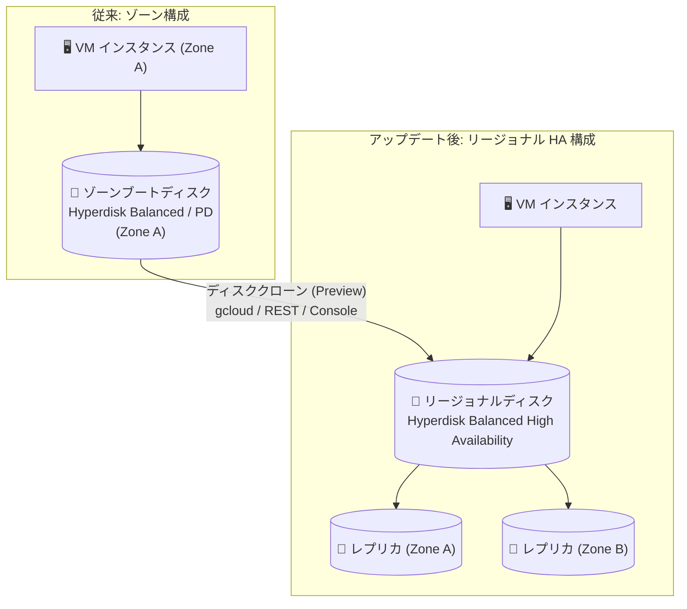

# Compute Engine: ゾーンブートディスクのクローンによるリージョナルディスク作成 (Preview) / 予約キャパシティ上限エラーの追加

**リリース日**: 2026-10-15

**サービス**: Compute Engine

**機能**: ゾーンブートディスクのクローンによるリージョナルディスク作成 (Hyperdisk Balanced High Availability 含む) / RESERVATION_CAPACITY_LIMIT_EXCEEDED エラーの導入

**ステータス**: Preview (リージョナルディスククローン) / Change (予約キャパシティ上限エラー)

📊 [このアップデートのインフォグラフィックを見る](https://takech9203.github.io/google-cloud-news-summary/20261015-compute-engine-regional-disk-clone-reservation-limit.html)

## 概要

2026 年 10 月 15 日、Compute Engine に 2 つのアップデートが発表されました。

1 つ目は、**ゾーンブートディスクをクローンしてリージョナルディスク (Hyperdisk Balanced High Availability ボリュームを含む) を作成できる機能の Preview 提供**です。従来からゾーンデータディスクのリージョナルクローンは可能でしたが、今回のアップデートによりブートディスクも対象になりました。既存のゾーンワークロードのブートディスクを、スナップショットを経由せずに直接 2 ゾーンレプリケーションされたリージョナルディスクへ複製できるため、ゾーン障害に備えた高可用性 (HA) 構成への移行が簡素化されます。ゾーンの Hyperdisk Balanced / Hyperdisk Extreme ボリュームをクローンすると、リージョナルディスクは Hyperdisk Balanced High Availability ボリュームとして作成されます。

2 つ目は、**予約 (Reservation) 作成時の新しいエラー `RESERVATION_CAPACITY_LIMIT_EXCEEDED` の導入**です。オンデマンド予約の作成、または既存予約のインスタンス数増加をリクエストした際に、対象ゾーンでリクエストしたマシンファミリーの予約キャパシティ上限に達している場合、リクエストはこのエラー (HTTP 429) で失敗するようになりました。エラー理由コードが明確になったことで、自動化処理でのエラーハンドリングやトラブルシューティングが容易になります。

**アップデート前の課題**

- ゾーンブートディスクをリージョナルディスク化するには、スナップショットを作成してからリージョナルディスクを作成するなど、複数ステップの手順が必要だった
- ディスククローンによるリージョナルディスク作成はデータディスクに限られ、ブートディスクは直接クローンできなかった
- ゾーンの予約キャパシティ上限に起因する予約作成の失敗について、専用のエラー理由コードが提供されていなかった

**アップデート後の改善**

- ゾーンブートディスクを 1 回のクローン操作でリージョナルディスク (Hyperdisk Balanced High Availability 含む) に複製できるようになった (Preview)
- ゾーンワークロードの HA 化 (リージョナルブートディスクへの移行) がシンプルになった
- 予約キャパシティ上限超過時に `RESERVATION_CAPACITY_LIMIT_EXCEEDED` (HTTP 429) という明確なエラー理由コードが返るようになり、別のマシンファミリーやゾーンの選択といった対処判断がしやすくなった

## アーキテクチャ図



ゾーンブートディスクを直接クローンすることで、同一リージョン内の 2 ゾーン (ソースディスクのゾーン + 指定した 2 つ目のゾーン) にレプリカを持つリージョナルディスクを作成できます。ゾーンの Hyperdisk Balanced / Extreme がソースの場合、クローンは Hyperdisk Balanced High Availability ボリュームになります。

## サービスアップデートの詳細

### 主要機能

1. **ゾーンブートディスクのリージョナルクローン (Preview)**
   - ゾーンのブートディスクまたはデータディスクをクローンして、新しいリージョナルディスクを作成できる
   - 対応するソースディスクタイプ: Hyperdisk Balanced、Hyperdisk Extreme (イメージから作成されたボリュームを除く)、Standard / Balanced / SSD Persistent Disk
   - ソースが Hyperdisk Balanced または Hyperdisk Extreme の場合、作成されるリージョナルディスクは常に Hyperdisk Balanced High Availability ボリュームとなり、ソースのプロビジョニング済みパフォーマンスは引き継がれない
   - サイズやプロビジョニング済みパフォーマンスを指定する場合は gcloud CLI または REST を使用する必要がある (Google Cloud コンソールでは指定不可)

2. **リージョナルクローンの可用性特性**
   - リージョナルディスククローンは作成後、平均 3 分以内に使用可能になる
   - ただし、完全にレプリケーションされ RPO (目標復旧時点) がほぼゼロの状態に達するまでには数十分かかる場合がある
   - クローンディスクはプレウォーミング不要で、作成直後からフルパフォーマンスを発揮する (データディスクの場合)

3. **RESERVATION_CAPACITY_LIMIT_EXCEEDED エラーの導入 (Change)**
   - オンデマンド予約の作成、または予約内の予約済みインスタンス数の増加時に、ゾーンがリクエストされたマシンファミリーの予約キャパシティ上限に達している場合、リクエストが失敗する
   - エラーメッセージ: `Failed to reserve additional capacity for '{machine_family}' because reservation capacity limit exceeded in '{zone}'. Select a different machine family or zone.`
   - HTTP ステータスコードは 429。別のマシンファミリーまたはゾーンの選択が推奨される

## 技術仕様

### リージョナルクローンのサポート状況 (クローンタイプ別)

| クローンタイプ | 用途 | サポートされるディスクタイプ |
|------|------|------|
| ゾーンディスク → ゾーンクローン | スケールアウト、テスト環境複製、マルウェアスキャン、プロジェクト間移動 | Standard / Balanced / SSD PD、Hyperdisk 全タイプ (Hyperdisk Balanced High Availability を除く) |
| ゾーンディスク → リージョナルクローン | ゾーンワークロードの HA 化、リージョナルブートディスクの作成 (Preview) | Standard / Balanced / SSD PD、Hyperdisk Extreme、Hyperdisk Balanced |
| リージョナルディスク → リージョナルクローン | HA ワークロードのテスト・スケールアウト | リージョナル PD (Standard / Balanced / SSD)、Hyperdisk Balanced High Availability |

### 主な制限事項とレート制限

| 項目 | 詳細 |
|------|------|
| レプリカゾーン | リージョナルクローンのレプリカゾーンの 1 つは、ソースディスクのゾーンと一致する必要がある |
| イメージ由来のブートディスク | イメージから作成されたゾーンブートディスクのリージョナルクローンは、スナップショット経由の作成と同程度の時間がかかる |
| レート制限 (イメージ由来のブートディスク) | 60 分間に最大 6 個のリージョナルクローン (ソースディスクのスナップショット作成数と共有)。超過後は 10 分ごとに 1 個 |
| レート制限 (容量) | ゾーンディスクからのリージョナルクローンは 15 分ごとに最大 1 TiB (バースト上限 257 TiB) |
| 暗号化 | CMEK / CSEK で暗号化されたソースディスクのクローンには同じ鍵が必要 |
| 非対応タイプ | Hyperdisk ML / Hyperdisk Throughput はリージョナルクローン不可 (スナップショット経由で Hyperdisk Balanced High Availability を作成する) |

### RESERVATION_CAPACITY_LIMIT_EXCEEDED エラー

| 項目 | 詳細 |
|------|------|
| エラー理由コード | `RESERVATION_CAPACITY_LIMIT_EXCEEDED` |
| HTTP ステータスコード | 429 |
| 発生条件 | オンデマンド予約の作成または予約インスタンス数の増加時に、ゾーンがリクエストしたマシンファミリーの予約キャパシティ上限に達している場合 |
| 推奨対処 | 別のマシンファミリーまたは別のゾーンを選択する |

## 設定方法

### 前提条件

1. ソースとなるゾーンディスクが、サポートされるディスクタイプ (Hyperdisk Balanced、Hyperdisk Extreme、Standard / Balanced / SSD PD) であること
2. リージョナルクローンのレプリカゾーンの 1 つがソースディスクのゾーンと一致すること
3. サイズやプロビジョニング済みパフォーマンスを指定する場合は gcloud CLI または REST を使用すること

### 手順

#### ステップ 1: ゾーンブートディスクからリージョナルクローンを作成する (gcloud)

```bash
gcloud compute disks create TARGET_DISK_NAME \
    --region=REGION \
    --replica-zones=SOURCE_ZONE,SECOND_ZONE \
    --source-disk=SOURCE_DISK_NAME \
    --source-disk-zone=SOURCE_ZONE
```

レプリカゾーンの 1 つ (`SOURCE_ZONE`) はソースディスクのゾーンと一致させる必要があります。ソースが Hyperdisk Balanced / Extreme の場合、作成されるディスクは Hyperdisk Balanced High Availability となります。

#### ステップ 2: コンソールから作成する場合

1. Google Cloud コンソールの「ディスク」ページで、クローンするゾーンディスクの操作メニューから「ディスクのクローンを作成」を選択
2. 「ロケーション」で「リージョナル」を選択し、セカンダリレプリカゾーンを指定
3. 「作成」をクリック

コンソールからの作成ではサイズとパフォーマンス上限を指定できず、ディスクサイズに応じたデフォルト上限でプロビジョニングされます。

## メリット

### ビジネス面

- **HA 移行の迅速化**: ゾーン障害に備えたリージョナルディスクへの移行が 1 回のクローン操作で完結し、DR / HA 対応のリードタイムを短縮できる
- **運用の予見性向上**: 予約作成失敗の原因が `RESERVATION_CAPACITY_LIMIT_EXCEEDED` として明示されることで、キャパシティ計画の判断材料が明確になる

### 技術面

- **スナップショット経由の手順が不要に**: ブートディスクを直接リージョナルクローンできるため、中間リソースの管理が減る
- **自動化のエラーハンドリング改善**: HTTP 429 + 明確な理由コードにより、IaC やスクリプトでのリトライ・フォールバック (別ゾーン / 別マシンファミリーへの切り替え) を実装しやすい

## デメリット・制約事項

### 制限事項

- ゾーンブートディスクのリージョナルクローンは Preview であり、Pre-GA 利用規約が適用され、サポートが限定される場合がある
- イメージから作成されたブートディスクのクローンは遅く、レート制限 (60 分で 6 個、スナップショットと共有) がある
- ソースが Hyperdisk Balanced / Extreme の場合、クローンはプロビジョニング済みパフォーマンスを引き継がないため、必要に応じて明示的に指定する必要がある (パフォーマンス指定時はサイズ指定も必須)
- Hyperdisk ML / Hyperdisk Throughput ボリュームはリージョナルクローンに対応していない

### 考慮すべき点

- リージョナルクローンは作成後約 3 分で使用可能になるが、RPO がほぼゼロになるまで数十分かかる場合があるため、切り替えタイミングに注意が必要
- クローン作成中はソースディスクが接続されたインスタンスを起動できないなど、クローン全般の制約が適用される
- 予約を自動作成するワークフローでは、`RESERVATION_CAPACITY_LIMIT_EXCEEDED` (429) を想定したエラーハンドリング (別ゾーン / 別マシンファミリーへのフォールバック) の追加を検討する

## ユースケース

### ユースケース 1: 既存ゾーンワークロードの HA 化

**シナリオ**: 単一ゾーンで稼働中の重要な VM (Hyperdisk Balanced ブートディスク) を、ゾーン障害に耐えられる構成に移行したい。

**実装例**:
```bash
# ゾーンブートディスクをリージョナル (Hyperdisk Balanced High Availability) にクローン
gcloud compute disks create my-boot-disk-regional \
    --region=asia-northeast1 \
    --replica-zones=asia-northeast1-a,asia-northeast1-b \
    --source-disk=my-boot-disk \
    --source-disk-zone=asia-northeast1-a
```

**効果**: スナップショットの作成・管理を介さずにリージョナルブートディスクを取得でき、片方のゾーンで障害が発生しても他方のレプリカからデータにアクセスできる。

### ユースケース 2: 予約自動化における上限エラーのハンドリング

**シナリオ**: バッチ基盤のスケール時にオンデマンド予約を自動作成しているが、特定ゾーンのマシンファミリーで予約キャパシティ上限に達することがある。

**効果**: `RESERVATION_CAPACITY_LIMIT_EXCEEDED` (HTTP 429) を検知して、別ゾーンや別マシンファミリーでの予約作成に自動フォールバックするロジックを実装でき、キャパシティ確保の成功率を高められる。

## 料金

リージョナルディスク (Hyperdisk Balanced High Availability を含む) およびクローン自体の料金については、公式のディスク料金ページを参照してください。

- [Compute Engine ディスク料金](https://cloud.google.com/compute/disks-image-pricing)

予約 (Reservation) は、予約したリソースに対してオンデマンド料金が課金されます。詳細は予約のドキュメントを参照してください。

## 関連サービス・機能

- **Google Cloud Hyperdisk**: 今回のアップデートの中心となるブロックストレージ。ゾーンの Hyperdisk Balanced / Extreme のリージョナルクローンは Hyperdisk Balanced High Availability となる
- **スナップショット**: 従来のリージョナルディスク移行手段。イメージ由来のブートディスクではクローンのレート制限がスナップショットと共有される
- **Compute Engine 予約 (Reservations)**: `RESERVATION_CAPACITY_LIMIT_EXCEEDED` エラーの対象。オンデマンド予約や将来予約リクエストによるキャパシティ確保に利用

## 参考リンク

- 📊 [インフォグラフィック](https://takech9203.github.io/google-cloud-news-summary/20261015-compute-engine-regional-disk-clone-reservation-limit.html)
- [公式リリースノート](https://docs.cloud.google.com/release-notes#October_15_2026)
- [ドキュメント: Duplicate a disk with clones](https://docs.cloud.google.com/compute/docs/disks/clone-duplicate-disks)
- [ドキュメント: Troubleshooting reservation creation](https://docs.cloud.google.com/compute/docs/troubleshooting/troubleshooting-reservation-creation)
- [ドキュメント: Compute Engine API エラー一覧](https://docs.cloud.google.com/compute/docs/reference/rest/v1/errors)
- [料金ページ: ディスクとイメージの料金](https://cloud.google.com/compute/disks-image-pricing)

## まとめ

ゾーンブートディスクのリージョナルクローン (Preview) により、既存のゾーンワークロードを Hyperdisk Balanced High Availability などのリージョナルディスクへ移行する手順が大幅に簡素化されました。HA / DR 要件のあるワークロードでは、Preview の制約 (レート制限、パフォーマンス指定の注意点) を確認のうえ検証を始めることを推奨します。また、予約を自動作成している環境では、新しい `RESERVATION_CAPACITY_LIMIT_EXCEEDED` エラー (HTTP 429) を想定したエラーハンドリングの見直しを行ってください。

---

**タグ**: Compute Engine, Hyperdisk, Regional Disk, Disk Clone, High Availability, Reservations, Preview
