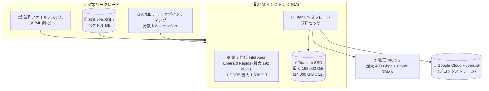

# Compute Engine: ストレージ最適化 Z4M マシンシリーズが一般提供 (GA)

**リリース日**: 2026-10-15

**サービス**: Compute Engine

**機能**: ストレージ最適化 Z4M マシンシリーズ

**ステータス**: GA (一般提供)

📊 [このアップデートのインフォグラフィックを見る](https://takech9203.github.io/google-cloud-news-summary/20261015-compute-engine-z4m-ga.html)

## 概要

Compute Engine のストレージ最適化マシンファミリーに属する **Z4M マシンシリーズ**が一般提供 (GA) になりました。Z4M は第 5 世代 Intel Xeon Scalable プロセッサ (Emerald Rapids)、DDR5 メモリ、および Titanium オフロードプロセッサを搭載し、大容量ストレージを必要とするワークロード向けに設計されたマシンシリーズです。

Z4M は最大 192 vCPU、最大 1,536 GB のメモリ (ベアメタル構成)、そして Compute Engine のインスタンスとして最大となる **168,000 GiB (約 168 TB) のローカル Titanium SSD** を提供します。2 枚の物理 NIC 構成では最大 400 Gbps のネットワーク帯域をサポートし、Titanium と Cloud RDMA により高いネットワーク性能・分離・セキュリティを実現します。

主な対象ワークロードは以下のとおりです。

- AI/ML ワークロードを支える並列ファイルシステム
- SQL、NoSQL、ベクトルデータベースなどの I/O 集約型ワークロード
- チェックポインティングや分散 Key-Value (KV) キャッシュなどの AI/ML トレーニング・推論ワークロード

**アップデート前の課題**

- ストレージ最適化ファミリーの既存シリーズでは、ローカル Titanium SSD 容量が Z3 で最大 72,000 GiB、Z4D で最大 84,000 GiB にとどまり、より大規模なストレージ密度を必要とするワークロードには容量が不足する場合があった
- AI/ML のチェックポインティングや分散 KV キャッシュのような、超大容量かつ低レイテンシのローカルストレージと広帯域ネットワークの両方を要求するワークロードに最適化された GA のマシンシリーズがなかった

**アップデート後の改善**

- 1 インスタンスあたり最大 168,000 GiB の Titanium SSD を持つマシンシリーズが GA となり、本番ワークロードで利用可能になった
- 2 枚の物理 NIC により最大 400 Gbps のネットワーク帯域と Cloud RDMA がサポートされ、並列ファイルシステムや分散キャッシュのノード間通信性能が向上した
- 確約利用割引 (CUD)、Flexible CUD、Spot VM (ベアメタルを除く)、予約などの割引・消費オプションが利用可能になった

## アーキテクチャ図



Z4M はネットワークとストレージの処理を Titanium オフロードプロセッサに委譲することでホスト CPU をワークロードに専念させ、大容量 Titanium SSD と Cloud RDMA 対応の広帯域ネットワークで I/O 集約型・AI/ML ワークロードを支えます。

## サービスアップデートの詳細

### 主要機能

1. **Compute Engine 最大のローカル Titanium SSD 容量**
   - 全マシンタイプにローカル Titanium SSD (14,000 GiB 単位) が自動的にアタッチされ、最大構成では 168,000 GiB を提供
   - Titanium SSD は Titanium I/O オフロード処理に基づくカスタム設計のローカル SSD で、従来のローカル SSD と比較してセキュリティ・性能・管理性が強化されている

2. **Titanium + Cloud RDMA による高性能ネットワーク**
   - 物理 NIC 1 枚構成で最大 200 Gbps、2 枚構成で最大 400 Gbps のネットワーク帯域をサポート
   - Cloud RDMA により、より高いレベルのネットワーク性能・分離・セキュリティを実現

3. **AI/ML ワークロードへの最適化**
   - CPU での AI/ML 推論・トレーニングを高速化する Intel Advanced Matrix Extensions (AMX) をサポート
   - 拡張されたクラスタ管理機能をサポートし、AI Hypercomputer と組み合わせて利用可能
   - NUMA アーキテクチャに最適化され、安定した一貫性のあるパフォーマンスを提供

4. **柔軟な消費・割引オプション**
   - リソースベース確約利用割引 (CUD)、Flexible CUD、Spot VM (ベアメタルを除く)、予約をサポート

## 技術仕様

### Z4M マシンタイプ

vCPU あたり 7.625 GB (大型タイプは 7.75 GB) の highmem 比率の事前定義構成で提供されます。

| マシンタイプ | vCPU | メモリ (GB) | Titanium SSD | NIC 数 | デフォルト下り帯域 (Gbps) |
|------|------|------|------|------|------|
| z4m-highmem-16 | 16 | 122 | 14,000 GiB (1 x 14,000) | 1 | 最大 32 |
| z4m-highmem-32 | 32 | 244 | 28,000 GiB (2 x 14,000) | 1 | 最大 67 |
| z4m-highmem-48 | 48 | 366 | 42,000 GiB (3 x 14,000) | 1 | 最大 100 |
| z4m-highmem-192 | 192 | 1,488 | 168,000 GiB (12 x 14,000) | 2 | 最大 400 |
| z4m-highmem-192-metal | 192 | 1,536 | 168,000 GiB (12 x 14,000) | 2 | 最大 400 |

### Titanium SSD のパフォーマンス

| マシンタイプ | 読み取り IOPS | 書き込み IOPS | 読み取りスループット (MiBps) | 書き込みスループット (MiBps) |
|------|------|------|------|------|
| z4m-highmem-16 | 1,300,000 | 1,024,000 | 6,300 | 4,800 |
| z4m-highmem-32 | 2,600,000 | 2,048,000 | 12,600 | 9,600 |
| z4m-highmem-48 | 3,900,000 | 3,072,000 | 18,900 | 14,400 |
| z4m-highmem-192 / 192-metal | 15,600,000 | 12,288,000 | 75,600 | 57,600 |

### ホストメンテナンス

| マシンタイプ | メンテナンス頻度 (目安) | メンテナンス動作 | 事前通知 |
|------|------|------|------|
| z4m-highmem-16 / 32 / 48 | 最短 30 日間隔 | ライブマイグレーションまたは Titanium SSD データ保持を伴う終了 | 7 日前 |
| z4m-highmem-192 | 最短 90 日間隔 | Titanium SSD データ保持を伴う終了 | 30 日前 |
| z4m-highmem-192-metal | 最短 90 日間隔 | インプレース再起動 | 30 日前 |

ホストイベント発生時、Compute Engine は Titanium SSD データの復旧を試行します。復旧タイムアウトは Z4M VM で最大 6 時間、Z4M ベアメタルインスタンスで最大 1 週間 (168 時間) であり、カスタマイズも可能です。

## 設定方法

### 前提条件

1. Z4M が利用可能なゾーンを選択する (利用可能なリージョン・ゾーンはドキュメントを参照)
2. Windows OS イメージは Z4M で未サポートのため、Linux 系の OS イメージを使用する

### 手順

#### ステップ 1: 利用可能なゾーンの確認

```bash
gcloud compute machine-types list --filter="name=z4m-highmem-16"
```

Z4M マシンタイプが利用可能なゾーンの一覧を確認します。

#### ステップ 2: Z4M インスタンスの作成

```bash
gcloud compute instances create my-z4m-instance \
    --zone=us-central1-a \
    --machine-type=z4m-highmem-16 \
    --image-family=debian-12 \
    --image-project=debian-cloud
```

Titanium SSD はマシンタイプに含まれており、インスタンス作成時に自動的にアタッチされます。

## メリット

### ビジネス面

- **本番利用が可能に**: GA に到達したことで、SLA のもとで本番ワークロードに Z4M を採用できる
- **コスト最適化オプション**: CUD、Flexible CUD、Spot VM、予約など複数の割引・消費オプションに対応し、ワークロード特性に応じたコスト管理が可能

### 技術面

- **圧倒的なストレージ密度**: 1 インスタンスで最大 168,000 GiB の Titanium SSD を提供し、Compute Engine で最大のローカルストレージ容量を実現
- **広帯域・低レイテンシネットワーク**: 2 枚の物理 NIC で最大 400 Gbps、Cloud RDMA 対応により分散ストレージ・分散キャッシュのスケールアウトに適する
- **ホスト CPU のオフロード**: Titanium によりネットワーク・ストレージ処理をホスト CPU から分離し、ワークロードに計算リソースを集中できる
- **データ保持機構**: メンテナンス時も Titanium SSD データが保持され、大容量ローカルデータの再構築コストを低減できる

## デメリット・制約事項

### 制限事項

- Z4M インスタンスは一部のゾーン・リージョンでのみ利用可能
- GPU は利用不可
- インスタンスのサスペンド (一時停止) は不可
- カスタムマシンタイプは作成不可
- ライブマイグレーションは、アタッチされた Titanium SSD が 42,000 GiB 以下のインスタンスのみサポート。それより大きいインスタンスは、メンテナンス時に Titanium SSD データ保持を伴って終了する
- Cloud RDMA を有効化したインスタンスはライブマイグレーション非対応 (ホストメンテナンスポリシーは「終了」を選択する必要がある)
- Windows OS イメージは非サポート

### 考慮すべき点

- Titanium SSD はローカルストレージであり、容量はマシンタイプに固定で紐付く (z4m-highmem-16 でも 14,000 GiB が付属するため、小容量用途ではコスト効率に注意)
- 大型マシンタイプ (z4m-highmem-192 / 192-metal) はメンテナンス時に終了または再起動となるため、アプリケーション側での可用性設計 (レプリケーション、チェックポイントなど) が必要

## ユースケース

### ユースケース 1: AI/ML トレーニングのチェックポインティング基盤

**シナリオ**: 大規模なモデルトレーニングにおいて、チェックポイントの書き込み・読み込みがトレーニング全体のスループットのボトルネックになっている。

**効果**: z4m-highmem-192 の 168,000 GiB の Titanium SSD (書き込み最大 57,600 MiBps) と Cloud RDMA 対応の 400 Gbps ネットワークにより、チェックポイントの保存・復元を高速化し、GPU/TPU クラスタの待機時間を削減できる。

### ユースケース 2: ベクトルデータベース・分散 KV キャッシュのホスティング

**シナリオ**: RAG (検索拡張生成) 基盤のベクトルデータベースや、LLM 推論の分散 KV キャッシュで、大容量かつ低レイテンシのローカルストレージが必要。

**効果**: 1 ノードあたりのストレージ密度が高いため少ないノード数で大規模データを保持でき、Titanium SSD の高 IOPS (最大 1,560 万読み取り IOPS) により低レイテンシの検索・キャッシュ応答を実現できる。

### ユースケース 3: AI/ML 向け並列ファイルシステム

**シナリオ**: AI/ML ワークロードに学習データを供給する並列ファイルシステム (ストレージノード群) を構築したい。

**効果**: 大容量 Titanium SSD と 2 枚の物理 NIC による広帯域・RDMA 対応ネットワークにより、高スループットの並列ファイルシステムのストレージノードとして利用できる。

## 料金

Z4M マシンタイプの料金は VM インスタンス料金ページで公開されています。マシンタイプ料金に加えて、ディスク使用量とネットワーク使用量は別途課金されます。Titanium SSD の料金はストレージ最適化マシンタイプファミリーの料金セクションを参照してください。

- [VM インスタンス料金 (Z4M マシンタイプ)](https://docs.cloud.google.com/compute/vm-instance-pricing#z4m_machine_types)
- [ディスクとイメージの料金](https://cloud.google.com/compute/disks-image-pricing)
- [ネットワーク料金](https://cloud.google.com/vpc/network-pricing)

割引オプションとして、リソースベース確約利用割引 (CUD)、Flexible CUD、Spot VM (ベアメタルマシンタイプを除く)、予約が利用できます。

## 利用可能リージョン

Z4M は一部のゾーン・リージョンで利用可能です。公式ドキュメントのリージョン・ゾーン一覧では、以下のゾーンで Z4M の提供が確認できます (2026 年 10 月時点)。

- us-central1-a / us-central1-b / us-central1-c (アイオワ)
- us-east4-a (バージニア北部)

最新の利用可能ゾーンは [リージョンとゾーン](https://docs.cloud.google.com/compute/docs/regions-zones#available) を参照するか、`gcloud compute machine-types list --filter="name=z4m-highmem-16"` で確認してください。

## 関連サービス・機能

- **Google Cloud Hyperdisk**: Z4M は Titanium により高性能なブロックストレージとして Hyperdisk を利用可能。永続データは Hyperdisk、ホットデータは Titanium SSD という使い分けができる
- **Cloud RDMA**: Z4M がサポートする低レイテンシの RDMA ネットワーキング。分散ストレージやキャッシュのノード間通信を高速化する
- **AI Hypercomputer**: Z4M は拡張クラスタ管理機能をサポートし、AI Hypercomputer と組み合わせて AI/ML インフラの一部として利用できる
- **Z4D / Z3 マシンシリーズ**: 同じストレージ最適化ファミリーの既存シリーズ。Z4D は最大 3 TB メモリ・84,000 GiB Titanium SSD、Z3 は最大 1.5 TB メモリ・72,000 GiB Titanium SSD を提供し、ワークロード要件に応じて選択できる

## 参考リンク

- 📊 [インフォグラフィック](https://takech9203.github.io/google-cloud-news-summary/20261015-compute-engine-z4m-ga.html)
- [公式リリースノート](https://docs.cloud.google.com/release-notes#October_15_2026)
- [ドキュメント: Storage-optimized machine family](https://docs.cloud.google.com/compute/docs/storage-optimized-machines)
- [料金ページ: VM インスタンス料金](https://docs.cloud.google.com/compute/vm-instance-pricing#z4m_machine_types)

## まとめ

Z4M マシンシリーズの GA により、Compute Engine 最大となる 168,000 GiB のローカル Titanium SSD と最大 400 Gbps の Cloud RDMA 対応ネットワークを本番ワークロードで利用できるようになりました。AI/ML の並列ファイルシステム、チェックポインティング、分散 KV キャッシュ、大規模なデータベース基盤を検討している場合は、Z4D / Z3 との容量・性能・コストの比較を行い、利用可能ゾーンを確認した上で Z4M の採用を評価することをおすすめします。

---

**タグ**: Compute Engine, Z4M, ストレージ最適化, Titanium SSD, Cloud RDMA, AI/ML, GA
