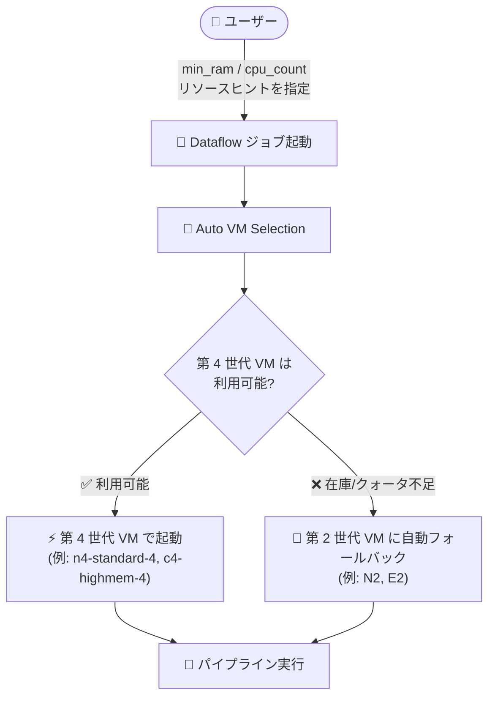

# Dataflow: Auto VM Selection が第 4 世代 Compute Engine マシンシリーズをサポート

**リリース日**: 2026-10-15

**サービス**: Dataflow

**機能**: Auto VM Selection の第 4 世代 Compute Engine マシンシリーズ対応

**ステータス**: 提供開始 (Feature)

📊 [このアップデートのインフォグラフィックを見る](https://takech9203.github.io/google-cloud-news-summary/20261015-dataflow-auto-vm-selection-gen4.html)

## 概要

Dataflow の Auto VM Selection が、第 4 世代の Compute Engine マシンシリーズ (N4、C4 など) をサポートしました。Auto VM Selection を有効にすると、Dataflow サービスはより新しい世代の VM を優先的に選択してワーカーをプロビジョニングするため、パイプラインのパフォーマンス向上が期待できます。

さらに重要な点として、ジョブ起動時に第 4 世代 VM が利用できない場合 (在庫不足やクォータ不足など) は、広く利用可能な第 2 世代マシンファミリー (N2、E2 など) に自動的にフォールバックします。これにより、不要な遅延なくジョブを確実に起動できます。

Auto VM Selection は、特定のマシンタイプを固定指定することで発生しがちな「ストックアウト (在庫切れ) によるジョブ起動の遅延・失敗」のリスクを低減する機能であり、Dataflow を日常的に運用するデータエンジニアリングチームにとって、信頼性とパフォーマンスの両立を実現するアップデートです。

**アップデート前の課題**

- Auto VM Selection による候補マシンファミリーに第 4 世代シリーズが含まれておらず、新世代 VM のパフォーマンス向上の恩恵を自動選択では受けられなかった
- 新世代 VM を使いたい場合は `workerMachineType` などでマシンタイプを明示指定する必要があり、指定したマシンタイプの在庫不足時にジョブ起動が遅延・失敗するリスクがあった

**アップデート後の改善**

- Auto VM Selection 有効時に、Dataflow が第 4 世代マシンシリーズ (N4、C4 など) を優先してワーカーをプロビジョニングし、パフォーマンスが向上する
- 第 4 世代 VM が起動時に利用できない場合は、第 2 世代マシンファミリー (N2、E2 など) に自動フォールバックし、ジョブの起動遅延を回避できる
- マシンタイプの固定指定なしで、新世代 VM の活用と起動の信頼性を両立できる

## アーキテクチャ図



Auto VM Selection は、互換性があり利用可能なマシンタイプのプールからワーカーを選択します。今回のアップデートで第 4 世代シリーズが優先候補となり、利用不可の場合は第 2 世代へ自動フォールバックしてジョブの起動を保証します。

## サービスアップデートの詳細

### 主要機能

1. **第 4 世代マシンシリーズの優先選択**
   - Auto VM Selection が N4、C4 などの第 4 世代 Compute Engine マシンシリーズを優先してワーカー VM を選択する
   - 新世代 VM によるパフォーマンス向上をマシンタイプの明示指定なしで享受できる

2. **第 2 世代への自動フォールバック**
   - 第 4 世代 VM が起動時に利用できない場合、在庫やクォータの状況に応じて、広く利用可能な第 2 世代マシンファミリー (N2、E2 など) に自動的にフォールバックする
   - フォールバックによりジョブの起動遅延や失敗を回避できる

3. **リソースヒントに基づく自動プロビジョニング**
   - アクセラレータを必要としないステップに `min_ram` または `cpu_count` リソースヒントを設定すると、Auto VM Selection が自動的に有効になる
   - 例: `cpu_count=2` を指定すると `n4-standard-2` や `c4-standard-2` が、`cpu_count=4` と `min_ram=16GB` を併用すると `n4-standard-4` や `c4-highmem-4` がプロビジョニングされる可能性がある

## 技術仕様

### マシンシリーズの選択動作

| 項目 | 詳細 |
|------|------|
| 優先されるマシンシリーズ | 第 4 世代 (例: N4、C4) |
| フォールバック先 | 第 2 世代 (例: N2、E2) |
| フォールバック条件 | 第 4 世代 VM の在庫不足、クォータ不足、構成との競合 |
| 有効化方法 | `min_ram` / `cpu_count` リソースヒントの指定 (アクセラレータ不要のステップ) |
| ディスクタイプの注意点 | `pd-ssd` や `pd-standard` を指定すると、互換性のある第 2 世代ファミリーに制限される |

### Auto VM Selection が無効化・非対応となる構成

| 機能・構成 | 動作 |
|------|------|
| マシンタイプの明示指定 (`workerMachineType` など) | 指定したマシンタイプが優先され、Auto VM Selection はバイパスされる |
| Dataflow Prime | 非対応 (Prime は垂直自動スケーリングを使用) |
| `min_cpu_platform` の指定 | Auto VM Selection がバイパスされる |
| Hyperdisk Balanced、カスタム IOPS/スループット | ジョブが失敗する場合がある |
| Confidential VM | 非対応 |
| GPU / TPU アクセラレータ | 非対応 (アクセラレータなしのワークロードのみ対象) |
| FlexRS | 非対応 (FlexRS は独自のワーカープールを管理) |

## 設定方法

### 前提条件

1. アクセラレータ (GPU/TPU) を使用しないパイプラインステップであること
2. ストリーミングパイプラインの場合、`--experiments=enable_streaming_rightfitting` の指定に加え、Streaming Engine (`--enable_streaming_engine`) と水平自動スケーリングが有効であること
3. 候補となる各マシンファミリー (第 4 世代・第 2 世代の両方) について、対象リージョンで十分な Compute Engine vCPU / メモリクォータがあること

### 手順

#### ステップ 1: リソースヒントを指定してジョブを起動

```bash
# Python の例: cpu_count と min_ram のリソースヒントを指定
python my_pipeline.py \
  --runner=DataflowRunner \
  --project=PROJECT_ID \
  --region=REGION \
  --resource_hints=cpu_count=4 \
  --resource_hints=min_ram=16GB
```

`min_ram` または `cpu_count` リソースヒントを指定すると Auto VM Selection が自動的に有効になり、要件を満たすマシンタイプ (第 4 世代を優先) からワーカーがプロビジョニングされます。

#### ステップ 2: マシンタイプの固定指定やディスクタイプ指定を外す

```bash
# 以下のオプションを指定していると Auto VM Selection がバイパスされる
# --worker_machine_type=n2-standard-4   <- 削除する
# --disk_type=pd-ssd                    <- 第 2 世代に制限されるため注意
```

`workerMachineType` / `machine_type` やディスクタイプの指定があると、第 4 世代 VM の自動選択が行われない (またはフォールバック先が制限される) ため、Auto VM Selection の恩恵を最大化するにはこれらの指定を外します。

## メリット

### ビジネス面

- **ジョブ起動の信頼性向上**: 第 4 世代 VM の在庫不足時にも第 2 世代へ自動フォールバックするため、バッチ処理の遅延やパイプライン停止による業務影響を低減できる
- **運用負荷の削減**: リージョンごとの VM 在庫状況を意識したマシンタイプの選定・変更作業が不要になる

### 技術面

- **新世代 VM によるパフォーマンス向上**: Auto VM Selection 有効時に第 4 世代 VM が優先されるため、コード変更なしで新しいハードウェアの性能を活用できる
- **キャパシティ耐性**: 複数の候補マシンファミリー (第 4 世代 + 第 2 世代) からプロビジョニングすることで、特定ファミリーのストックアウトの影響を受けにくくなる

## デメリット・制約事項

### 制限事項

- Dataflow Prime、Confidential VM、GPU/TPU、FlexRS、`min_cpu_platform` 指定との併用は不可 (バイパスまたは非対応)
- Hyperdisk Balanced やカスタム IOPS/スループットを指定したジョブは失敗する場合がある
- ディスクタイプ (`pd-ssd` / `pd-standard`) を指定すると、互換性のある第 2 世代ファミリーに制限される
- 特定の予約 (Reservation) をターゲットにすることはできない (マシンタイプが一致する場合に自動消費型の予約が使用される可能性はある)

### 考慮すべき点

- Auto VM Selection は入手可能性 (obtainability) を優先するため、どのマシンファミリーが選択されるかによって実行時のパフォーマンスやスループットが変動しうる。厳格な実行 SLA があるワークロードでは、事前に一部のジョブでテストしてベースラインを確認することが推奨される
- 既知の問題として、ワーカーあたりのスレッド数が選択された VM の vCPU 数と一致せず CPU 使用率が低くなる場合がある。回避策として `numberOfWorkerHarnessThreads` パイプラインオプションを使用できる (すべてのワーカープールに適用される)
- 候補となる各マシンファミリーについてプロジェクトのクォータが不足していると、フォールバック時に `QUOTA_EXCEEDED` エラーでワーカーのプロビジョニングが失敗する可能性がある

## ユースケース

### ユースケース 1: 大規模バッチ ETL の起動信頼性とパフォーマンスの両立

**シナリオ**: 毎晩実行される大規模なバッチ ETL パイプラインで、特定マシンタイプの在庫不足によりジョブ起動が遅延することがあり、下流のレポート処理に影響していた。

**実装例**:
```bash
python nightly_etl.py \
  --runner=DataflowRunner \
  --project=PROJECT_ID \
  --region=us-central1 \
  --resource_hints=cpu_count=8 \
  --resource_hints=min_ram=32GB
```

**効果**: 第 4 世代 VM が利用可能なら高いパフォーマンスで実行され、在庫不足時も第 2 世代へ自動フォールバックしてジョブが確実に起動する。深夜バッチの遅延リスクを低減できる。

### ユースケース 2: マシンタイプ指定を撤廃した運用簡素化

**シナリオ**: 複数リージョンで多数の Dataflow ジョブを運用しており、リージョンごとの VM 在庫状況に合わせてマシンタイプの指定を個別にメンテナンスしていた。

**効果**: マシンタイプの固定指定をやめてリソースヒントベースの指定に移行することで、リージョンごとの在庫を意識したチューニングが不要になり、新世代 VM への移行も Dataflow サービス側で自動的に行われる。

## 料金

Dataflow の課金はマシンタイプのファミリーに依存せず、ワーカーが使用する vCPU・メモリ・ディスクなどのリソース量に基づきます。Auto VM Selection 自体に追加料金はありません。詳細は料金ページを参照してください。

- [Dataflow の料金](https://cloud.google.com/dataflow/pricing)

## 関連サービス・機能

- **Compute Engine**: Dataflow ワーカーの実体となる VM。第 4 世代マシンシリーズ (N4、C4 など) と第 2 世代 (N2、E2 など) が Auto VM Selection の候補となる
- **Right Fitting (リソースヒント)**: `min_ram` / `cpu_count` ヒントにより Auto VM Selection が有効化される仕組み
- **Streaming Engine / 水平自動スケーリング**: ストリーミングパイプラインで Auto VM Selection を利用するための前提機能
- **Dataflow Prime**: Auto VM Selection とは排他の実行モード。垂直自動スケーリングと動的 Right Fitting を使用する

## 参考リンク

- 📊 [インフォグラフィック](https://takech9203.github.io/google-cloud-news-summary/20261015-dataflow-auto-vm-selection-gen4.html)
- [公式リリースノート](https://docs.cloud.google.com/release-notes#October_15_2026)
- [ドキュメント: Auto VM Selection](https://docs.cloud.google.com/dataflow/docs/guides/auto-vm-selection)
- [ドキュメント: ワーカー VM のカスタマイズ](https://docs.cloud.google.com/dataflow/docs/guides/configure-worker-vm)
- [料金ページ](https://cloud.google.com/dataflow/pricing)

## まとめ

Dataflow の Auto VM Selection が第 4 世代 Compute Engine マシンシリーズに対応し、新世代 VM のパフォーマンスとジョブ起動の信頼性を自動選択だけで両立できるようになりました。マシンタイプを固定指定している既存パイプラインは、リソースヒントベースの指定への移行を検討する価値があります。移行時は候補ファミリーごとのクォータ確認と、パフォーマンスベースラインの事前テストを推奨します。

---

**タグ**: Dataflow, Compute Engine, Auto VM Selection, 第4世代マシンシリーズ, N4, C4, パフォーマンス, 自動フォールバック
