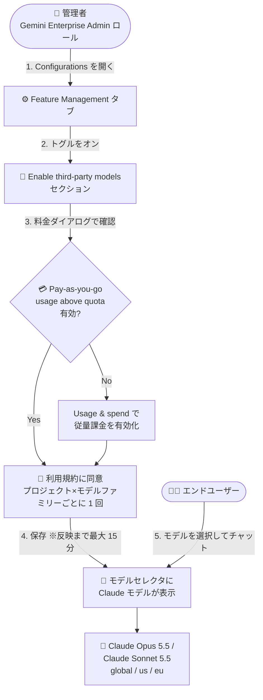

# Gemini Enterprise: Anthropic Claude モデル (Claude Opus 5.5 / Claude Sonnet 5.5) が利用可能に

**リリース日**: 2026-10-15

**サービス**: Gemini Enterprise

**機能**: Gemini Enterprise アプリでの Anthropic モデル (Claude Opus 5.5 / Claude Sonnet 5.5) 提供

**ステータス**: GA (一般提供)

📊 [このアップデートのインフォグラフィックを見る](https://takech9203.github.io/google-cloud-news-summary/20261015-gemini-enterprise-anthropic-claude-models.html)

## 概要

Gemini Enterprise アプリ (Web アプリ) で Anthropic のモデル **Claude Opus 5.5** と **Claude Sonnet 5.5** が利用可能になり、一般提供 (GA) が開始されました。管理者が Feature Management タブの「Enable third-party models」セクションでモデルを有効化すると、エンドユーザーはチャット画面のモデルセレクタから Claude モデルを選択して利用できます。

これまで Gemini Enterprise アプリのアシスタントで選択できるのは Gemini モデルのみでしたが、今回のアップデートにより、組織はユースケースに応じて Google の Gemini モデルと Anthropic の Claude モデルを使い分けられるようになりました。Claude モデルは `global` ロケーションおよび `us` / `eu` マルチリージョンで利用でき、トークン単位の従量課金 (pay-as-you-go) で課金されます。

サードパーティモデルはデフォルトで無効になっており、管理者による課金設定の有効化と利用規約への同意 (オプトイン) が必須です。管理者がモデルの可用性を統制できるため、組織のポリシーに沿った形で複数ベンダーのモデルを安全に展開できます。

**アップデート前の課題**

- Gemini Enterprise アプリのモデルセレクタでは Gemini モデル (Gemini 4 Argon、Gemini 3.8 Flash、Gemini 2.5 Pro など) のみが選択可能で、サードパーティモデルを利用できなかった
- Claude モデルを業務で使いたい場合、Gemini Enterprise アプリの外部 (別のツールや API 経由) で利用する必要があった

**アップデート後の改善**

- 管理者が Feature Management タブで有効化するだけで、ユーザーが Gemini Enterprise アプリのモデルセレクタから Claude Opus 5.5 / Claude Sonnet 5.5 を直接選択できるようになった
- Gemini モデルと Claude モデルを同一のエンタープライズ環境 (管理・課金・ガバナンスが統合された環境) で使い分けられるようになった
- 従量課金 (pay-as-you-go) ベースのため、サブスクリプションのシートクレジットとは別に、使った分だけの支払いで利用できる

## アーキテクチャ図

管理者が Feature Management タブでサードパーティモデルを有効化 (課金確認 + 利用規約同意) すると、エンドユーザーが Web アプリのモデルセレクタから Claude モデルを選択できるようになる流れを示しています。

## サービスアップデートの詳細

### 主要機能

1. **Claude Opus 5.5 / Claude Sonnet 5.5 の提供 (GA)**
   - Gemini Enterprise Web アプリのモデルセレクタから Anthropic の 2 モデルを選択可能
   - Claude Opus 5.5 は Anthropic の最上位 Opus モデル、Claude Sonnet 5.5 はコストバランスに優れたモデル
   - いずれも `global` / `us` / `eu` で利用可能

2. **管理者によるオプトイン制御**
   - サードパーティモデルはデフォルトで無効 (オフ)
   - 有効化には Gemini Enterprise Admin IAM ロール (`roles/discoveryengine.agentspaceAdmin`) が必要
   - 有効化時に Model pricing ダイアログで課金方式を確認し、利用規約 (Terms of Service) に同意する
   - 利用規約への同意はプロジェクト × モデルファミリーごとに 1 回のみ (同一プロジェクト内の他のアプリで同じモデルを有効化する際は再同意不要)

3. **従量課金 (pay-as-you-go) ベースの課金**
   - Claude モデルの利用はトークン単位の従量課金のみで提供 (エディションのプール済みクォータは対象外)
   - 事前に「Pay-as-you-go usage above quota」をエディションごとに有効化しておく必要がある
   - 月次の支出上限 (spend limit) や Cloud Billing の予算設定によるコスト管理が推奨されている

4. **無効化による即時アクセス制御**
   - 管理者がトグルをオフにすると、数分以内にモデルセレクタからモデルが削除される

## 技術仕様

### 提供モデルと利用可能ロケーション

| モデル | 提供元 | 利用可能ロケーション | デフォルト状態 |
|------|------|------|------|
| Claude Opus 5.5 | Anthropic | `global`、`us`、`eu` | オフ (管理者のオプトインが必要) |
| Claude Sonnet 5.5 | Anthropic | `global`、`us`、`eu` | オフ (管理者のオプトインが必要) |

### 制約・前提に関する仕様

| 項目 | 詳細 |
|------|------|
| 必要な IAM ロール | Gemini Enterprise Admin (`roles/discoveryengine.agentspaceAdmin`) |
| 課金の前提 | 「Pay-as-you-go usage above quota」をエディション (Standard / Plus など) ごとに有効化 |
| モデルセレクタ | Feature Management タブで「Enable model selector」トグルがオンであること |
| 対象外エディション | Gemini Enterprise Starter エディションではサードパーティモデルは利用不可 |
| 対象外リージョン | in-country リージョン (国内リージョン) では利用不可 |
| 初回有効化の反映時間 | 最大 15 分 |

## 設定方法

### 前提条件

1. Gemini Enterprise Admin IAM ロール (`roles/discoveryengine.agentspaceAdmin`) を保有していること
2. サブスクリプションを持つ場合、プロジェクトで「Pay-as-you-go usage above quota」が有効化されていること (エディションごとに有効化が必要)
3. Feature Management タブで「Enable model selector」トグルがオンになっていること

### 手順

#### ステップ 1: Feature Management タブを開く

1. Google Cloud コンソールで **Gemini Enterprise** ページに移動
2. 構成するアプリの名前をクリック
3. **Configurations** をクリックし、**Feature Management** タブを選択

#### ステップ 2: サードパーティモデルを有効化する

1. **Enable third-party models** セクションに移動
2. 有効化したいモデルのトグルをクリック → **Model pricing** ダイアログが表示される
3. 従量課金が利用可能な場合は **Enable** をクリック (未設定の場合は **Go to Usage & spend** から従量課金を有効化)
4. **Terms of service** ダイアログが表示されたら、規約を最後まで読み **Agree** をクリック
5. **Save** をクリックし、**Important billing info** ダイアログで **I understand** をクリック

初回有効化時は反映まで最大 15 分かかります。反映後、ユーザーはモデルセレクタから Claude モデルを選択できます。

## メリット

### ビジネス面

- **マルチモデル戦略の実現**: 単一のエンタープライズ環境 (Gemini Enterprise) 内で Google と Anthropic のモデルを使い分けられ、ベンダーロックインを緩和しつつユースケースに最適なモデルを選択できる
- **統制されたガバナンス**: デフォルト無効 + 管理者オプトイン方式のため、組織のポリシーに沿った段階的な展開が可能
- **コスト管理**: 従量課金のため初期コミットが不要。支出上限や Cloud Billing の予算と組み合わせてコストを統制できる

### 技術面

- **ユーザー体験の統一**: ユーザーは使い慣れた Gemini Enterprise アプリのモデルセレクタでモデルを切り替えるだけで Claude を利用できる
- **マルチリージョン対応**: `global` に加えて `us` / `eu` マルチリージョンで利用可能
- **即時のアクセス制御**: 管理者がトグルをオフにすると数分でモデルセレクタから削除され、アクセスを速やかに遮断できる

## デメリット・制約事項

### 制限事項

- Gemini Enterprise Starter エディションではサードパーティモデルを利用できない
- in-country リージョン (国内リージョン) では利用できない (`global` / `us` / `eu` のみ)
- Claude モデルは従量課金 (pay-as-you-go) のみで提供され、エディションのプール済みクォータ (シートクレジット) では利用できない
- Anthropic は特定のリセラーによる再販を禁止しており、該当するリセラー管理の請求先アカウントでは利用規約に同意できず、Claude モデルを有効化できない

### 考慮すべき点

- 従量課金が前提のため、有効化前に「Pay-as-you-go usage above quota」の設定と月次支出上限・予算の設定を済ませておくことが推奨される
- 従量課金を後からオフにすると、再度オンにするまでユーザーはサードパーティモデルを利用できなくなる
- 交渉済み価格やカスタム契約がある場合、公開価格と異なる可能性がある (契約内容の確認が必要)
- Gemini Enterprise アプリでの Claude モデルの価格・割引は、Google Cloud Marketplace 経由で調達した場合の価格とは別体系

## ユースケース

### ユースケース 1: 部門ごとのモデル使い分け

**シナリオ**: 全社で Gemini Enterprise を導入している企業が、文書作成やコーディング支援など特定のタスクで Claude モデルの利用を希望する部門に対して、管理者が統制された形でアクセスを提供したい。

**効果**: 管理者が対象アプリの Feature Management で Claude モデルを有効化するだけで、ユーザーは既存の Gemini Enterprise アプリからモデルを切り替えて利用可能。新たなツール導入やアカウント管理は不要で、課金も既存の Cloud Billing アカウントに統合される。

### ユースケース 2: コストを統制したサードパーティモデルの試験導入

**シナリオ**: Claude モデルの業務適合性を評価したいが、コストの上振れは避けたい。

**効果**: 月次支出上限 (spend limit) と Cloud Billing の予算を設定した上で従量課金ベースで試験利用できるため、初期コミットなしに小さく始められる。不要になれば管理者がトグルをオフにするだけで数分以内にユーザーのアクセスを停止できる。

## 料金

Claude モデルは Gemini Enterprise アプリでは **従量課金 (pay-as-you-go) のみ** で提供されます。利用にはプロジェクトで「Pay-as-you-go usage above quota」の有効化が必要です。

### 料金例 (global ロケーション、100 万トークンあたり、USD)

| モデル | 入力 | 出力 | 5 分キャッシュ書き込み | 1 時間キャッシュ書き込み | キャッシュヒット |
|--------|------|------|----------------------|------------------------|----------------|
| Claude Opus 5.5 | $4.00 | $20.00 | $5.00 | $8.00 | $0.20 |
| Claude Sonnet 5.5 | $2.00 | $10.00 | $2.50 | $4.00 | $0.20 |

- 上記は `global` ロケーションの公開価格 (USD)。最新の価格およびロケーション別の価格は [Claude pricing (Quotas and overages)](https://docs.cloud.google.com/gemini/enterprise/docs/quotas-and-overages#claude-pricing) を参照
- 交渉済み価格やカスタム契約がある場合は、契約上の価格が適用される
- Gemini Enterprise アプリでの価格・割引は Google Cloud Marketplace 経由の調達価格とは別体系

## 利用可能リージョン

- `global` ロケーション
- `us` マルチリージョン
- `eu` マルチリージョン

in-country リージョン (国内リージョン) では利用できません。リージョン別のデータレジデンシーの詳細は [Data residency for Gemini Enterprise](https://docs.cloud.google.com/gemini/enterprise/docs/locations) を参照してください。

## 関連サービス・機能

- **Gemini Enterprise Agent Platform (パートナーモデル / Model-as-a-Service)**: Claude モデルは Agent Platform 上でマネージド API として提供されるパートナーモデル。API 経由での直接利用も可能
- **Cloud Billing**: サードパーティモデルの従量課金は Cloud Billing アカウントに請求される。予算 (budgets) の設定によるコスト管理と組み合わせて利用
- **IAM**: モデルの有効化には Gemini Enterprise Admin ロール (`roles/discoveryengine.agentspaceAdmin`) が必要
- **Pay-as-you-go usage above quota (overages)**: Claude モデル利用の前提となる従量課金設定。月次支出上限の設定も可能

## 参考リンク

- 📊 [インフォグラフィック](https://takech9203.github.io/google-cloud-news-summary/20261015-gemini-enterprise-anthropic-claude-models.html)
- [公式リリースノート](https://docs.cloud.google.com/release-notes#October_15_2026)
- [ドキュメント: Enable third-party models](https://docs.cloud.google.com/gemini/enterprise/docs/manage-web-app-features#enable-third-party-models)
- [料金: Claude pricing (Quotas and overages)](https://docs.cloud.google.com/gemini/enterprise/docs/quotas-and-overages#claude-pricing)
- [Claude Opus 5.5 モデルカード](https://docs.cloud.google.com/gemini-enterprise-agent-platform/models/partner-models/claude/opus-5-5)
- [Claude Sonnet 5.5 モデルカード](https://docs.cloud.google.com/gemini-enterprise-agent-platform/models/partner-models/claude/sonnet-5-5)
- [Data residency for Gemini Enterprise](https://docs.cloud.google.com/gemini/enterprise/docs/locations)
- [Configure overages](https://docs.cloud.google.com/gemini/enterprise/docs/configure-overages)

## まとめ

Gemini Enterprise アプリで Anthropic の Claude Opus 5.5 / Claude Sonnet 5.5 が GA となり、管理者のオプトインだけでユーザーが Gemini と Claude をモデルセレクタで使い分けられるようになりました。従量課金のみの提供のため、導入時は「Pay-as-you-go usage above quota」の有効化と月次支出上限・予算の設定をセットで行い、コストを統制しながら段階的に展開することを推奨します。

---

**タグ**: #GeminiEnterprise #Anthropic #Claude #ClaudeOpus #ClaudeSonnet #GA #サードパーティモデル #生成AI
